# Cairn MVP spec {#spec.cairn-mvp-spec}

This spec turns [prd.md](prd.md) into code. It is the first spec Cairn has, so it also sets the format that `cairn plan` writes.

Already built: the section ID parser (`packages/core/src/section-ids.ts`), a task machine without `failed`, the presence room and server, and a viewer that lists demo rows. Everything else below is new.

## Format {#spec.format}

- Context: `prd.goal`, `prd.non-goals-for-v1`, `prd.one-day-build-order`

Each spec section starts with a list of keys, before any prose. `cairn lint`, the planner and the viewer read them.

| Key          | Value                                        | Used for                                    |
| ------------ | -------------------------------------------- | ------------------------------------------- |
| `Implements` | PRD section IDs                              | Curves, rollup, coverage                    |
| `Files`      | Paths it will touch; a trailing `/` is a dir | Plan-time gate detection                    |
| `Depends on` | Spec section IDs                             | Stack order                                 |
| `Defers`     | PRD section IDs left for later               | Coverage; the viewer shows them as deferred |
| `Context`    | PRD section IDs that need no code            | Coverage; the viewer shows no badge         |

IDs are written in backticks and separated by commas. A key applies to its section and every section below it.

A PRD section is covered when it, or a section under it, appears in some `Implements`, `Defers` or `Context` key. A `Defers` or `Context` key covers the sections under the one it names too. "Under" means in the heading tree, not by ID prefix: the top heading does not namespace its children, so `prd.goal` sits under `prd.cairn-mvp`.

## Scope {#spec.scope}

- Defers: `prd.v2-diverging-state`, `prd.v2-multiplayer-on-cloudflare`, `prd.later`

This spec covers v1. Presence is the one v2 piece already built, and it stays: `cairn serve` keeps serving `/presence` next to the trace API.

## Package layout {#spec.package-layout}

- Implements: `prd.implementation-in-effect`

| Package       | Holds                                                                                                     |
| ------------- | --------------------------------------------------------------------------------------------------------- |
| `contract`    | Schemas, generated JSON Schema, the plain JS entry                                                        |
| `core`        | Pure logic: sections, gates, stack order, lint, status derivation, rollup, redaction, machines            |
| `cli`         | Services, commands and the server. Two composition roots: `src/main.ts` (CLI) and `src/serve.ts` (server) |
| `apps/viewer` | The Foldkit viewer                                                                                        |

Core takes plain values and does no IO. Only the CLI touches disk, git, the database or a model, through these services:

| Service      | Live                                 | Test                           |
| ------------ | ------------------------------------ | ------------------------------ |
| `Git`        | `git` subprocesses                   | An in-memory commit graph      |
| `TraceStore` | `node:sqlite` on `.cairn/cairn.db`   | `node:sqlite` on `:memory:`    |
| `Planner`    | `LanguageModel` (see `spec.models`)  | Scripted replies from fixtures |
| `Judge`      | `DecisionModel` (see `spec.models`)  | Scripted answers               |
| `Redactor`   | Reads `.env*` and config, calls core | Fixed secret set               |

The PRD's `Clock` service is Effect's own `Clock`; tests use `TestClock`. Files go through Effect's `FileSystem`. Commands use `effect/cli`.

## Libraries {#spec.libraries}

- Implements: `prd.implementation-in-effect`, `prd.viewer`

Already installed, and kept:

| Library                       | Version                    | Used for                                          |
| ----------------------------- | -------------------------- | ------------------------------------------------- |
| `effect`                      | 4.1.5                      | Schema, services, `effect/cli`, `effect/ai`, HTTP |
| `xstate` and `@xstate/effect` | 6.0.0-beta.4, 1.0.0-beta.3 | Task and room machines                            |
| `foldkit`                     | 0.171.0                    | The viewer                                        |

New:

| Library                                                                 | Version             | License    | Used for                                                |
| ----------------------------------------------------------------------- | ------------------- | ---------- | ------------------------------------------------------- |
| `@pierre/diffs`                                                         | 1.6.4               | Apache-2.0 | Parsing patches into hunks and rendering commit diffs   |
| `@xyflow/system`                                                        | 1.0.0               | MIT        | Bezier paths, viewport math and pan/zoom for the canvas |
| `@effect/ai-anthropic`                                                  | 4.1.5               | MIT        | The live `LanguageModel`, for the `Planner`             |
| `@effect/ai-typesafe`                                                   | 4.1.5               | MIT        | The live `DecisionModel` (Jev), for the `Judge`         |
| `mdast-util-from-markdown`, `mdast-util-gfm`, `micromark-extension-gfm` | 2.1.0, 3.1.0, 3.0.0 | MIT        | Markdown to nodes for the viewer                        |

Built into Node 24, so no package: `node:sqlite` for `cairn.db`, and `path.matchesGlob` for gate patterns. Diffs come from `git`, so the CLI needs no diff library.

Considered and left out:

- `@pierre/words` renders markdown to HTML strings through WebAssembly and is built for streaming model output. The viewer would need `innerHTML` for it, and it knows nothing of `{#id}` headings. It may suit streaming session logs later.
- `@pierre/highlights`, the WebAssembly highlighter `@pierre/diffs` can use instead of Shiki. It is in beta; Shiki's JavaScript engine is the default and is enough for now.
- A SQLite package such as `better-sqlite3`, since `node:sqlite` needs no native build.
- Rete, JointJS, Cytoscape, Drawflow and LiteGraph. Each owns its scene and graph state, which would put state in two places beside the Foldkit model.
- `elkjs` for layout: EPL-2.0 or GPL-3.0 and 8 MB. `@dagrejs/dagre` (MIT) is the choice when layout stops being fixed.
- The AI SDK (`ai`, `@ai-sdk/anthropic`, `@ai-sdk/typesafe-ai`). It would add a second schema language and a Promise API beside Effect, and `effect/ai` already covers both language and decision models with Effect Schema.
- Cloudflare AI Gateway as a dependency. It is a proxy, not a library; `baseUrl` in config lets a user route through it (see `spec.models`).
- Workers AI. Cairn runs on the user's machine, not in a Worker.

## Contract {#spec.contract}

- Implements: `prd.contract-package`
- Files: `packages/contract/src/`, `packages/contract/schema/`

Everything a file in `.cairn/` holds is decoded through a schema here. A decode failure is a typed error that names the file, the line where there is one, and the field path.

### Section IDs {#spec.contract.section-ids}

- Implements: `prd.section-ids`
- Files: `packages/contract/src/ids.ts`

`SectionId` exists. Add `PrdSectionId` and `SpecSectionId`, which also check the prefix.

`SectionId`, `TaskId` and the two prefixed IDs live in `ids.ts`, and `index.ts` re-exports them. Contract modules import IDs from `ids.ts`, never from `index.ts`, which re-exports them and would make a cycle. `TaskId` matches `^[A-Za-z0-9][A-Za-z0-9._-]*$`, so it survives a `Cairn-Task` trailer.

### Manifest {#spec.contract.manifest}

- Implements: `prd.manifest-schema`
- Files: `packages/contract/src/manifest.ts`

```ts
Manifest = {
  version: 1
  feature: Slug
  baseBranch: string
  tasks: NonEmptyArray<ManifestTask>
}

ManifestTask = {
  id: TaskId // t1, t2, ... in dependency order (see spec.planning.stack-order)
  title: NonEmptyString
  prdSections: NonEmptyArray<PrdSectionId>
  specSections: NonEmptyArray<SpecSectionId>
  files: Array<string> // new: the declared files plan-time detection runs on
  branch: string // <feature>/<NN>-<slug>
  parent: TaskId | null // see spec.planning.stack-order
  dependsOn: Array<TaskId> // new: the tasks this one needs
  worktree: string | null // new: where it is built; null is the repo's own checkout
  model: NonEmptyString
  reasoning: "low" | "medium" | "high" | "xhigh" | "max"
  humanGate: { required: boolean; reasons: Array<GateReason> }
  status: TaskStatus
  commits: Array<Sha>
  sessions: Array<SessionId>
}

GateReason = "tag:human" | `path:${string}`
TaskStatus = "pending" | "running" | "blocked_on_human" | "failed" | "done" | "landed"
```

`TaskStatus` gains `failed`. The existing `Task` schema, with one `section` and a `gated` flag, is replaced by `ManifestTask`; the machine and the viewer move to it.

`status`, `commits` and `sessions` are a snapshot. Cairn writes them; nothing reads them to decide anything. Derived status (see `spec.status.derivation`) is the truth. Only Cairn writes `manifest.json`.

### Events {#spec.contract.events}

- Implements: `prd.orchestrator-contract`
- Files: `packages/contract/src/events.ts`

One JSON object per line of `events.jsonl`:

```ts
Event = {
  v?: 1 // missing means 1
  ts: string // ISO 8601, decoded to a DateTime.Utc
  taskId: TaskId
  status: TaskStatus
  detail?: string
  actor?: "orchestrator" | `human:${string}` | `agent:${string}` // missing means orchestrator
}
```

`actor` is new. Approvals need it: only a `human:` actor can move a task out of `blocked_on_human`.

### Trailers {#spec.contract.trailers}

- Implements: `prd.orchestrator-contract`
- Files: `packages/contract/src/trailers.ts`

```text
Cairn-Task: t1
Cairn-Section: spec.contract.manifest
Cairn-Section: spec.contract.events
Cairn-Session: s_8f2k1q
```

One `Cairn-Task` and one `Cairn-Session`. `Cairn-Section` repeats, once per spec section, since a task can have several. `SessionId` matches `^s_[a-z0-9]{6,}$`.

### Trace {#spec.contract.trace}

- Implements: `prd.viewer`, `prd.contract-package`
- Files: `packages/contract/src/trace.ts`
- Depends on: `spec.contract.manifest`, `spec.contract.events`, `spec.contract.trailers`

`Trace` is what the server sends and the viewer draws. `cairn status --json` prints it, and the demo loads one from a file.

```ts
Trace = {
  version: 1
  feature: Slug
  baseBranch: string
  prd: TraceDocument
  spec: TraceDocument
  tasks: Array<TraceTask> // manifest order
  sections: Array<{ id: SectionId; status: SectionStatus }> // every PRD and spec section
  warnings: Array<TraceWarning>
  judgments: Array<Judgment & { stale: boolean }> // empty until the judging work fills it (see spec.server)
}

TraceDocument = {
  path: string // ".cairn/prd.md" or ".cairn/spec.md"
  markdown: string // the whole file, rendered by the viewer
  sections: Array<TraceSection>
}

TraceSection = {
  id: SectionId
  title: string // without the {#id}
  level: number
  line: number
  parent: SectionId | null
  human: boolean
  keys: {
    // own keys plus inherited ones; all empty in the PRD
    implements: Array<PrdSectionId>
    files: Array<string>
    dependsOn: Array<SpecSectionId>
    defers: Array<PrdSectionId>
    context: Array<PrdSectionId>
  }
}

TraceTask = Omit<ManifestTask, "status" | "commits"> & {
  status: TaskStatus // derived, not the manifest snapshot
  waiting: boolean // pending, with a blocked_on_human task below it
  gate: { required: boolean; reasons: Array<GateReason> } // effective: plan time plus the files its commits changed
  commits: Array<TraceCommit>
  events: Array<Event> // sorted as derivation sorts them
}

TraceCommit = {
  sha: Sha
  parents: Array<Sha>
  subject: string
  files: Array<string>
  sections: Array<SpecSectionId> // from Cairn-Section trailers
  session: SessionId | null // from Cairn-Session
}

TraceWarning = {
  kind: "illegal-transition" | "non-human-approval" | "unknown-task" | "missing-trailers" | "landed-without-approval" | "missing-session"
  message: string
  taskId: TaskId | null
  sha: Sha | null
}
```

`TraceSection` is declared here rather than imported from core's `Section`, so the viewer depends only on the contract. The trace carries no positions: the viewer lays everything out itself (see `spec.viewer.model-and-messages`).

The viewer is built against this schema and the demo trace, so it does not wait for the CLI or the server. The demo trace has to decode through `Trace`; a test checks it.

### Config {#spec.contract.config}

- Implements: `prd.human-gates`
- Files: `packages/contract/src/config.ts`

```ts
Config = {
  version: 1
  humanPaths: Array<string> // defaults to the PRD's list
  redact: { deny: Array<string> } // defaults to []
  planner: {
    model: string // defaults to "claude-opus-5-5"
    baseUrl: string | undefined // e.g. a Cloudflare AI Gateway URL
  }
  judge: {
    model: string // defaults to "jev-1.14.0"
    baseUrl: string | undefined
    pass: number // defaults to 0.8
    flag: number // defaults to 0.5
    minConfidence: number // defaults to 0.5
    maxRounds: number // defaults to 2
    models: Record<string, string> // name the manifest uses, and when to use it
  }
}
```

A missing `.cairn/config.json` decodes to the defaults. `judge.pass` must be greater than `judge.flag`, and all three thresholds lie in `[0, 1]`. `judge.models` defaults to:

| Name     | When to use it                                                                     |
| -------- | ---------------------------------------------------------------------------------- |
| `haiku`  | Mechanical changes: a schema field, a rename, a command wired to existing code     |
| `sonnet` | Most tasks: a feature or service with its tests across a few files                 |
| `opus`   | Logic where a subtle bug costs a lot: derivation, ordering, redaction, concurrency |

### Judgments {#spec.contract.judgments}

- Implements: `prd.judging-the-plan`
- Files: `packages/contract/src/judgments.ts`

```ts
Judgments = {
  version: 1
  model: string // the decision model that answered, e.g. "jev-1.14.0"
  judgments: Array<Judgment>
}

Judgment = {
  target:
    | { kind: "section"; id: SpecSectionId }
    | { kind: "task"; id: TaskId }
    | { kind: "draft"; title: string } // a draft that was split, so never got a TaskId
    | { kind: "stack" }
  question: "size" | "faithful" | "buildable" | "matches" | "model" | "reasoning" | "complete" | "ordered" | "oneFeature"
  verdict: "pass" | "flag" | "unsure"
  action: "none" | "split" | "routed" // what planning did because of it
  round: number // 1 for the first ask; a split's replacements are judged in round 2
  answer: RateAnswer | ProbabilityAnswer | Unanswered
  message: string
  inputHash: Sha256Hex
  at: DateTimeUtc
}

RateAnswer = { label: string; probabilities: Record<string, number>; confidence: number | undefined }
ProbabilityAnswer = { probability: number }
Unanswered = { unanswered: "Refused" | "Missing" | "Invalid"; description: string }
```

The answer shapes mirror `effect/ai`'s `RateAnswer`, `ProbabilityAnswer` and `Unanswered`; a `classify` answer uses `RateAnswer`'s shape. Judgments on drafts that became tasks are keyed by the task's ID once `stackOf` assigns it. Only Cairn writes `judgments.json`. A missing file decodes to no judgments.

### Spec index {#spec.contract.spec-index}

- Implements: `prd.repo-layout`
- Files: `packages/contract/src/spec-index.ts`, `packages/cli/src/spec-index.ts`
- Depends on: `spec.sections.parsing`, `spec.planning.planner-service`

`spec.json` is a structured copy of `spec.md`, so the planner, the judge and other tools read the spec without parsing markdown.

```ts
SpecIndex = {
  version: 1
  source: string // ".cairn/spec.md"
  prd: string
  manifest: string
  sections: Array<IndexedSection> // in document order
}

IndexedSection = {
  // derived by code from spec.md and manifest.json
  id: SpecSectionId
  title: string
  level: number
  line: number
  parent: SpecSectionId | null
  children: Array<SpecSectionId>
  human: boolean
  implements: Array<PrdSectionId> // own keys only, not inherited
  files: Array<string>
  dependsOn: Array<SpecSectionId>
  defers: Array<PrdSectionId>
  context: Array<PrdSectionId>
  tasks: Array<TaskId> // tasks whose specSections name this section
  // extracted from the section's prose by Planner.index
  summary: string
  requirements: Array<{ id: `${SpecSectionId}#r${number}`; level: "must" | "must-not" | "should" | "may"; text: string }>
  artifacts: Array<Artifact> // { id, kind, name, location, description, ...kind-specific fields }
  tests: Array<{ id: `${SpecSectionId}#t${number}`; kind: "check" | "example" | "property" | "scene" | "integration" | "mutation"; text: string }>
  decisions: Array<{ id: `${SpecSectionId}#d${number}`; text: string; why: string | null }> // null when the spec gives no reason
}
```

`cairn plan` writes `spec.json` whenever it writes `spec.md` or `manifest.json`. Code fills the derived fields. `Planner.index` fills the rest, one call per section whose body changed; a section whose body is unchanged keeps its entry.

Until the CLI exists, `spec.json` is written by hand in this format, and the lint rule `index-drift` is what keeps it honest.

### JavaScript entry {#spec.contract.javascript-entry}

- Implements: `prd.contract-package`
- Files: `packages/contract/src/js.ts`, `packages/contract/package.json`

`@cairn/contract/js` exports functions that need no Effect:

- `parseManifest(input)`, `parseEvent(line)`, `parseConfig(input)` return the decoded value or throw a `CairnContractError` with `path` (the field path) and a message.
- `formatTrailers({ taskId, sections, sessionId })` returns the trailer block. `trailerArgs(...)` returns the same as `--trailer` arguments for `git commit`.
- `appendEvent(path, event)` validates the event and appends it in a single `O_APPEND` write, so concurrent writers never interleave lines.
- `cairnDir(cwd)` returns the main checkout's `.cairn/` the same way the CLI finds it, so an orchestrator working in a worktree appends to the shared `events.jsonl`.
- `migrateManifest(input)` upgrades older versions. Version 1 is the only one, so for now it checks the version and returns the input.

The package ships `.d.ts` files and `schema/{manifest,event,config}.schema.json`, generated with `Schema.toJsonSchemaDocument`. A test regenerates them and fails if the committed files differ, so `pnpm check` catches drift.

## Sections {#spec.sections}

### Parsing {#spec.sections.parsing}

- Implements: `prd.section-ids`
- Files: `packages/core/src/section-ids.ts`, `packages/core/src/sections.ts`

`sectionsOf(markdown)` returns every heading outside a fence:

```ts
Section = {
  id: SectionId | undefined
  level: number
  title: string // without the {#id}
  line: number // 1-based, for lint output
  parent: SectionId | undefined
  body: string // up to the next heading of any level
  human: boolean // its body or an ancestor's body has <!-- human -->
  keys: { implements; files; dependsOn; defers; context } // own keys plus inherited ones
}
```

It reuses the fence and heading rules `assignSectionIds` already has, so both agree on what counts as a heading.

### `cairn ids` {#spec.sections.cairn-ids}

- Implements: `prd.cli`, `prd.section-ids`
- Files: `packages/cli/src/commands/ids.ts`
- Depends on: `spec.sections.parsing`

Runs `assignSectionIds` on `prd.md` with `prd` and on `spec.md` with `spec`. Writes a file only when IDs were added, and prints each added ID. `--check` writes nothing and exits 1 if any heading lacks an ID.

## Gates {#spec.gates}

### Path matching {#spec.gates.path-matching}

- Implements: `prd.human-gates`
- Files: `packages/core/src/gates.ts`

Patterns use `path.matchesGlob` from Node, with one gitignore rule added: a pattern without a `/` matches the file name in any directory. Without it, `*.sql` would miss `db/001.sql`. A declared path ending in `/` is a directory and matches when a file inside it would.

### Detection {#spec.gates.detection}

- Implements: `prd.human-gates`
- Files: `packages/core/src/gates.ts`
- Depends on: `spec.gates.path-matching`, `spec.sections.parsing`, `spec.contract.manifest`

`gateOf(task, sections, config, changedFiles)` returns `{ required, reasons }`:

- `tag:human` if any linked PRD or spec section has `human: true`.
- `path:<pattern>` for each pattern that matches a file in `task.files` (plan time) or in `changedFiles` (after commits).

The plan stores the plan-time result in `humanGate`. Status derivation recomputes it with the files the task's commits actually changed, so a hit after commit gates a task the plan did not.

## Models {#spec.models}

- Implements: `prd.implementation-in-effect`, `prd.judging-the-plan`
- Files: `packages/cli/src/models.ts`
- Depends on: `spec.contract.config`

Cairn uses two kinds of model, each behind an `effect/ai` service. `models.ts` builds both Layers from config, and the CLI composition root provides them.

| Service         | Does                                       | Live provider                                                         | Key                 | Used by   |
| --------------- | ------------------------------------------ | --------------------------------------------------------------------- | ------------------- | --------- |
| `LanguageModel` | Writes text and schema-decoded objects     | `@effect/ai-anthropic`, `AnthropicLanguageModel.model(planner.model)` | `ANTHROPIC_API_KEY` | `Planner` |
| `DecisionModel` | Answers typed questions with probabilities | `@effect/ai-typesafe`, `TypeSafeDecisionModel.model(judge.model)`     | `TYPESAFE_API_KEY`  | `Judge`   |

- Keys are read with `Config.Redacted`, never written and never logged. The `Redactor` adds both keys' values to its secret set, so a key in the shell environment is stripped from session logs like one in `.env`.
- Layers are built only when a command needs them. A command that calls no model never reads a key. `cairn plan` without `ANTHROPIC_API_KEY` fails before it changes any file.
- `planner.baseUrl` and `judge.baseUrl` become each client's `apiUrl`. Setting them routes calls through a proxy, such as Cloudflare AI Gateway for logs, caching and spend. Cairn ships no gateway and needs no Cloudflare account.
- The Jev model is pinned (`jev-1.14.0`, not `jev-latest`) so the same input gets the same model, and `judgments.json` records it.
- No test reads a key or touches the network. `Planner` and `Judge` tests provide scripted Layers.

## Planning {#spec.planning}

### Planner service {#spec.planning.planner-service}

- Implements: `prd.cli`
- Files: `packages/cli/src/planner.ts`, `packages/cli/prompts/`
- Depends on: `spec.models`

Five calls, each with a prompt file in `packages/cli/prompts/`:

- `spec(prd)` returns spec markdown. The prompt includes this file as its worked example.
- `tasks(prd, spec)` returns `TaskDraft[]`: title, PRD and spec sections, files, the drafts it depends on, model and reasoning. Model and reasoning are proposals; routing (see `spec.judging.checkpoints`) can replace them.
- `splitSection(section, reason)` returns markdown for two or more sections that replace it, under the same parent and with the same `Implements`.
- `splitTask(draft, spec, reason)` returns two or more `TaskDraft`s that together cover the draft's spec sections and files.
- `index(section)` returns the prose fields of an `IndexedSection` (see `spec.contract.spec-index`).

`reason` is the judgment that asked for the split, so the prompt says what was wrong. Every structured output is decoded through its schema. A failed decode retries once with the error in the prompt, then fails with a `PlannerError`.

The model never decides gates, IDs, branch names or order. Those are deterministic and tested.

The live layer uses the `LanguageModel` from `spec.models`, so the key comes from `ANTHROPIC_API_KEY` and is never written anywhere. The test layer replays fixtures: this `spec.md`, the drafts behind this repo's `manifest.json`, this repo's `spec.json`, and scripted splits.

### Stack order {#spec.planning.stack-order}

- Implements: `prd.human-gates`, `prd.cli`, `prd.manifest-schema`
- Files: `packages/core/src/stack.ts`
- Depends on: `spec.gates.detection`

`stackOf(feature, drafts, gates)` returns the tasks as a set of stacks:

1. Topologically sort by dependency. Among tasks whose dependencies are placed, take gated ones first, then planner order. IDs are `t1`… in that order. Branches are `<feature>/<NN>-<slug>`.
2. `dependsOn` is the draft's dependencies, as task IDs.
3. `parentOf` sets the parent. A task with no dependencies starts a stack on `baseBranch`: `parent` is `null`. A task whose dependencies all lie on one chain takes the latest of them as its parent. A task whose dependencies lie on different stacks has `parent: null` and starts from `baseBranch` once every dependency has landed.
4. A cycle fails with a `PlannerError` naming the tasks in it.
5. `worktreesOf` gives each task a `worktree`. Walking tasks in ID order, a task takes the worktree of its parent, or else of one of its dependencies, when that worktree's latest task is one it depends on and no other task has taken it next. Otherwise it gets a new one. The first worktree is the repo's own checkout (`null`); the rest are `wt-1`, `wt-2`, ….

Tasks that share a worktree always run one after another, so a chain is built in one checkout. Tasks that can run at the same time never share one.

Every ancestor of a task is something it depends on. So a gated task has nothing below it but its own dependencies, and tasks on different stacks can be built at the same time.

This repo's stacks, drawn from [manifest.json](manifest.json). Each box is a stack built bottom to top, and stacks run in parallel. A solid arrow is a parent branch; a dashed arrow means the task starts from `main` once that dependency has landed. The last line of each task is its worktree. Purple is opus, blue is sonnet, yellow is haiku; a red border and GATE mark a human gate. Redraw it when the manifest changes.

```mermaid
flowchart BT
  main(["main"])
  subgraph s1["Stack 1 · sessions"]
    direction BT
    t1["t1 · 01-redact · GATE<br/>Redact secrets from session logs<br/>main checkout"]
    t3["t3 · 03-redactor-service · GATE<br/>Add the Redactor service<br/>main checkout"]
  end
  subgraph s2["Stack 2 · sessions"]
    direction BT
    t2["t2 · 02-trace-store · GATE<br/>Add the trace store and its first migration<br/>wt-1"]
  end
  subgraph s4["Stack 4 · status"]
    direction BT
    t5["t5 · 05-failed-status<br/>Add the failed status to the task machine<br/>wt-3"]
  end
  subgraph s6["Stack 6 · contract"]
    direction BT
    t7["t7 · 07-decode-error<br/>Add a decode error that names the file, line and field path<br/>wt-5"]
  end
  subgraph s7["Stack 7 · contract"]
    direction BT
    t8["t8 · 08-event-schema<br/>Add the event schema with an actor<br/>wt-6"]
  end
  subgraph s8["Stack 8 · contract"]
    direction BT
    t9["t9 · 09-trailer-schema<br/>Add the trailer and commit schemas<br/>wt-7"]
    t6["t6 · 06-manifest-schema<br/>Add the manifest schema<br/>wt-7"]
  end
  subgraph s9["Stack 9 · contract"]
    direction BT
    t10["t10 · 10-trace-schema<br/>Add the Trace schema<br/>wt-7"]
    t13["t13 · 13-viewer-manifest-task<br/>Move the viewer to ManifestTask<br/>wt-7"]
    t43["t43 · 43-chain-of<br/>Add chainOf for linked sections and tasks<br/>wt-7"]
    t44["t44 · 44-demo-trace<br/>Add a demo trace built from this repo<br/>wt-14"]
  end
  subgraph s10["Stack 10 · contract"]
    direction BT
    t11["t11 · 11-config-schema<br/>Add the config schema with defaults<br/>wt-8"]
    t28["t28 · 28-planner-service<br/>Add the Planner service with a fixture layer<br/>wt-8"]
    t29["t29 · 29-planner-live<br/>Add the live language model layer and planner prompts<br/>wt-8"]
    t55["t55 · 55-judgment-schema<br/>Add the judgments schema and the judge config<br/>wt-15"]
    t57["t57 · 57-decision-model<br/>Add the Jev decision model layer<br/>wt-17"]
    t61["t61 · 61-planner-split<br/>Add the split and index planner calls<br/>wt-17"]
  end
  subgraph s11["Stack 11 · status"]
    direction BT
    t12["t12 · 12-machine-manifest-task<br/>Move the task machine to ManifestTask and an effective gate, and remove Task<br/>wt-4"]
  end
  subgraph s12["Stack 12 · contract"]
    direction BT
    t14["t14 · 14-js-parse<br/>Add the plain JS entry with parse functions and cairnDir<br/>wt-9"]
    t15["t15 · 15-js-append-event<br/>Add trailerArgs and appendEvent to the JS entry<br/>wt-9"]
    t16["t16 · 16-json-schema<br/>Generate the contract JSON Schema and declaration files<br/>wt-9"]
  end
  subgraph s13["Stack 13 · sections"]
    direction BT
    t17["t17 · 17-sections-of<br/>Parse markdown into sections with keys and human tags<br/>wt-10"]
    t24["t24 · 24-cairn-ids<br/>Add cairn ids<br/>wt-10"]
  end
  subgraph s14["Stack 14 · gates"]
    direction BT
    t18["t18 · 18-gate-path-matching<br/>Match gate patterns against declared paths<br/>wt-11"]
  end
  subgraph s15["Stack 15 · gates"]
    direction BT
    t19["t19 · 19-gate-detection<br/>Detect human gates from tags and paths<br/>wt-11"]
    t20["t20 · 20-stack-order<br/>Order drafts into stacks by dependency<br/>wt-11"]
    t25["t25 · 25-lint-sections<br/>Lint section IDs and PRD coverage<br/>wt-11"]
    t26["t26 · 26-lint-stack<br/>Lint parents, dependencies and gates<br/>wt-11"]
    t27["t27 · 27-cairn-lint<br/>Add cairn lint<br/>wt-11"]
    t66["t66 · 66-index-drift<br/>Lint spec.json for drift<br/>wt-11"]
  end
  subgraph s16["Stack 16 · status"]
    direction BT
    t21["t21 · 21-git-service<br/>Add the Git service with live and in-memory layers<br/>wt-4"]
  end
  subgraph s17["Stack 17 · cli"]
    direction BT
    t22["t22 · 22-cli-init<br/>Add the cairn binary and cairn init<br/>wt-12"]
    t23["t23 · 23-workspace-loader<br/>Load the .cairn files through the contract schemas<br/>wt-12"]
  end
  subgraph s18["Stack 18 · planning"]
    direction BT
    t30["t30 · 30-cairn-plan<br/>Add cairn plan<br/>wt-8"]
  end
  subgraph s19["Stack 19 · status"]
    direction BT
    t31["t31 · 31-derive-events<br/>Derive task status from events<br/>wt-6"]
    t32["t32 · 32-derive-commits<br/>Derive effective gates and landing from commits<br/>wt-6"]
    t33["t33 · 33-section-rollup<br/>Roll task status up to sections<br/>wt-6"]
  end
  subgraph s20["Stack 20 · server"]
    direction BT
    t34["t34 · 34-trace-schema<br/>Build the Trace from derived state<br/>wt-4"]
  end
  subgraph s21["Stack 21 · status"]
    direction BT
    t35["t35 · 35-cairn-status<br/>Add cairn status<br/>wt-8"]
    t36["t36 · 36-cairn-approve<br/>Add cairn approve<br/>wt-8"]
  end
  subgraph s22["Stack 22 · sessions"]
    direction BT
    t37["t37 · 37-cairn-session<br/>Add cairn session put and note<br/>main checkout"]
  end
  subgraph s23["Stack 23 · orchestrator-adapter"]
    direction BT
    t38["t38 · 38-orchestrator-contract-test<br/>Test the orchestrator contract end to end<br/>main checkout"]
  end
  subgraph s24["Stack 24 · server"]
    direction BT
    t39["t39 · 39-api-trace<br/>Serve the trace at /api/trace with an ETag<br/>wt-8"]
    t40["t40 · 40-api-sessions-commits<br/>Serve sessions and commit patches<br/>wt-8"]
    t41["t41 · 41-cairn-serve<br/>Add cairn serve with the built viewer<br/>wt-8"]
  end
  subgraph s25["Stack 25 · viewer"]
    direction BT
    t42["t42 · 42-markdown-rendering<br/>Render markdown to Foldkit nodes<br/>wt-13"]
  end
  subgraph s26["Stack 26 · viewer"]
    direction BT
    t45["t45 · 45-viewer-columns<br/>Show the trace as PRD, spec and stack columns, with the stack layout<br/>wt-14"]
    t46["t46 · 46-trace-polling<br/>Load the trace from /api/trace and poll it<br/>wt-14"]
    t47["t47 · 47-chain-highlight<br/>Highlight the chain on hover and select it on click<br/>wt-14"]
    t48["t48 · 48-curves-of<br/>Compute bezier curves between linked nodes<br/>wt-14"]
    t49["t49 · 49-curves-overlay<br/>Measure node positions and draw the curves<br/>wt-14"]
    t50["t50 · 50-canvas-pan-zoom<br/>Pan and zoom the canvas with XYPanZoom<br/>wt-14"]
    t51["t51 · 51-canvas-presence<br/>Keep presence cursors in canvas coordinates<br/>wt-14"]
    t52["t52 · 52-detail-drawer<br/>Open the detail drawer from sections and tasks<br/>wt-14"]
  end
  subgraph s27["Stack 27 · viewer"]
    direction BT
    t53["t53 · 53-diff-parse<br/>Parse commit patches with @pierre/diffs<br/>wt-14"]
    t54["t54 · 54-diff-render<br/>Render commit diffs in the drawer<br/>wt-14"]
    t67["t67 · 67-judgment-markers<br/>Show judgments in the trace and the viewer<br/>wt-14"]
  end
  subgraph s28["Stack 28 · contract"]
    direction BT
    t56["t56 · 56-spec-index-schema<br/>Add the spec index schema<br/>wt-16"]
  end
  subgraph s29["Stack 29 · judging"]
    direction BT
    t58["t58 · 58-judging-questions<br/>Define the judging questions and their inputs<br/>wt-18"]
  end
  subgraph s30["Stack 30 · judging"]
    direction BT
    t59["t59 · 59-verdicts<br/>Turn answers into verdicts and routes<br/>wt-18"]
  end
  subgraph s31["Stack 31 · judging"]
    direction BT
    t60["t60 · 60-judge-service<br/>Add the Judge service with a scripted layer<br/>wt-18"]
    t65["t65 · 65-cairn-judge<br/>Add cairn judge<br/>wt-18"]
  end
  subgraph s32["Stack 32 · judging"]
    direction BT
    t62["t62 · 62-refine<br/>Refine the spec and drafts at the checkpoints<br/>wt-17"]
  end
  subgraph s33["Stack 33 · contract"]
    direction BT
    t63["t63 · 63-spec-index-writer<br/>Write spec.json from the spec and manifest<br/>wt-16"]
  end
  subgraph s34["Stack 34 · planning"]
    direction BT
    t64["t64 · 64-plan-checkpoints<br/>Run the checkpoints inside cairn plan<br/>wt-16"]
  end
  main --> t1
  main --> t2
  t1 --> t3
  main --> t5
  main --> t7
  main --> t8
  main --> t9
  t6 -.-> t10
  t8 -.-> t10
  t9 -.-> t10
  t9 --> t6
  main --> t11
  t5 -.-> t12
  t6 -.-> t12
  t10 --> t13
  main --> t14
  t14 --> t15
  t15 --> t16
  main --> t17
  main --> t18
  t6 -.-> t19
  t17 -.-> t19
  t18 -.-> t19
  t19 --> t20
  t8 -.-> t21
  t9 -.-> t21
  t12 -.-> t21
  t19 -.-> t21
  main --> t22
  t22 --> t23
  t17 --> t24
  t20 --> t25
  t25 --> t26
  t26 --> t27
  t11 --> t28
  t28 --> t29
  t24 -.-> t30
  t27 -.-> t30
  t29 -.-> t30
  t8 -.-> t31
  t9 -.-> t31
  t12 -.-> t31
  t19 -.-> t31
  t31 --> t32
  t32 --> t33
  t2 -.-> t34
  t21 -.-> t34
  t32 -.-> t34
  t21 -.-> t35
  t30 -.-> t35
  t32 -.-> t35
  t35 --> t36
  t2 -.-> t37
  t3 -.-> t37
  t16 -.-> t38
  t36 -.-> t38
  t37 -.-> t38
  t34 -.-> t39
  t36 -.-> t39
  t39 --> t40
  t40 --> t41
  main --> t42
  t13 --> t43
  t13 --> t44
  t42 -.-> t45
  t43 -.-> t45
  t44 -.-> t45
  t45 --> t46
  t46 --> t47
  t47 --> t48
  t48 --> t49
  t49 --> t50
  t50 --> t51
  t51 --> t52
  t41 -.-> t53
  t52 -.-> t53
  t53 --> t54
  t11 --> t55
  t17 -.-> t56
  t29 -.-> t56
  t29 --> t57
  t6 -.-> t58
  t17 -.-> t58
  t55 -.-> t59
  t58 -.-> t59
  t57 -.-> t60
  t59 -.-> t60
  t57 --> t61
  t60 -.-> t62
  t61 -.-> t62
  t56 -.-> t63
  t61 -.-> t63
  t30 -.-> t64
  t62 -.-> t64
  t63 -.-> t64
  t60 --> t65
  t27 --> t66
  t54 --> t67
  class t1,t3,t20,t31,t32,t58,t60,t62 opus
  class t2,t5,t6,t7,t8,t9,t10,t12,t13,t14,t15,t16,t17,t18,t19,t21,t22,t23,t25,t26,t28,t29,t30,t33,t34,t35,t36,t37,t38,t39,t40,t41,t42,t43,t45,t46,t47,t48,t49,t50,t51,t52,t53,t54,t55,t57,t59,t61,t63,t64,t65,t67 sonnet
  class t11,t24,t27,t44,t56,t66 haiku
  class t1,t2,t3 gate
  classDef opus fill:#7c3aed,color:#ffffff,stroke:#4c1d95
  classDef sonnet fill:#2563eb,color:#ffffff,stroke:#1e3a8a
  classDef haiku fill:#facc15,color:#111111,stroke:#a16207
  classDef gate stroke:#dc2626,stroke-width:5px
  style main fill:#e5e7eb,color:#111111,stroke:#6b7280
```



### `cairn plan` {#spec.planning.cairn-plan}

- Implements: `prd.cli`
- Files: `packages/cli/src/commands/plan.ts`
- Depends on: `spec.planning.planner-service`, `spec.planning.stack-order`, `spec.lint`, `spec.sections.cairn-ids`, `spec.judging.checkpoints`, `spec.contract.spec-index`

1. Assign missing IDs in `prd.md`.
2. If `spec.md` is missing, or `--respec` is passed, generate it and assign its IDs. Otherwise keep the human's edits and plan from the file as it is.
3. Draft tasks.
4. If `TYPESAFE_API_KEY` is set, `refine` the spec and drafts (see `spec.judging.checkpoints`). Otherwise print `Judging skipped: TYPESAFE_API_KEY is not set.` and keep the drafts as they are.
5. Compute gates, order the stack, ask the stack questions, and lint the result in memory.
6. Print what judging changed, then the stack as `cairn status` would, with lint findings and `flag` or `unsure` judgments, and ask `Write manifest.json? [y/N]`. `--yes` skips the question.
7. Refuse to write if lint has errors, or if an existing manifest has a task that is not `pending`. Re-planning a started stack is v2's rebase flow. Judgments never block the write.
8. Write `spec.md` if it was generated or split, then `spec.json`, `manifest.json` and `judgments.json`.

## Lint {#spec.lint}

- Implements: `prd.cli`, `prd.section-ids`
- Files: `packages/core/src/lint.ts`, `packages/cli/src/commands/lint.ts`
- Depends on: `spec.sections.parsing`, `spec.gates.detection`, `spec.planning.stack-order`

`lint(prd, spec, manifest, config)` is pure and returns a list of `Finding`, each `{ rule, severity, file, line, message }`. The command prints `file:line rule message` and exits 1 on any error.

| Rule                | Severity | Fires when                                                                                                        |
| ------------------- | -------- | ----------------------------------------------------------------------------------------------------------------- |
| `unknown-section`   | error    | A task or spec key names an ID that no heading has, including a deleted heading                                   |
| `unmapped-section`  | error    | A PRD section is not covered (see `spec.format`)                                                                  |
| `missing-id`        | error    | A heading has no ID. The message says to run `cairn ids`                                                          |
| `duplicate-id`      | error    | Two headings share an ID                                                                                          |
| `wrong-prefix`      | error    | A `spec.` ID in `prd.md`, or the reverse                                                                          |
| `bad-parent`        | error    | A parent or dependency that is not in the manifest, or a cycle                                                    |
| `parent-mismatch`   | error    | `parent` differs from what `parentOf` computes from `dependsOn`                                                   |
| `worktree-clash`    | error    | Two tasks share a `worktree` and neither depends on the other                                                     |
| `gate-mismatch`     | error    | `humanGate` differs from what plan-time detection computes                                                        |
| `no-commits-landed` | warning  | A task is `landed` with no commits                                                                                |
| `index-drift`       | warning  | A derived field in `spec.json` differs from `spec.md` or `manifest.json`; the message names the section and field |

## Judging {#spec.judging}

- Implements: `prd.judging-the-plan`

Lint says whether the plan is well formed. Judging asks a decision model, at each step of the breakdown, whether the pieces are the right size and which model each task needs. The language model writes and splits; the decision model decides when to split and which model to use; code decides what each answer means and keeps every change within bounds.

### Questions {#spec.judging.questions}

- Files: `packages/core/src/judging/questions.ts`
- Depends on: `spec.sections.parsing`, `spec.contract.manifest`

Three `Decision.make` definitions from `effect/ai`, each an input schema and named decisions. They are plain data, so they live in core. `inputsOf(prd, spec, manifest)` is pure and returns one input per spec section, per task and for the stack.

| Target  | Input                                                                                     | Decision     | Kind                                          | Asks                                                                              |
| ------- | ----------------------------------------------------------------------------------------- | ------------ | --------------------------------------------- | --------------------------------------------------------------------------------- |
| Section | The section's title, body and files; the title and body of each PRD section it implements | `size`       | rate: `too_small`, `right`, `too_large`       | Is it one to three tasks' worth, or a detail of a neighbour, or several features? |
|         |                                                                                           | `faithful`   | probability                                   | It does what its PRD sections ask and adds no behaviour they do not ask for       |
|         |                                                                                           | `buildable`  | probability                                   | An agent could build it from its text and files without asking a question         |
| Task    | Title, files, the titles it depends on; the bodies of its spec and PRD sections           | `size`       | rate: `too_small`, `right`, `too_large`       | Is it one reviewable diff from one agent session?                                 |
|         |                                                                                           | `matches`    | probability                                   | Its title and files carry out its spec sections, and nothing they do not ask      |
|         |                                                                                           | `model`      | classify: the names in `judge.models`         | Which model the task needs, from each model's description in config               |
|         |                                                                                           | `reasoning`  | rate: `low`, `medium`, `high`, `xhigh`, `max` | How much reasoning the work needs                                                 |
| Stack   | Feature, the PRD goal, every PRD section's ID and title, every task's title and sections  | `complete`   | probability                                   | Together the tasks build every PRD section listed                                 |
|         |                                                                                           | `ordered`    | probability                                   | Each task can be built and tested with only the tasks it depends on               |
|         |                                                                                           | `oneFeature` | probability                                   | It builds one feature, not several that could ship alone                          |

The task input leaves out the planner's own model and reasoning, so Jev's choice does not lean on them.

Each rating level and probability carries a description in the definition, with an example from this repo's own plan. The definitions are the prompt; there is no prompt file.

### Verdicts {#spec.judging.verdicts}

- Files: `packages/core/src/judging/verdicts.ts`
- Depends on: `spec.judging.questions`, `spec.contract.judgments`

`verdictOf(question, outcome, thresholds, task?)` is pure and returns `pass`, `flag` or `unsure`:

- A probability: `pass` at or above `judge.pass`, `flag` below `judge.flag`, `unsure` between.
- `size`: `unsure` when confidence is below `judge.minConfidence`; otherwise `pass` for `right` and `flag` for the other two, with the label in the message.
- An unanswered decision (refused, missing or invalid) is `unsure`, with the reason in the message.

`model` and `reasoning` choose rather than judge. `routeOf(answers, draft, thresholds)` returns the model and reasoning to use, each with `source: "judge" | "planner"`. An answer with confidence at or above `judge.minConfidence` gives Jev's label and `pass`; a lower one keeps the planner's value and gives `unsure`. In `cairn judge`, which changes nothing, a confident answer that differs from the manifest is a `flag`.

Properties: raising a probability never turns `pass` into `flag`; lowering confidence never turns `unsure` into `pass`; an unanswered decision is never `pass`; `routeOf` never returns a model that is not in `judge.models`.

### Judge service {#spec.judging.judge-service}

- Files: `packages/cli/src/judge.ts`
- Depends on: `spec.models`, `spec.judging.verdicts`

`Judge.judge(inputs, previous)` returns `Judgments`. For each target it hashes the encoded input with SHA-256. A previous judgment with the same hash and model is kept without a call. The rest go to `DecisionModel.decideSettled`, one request per target with all its questions, four requests at a time.

- The TypeSafe client does not retry. `Judge` retries a rate-limit error up to three times, waiting the delay the provider gives.
- Any other `AiError` fails with a `JudgeError` that names the target. A missing key fails with a `JudgeError` that names `TYPESAFE_API_KEY`.
- The test layer builds a `DecisionModel` with `DecisionModel.make` and a scripted `decide`. Tests count its calls to show that an unchanged target is not asked again.

### Checkpoints {#spec.judging.checkpoints}

- Files: `packages/cli/src/refine.ts`
- Depends on: `spec.judging.judge-service`, `spec.planning.planner-service`

`refine({ prd, spec, drafts, specGenerated })` runs the first three checkpoints in order and returns the refined spec, the refined drafts and the judgments behind every change:

1. Sections, only when `specGenerated` is true. A section whose `size` is `too_large` with confidence at or above `judge.minConfidence` goes to `Planner.splitSection`. Its replacement sections get IDs and are judged again. `too_small`, `faithful` and `buildable` are reported. A spec a human wrote or edited is reported on, never rewritten.
2. Task size. A draft whose `size` is confidently `too_large` goes to `Planner.splitTask`, and the new drafts are judged again. `too_small` and `matches` are reported.
3. Routing. Each draft's `model` and `reasoning` answers go through `routeOf`. A confident answer replaces the planner's value; otherwise the planner's value stays and the judgment is `unsure`.

The fourth checkpoint, the stack questions, runs in `cairn plan` after `stackOf` has ordered the drafts. It only reports.

Bounds:

- Steps 1 and 2 run at most `judge.maxRounds` rounds each. Anything still too large after the last round is reported as `flag`.
- A split has to cover what it replaces: the replacement sections keep the original's `Implements`, and the new drafts together keep the original's spec sections and files. A split that drops one is discarded, the original is kept, and the judgment says why.
- Every change is a judgment with `action: "split"` or `action: "routed"`. `cairn plan` prints them before the stack, for example `split  draft "Add the trace store" into 2 tasks (size too_large, confidence 0.83)` and `routed t12 sonnet to haiku (confidence 0.91)`.
- Without `TYPESAFE_API_KEY`, `refine` returns its input unchanged with no judgments.

Tests use the scripted `Judge` and `Planner` layers: one `too_large` answer causes one split; a split that drops a spec section is discarded; rounds stop at `judge.maxRounds` even when every answer is `too_large`; a low-confidence `model` answer leaves the planner's model.

### `cairn judge` {#spec.judging.cairn-judge}

- Files: `packages/cli/src/commands/judge.ts`
- Depends on: `spec.judging.judge-service`, `spec.contract.judgments`

`cairn judge` judges the current `spec.md` and `manifest.json`, writes `.cairn/judgments.json`, and prints one line per `flag` or `unsure`: `file:line judge:<question> <verdict> <message>`, with the probability or the label and confidence. Task lines point at the task's first spec section.

- `--fresh` ignores previous judgments and asks again.
- `--strict` exits 1 on any `flag`. Without it the command exits 0 unless it fails.
- It never writes `manifest.json`, `spec.md`, `spec.json` or `prd.md`. To act on a flag, edit the spec or re-run `cairn plan` while every task is `pending`.

## Status {#spec.status}

### Task machine {#spec.status.task-machine}

- Implements: `prd.orchestrator-contract`
- Files: `packages/core/src/task-machine.ts`
- Depends on: `spec.contract.manifest`

Add `failed`: `running` goes there on `fail`, and `start` takes it back to `running`. The machine's input is the task plus its effective gate. Everything else stays: a gated task reaches `done` only through `approve`, and `land` is ignored outside `done`.

### Derivation {#spec.status.derivation}

- Implements: `prd.orchestrator-contract`, `prd.human-gates`
- Files: `packages/core/src/derive.ts`
- Depends on: `spec.status.task-machine`, `spec.contract.events`, `spec.contract.trailers`, `spec.gates.detection`

`derive(manifest, sections, config, events, commits)` recomputes every task from scratch each time:

1. Group commits by their `Cairn-Task` trailer. The files they change give each task's effective gate.
2. Sort the task's events by `ts`, then by status and actor, so the order of lines in the file never matters.
3. Fold them through the task machine. `running` sends `start`; `done` sends `approve` from `blocked_on_human` when the actor is human, and `finish` otherwise; `blocked_on_human` sends `finish`; `failed` sends `fail`; `landed` sends `land`.
4. Send `land` when the task's commits are reachable from `baseBranch`, or a commit on `baseBranch` carries the task's trailer (a squash merge).

An orchestrator that reports `done` for a gated task still leaves it in `blocked_on_human`: the machine enforces the gate, not the orchestrator.

Anything the machine ignores becomes a warning in the result, not an error: an illegal transition, an approval from a non-human actor, an event or trailer for an unknown task, a commit on a task branch without trailers, and a branch that landed without approval.

A `pending` task with a `blocked_on_human` task below it is marked `waiting`, so the viewer can show why it has not started.

### Section rollup {#spec.status.section-rollup}

- Implements: `prd.viewer`
- Files: `packages/core/src/rollup.ts`
- Depends on: `spec.status.derivation`

A section's status comes from the tasks linked to it or to any section under it. The first rule that matches wins:

1. `deferred` or `context` if a spec key says so.
2. `unmapped` if no task links to it.
3. `blocked_on_human`, then `failed`, then `running`, if any task has that status.
4. `landed` if all have landed, `done` if all are done or landed, `pending` if all are pending.
5. `in_progress` otherwise.

`SectionStatus` goes in the contract next to `TaskStatus`.

### `cairn status` and `cairn approve` {#spec.status.cairn-status-and-cairn-approve}

- Implements: `prd.cli`, `prd.human-gates`
- Files: `packages/cli/src/commands/status.ts`, `packages/cli/src/commands/approve.ts`, `packages/cli/src/git.ts`
- Depends on: `spec.status.derivation`

`cairn status` prints each stack as a tree, top to bottom, one line per task with status, branch, model and a gate marker, then any warnings. A task that waits for another stack to land names what it waits for. `--json` prints the `Trace` the server serves. Both refresh the manifest snapshot when it changed.

`cairn approve <taskId>` appends `{ status: "done", actor: "human:<git user.name>" }` and prints the new status. It refuses a task that is not `blocked_on_human`. The PRD has no way to approve a gate; this is it.

`Git.log` reads each task branch with `git log --format=%H%x1f%P%x1f%(trailers:key=Cairn-Task,key=Cairn-Section,key=Cairn-Session)` and `git show --name-only` for changed files.

## Sessions {#spec.sessions}

### Trace store {#spec.sessions.trace-store}

- Implements: `prd.orchestrator-contract`, `prd.repo-layout`
- Files: `packages/cli/src/trace-store.ts`, `packages/cli/src/migrations/001-init.sql`

`node:sqlite`, so there is no native dependency. Migrations are numbered SQL files, tracked with `PRAGMA user_version`. The database opens with `journal_mode = WAL` and a five-second `busy_timeout`, because tasks running in parallel store sessions at the same time.

```sql
create table sessions (
  id text primary key,          -- s_...
  task_id text not null,
  agent text,
  model text,
  started_at text,
  ended_at text,
  log text not null,            -- redacted JSONL
  redactions text not null,     -- JSON: count per kind
  stored_at text not null
);

create table notes (
  id integer primary key,
  session_id text not null references sessions (id),
  kind text not null check (kind in ('note', 'review', 'annotation')),
  author text not null,
  body text not null,
  created_at text not null
);
```

Notes attach to sessions, never to commits. `cairn.db` is gitignored: even redacted, session logs stay on the machine that made them.

### Redaction {#spec.sessions.redaction}

<!-- human -->

- Implements: `prd.redaction`
- Files: `packages/core/src/redact.ts`, `packages/cli/src/redactor.ts`

`redact(jsonl, secrets)` in core parses each line, rewrites every string value, and serializes it again. Working on decoded strings catches secrets that JSON escaping would hide from a regex over raw text. A line that does not parse fails the whole session.

Secrets come from three places:

- Values in `.env*` files at the repo root, and the current environment's values for the same names. Values under 8 characters are skipped, so `PORT=3000` does not redact every 3000.
- Token patterns: Anthropic and OpenAI keys, GitHub tokens, AWS access keys, Slack tokens, bearer tokens, JWTs and PEM private key blocks.
- `config.redact.deny`.

Each match becomes `[REDACTED:<kind>]`. The result carries a count per kind, stored with the session and printed. Any error fails closed: nothing is written and the command exits non-zero.

Redaction is a mutation-testing target, as is gate detection and derivation.

### `cairn session` {#spec.sessions.cairn-session}

- Implements: `prd.orchestrator-contract`
- Files: `packages/cli/src/commands/session.ts`
- Depends on: `spec.sessions.trace-store`, `spec.sessions.redaction`

- `cairn session put --task t1 [--id s_x] < log.jsonl` redacts, stores and prints the session ID, generating one if none is given.
- `cairn session note <id> --kind review <text>` adds a note.

Redaction lives in Cairn, not in each adapter, so there is one implementation to get right and to test.

## Orchestrator adapter {#spec.orchestrator-adapter}

- Implements: `prd.orchestrator-contract`
- Depends on: `spec.contract.javascript-entry`, `spec.sessions.cairn-session`, `spec.status.cairn-status-and-cairn-approve`

What the existing orchestrator does per task, using only `@cairn/contract/js` and the CLI:

1. Read the manifest with `parseManifest`. Take every task that is `pending` in `cairn status --json` whose dependencies are `done` or `landed`, and whose dependencies off its own chain are `landed`. Run them in parallel. How many run at once is the orchestrator's choice; the plan only guarantees that tasks running at once have different worktrees.
2. Work in the task's `worktree`: the repo's own checkout when it is `null`, otherwise `git worktree add ../<repo>-<worktree>` the first time it is used. There, `gt checkout` the parent branch, or `baseBranch` after `gt sync` when the task has no parent, so it starts from the latest `baseBranch`.
3. `appendEvent` with `running`.
4. Run the agent with a new session ID. Its first commit is `gt create <branch> -m <message>`, and later ones are `gt modify --commit -m <message>`. Each message ends with the `formatTrailers` block. `gt modify` restacks the branches above automatically.
5. Pipe the session log to `cairn session put`.
6. `appendEvent` with `failed`, or with `blocked_on_human` when `humanGate.required` and `done` otherwise. A blocked task stops its chain until `cairn approve`.

Graphite does the rest of the stack work: `gt submit --stack` opens or updates one pull request per task, and `gt sync` pulls `baseBranch`, deletes merged branches and restacks what is left. Landing is still read from git (see `spec.status.derivation`): a squash merge carries the task's trailers onto `baseBranch`. Graphite runs git hooks by default, so `pnpm check` still gates every commit; `--no-verify` is refused as before.

The `adapters` package from the vision comes later. For dogfooding, this list is the contract the orchestrator has to meet.

## CLI {#spec.cli}

- Implements: `prd.cli`, `prd.repo-layout`
- Files: `packages/cli/src/main.ts`, `packages/cli/src/commands/init.ts`, `packages/cli/package.json`

One `cairn` binary built with `effect/cli`. Each command finds `.cairn/` in the repo's main checkout, from `git rev-parse --path-format=absolute --git-common-dir`, not from the current worktree. Commands run inside a worktree read and write the same `events.jsonl` and `cairn.db` as everyone else.

`cairn init` creates `.cairn/` with a PRD template, an empty `events.jsonl` and the default `config.json`, and adds `.cairn/cairn.db` to `.gitignore`. It refuses to overwrite an existing `.cairn/`.

## Server {#spec.server}

- Implements: `prd.cli`, `prd.viewer`
- Files: `packages/cli/src/serve.ts`, `packages/cli/src/api.ts`
- Depends on: `spec.status.cairn-status-and-cairn-approve`, `spec.sessions.trace-store`

`cairn serve` runs the existing server on port 4310 with these routes:

| Route                   | Returns                                                                                                                                                               |
| ----------------------- | --------------------------------------------------------------------------------------------------------------------------------------------------------------------- |
| `GET /api/trace`        | The `Trace`: both documents' markdown and sections, the derived tasks, section statuses, commits, events, judgments and warnings. An `ETag` from a hash of the inputs |
| `GET /api/sessions/:id` | The redacted session and its notes                                                                                                                                    |
| `GET /api/commits/:sha` | `git show --patch` output as text, which `parsePatchFiles` reads                                                                                                      |
| `WS /presence`          | Unchanged                                                                                                                                                             |
| `GET /*`                | The built viewer. In dev, Vite serves it and proxies `/api`                                                                                                           |

The viewer polls `/api/trace` every two seconds with `If-None-Match` (the viewer side is in `spec.viewer.model-and-messages`). A file watcher can replace polling later; the PRD allows either.

`Trace` is a contract schema (see `spec.contract.trace`), so the server encodes and the viewer decodes the same type.

Each judgment in the `Trace` carries `stale: boolean`. The server recomputes `inputsOf` and marks a judgment stale when its `inputHash` no longer matches.

## Viewer {#spec.viewer}

### Model and messages {#spec.viewer.model-and-messages}

- Implements: `prd.viewer`
- Files: `apps/viewer/src/model.ts`, `apps/viewer/src/main.ts`, `apps/viewer/src/trace.ts`, `apps/viewer/src/load.ts`, `apps/viewer/src/stacks.ts`
- Depends on: `spec.contract.trace`, `spec.viewer.markdown-rendering`

The model holds the trace, the hovered node, the selected node, the drawer, the measured node positions and the canvas viewport. Messages: `ReceivedTrace`, `FailedToLoadTrace`, `HoveredNode`, `LeftNode`, `ClickedNode`, `ClickedCommit`, `ReceivedCommit`, `ClosedDrawer`, `MeasuredLayout`, `PannedOrZoomed`.

`chainOf(trace, node)` is pure: the PRD sections, spec sections and tasks linked to a node, in both directions. Hovering highlights the chain; clicking selects it.

Layout as the PRD gives it: PRD, spec, then the stacks. Each section heading carries its rollup badge, and each task node shows branch, model, status and a gate marker. A spec section or task node with a `flag` or `unsure` judgment also shows a judgment marker, dimmed when the judgment is stale.

The stacks area is a node graph, one column per chain, read bottom to top. `stackLayoutOf(tasks)` is pure and gives each task a column and a row:

- Columns follow parent links. A task with no parent starts a new column. At a fork, the first child (by ID) continues its parent's column and each other child starts a new column right after it. Columns are ordered by the ID of their first task.
- A task's row is its wave: 1 for a task with no dependencies, otherwise 1 more than the highest wave among its dependencies. Row 1 is at the bottom, so everything a task needs sits below it.
- Within a column, a parent and its child are joined by a curve from the parent's top edge to the child's bottom edge. A dependency on another column is a dashed curve, drawn the same way. Both come from `curvesOf` (see `spec.viewer.curves`).

Properties: every task sits above all of its dependencies; a task and its parent share a column; two tasks never share a column and a row.
Loading: under `cairn serve`, a subscription in `load.ts` fetches `/api/trace` every two seconds with `If-None-Match` (see `spec.server`). A `200` is decoded through the `Trace` schema and sends `ReceivedTrace`; a `304` sends nothing; a network or decode error sends `FailedToLoadTrace`, and the view shows the error above the last good trace. The demo build (`vite build --mode demo`) loads `demo-trace.json` once and never polls.

### Markdown rendering {#spec.viewer.markdown-rendering}

- Implements: `prd.viewer`
- Files: `apps/viewer/src/markdown.ts`

Parse with `mdast-util-from-markdown` plus GFM tables and map the nodes to Foldkit's `h` builders. No `innerHTML`, so a PRD cannot inject markup, and Scene tests see the rendered text. Each heading's `{#id}` becomes its element ID and `data-section` attribute. The key list at the top of a spec section renders as small chips. HTML comments are dropped.

### Canvas and curves {#spec.viewer.curves}

- Implements: `prd.viewer`
- Files: `apps/viewer/src/layout.ts`, `apps/viewer/src/curves.ts`, `apps/viewer/src/canvas.ts`
- Depends on: `spec.viewer.model-and-messages`

The three columns sit on one canvas, built the way React Flow builds its own, from `@xyflow/system`, the framework-agnostic core under React Flow and Svelte Flow. Foldkit renders every node and edge; the library supplies geometry and gestures, never DOM or state.

- Positions: a subscription measures every `[data-section]` and `[data-task]` element on load and resize, and sends `MeasuredLayout`. Positions are in canvas coordinates, so pan and zoom do not invalidate them.
- Curves: `curvesOf(trace, positions)` is pure. It returns one edge per link, with its path from `getBezierPath`. PRD to spec and spec to task links run from a node's right edge to the next node's left edge. Links inside the stacks area run from a task's top edge to the bottom edge of the task above it: solid for a parent, dashed for a dependency on another column (see `spec.viewer.model-and-messages`). The view draws all edges in one SVG layer and dims those outside the highlighted chain.
- Pan and zoom: `XYPanZoom` runs in a Foldkit `Mount` on the canvas pane. Its `onPanZoom` callback sends `PannedOrZoomed` with the viewport, and the model holds it. When the model's viewport changes for another reason, such as fitting the selected chain with `getViewportForBounds`, the mount calls `syncViewport`. `destroy` runs on unmount.

Not in v1: dragging nodes, drawing connections and automatic layout. When they come, drag starts as a small pointer handler that sends `DraggedNode`, `XYDrag` and `XYHandle` are used only if snapping or connection drawing needs them, and `@dagrejs/dagre` places nodes as a pure function called from `update`.

### Presence on the canvas {#spec.viewer.presence}

- Implements: `prd.v2-multiplayer-on-cloudflare.presence`, `prd.viewer`
- Files: `apps/viewer/src/presence.ts`, `apps/viewer/src/canvas.ts`, `packages/core/src/room-machine.ts`
- Depends on: `spec.viewer.curves`

Today a cursor is a fraction of the sender's window, drawn with `position: fixed`. Once the canvas pans and zooms, that puts a cursor over different content in each window.

- A cursor is a point in canvas coordinates. The sender converts the pointer with its current viewport through `toCanvas(point, viewport)`, built on `pointToRendererPoint` from `@xyflow/system`.
- The view draws each cursor inside the canvas's transformed layer, so it sits over the same node in every window, whatever that window's pan and zoom. Its label is scaled by `1 / zoom` so it stays the same size on screen.
- The `Cursor` schema keeps `{ x, y }`; only its meaning changes, from window fractions to canvas coordinates. The room machine stops clamping cursors to `[0, 1]`. A pointer outside the canvas pane sends no move.

Tests: a property that `toScreen(toCanvas(p, v), v)` returns `p` for any viewport `v`; a Scene test with two participants and different viewports that finds the other participant's cursor at the same canvas position.

### Detail panel {#spec.viewer.detail-panel}

- Implements: `prd.viewer`, `prd.acceptance-criteria`
- Files: `apps/viewer/src/drawer.ts`
- Depends on: `spec.viewer.model-and-messages`

Clicking a PRD or spec section opens the drawer with its tasks, and each task lists its commits. Clicking a commit loads its diff (see `spec.viewer.diff-view`). That is the two-click path from section to commit.

Clicking a task shows its commits, sessions (linked to `/api/sessions/:id`), events timeline, gate reasons and judgments. A spec section's drawer lists its judgments too. Each judgment shows its question, verdict, message and the probability or label and confidence behind it.

### Diff view {#spec.viewer.diff-view}

- Implements: `prd.viewer`
- Files: `apps/viewer/src/diff.ts`, `apps/viewer/package.json`
- Depends on: `spec.viewer.detail-panel`, `spec.server`

`ReceivedCommit` carries the patch text. `parsePatchFiles` from `@pierre/diffs` turns it into `ParsedPatch`: the commit message as `patchMetadata`, then one `FileDiffMetadata` per file with its hunks. Cairn's code reads that structure; it does not parse hunks itself.

Each file renders through `@pierre/diffs`' vanilla `FileDiff` class inside a Foldkit `Mount`, which hands a real element to a library that owns its own DOM. The mount calls `render({ fileDiff, containerWrapper })`, calls `setOptions` when the model changes, and calls `cleanUp()` on unmount.

Options:

- `diffStyle`: `unified` in the drawer, with a toggle for `split`. The toggle is model state.
- `lineDiffType`: `word-alt`, the default, which highlights changed words in a line.
- `hunkSeparators`: `line-info`, the default. A diff parsed from a patch has only the patch's lines, so expanding context needs `loadDiffFiles` and a route that returns both versions of a file. That waits until someone asks for it.
- Light and dark follow `themeType: "system"`.

The files touched by a human-gated path are listed first, with the matching pattern as a label. Later, the same position data can carry line annotations, through `setLineAnnotations`, for review notes from `cairn.db`.

Snabbdom hooks do not fire in Scene tests, so a Scene sees the mount element and not the diff inside it. Scene tests check that the right files mount with the right options. A unit test checks the patch-to-files step against real `git show` output.

### Demo data {#spec.viewer.demo-data}

- Implements: `prd.viewer`
- Files: `apps/viewer/src/demo.ts`, `apps/viewer/src/demo-trace.json`
- Depends on: `spec.contract.trace`

The demo, and the site deployed from it, loads a `Trace` built from this repo's own `.cairn/` by `cairn status --json`. It replaces the three hand-written rows in `demo.ts`. Until the CLI exists, the fixture is written by hand.

## Acceptance {#spec.acceptance}

- Implements: `prd.acceptance-criteria`

| PRD criterion                                     | How it is checked                                                                                |
| ------------------------------------------------- | ------------------------------------------------------------------------------------------------ |
| Three or more stacked tasks on a RinkSide feature | Dogfood run; `cairn status` output kept with the feature                                         |
| Trailers and resolvable sessions                  | `cairn status` warns on a commit without trailers or with a session missing from `cairn.db`      |
| A migrations task is gated and blocks children    | Derivation property test: no child leaves `pending` before a human approves its gated parent     |
| Correct status and two clicks to commits          | Rollup property tests; a Scene test clicks a section and then a commit                           |
| Lint catches orphaned and unmapped sections       | Lint tests for `unknown-section` and `unmapped-section`                                          |
| An oversized draft is broken down before printing | `refine` test: a scripted `too_large` answer splits a draft, and the plan output lists the split |
| A model changes only when Jev is confident        | `routeOf` property test and a `refine` test with a low-confidence `model` answer                 |
| A changed task's judgment shows stale             | Trace test: edit a task and check `stale`                                                        |
| Planning without `TYPESAFE_API_KEY` still writes  | `cairn plan` test with no key: manifest written, skip message printed                            |
