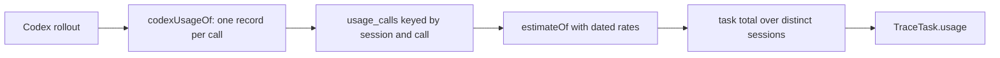
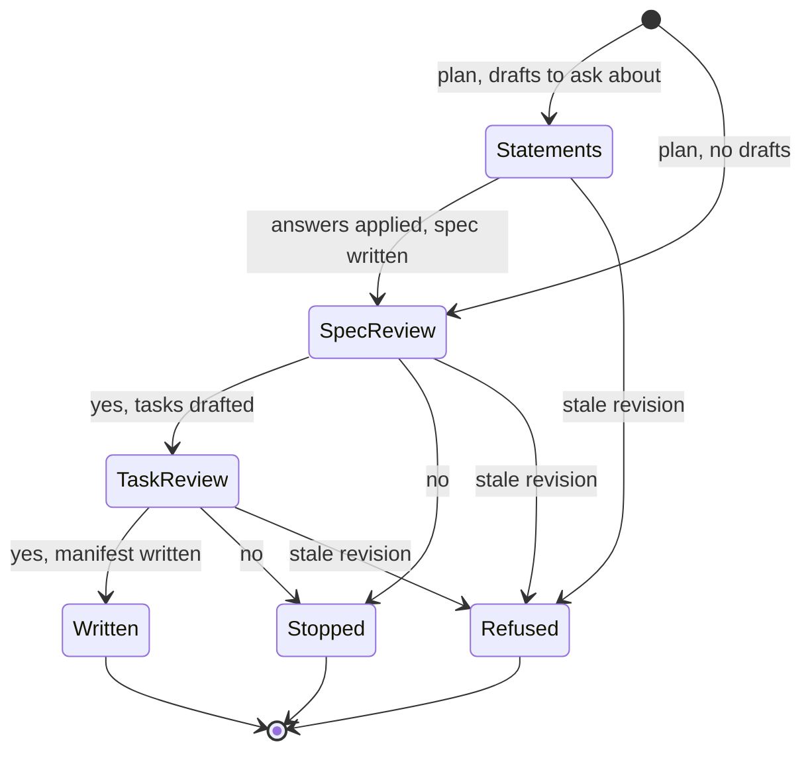
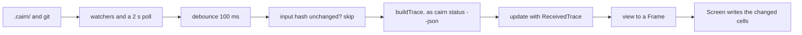
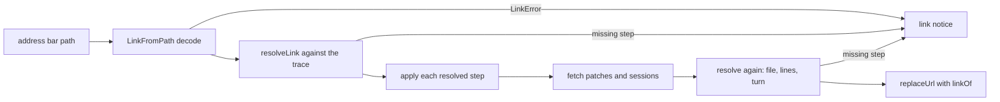
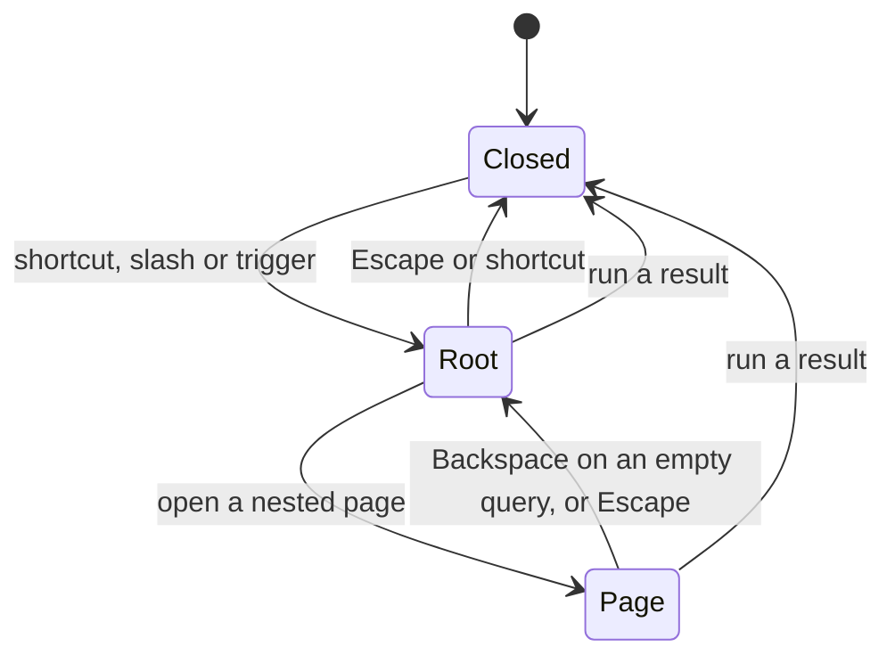
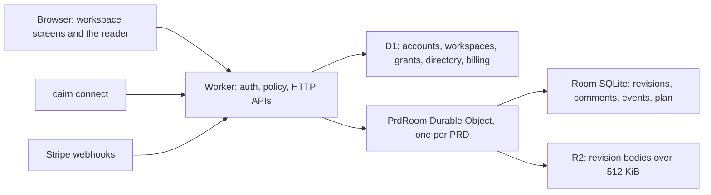
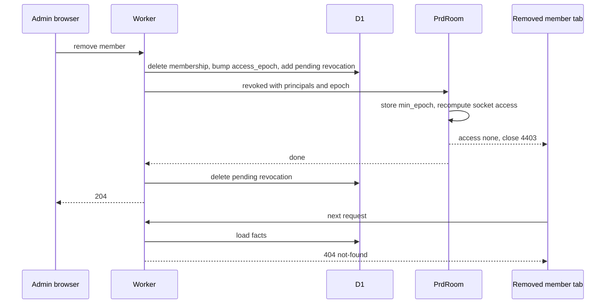

# Cairn MVP spec {#spec.cairn-mvp-spec}

This spec turns [prd.md](prd.md) into code. It is the first spec Cairn has, so it also sets the format that `cairn plan` writes.

Current implementation: the contract schemas, section parsing and `cairn ids`, the task machine (including `failed`), gate detection, stack order and the stack diagram, `cairn lint`, event and commit status derivation, the `Git` service, the trace store, presence, and the viewer’s canvas and reader are built. `cairn init` and `cairn plan` write the plan, the planner through its CLI and API sources. Judging’s questions, verdicts and decision model, and `replanOf`, are built but `cairn plan` does not run them yet. The viewer still loads a bundled demo trace. Building the Trace, section rollup, `cairn status`, `cairn serve`, sessions and redaction, `cairn judge` and planning again remain unfinished. Until live trace integration ships, the manifest and bundled demo are manually reconciled progress snapshots. Historical events are retained; they do not encode reopening completed tasks. The requirements below describe the complete target, not a claim that every section is built.

## Format {#spec.format}

- Context: `prd.goal`, `prd.non-goals-for-v1`, `prd.one-day-build-order`

Each spec section starts with a list of keys, before any prose. `cairn lint`, the planner and the viewer read them.

| Key          | Value                                        | Used for                                    |
| ------------ | -------------------------------------------- | ------------------------------------------- |
| `Implements` | PRD section IDs                              | Curves, rollup, coverage                    |
| `Files`      | Paths it will touch; a trailing `/` is a dir | Plan-time gate detection                    |
| `Depends on` | Spec section IDs                             | Stack order                                 |
| `Defers`     | PRD section IDs left for later               | Coverage; the viewer shows them as deferred |
| `Context`    | PRD section IDs that need no code            | Coverage; the viewer shows no badge         |

IDs are written in backticks and separated by commas. A key applies to its section and every section below it.

A PRD section is covered when it, or a section under it, appears in some `Implements`, `Defers` or `Context` key. A `Defers` or `Context` key covers the sections under the one it names too. "Under" means in the heading tree, not by ID prefix: the top heading does not namespace its children, so `prd.goal` sits under `prd.cairn-mvp`.

## Scope {#spec.scope}

- Defers: `prd.v2-diverging-state`, `prd.v2-multiplayer-on-cloudflare`, `prd.later`

This spec covers v1. Presence is the one v2 piece already built, and it stays: `cairn serve` keeps serving `/presence` next to the trace API.

## Package layout {#spec.package-layout}

- Implements: `prd.implementation-in-effect`

| Package       | Holds                                                                                                     |
| ------------- | --------------------------------------------------------------------------------------------------------- |
| `contract`    | Schemas, generated JSON Schema, the plain JS entry                                                        |
| `core`        | Pure logic: sections, gates, stack order, lint, status derivation, rollup, redaction, machines            |
| `cli`         | Services, commands and the server. Two composition roots: `src/main.ts` (CLI) and `src/serve.ts` (server) |
| `apps/viewer` | The Foldkit viewer                                                                                        |

Core takes plain values and does no IO. Only the CLI touches disk, git, the database or a model, through these services:

| Service      | Live                                 | Test                           |
| ------------ | ------------------------------------ | ------------------------------ |
| `Git`        | `git` subprocesses                   | An in-memory commit graph      |
| `TraceStore` | `SqliteClient` on `.cairn/cairn.db`  | `SqliteClient` on `:memory:`   |
| `Planner`    | `LanguageModel` (see `spec.models`)  | Scripted replies from fixtures |
| `Judge`      | `DecisionModel` (see `spec.models`)  | Scripted answers               |
| `Redactor`   | Reads `.env*` and config, calls core | Fixed secret set               |

The PRD's `Clock` service is Effect's own `Clock`; tests use `TestClock`. Files go through Effect's `FileSystem`. Commands use `effect/cli`.

## Libraries {#spec.libraries}

- Implements: `prd.implementation-in-effect`, `prd.viewer`

Already installed, and kept:

| Library                       | Version                    | Used for                                          |
| ----------------------------- | -------------------------- | ------------------------------------------------- |
| `effect`                      | 4.1.5                      | Schema, services, `effect/cli`, `effect/ai`, HTTP |
| `xstate` and `@xstate/effect` | 6.0.0-beta.5, 1.0.0-beta.3 | Task and room machines                            |
| `foldkit`                     | 0.171.0                    | The viewer                                        |

Additional libraries, some installed and some planned:

| Library                                                                  | Version             | License    | Used for                                                                                                    |
| ------------------------------------------------------------------------ | ------------------- | ---------- | ----------------------------------------------------------------------------------------------------------- |
| `@pierre/diffs`                                                          | 1.6.4               | Apache-2.0 | Parsing patches into hunks and rendering task and commit diffs                                              |
| `@pierre/highlights`                                                     | 0.5.2               | Apache-2.0 | Syntax colours for fenced code in the viewer                                                                |
| `pele`                                                                   | 1.13.0              | MIT        | Drawing Mermaid diagrams as SVG in the viewer, and checking that one draws in `cairn lint` and `cairn plan` |
| `@xyflow/system`                                                         | 1.0.0               | MIT        | Bezier paths, viewport math and pan/zoom for the canvas; removed with it (see `spec.viewer.canvas-removal`) |
| `@effect/ai-anthropic`                                                   | 4.1.5               | MIT        | A live `LanguageModel` for the `Planner` when `planner.source` is `api`                                     |
| `@effect/ai-openai`, `@effect/ai-openai-compat`, `@effect/ai-openrouter` | 4.1.5               | MIT        | The other `api` providers (see `spec.models`)                                                               |
| `@effect/ai-typesafe`                                                    | 4.1.5               | MIT        | The live `DecisionModel` (Jev), for the `Judge`                                                             |
| `@effect/sql-sqlite-node`                                                | 4.1.5               | MIT        | `SqliteClient` and `SqliteMigrator` for `cairn.db`, on `node:sqlite` (see `spec.sessions.trace-store`)      |
| `mdast-util-from-markdown`, `mdast-util-gfm`, `micromark-extension-gfm`  | 2.1.0, 3.1.0, 3.0.0 | MIT        | Markdown to nodes for the viewer                                                                            |
| `@foldkit/ui`                                                            | 0.171.0             | MIT        | The switch and the disclosure in the viewer's design system; pinned with `foldkit`                          |

Built into Node 24, so no package: `path.matchesGlob` for gate patterns, and `node:sqlite`, which `@effect/sql-sqlite-node` runs on. Diffs come from `git`, so the CLI needs no diff library.

Considered and left out:

- `@pierre/words` renders markdown to HTML strings through WebAssembly and is built for streaming model output. It drops raw HTML and checks URLs, but its output is still a string, so the viewer would need `innerHTML` for the whole document, and its hooks take and return HTML strings, so the `{#id}` headings, their `data-section` attributes and the title buttons that send Messages would have to be rebuilt from strings. Its Mermaid plugin needs `pele` anyway, and its code plugin needs `@pierre/highlights`; the viewer uses both directly. It may suit streaming session logs later.
- `mermaid` for diagrams: 123 MB unpacked with d3, cytoscape and elkjs behind it, and an asynchronous render that needs a DOM. `pele` draws the same syntax (Mermaid 12.1.0) synchronously from one dependency-free package, and escapes the diagram text itself.
- Shiki, through `@pierre/diffs`, for code blocks: it loads grammars asynchronously, so a block would need a Model field and Messages to arrive after the first render. `@pierre/highlights` returns tokens synchronously, and the view turns them into spans with no `innerHTML`. It is in beta, so its version is pinned exactly. Diffs use it too: `@pierre/diffs` takes `preferredHighlighter: "highlights"`, so one set of lexers colours both fences and diffs and Shiki is never loaded.
- A SQLite driver such as `better-sqlite3`: `@effect/sql-sqlite-node` runs on `node:sqlite`, which needs no native build.
- An ORM such as Drizzle or Prisma. One table needs no query builder, and an ORM would declare row types a second time beside Effect Schema. Effect SQL decodes rows through Schema, and the same `SqlClient` runs on a Durable Object (`@effect/sql-sqlite-do`) or D1 (`@effect/sql-d1`) if v2 needs it.
- Rete, JointJS, Cytoscape, Drawflow and LiteGraph. Each owns its scene and graph state, which would put state in two places beside the Foldkit model.
- `elkjs` for layout: EPL-2.0 or GPL-3.0 and 8 MB. `@dagrejs/dagre` (MIT) is the choice when layout stops being fixed.
- The AI SDK (`ai`, `@ai-sdk/anthropic`, `@ai-sdk/typesafe-ai`). It would add a second schema language and a Promise API beside Effect, and `effect/ai` already covers both language and decision models with Effect Schema.
- Cloudflare AI Gateway as a dependency. It is a proxy, not a library; `baseUrl` in config lets a user route through it (see `spec.models`).
- Workers AI. Cairn runs on the user's machine, not in a Worker.
- A Google provider package. `@effect/ai-google` has no 4.1.5 release, and Google's models answer the OpenAI API, so `openai-compatible` with a `baseUrl` reaches them.
- The Claude Agent SDK for the `cli` source. It would run an agent loop inside Cairn; the planner needs one prompt in and one answer out, which `claude -p` gives with the person's own sign-in.

## Contract {#spec.contract}

- Implements: `prd.contract-package`
- Files: `packages/contract/src/`, `packages/contract/schema/`

Everything a file in `.cairn/` holds is decoded through a schema here. A decode failure is a typed error that names the file, the line where there is one, and the field path.

### Section IDs {#spec.contract.section-ids}

- Implements: `prd.section-ids`
- Files: `packages/contract/src/ids.ts`

`SectionId` exists. Add `PrdSectionId` and `SpecSectionId`, which also check the prefix.

`SectionId`, `TaskId` and the two prefixed IDs live in `ids.ts`, and `index.ts` re-exports them. Contract modules import IDs from `ids.ts`, never from `index.ts`, which re-exports them and would make a cycle. `TaskId` matches `^[A-Za-z0-9][A-Za-z0-9._-]*$`, so it survives a `Cairn-Task` trailer.

### Manifest {#spec.contract.manifest}

- Implements: `prd.manifest-schema`
- Files: `packages/contract/src/manifest.ts`

```ts
Manifest = {
  version: 1
  feature: Slug
  baseBranch: string
  tasks: NonEmptyArray<ManifestTask>
}

ManifestTask = {
  id: TaskId // t1, t2, ... in dependency order (see spec.planning.stack-order)
  title: NonEmptyString
  prdSections: NonEmptyArray<PrdSectionId>
  specSections: NonEmptyArray<SpecSectionId>
  files: Array<string> // new: the declared files plan-time detection runs on
  branch: string // <feature>/<NN>-<slug>
  parent: TaskId | null // see spec.planning.stack-order
  dependsOn: Array<TaskId> // new: the tasks this one needs
  worktree: string | null // new: where it is built; null is the repo's own checkout
  model: NonEmptyString
  reasoning: "low" | "medium" | "high" | "xhigh" | "max"
  humanGate: { required: boolean; reasons: Array<GateReason> }
  status: TaskStatus
  commits: Array<Sha>
  sessions: Array<SessionId>
}

GateReason = "tag:human" | `path:${string}`
TaskStatus = "pending" | "running" | "blocked_on_human" | "failed" | "done" | "landed"
```

`TaskStatus` gains `failed`. The existing `Task` schema, with one `section` and a `gated` flag, is replaced by `ManifestTask`; the machine and the viewer move to it.

`status`, `commits` and `sessions` are a snapshot. Cairn writes them; nothing reads them to decide anything. Derived status (see `spec.status.derivation`) is the truth. Only Cairn writes `manifest.json`.

### Events {#spec.contract.events}

- Implements: `prd.orchestrator-contract`
- Files: `packages/contract/src/events.ts`

One JSON object per line of `events.jsonl`:

```ts
Event = {
  v?: 1 // missing means 1
  ts: string // ISO 8601, decoded to a DateTime.Utc
  taskId: TaskId
  status: TaskStatus
  detail?: string
  actor?: "orchestrator" | `human:${string}` | `agent:${string}` // missing means orchestrator
  model?: string // on a running event: the model the task was started with
  reasoning?: Reasoning // on a running event: the reasoning level it was started with
}
```

`actor` is new. Approvals need it: only a `human:` actor can move a task out of `blocked_on_human`.

`model` and `reasoning` are new and optional, with the manifest's types. The orchestrator sets both on a `running` event to what it started the task with, which is not always what the plan chose: a retry or a human can change it. An event without them still decodes, and on any other status they are ignored. The viewer reads them to show what ran (see `spec.viewer.models`).

### Trailers {#spec.contract.trailers}

- Implements: `prd.orchestrator-contract`
- Files: `packages/contract/src/trailers.ts`

```text
Cairn-Task: t1
Cairn-Section: spec.contract.manifest
Cairn-Section: spec.contract.events
Cairn-Session: s_8f2k1q
```

One `Cairn-Task` and one `Cairn-Session`. `Cairn-Section` repeats, once per spec section, since a task can have several. `SessionId` matches `^s_[a-z0-9]{6,}$`.

### Trace {#spec.contract.trace}

- Implements: `prd.viewer`, `prd.contract-package`
- Files: `packages/contract/src/trace.ts`
- Depends on: `spec.contract.manifest`, `spec.contract.events`, `spec.contract.trailers`

`Trace` is what the server sends and the viewer draws. `cairn status --json` prints it, and the demo loads one from a file.

```ts
Trace = {
  version: 1
  feature: Slug
  baseBranch: string
  prd: TraceDocument
  spec: TraceDocument
  tasks: Array<TraceTask> // manifest order
  sections: Array<{ id: SectionId; status: SectionStatus }> // every PRD and spec section
  warnings: Array<TraceWarning>
  judgments: Array<Judgment & { stale: boolean }> // empty until the judging work fills it (see spec.server)
}

TraceDocument = {
  path: string // ".cairn/prd.md" or ".cairn/spec.md"
  markdown: string // the whole file, rendered by the viewer
  sections: Array<TraceSection>
}

TraceSection = {
  id: SectionId
  title: string // without the {#id}
  level: number
  line: number
  parent: SectionId | null
  human: boolean
  summary: string | null // one sentence from spec.json; null in the PRD and for a section the index does not hold
  keys: {
    // own keys plus inherited ones; all empty in the PRD
    implements: Array<PrdSectionId>
    files: Array<string>
    dependsOn: Array<SpecSectionId>
    defers: Array<PrdSectionId>
    context: Array<PrdSectionId>
  }
}

TraceTask = Omit<ManifestTask, "status" | "commits"> & {
  status: TaskStatus // derived, not the manifest snapshot
  waiting: boolean // pending, with a blocked_on_human task below it
  gate: { required: boolean; reasons: Array<GateReason> } // effective: plan time plus the files its commits changed
  commits: Array<TraceCommit>
  events: Array<Event> // sorted as derivation sorts them
}

TraceCommit = {
  sha: Sha
  parents: Array<Sha>
  subject: string
  files: Array<string>
  sections: Array<SpecSectionId> // from Cairn-Section trailers
  session: SessionId | null // from Cairn-Session
}

TraceWarning = {
  kind: "illegal-transition" | "non-human-approval" | "unknown-task" | "missing-trailers" | "landed-without-approval" | "missing-session"
  message: string
  taskId: TaskId | null
  sha: Sha | null
}
```

`summary` is new. It is the section's `summary` in `spec.json` (see `spec.contract.spec-index`), carried in the trace so the viewer reads one thing. A trace written without it decodes with `null`. The spec cards show it (see `spec.viewer.spec-cards`).

`TraceSection` is declared here rather than imported from core's `Section`, so the viewer depends only on the contract. The trace carries no positions: the viewer lays everything out itself (see `spec.viewer.model-and-messages`).

The viewer is built against this schema and the demo trace, so it does not wait for the CLI or the server. The demo trace has to decode through `Trace`; a test checks it.

### Session {#spec.contract.session}

- Implements: `prd.code-view`
- Files: `packages/contract/src/session.ts`
- Depends on: `spec.contract.trailers`

`Session` is what `GET /api/sessions/:id` sends and the session pane draws. `cairn.db` keeps the redacted log as the agent wrote it; `Session` is how Cairn reads it (see `spec.sessions.reading`), so a better reader later needs no migration.

```ts
Session = {
  version: 1
  id: SessionId
  taskId: TaskId
  format: "claude-code" | "unknown"
  turns: Array<Turn> // log order
  skipped: number // lines of a read type that did not decode
  redactions: Record<string, number> // count per kind
  notes: Array<SessionNote>
}

Turn = PromptTurn | ReplyTurn | ToolTurn

PromptTurn = { kind: "prompt"; id: string; at: DateTime.Utc; text: string } // id: the log line's uuid
ReplyTurn = { kind: "reply"; id: string; at: DateTime.Utc; text: string }

ToolTurn = {
  kind: "tool"
  id: string // the tool call's id, which its result repeats
  at: DateTime.Utc
  name: string // "Edit", "Write", "Bash", ...
  target: string | null // the file path or command, for the one-line summary
  input: string // the call's input as JSON text
  output: string // the result's text; empty when no result arrived
  failed: boolean
  edits: Array<FileEdit>
}

FileEdit = {
  path: string // relative to the checkout the agent ran in
  added: Array<string> // lines the edit wrote, without the "+"
  removed: Array<string> // lines it removed, without the "-"
}

SessionNote = { kind: "note" | "review" | "annotation"; author: string; body: string; at: DateTime.Utc }
```

Turn IDs are unique within a session; the schema refuses a duplicate.

### Config {#spec.contract.config}

- Implements: `prd.human-gates`
- Files: `packages/contract/src/config.ts`

```ts
Config = {
  version: 1
  humanPaths: Array<string> // defaults to the PRD's list
  redact: { deny: Array<string> } // defaults to []
  planner: {
    source: "cli" | "api" // defaults to "cli"
    cli: "claude" | "codex" // defaults to "claude"; read when source is "cli"
    provider: "anthropic" | "openai" | "openrouter" | "openai-compatible" // defaults to "anthropic"; read when source is "api"
    model: string | undefined // undefined leaves the choice to the CLI; required when source is "api"
    small: string | undefined // the model for index and the two splits; defaults to model
    keyEnv: string | undefined // the environment variable holding the key; defaults per provider
    baseUrl: string | undefined // e.g. a Cloudflare AI Gateway URL; required for "openai-compatible"
    gatewayTokenEnv: string | undefined // the environment variable holding an AI Gateway token; read when source is "api"
  }
  judge: {
    model: string // defaults to "jev-1.14.0"
    baseUrl: string | undefined // e.g. a Cloudflare AI Gateway URL; required when gatewayTokenEnv is set
    gatewayTokenEnv: string | undefined // the environment variable holding an AI Gateway token
    pass: number // defaults to 0.8
    flag: number // defaults to 0.5
    minConfidence: number // defaults to 0.5
    maxRounds: number // defaults to 2
    models: Record<string, string> // name the manifest uses, and when to use it
  }
}
```

A missing `.cairn/config.json` decodes to the defaults. A config whose `planner.source` is `api` with no `planner.model`, or whose provider is `openai-compatible` with no `planner.baseUrl`, fails to decode with a message naming the field. A config whose `planner.source` is `api` and that sets `planner.gatewayTokenEnv` with no `planner.baseUrl` fails to decode the same way: the token is for the gateway, and a request that goes straight to a provider must not carry it. `planner.gatewayTokenEnv` holds the name of a variable, never the token. A config that sets `judge.gatewayTokenEnv` with no `judge.baseUrl` fails to decode, naming both fields, for the same reason; `judge.gatewayTokenEnv` also holds a variable's name. `judge.pass` must be greater than `judge.flag`, and all three thresholds lie in `[0, 1]`. `judge.models` defaults to:

| Name     | When to use it                                                                     |
| -------- | ---------------------------------------------------------------------------------- |
| `haiku`  | Mechanical changes: a schema field, a rename, a command wired to existing code     |
| `sonnet` | Most tasks: a feature or service with its tests across a few files                 |
| `opus`   | Logic where a subtle bug costs a lot: derivation, ordering, redaction, concurrency |

### Judgments {#spec.contract.judgments}

- Implements: `prd.judging-the-plan`
- Files: `packages/contract/src/judgments.ts`

```ts
Judgments = {
  version: 1
  model: string // the decision model that answered, e.g. "jev-1.14.0"
  judgments: Array<Judgment>
}

Judgment = {
  target:
    | { kind: "section"; id: SpecSectionId }
    | { kind: "task"; id: TaskId }
    | { kind: "draft"; title: string } // a draft that was split, so never got a TaskId
    | { kind: "stack" }
  question: "size" | "faithful" | "buildable" | "matches" | "model" | "reasoning" | "complete" | "ordered" | "oneFeature"
  verdict: "pass" | "flag" | "unsure"
  action: "none" | "split" | "routed" // what planning did because of it
  round: number // 1 for the first ask; a split's replacements are judged in round 2
  answer: RateAnswer | ProbabilityAnswer | Unanswered
  message: string
  inputHash: Sha256Hex
  at: DateTimeUtc
}

RateAnswer = { label: string; probabilities: Record<string, number>; confidence: number | undefined }
ProbabilityAnswer = { probability: number }
Unanswered = { unanswered: "Refused" | "Missing" | "Invalid"; description: string }
```

The answer shapes mirror `effect/ai`'s `RateAnswer`, `ProbabilityAnswer` and `Unanswered`; a `classify` answer uses `RateAnswer`'s shape. Judgments on drafts that became tasks are keyed by the task's ID once `stackOf` assigns it. Only Cairn writes `judgments.json`. A missing file decodes to no judgments.

### Spec index {#spec.contract.spec-index}

- Implements: `prd.repo-layout`
- Files: `packages/contract/src/spec-index.ts`, `packages/cli/src/spec-index.ts`
- Depends on: `spec.sections.parsing`, `spec.planning.planner-service`

`spec.json` is a structured copy of `spec.md`, so the planner, the judge and other tools read the spec without parsing markdown.

```ts
SpecIndex = {
  version: 1
  source: string // ".cairn/spec.md"
  prd: string
  manifest: string
  sections: Array<IndexedSection> // in document order
}

IndexedSection = {
  // derived by code from spec.md and manifest.json
  id: SpecSectionId
  title: string
  level: number
  line: number
  parent: SpecSectionId | null
  children: Array<SpecSectionId>
  human: boolean
  implements: Array<PrdSectionId> // own keys only, not inherited
  files: Array<string>
  dependsOn: Array<SpecSectionId>
  defers: Array<PrdSectionId>
  context: Array<PrdSectionId>
  tasks: Array<TaskId> // tasks whose specSections name this section
  // recorded when the section is written or first indexed
  writtenFrom: {
    body: string | null // hash of the section's body as the planner wrote it; null for a section a person wrote
    prd: Record<PrdSectionId, string> // hash of each PRD section it implements, as it was then
  }
  // extracted from the section's prose by Planner.index
  summary: string
  requirements: Array<{ id: `${SpecSectionId}#r${number}`; level: "must" | "must-not" | "should" | "may"; text: string }>
  artifacts: Array<Artifact> // { id, kind, name, location, description, ...kind-specific fields }
  tests: Array<{ id: `${SpecSectionId}#t${number}`; kind: "check" | "example" | "property" | "scene" | "integration" | "mutation"; text: string }>
  decisions: Array<{ id: `${SpecSectionId}#d${number}`; text: string; why: string | null }> // null when the spec gives no reason
}
```

`cairn plan` writes `spec.json` whenever it writes `spec.md` or `manifest.json`. Code fills the derived fields. `Planner.index` fills the rest, one call per section whose body changed; a section whose body is unchanged keeps its entry.

`writtenFrom` is what planning again reads (see `spec.planning.again`). A hash is the SHA-256 of the section's body with trailing whitespace removed from each line, in hex. A section's body hash differing from `writtenFrom.body` means a person edited it. `writtenFrom` is set once, when the section is written or first indexed, and only a rewrite of that section replaces it.

Until the CLI exists, `spec.json` is written by hand in this format, and the lint rule `index-drift` is what keeps it honest.

### JavaScript entry {#spec.contract.javascript-entry}

- Implements: `prd.contract-package`
- Files: `packages/contract/src/js.ts`, `packages/contract/package.json`

`@cairn/contract/js` exports functions that need no Effect:

- `parseManifest(input)`, `parseEvent(line)`, `parseConfig(input)` return the decoded value or throw a `CairnContractError` with `path` (the field path) and a message.
- `formatTrailers({ taskId, sections, sessionId })` returns the trailer block. `trailerArgs(...)` returns the same as `--trailer` arguments for `git commit`.
- `appendEvent(path, event)` validates the event and appends it in a single `O_APPEND` write, so concurrent writers never interleave lines.
- `cairnDir(cwd)` returns the main checkout's `.cairn/` the same way the CLI finds it, so an orchestrator working in a worktree appends to the shared `events.jsonl`.
- `migrateManifest(input)` upgrades older versions. Version 1 is the only one, so for now it checks the version and returns the input.

The package ships `.d.ts` files and `schema/{manifest,event,config}.schema.json`, generated with `Schema.toJsonSchemaDocument`. A test regenerates them and fails if the committed files differ, so `pnpm check` catches drift.

### Links {#spec.contract.links}

- Implements: `prd.deep-links.targets`, `prd.deep-links.composing`
- Files: `packages/contract/src/link.ts`, `packages/contract/src/index.ts`, `packages/contract/test/link.test.ts`, `packages/contract/package.json`
- Depends on: `spec.contract.section-ids`, `spec.contract.trailers`, `spec.contract.session`

A link is a list of steps, and its text is a URL path. `link.ts` defines both. The step schemas and one Schema that turns a path into steps and steps back into a path are the only definition of a link. The viewer's route reads links through it (see `spec.viewer.deep-links.opening-a-link`) and `cairn link` writes them through it (see `spec.cli.cairn-link`), so a printed link and a copied link are always the same text. `link.ts` imports IDs from `ids.ts` and `trailers.ts`, never from `index.ts`, and `index.ts` re-exports it.

```ts
Link = Array<Step> // well formed: see the rules below

Step =
  | { kind: "section"; id: PrdSectionId | SpecSectionId } // a PRD or spec section, or a PRD list item, by its ID
  | { kind: "passage"; section: PrdSectionId | SpecSectionId; quote: Quote }
  | { kind: "task"; id: TaskId }
  | { kind: "stack"; root: TaskId } // the stack that root starts
  | { kind: "segment"; root: TaskId } // that stack's finished trunk
  | { kind: "diff"; head: Sha } // the task before it, as its stacked diff stood at head
  | { kind: "commit"; sha: Sha }
  | { kind: "file"; path: NonEmptyString } // relative to the repo root
  | { kind: "lines"; side: "new" | "old"; start: PositiveInt; end: PositiveInt } // start <= end
  | { kind: "turn"; session: SessionId; turn: NonEmptyString } // a Turn's id (see spec.contract.session)
  | { kind: "note"; id: NoteId }

Quote = string // 1 to 500 characters, whitespace runs collapsed to one space, trimmed
NoteId = string // ^n_[a-z0-9]{6,}$
```

The steps cover every target the PRD lists. A stack is named by its root task, not its number, because numbers move when the plan changes and a root's ID does not. A line is a side and a line number, so the same link works in the unified view and in the split view. Notes are not stored yet (see `spec.sessions.trace-store`). I chose `NoteId` to follow the pattern of `SessionId`, and the notes work stores notes under it.

Each step is written as path segments. Every argument is encoded with `encodeURIComponent`, so a file path's `/` becomes `%2F`:

| Step    | Path                                                           |
| ------- | -------------------------------------------------------------- |
| section | `/section/<id>`                                                |
| passage | `/passage/<id>/<quote>`                                        |
| task    | `/task/<id>`                                                   |
| stack   | `/stack/<root>`                                                |
| segment | `/segment/<root>`                                              |
| diff    | `/diff/<head>`                                                 |
| commit  | `/commit/<sha>`                                                |
| file    | `/file/<path>`                                                 |
| lines   | `/lines/n40`, `/lines/n40-42`, `/lines/o12` (`n` new, `o` old) |
| turn    | `/turn/<session>/<turn>`                                       |
| note    | `/note/<id>`                                                   |

The link with no steps is `/`. A trailing `/` is accepted when a link is read and never written. A single range is written as `n40`, not `n40-40`. None of the step names is `api`, `presence` or `assets`, so a link never collides with a server route or a built file.

A well-formed link follows these rules, and decoding enforces them:

- `diff` comes directly after a `task`.
- `file` comes directly after a `diff` or a `commit`. `lines` comes directly after a `file`.
- After the first `diff`, `commit` or `turn`, only `file`, `lines` and `turn` may follow. A link has at most one `diff` or `commit` and at most one `turn`, and a `turn` is last.
- A `note` is last.

`LinkFromPath` is an Effect Schema from the path string to `Link`. Decoding reads a link and encoding writes one. Every ID decodes through its own contract schema. A failure is a `LinkError` that gives the step's index, the step's name and the field path, for example `step 3 (file): must follow a diff or a commit` or `step 2 (diff).head: expected 40 lowercase hex characters`.

The contract takes `fast-check` as a dev dependency, at the version `spec.testing.model-based` pins.

Tests, in `link.test.ts`:

- A property: for every well-formed `Link`, generated from the step schemas with arbitraries that follow the rules above, encoding and then decoding gives the same steps, and encoding gives the same path each time. This is the acceptance criterion that writing a link and reading it back gives the same steps.
- Quotes and file paths with `/`, `%`, spaces, emoji and surrogate pairs come back unchanged.
- Examples: the path for the PRD's `cairn link prd.code-view t74 --file packages/cli/src/api.ts --line 40` is `/section/prd.code-view/task/t74/diff/<sha>/file/packages%2Fcli%2Fsrc%2Fapi.ts/lines/n40`.
- Refusals: a `file` with no diff before it, a `lines` that does not follow a `file`, a `task` after a `commit`, `/lines/n42-40`, a bad SHA and a bad percent-encoding are each refused, and each error names the step and the field.

### Items and statements {#spec.contract.items-and-statements}

- Implements: `prd.section-ids.items`, `prd.done-when.statements`
- Files: `packages/contract/src/ids.ts`, `packages/contract/src/trailers.ts`, `packages/contract/src/trace.ts`, `packages/contract/src/spec-index.ts`, `packages/contract/schema/`, `packages/contract/test/items.test.ts`
- Depends on: `spec.contract.section-ids`, `spec.contract.trace`, `spec.contract.spec-index`

A list item's ID follows the same rules as a section ID, so it decodes through `PrdSectionId` or `SpecSectionId`. Every field that holds a section ID can therefore hold an item ID with no schema change: `Implements`, `Defers` and `Context`, `prdSections`, a link's `section` step. Items are planned against only in the PRD, because the PRD only speaks of PRD items. A spec's list items can still carry IDs, and they parse the same way.

`ids.ts` adds `StatementId`:

```ts
StatementId = string // ^prd\.[a-z0-9]+(?:[.-][a-z0-9]+)*#v[1-9][0-9]*$
ownerOf(id: StatementId): PrdSectionId // the part before "#v": a section or a list item
TestId = `${SpecSectionId}#t${number}` // moved here from spec-index.ts, so trace.ts can import it
```

`trailers.ts`: a `Cairn-Section` trailer decodes `PrdSectionId | SpecSectionId`, so a commit can name the item it builds.

`trace.ts` adds:

```ts
TraceDocument += {
  items: Array<TraceItem> // document order
  statements: Array<TraceStatement> // document order; always empty for the spec
}

TraceItem = {
  id: SectionId
  text: string // the item's own text, without its {#id}
  line: number
  section: SectionId // the heading it sits under
  parent: SectionId // the item it is nested in, or else that heading
  human: boolean // its own text or an ancestor has <!-- human -->
}

TraceStatement = {
  id: StatementId
  owner: PrdSectionId
  text: string // without "Draft:", the human tag or the {#id}
  line: number
  draft: boolean
  human: boolean
  provedBy: Array<TestId>
}

TraceTask += { statements: Array<StatementId> } // see spec.planning.done-when.tracing-statements
```

`Trace.sections`, the list of statuses, also holds every item that has an ID.

`spec-index.ts`: each entry in `tests` gains `proves: Array<StatementId>`. The index gains a top-level `tasks: Array<{ id: TaskId; statements: Array<{ id: StatementId; draft: boolean; provedBy: Array<TestId> }> }>`.

A trace or a `spec.json` written before these fields existed still decodes, with empty arrays. The JSON Schema files are generated again.

Tests: `StatementId` accepts `prd.saved-views#v1` and `prd.cli.lint#v12`, and refuses `spec.x#v1`, `prd.x#v0` and `prd.x#t1`. `ownerOf` returns what comes before `#v`. A trace without the new fields decodes, and so does the demo trace. A `Cairn-Section: prd.cli.lint` trailer round-trips.

### Relation kinds {#spec.contract.relation-kinds}

- Implements: `prd.relations.kinds`
- Files: `packages/contract/src/relations.ts`, `packages/contract/src/manifest.ts`, `packages/contract/src/index.ts`, `packages/contract/schema/`, `packages/contract/test/relations.test.ts`
- Depends on: `spec.contract.manifest`, `spec.contract.items-and-statements`

`relations.ts` declares the relation kinds in one place. It imports IDs from `ids.ts`, and `index.ts` re-exports it.

```ts
EndKind = "task" | "spec" | "prd" | "item" | "statement" | "test"
End = { kind: EndKind; id: string }

RelationKind = "needs" | "builtOn" | "orderedAfter" | "builds" | "names" | "implements" | "dependsOn" | "proves"

relationKinds: { readonly [K in RelationKind]: {
  label: string // "needs", "built on", "ordered after", ...
  from: ReadonlyArray<EndKind>
  to: ReadonlyArray<EndKind>
  recordedIn: string // "manifest.json dependsOn", "spec.md Implements", ...
} }

Relation = { kind: RelationKind; from: End; to: End }
```

The table holds the eight rows of the PRD. `names` and `implements` end on `prd` or `item`. `proves` runs from `test` to `statement`.

The relation index reads each kind through one extractor (see `spec.status.relation-index`). The extractors are typed as `Record<RelationKind, Extractor>`, so a kind added here fails to compile until its extractor exists. Nothing else has to change when a kind is added.

`manifest.ts` adds the field that records `ordered after`:

```ts
ManifestTask += {
  orderedAfter: Array<{ task: TaskId; reason: string }>, // defaults to []; a conflict ordering, not a dependency
};
```

A manifest without the field decodes with `[]`. The JSON Schema files are generated again.

Tests:

- Every kind has a non-empty `from` and `to`.
- `Relation` refuses an end kind that its kind's declaration does not allow.
- An old manifest decodes with an empty `orderedAfter`.

### Attempts {#spec.contract.attempts}

- Implements: `prd.outcomes.attempts`
- Files: `packages/contract/src/events.ts`, `packages/contract/src/attempts.ts`, `packages/contract/src/js.ts`, `packages/contract/schema/`, `packages/contract/test/attempts.test.ts`
- Depends on: `spec.contract.events`, `spec.contract.trailers`

The orchestrator reports what each attempt cost and how it ended on the events it already writes. `Event` becomes a union discriminated by `kind`. A line with no `kind` is a status event, so every existing line still decodes.

```ts
Event = StatusEvent | UsageEvent | ConflictEvent // ConflictEvent: see spec.orchestrator-adapter.conflict-aware-running

StatusEvent = {
  kind?: "status"
  // ...every field Event has today
  session?: SessionId // the attempt's session, on running, done and failed
  harness?: Harness // on running
  attempt?: AttemptKind // on running; derived when missing (see spec.status.attempts)
  usage?: Usage // on done and failed
  cost?: number | null // US dollars; null when it is not known
  route?: Route // on done and failed
  failure?: FailureReason // on failed
}

UsageEvent = { // a session on the task that is not an attempt
  kind: "usage"
  v?: 1
  ts: string
  taskId: TaskId
  session: SessionId
  purpose: "review" | "conflict"
  model: string
  reasoning: Reasoning
  harness: Harness
  usage: Usage
  cost: number | null
  route: Route
}

Harness = { name: NonEmptyString; version: string } // "claude-code", "codex", "pi"
Usage = {
  input: number | null // every input token, cached ones included
  cachedInput: number | null // the part of input read from cache
  cacheWrite: number | null
  output: number | null // reasoning tokens included
  reasoning: number | null
}
Route = "subscription" | "api" | "gateway" | "unified"
AttemptKind = "first" | "retry" | "escalation" | "repair"
FailureReason = "checks" | "agent" | "infra" | "upstream"
```

What each route means:

- `subscription`: a CLI's own plan. `cost` is `null`.
- `api`: straight to the provider's account.
- `gateway`: through Cloudflare AI Gateway, billed to the provider's account.
- `unified`: Cloudflare's Unified Billing balance.

Token counts are non-negative integers. A count the provider did not give is `null`, never `0`. Derivation folds only status events through the task machine. Usage and conflict events never change a status.

`attempts.ts` holds the derived `Attempt`. It lives in the contract because the trace carries it:

```ts
Attempt = {
  task: TaskId
  n: number // 1 for the first
  session: SessionId | null
  kind: AttemptKind
  model: string
  reasoning: Reasoning
  harness: Harness | null
  startedAt: DateTime.Utc
  endedAt: DateTime.Utc | null
  usage: Usage
  cost: number | null
  costSource: "reported" | "priced" | "unknown"
  route: Route | null
  outcome: "verified" | "failed" | "open"
  failure: FailureReason | null
}
```

`parseEvent` in the JS entry decodes the union, and `appendEvent` accepts every member. The JSON Schema files are generated again.

Tests:

- A line written before this change decodes as a status event.
- A `failed` event with each failure reason round-trips.
- A usage count of `-1` is refused.
- `cost: null` decodes as unknown, not as zero.

### Usage in the trace {#spec.contract.usage-in-the-trace}

- Implements: `prd.outcomes.session-cost`, `prd.outcomes.reporting`
- Files: `packages/contract/src/trace.ts`, `packages/cli/src/api.ts`, `packages/cli/src/commands/status.ts`, `packages/cli/test/trace-usage.test.ts`
- Depends on: `spec.contract.attempts`, `spec.status.attempts`, `spec.sessions.api-equivalent-cost`, `spec.sessions.subscription-allowance`, `spec.server`

The viewer reads cost and attempts from the `Trace`, like everything else it reads.

```ts
TraceTask += {
  attempts: Array<Attempt>
  terminal: boolean // reached its attempt or cost limit without verifying
  usage: TaskUsage
}

TaskUsage = {
  sessions: Array<SessionUsage>
  apiEstimate: Estimate // the sum over sessions of share × estimate
  billed: { usd: number | null; unknownAttempts: number }
  allowance: Array<AllowanceShare> // attributable consumption only
  allocated: Allocation | null // private
}

SessionUsage = {
  session: SessionId
  share: number // 1 for the task's own session; an explicit allocation otherwise
  purpose: "attempt" | "review" | "conflict" | "subagent"
  byModel: Array<{
    model: string
    reasoning: Reasoning | null
    input: number
    cachedInput: number
    cacheWrite: number | null
    output: number
    reasoningTokens: number | null
  }>
  estimate: Estimate
  billed: number | null
}

Estimate = {
  usd: number | null
  coverage: { calls: number; priced: number }
  sources: Array<{ model: string; source: string; effective: string }>
  assumptions: Array<string>
  excluded: Array<string>
}

AllowanceShare = { allowance: string; label: string; percent: number | null; resetsAt: DateTime.Utc; note: string }
Allocation = { usd: number | null; currency: string; provisional: boolean; method: string }

Trace += { account: Array<AccountAllowance> } // private: account-wide use and remaining, per allowance
```

The trace builder fills these fields from the attempts (see `spec.status.attempts`), the usage records and their estimates (see `spec.sessions.api-equivalent-cost`) and the allowance snapshots (see `spec.sessions.subscription-allowance`).

Some fields are private: `account`, `allocated` and the fee behind it, and each `AllowanceShare`. `GET /api/trace` serves them, because it only answers on the person's own machine. `cairn status --json` leaves them out unless `--private` is passed. The demo trace is built by `cairn status --json`, so the demo and any shared export carry none of them.

Tests:

- A trace written before this change decodes with no attempts and an unknown estimate.
- `cairn status --json` has no `account` and no allowance shares, and with `--private` it has both.
- A session referenced by two commits of one task appears once in `sessions`.

## Sections {#spec.sections}

### Parsing {#spec.sections.parsing}

- Implements: `prd.section-ids`
- Files: `packages/core/src/section-ids.ts`, `packages/core/src/sections.ts`

`sectionsOf(markdown)` returns every heading outside a fence:

```ts
Section = {
  id: SectionId | undefined
  level: number
  title: string // without the {#id}
  line: number // 1-based, for lint output
  parent: SectionId | undefined
  body: string // up to the next heading of any level
  human: boolean // its body or an ancestor's body has <!-- human -->
  keys: { implements; files; dependsOn; defers; context } // own keys plus inherited ones
}
```

It reuses the fence and heading rules `assignSectionIds` already has, so both agree on what counts as a heading.

### `cairn ids` {#spec.sections.cairn-ids}

- Implements: `prd.cli`, `prd.section-ids`, `prd.cli.ids`
- Files: `packages/cli/src/commands/ids.ts`
- Depends on: `spec.sections.parsing`

Runs `assignSectionIds` on `prd.md` with `prd` and on `spec.md` with `spec`. Writes a file only when IDs were added, and prints each added ID. `--check` writes nothing and exits 1 if any heading lacks an ID.

### List items {#spec.sections.list-items}

- Implements: `prd.section-ids.items`
- Files: `packages/core/src/items.ts`, `packages/core/src/section-ids.ts`, `packages/cli/src/commands/ids.ts`, `packages/core/test/items.test.ts`
- Depends on: `spec.sections.parsing`, `spec.sections.cairn-ids`, `spec.contract.items-and-statements`

`itemsOf(markdown, sections)` in `items.ts` is pure. It returns every list item outside a fence, using the fence rules `assignSectionIds` already has:

```ts
Item = {
  id: SectionId | undefined
  asks: boolean // it ends in {#}
  text: string // its own text, without the attribute
  line: number
  section: SectionId | undefined // the heading it is under
  parent: SectionId | undefined // the item it is nested in, or else that heading
  human: boolean
}
```

- An item starts at a line that matches `^( *)([-*+]|\d+[.)]) +`. Its own text runs until its first nested list, the next item at the same indent or less, a heading, or a blank line followed by a line that is not indented.
- An ID is a trailing ` {#<id>}` at the end of the item's own text. A trailing ` {#}` asks for one.
- The items of a `Done when:` list are statements, not items, and `itemsOf` leaves them out (see `spec.planning.done-when.statements`).
- An item is `human` when its own text has `<!-- human -->`, or when its section or any item it is nested in is human.

`assignItemIds(markdown, taken)` in `section-ids.ts` fills each `{#}`, and `cairn ids` runs it after the headings. The ID is the ID of the heading the item sits under, then `.`, then the first two words of the item's visible text, lowercased and joined by `-`. Markdown, backticks and punctuation are stripped first. On a clash it adds `-2`, `-3` and so on. The PRD only says "first words", so I chose two: ``- `cairn lint` checks … {#}`` under `prd.cli` becomes `{#prd.cli.cairn-lint}`.

- An item that already has an ID is never changed.
- An item with no attribute is never given one.
- Only lines that end in `{#}` change.
- `cairn ids --check` exits 1 when any `{#}` is left, as it does for a heading with no ID.

Tests:

- Properties: `assignItemIds` applied twice gives what applying it once gives, and it changes no line that lacks `{#}`.
- Every item's `parent` is a heading or an item that comes earlier in the document.
- Items inside fences are ignored.
- Examples: an item nested two deep gets the right parent; an item whose text wraps onto three lines has its attribute read from the last line; two items with the same first words under one heading get `-2`.

### Item coverage {#spec.sections.item-coverage}

- Implements: `prd.section-ids.items`
- Files: `packages/core/src/lint.ts`, `packages/core/src/rollup.ts`, `packages/core/src/gates.ts`, `packages/cli/prompts/`, `packages/cli/src/api.ts`, `packages/core/test/lint.test.ts`, `packages/core/test/rollup.test.ts`
- Depends on: `spec.sections.list-items`, `spec.lint`, `spec.status.section-rollup`, `spec.gates.detection`, `spec.planning.planner-service`

Once an item has an ID, it is planned, counted and linted on its own.

Coverage. An item is covered when an `Implements`, `Defers` or `Context` key names it, or when a `Defers` or `Context` key names a heading or item it sits under. An `Implements` that names the section around an item does not cover the item. That is the one place where an item's coverage differs from a section's (see `spec.format`).

Lint:

| Rule              | Severity | Fires when                                                                                                      |
| ----------------- | -------- | --------------------------------------------------------------------------------------------------------------- |
| `unmapped-item`   | error    | A PRD item with an ID is not covered                                                                            |
| `unknown-section` | error    | As now. Item and statement IDs count as known IDs, so deleting an item that a task or a key names is this error |
| `duplicate-id`    | error    | As now, across headings, items and statements                                                                   |
| `wrong-prefix`    | error    | As now, for items too                                                                                           |

Rollup. An item's tasks are the tasks whose `specSections` hold a spec section that implements the item, plus the tasks whose `prdSections` name it. An item's status follows the rules in `spec.status.section-rollup`. A heading's tasks include those of every item under it.

Gates. `gateOf` treats a task that names a human item, or builds a spec section implementing one, as tagged, with the reason `tag:human`.

Planner. The `spec`, `sections` and `tasks` prompts gain one rule: when a section's items have IDs, name the items in `Implements` and `prdSections`, not the section that holds them.

Trace. The trace builder fills `items`, and the status of each item, from `itemsOf` and the rollup.

`replanOf` is not changed here. Mapping items that are given IDs after their section was planned belongs to `spec.planning.again`. Until then, `cairn lint` reports each such item as unmapped.

Tests:

- A PRD with `prd.cli` implemented and an item `prd.cli.lint` that nothing names gives `unmapped-item`. A `Context: prd.cli` key silences it, and so does `Implements: prd.cli.lint`.
- A task naming a deleted item gives `unknown-section`.
- Rollup properties: a heading's task set holds each of its items' task sets, and an item with no task is `unmapped`.

## Gates {#spec.gates}

### Path matching {#spec.gates.path-matching}

- Implements: `prd.human-gates`
- Files: `packages/core/src/gates.ts`

Patterns use `path.matchesGlob` from Node, with one gitignore rule added: a pattern without a `/` matches the file name in any directory. Without it, `*.sql` would miss `db/001.sql`. A declared path ending in `/` is a directory and matches when a file inside it would.

Outstanding correction: task `t18` is recorded as `failed`, with its existing commits retained, because the current matcher probes only a file named `x` inside a declared directory. It therefore misses patterns such as `*.sql` for `db/`, and `**/migrations/**` for `db/`, even though files beneath that directory can match. Directory matching and its tests must cover those cases. Post-commit detection against actual file paths does not replace the plan-time requirement.

### Detection {#spec.gates.detection}

- Implements: `prd.human-gates`
- Files: `packages/core/src/gates.ts`
- Depends on: `spec.gates.path-matching`, `spec.sections.parsing`, `spec.contract.manifest`

`gateOf(task, sections, config, changedFiles)` returns `{ required, reasons }`:

- `tag:human` if any linked PRD or spec section has `human: true`.
- `path:<pattern>` for each pattern that matches a file in `task.files` (plan time) or in `changedFiles` (after commits).

The plan stores the plan-time result in `humanGate`. Status derivation recomputes it with the files the task's commits actually changed, so a hit after commit gates a task the plan did not.

## Models {#spec.models}

- Implements: `prd.implementation-in-effect`, `prd.judging-the-plan`, `prd.planning.writers`
- Files: `packages/cli/src/models.ts`, `packages/cli/src/cli-model.ts`
- Depends on: `spec.contract.config`

Cairn uses two kinds of model, each behind an `effect/ai` service. `models.ts` builds both Layers from config, and the CLI composition root provides them.

| Service         | Does                                       | Live layer                                                        | Used by   |
| --------------- | ------------------------------------------ | ----------------------------------------------------------------- | --------- |
| `LanguageModel` | Writes text and schema-decoded objects     | One of the planner sources below, chosen by `planner.source`      | `Planner` |
| `DecisionModel` | Answers typed questions with probabilities | `@effect/ai-typesafe`, `TypeSafeDecisionModel.model(judge.model)` | `Judge`   |

The `cli` source, the default. `cli-model.ts` is a `LanguageModel` that runs the person's agent CLI once per call and reads its answer, so planning uses that CLI's sign-in and Cairn reads no key.

Current support: the Claude CLI source, the Codex CLI source and the four API providers (`anthropic`, `openai`, `openrouter` and `openai-compatible`) are implemented. Codex runs with the person's `~/.codex/config.toml` and execpolicy rules ignored and every tool, app, plugin and hook switched off, each flag checked against a real `codex-cli 0.172.0` run (`cli-model.ts` lists them and what a run showed).

| `planner.cli` | Command                                                      | Structured output                             |
| ------------- | ------------------------------------------------------------ | --------------------------------------------- |
| `claude`      | `claude -p --tools "" --output-format json`, prompt on stdin | `--json-schema` with the call's JSON Schema   |
| `codex`       | `codex exec`, prompt on stdin                                | The schema flag `codex exec --help` documents |

- `--model` is passed only when `planner.model` or `planner.small` is set.
- The CLI runs with no tools, in a temporary directory, so it cannot read or change the repository. Everything it needs is in the prompt.
- The command runs through `ChildProcess` from `effect/unstable/process`. A non-zero exit, or output that is not the expected JSON, is a `PlannerError` carrying the CLI's stderr.
- Read `claude --help` and `codex exec --help` on the machine before writing the flags; both CLIs change often. A flag the installed CLI does not have fails with a message naming the CLI's version.
- A binary that is not on `PATH` fails before any file changes: `claude was not found. Install Claude Code, or set planner.cli or planner.source in .cairn/config.json.`

The `api` source. `planner.provider` picks the layer:

| Provider            | Layer                                 | Key, unless `planner.keyEnv` names another |
| ------------------- | ------------------------------------- | ------------------------------------------ |
| `anthropic`         | `@effect/ai-anthropic`                | `ANTHROPIC_API_KEY`                        |
| `openai`            | `@effect/ai-openai`                   | `OPENAI_API_KEY`                           |
| `openrouter`        | `@effect/ai-openrouter`               | `OPENROUTER_API_KEY`                       |
| `openai-compatible` | `@effect/ai-openai-compat`, `baseUrl` | `OPENAI_COMPATIBLE_API_KEY`, or none       |

- `openai-compatible` is how Google's models and open-weight models are reached, hosted or on the person's machine. A local endpoint needs no key, so a missing key is not an error for this provider.
- Read each package's `index.d.ts` for its layer and client constructors before writing `models.ts`.

Both sources:

- `languageModelFor(call)` gives the `Planner` its model per call: `planner.small` for `index`, `splitSection` and `splitTask` when it is set, and `planner.model` otherwise.
- Keys are read with `Config.Redacted`, never written and never logged. The `Redactor` adds the value of every key Cairn reads, the gateway token below included, to its secret set, so a key in the shell environment is stripped from session logs like one in `.env`.
- Layers are built only when a command needs them. A command that calls no model never reads a key or looks for a CLI. `cairn plan` with `source: "api"` and no key for its provider fails before it changes any file.
- `planner.baseUrl` and `judge.baseUrl` become each client's `apiUrl`. Setting them routes calls through a proxy, such as Cloudflare AI Gateway for logs, caching and spend. Cairn ships no gateway and needs no Cloudflare account.
- `planner.gatewayTokenEnv` names the variable holding an AI Gateway token. Cloudflare requires authentication on a new gateway, so every request through it carries `cf-aig-authorization: Bearer <token>`. When it is set and `planner.source` is `api`, building the planner layer reads the variable with `Config.Redacted` and the client sends that header on every HTTP request, for every `api` provider. A missing variable fails before any file changes with a `ModelKeyError` naming it. When it is unset no header is sent, and the `cli` source ignores it. - `judge.gatewayTokenEnv` does the same for the Judge, and requires `judge.baseUrl` (a config that sets one without the other fails to decode, naming both). When it is set, `decisionModel` reads the variable with `Config.Redacted` and the TypeSafe client sends `cf-aig-authorization: Bearer <token>` on every request. A missing or empty variable fails with a `ModelKeyError` naming it. `TYPESAFE_API_KEY` is then optional: when it is set it is sent as TypeSafe's bearer key, and when it is not no `Authorization` header is sent and the gateway uses the key stored in it (bring your own key). When `judge.gatewayTokenEnv` is unset, `TYPESAFE_API_KEY` is required and no gateway header is sent. Judging is available when `TYPESAFE_API_KEY` is set or `judge.gatewayTokenEnv` is.
- The Jev model is pinned (`jev-1.14.0`, not `jev-latest`) so the same input gets the same model, and `judgments.json` records it.
- No test reads a key, touches the network or runs a real CLI. The gateway header is tested with a stub `HttpClient` that records each request: every `api` provider sends it when `planner.gatewayTokenEnv` is set and none sends it when unset, and a missing variable fails naming it. The same stub shows that with `judge.gatewayTokenEnv` set and no `TYPESAFE_API_KEY` each judge request carries `cf-aig-authorization`, no `Authorization` and goes to `judge.baseUrl`, that with both set it carries both, and that a missing gateway variable fails naming it. `Planner` and `Judge` tests provide scripted Layers. `cli-model.ts` is tested against a stub executable on a temporary `PATH` that prints a recorded answer: it gets the prompt on stdin and the schema flag, a non-zero exit becomes a `PlannerError` with its stderr, and a missing binary gives the message above.

## Planning {#spec.planning}

### Planner service {#spec.planning.planner-service}

- Implements: `prd.cli`, `prd.planning.diagrams`
- Files: `packages/cli/src/planner.ts`, `packages/cli/prompts/`
- Depends on: `spec.models`

Six calls, each with a prompt file in `packages/cli/prompts/`:

- `spec(prd)` returns spec markdown. The prompt includes this file as its worked example.
- `sections(prd, spec, prdSections)` returns markdown for new spec sections that implement the given PRD sections, written to sit in the spec it is given: it reuses that spec's names and files, and each section says which existing section it goes under.
- `tasks(prd, spec, specSections, existing)` returns `TaskDraft[]` for the given spec sections: title, PRD and spec sections, files, what it depends on, model and reasoning. A draft depends on other drafts or on tasks in `existing`, by ID. On a first plan `specSections` is every section and `existing` is empty. Model and reasoning are proposals; routing (see `spec.judging.checkpoints`) can replace them.
- `splitSection(section, reason)` returns markdown for two or more sections that replace it, under the same parent and with the same `Implements`.
- `splitTask(draft, spec, reason)` returns two or more `TaskDraft`s that together cover the draft's spec sections and files.
- `index(section)` returns the prose fields of an `IndexedSection` (see `spec.contract.spec-index`).

`reason` is the judgment that asked for the split, so the prompt says what was wrong. Every structured output is decoded through its schema. A failed decode retries once with the error in the prompt, then fails with a `PlannerError`.

Diagrams. The `spec` and `sections` prompts say when to draw a Mermaid diagram: for a machine's states and events, for messages between two processes, and for data that passes through three or more steps, and not for anything a list already says. Each Mermaid block in the returned markdown goes through `drawsOf` (see `spec.lint`). A block that does not draw is sent back once with the error, as a failed decode is; if it still does not draw, the block is removed and the plan output warns, naming the section.

The model never decides gates, IDs, branch names, order or the stack diagram. Those are deterministic and tested.

The live layer uses the `LanguageModel` from `spec.models`, whichever source config names. The test layer replays fixtures: this `spec.md`, the drafts behind this repo's `manifest.json`, this repo's `spec.json`, the sections and drafts of one later addition to the plan, and scripted splits.

### Stack order {#spec.planning.stack-order}

- Implements: `prd.human-gates`, `prd.cli`, `prd.manifest-schema`
- Files: `packages/core/src/stack.ts`
- Depends on: `spec.gates.detection`

`stackOf(feature, drafts, gates, existing)` returns the tasks as a set of stacks. `existing` is the tasks already in the manifest, empty on a first plan. They are returned as they are and placed first; the steps below order the drafts after them, with IDs continuing from the highest existing one, and a draft's parent, dependencies and worktree may be existing tasks.

1. Topologically sort by dependency. Among tasks whose dependencies are placed, take gated ones first, then planner order. IDs are `t1`… in that order. Branches are `<feature>/<NN>-<slug>`.
2. `dependsOn` is the draft's dependencies, as task IDs.
3. `parentOf` sets the parent. A task with no dependencies starts a stack on `baseBranch`: `parent` is `null`. A task whose dependencies all lie on one chain takes the latest of them as its parent. A task whose dependencies lie on different stacks has `parent: null` and starts from `baseBranch` once every dependency has landed.
4. A cycle fails with a `PlannerError` naming the tasks in it.
5. `worktreesOf` gives each task a `worktree`. Walking tasks in ID order, a task takes the worktree of its parent, or else of one of its dependencies, when that worktree's latest task is one it depends on and no other task has taken it next. Otherwise it gets a new one. The first worktree is the repo's own checkout (`null`); the rest are `wt-1`, `wt-2`, ….

Tasks that share a worktree always run one after another, so a chain is built in one checkout. Tasks that can run at the same time never share one.

Every ancestor of a task is something it depends on. So a gated task has nothing below it but its own dependencies, and tasks on different stacks can be built at the same time.

This repo's stacks, drawn from [manifest.json](manifest.json). Each box is a stack built bottom to top, and stacks run in parallel. A solid arrow is a parent branch; a dashed arrow means the task starts from `main` once that dependency has landed. The last line of each task is its worktree. Purple is opus, blue is sonnet, yellow is haiku; a red border and GATE mark a human gate. Stacks are numbered in the order of their first task and named for the second part of that task's first spec section. The viewer draws the same stacks by the same rules (see `spec.viewer.stacks`), and a test fails when this diagram and the manifest disagree, so redraw it when the manifest changes.

<!-- cairn:stacks -->

```mermaid
flowchart BT
  main(["main"])
  subgraph s1["Stack 1 · sessions"]
    direction BT
    t1["t1 · 01-redact · GATE<br/>Redact secrets from session logs<br/>main checkout"]
    t3["t3 · 03-redactor-service · GATE<br/>Add the Redactor service<br/>main checkout"]
  end
  subgraph s2["Stack 2 · sessions"]
    direction BT
    t2["t2 · 02-trace-store · GATE<br/>Add the trace store and its first migration<br/>wt-1"]
  end
  subgraph s3["Stack 3 · status"]
    direction BT
    t5["t5 · 05-failed-status<br/>Add the failed status to the task machine<br/>wt-3"]
  end
  subgraph s4["Stack 4 · contract"]
    direction BT
    t7["t7 · 07-decode-error<br/>Add a decode error that names the file, line and field path<br/>wt-5"]
  end
  subgraph s5["Stack 5 · contract"]
    direction BT
    t8["t8 · 08-event-schema<br/>Add the event schema with an actor<br/>wt-6"]
    t82["t82 · 82-event-model<br/>Record the model and reasoning a task ran with on its running event<br/>wt-27"]
    t83["t83 · 83-trace-summary<br/>Carry each spec section's summary in the Trace<br/>wt-27"]
  end
  subgraph s6["Stack 6 · contract"]
    direction BT
    t9["t9 · 09-trailer-schema<br/>Add the trailer and commit schemas<br/>wt-7"]
    t6["t6 · 06-manifest-schema<br/>Add the manifest schema<br/>wt-7"]
    t76["t76 · 76-session-schema<br/>Add the Session schema<br/>wt-22"]
    t77["t77 · 77-session-reader<br/>Read Claude Code session logs into a Session<br/>wt-22"]
  end
  subgraph s7["Stack 7 · contract"]
    direction BT
    t10["t10 · 10-trace-schema<br/>Add the Trace schema<br/>wt-7"]
    t13["t13 · 13-viewer-manifest-task<br/>Move the viewer to ManifestTask<br/>wt-7"]
    t43["t43 · 43-chain-of<br/>Add chainOf for linked sections and tasks<br/>wt-7"]
    t44["t44 · 44-demo-trace<br/>Add a demo trace built from this repo<br/>wt-14"]
  end
  subgraph s8["Stack 8 · contract"]
    direction BT
    t11["t11 · 11-config-schema<br/>Add the config schema with defaults<br/>wt-8"]
    t28["t28 · 28-planner-service<br/>Add the Planner service with a fixture layer<br/>wt-8"]
    t55["t55 · 55-judgment-schema<br/>Add the judgments file schema and the judge config<br/>wt-15"]
    t29["t29 · 29-planner-live<br/>Add the planner's CLI source and its prompts<br/>wt-8"]
    t57["t57 · 57-decision-model<br/>Add the Jev decision model layer<br/>wt-17"]
    t106["t106 · 106-planner-providers<br/>Add the API providers for the planner<br/>wt-32"]
    t61["t61 · 61-planner-split<br/>Add the split and index planner calls<br/>wt-17"]
    t115["t115 · 115-gateway-token<br/>Send the AI Gateway token with planner requests<br/>wt-32"]
  end
  subgraph s9["Stack 9 · status"]
    direction BT
    t12["t12 · 12-machine-manifest-task<br/>Move the task machine to ManifestTask and an effective gate, and remove Task<br/>wt-4"]
  end
  subgraph s10["Stack 10 · contract"]
    direction BT
    t14["t14 · 14-js-parse<br/>Add the plain JS entry with parse functions and cairnDir<br/>wt-9"]
    t15["t15 · 15-js-append-event<br/>Add trailerArgs and appendEvent to the JS entry<br/>wt-9"]
    t16["t16 · 16-json-schema<br/>Generate the contract JSON Schema and declaration files<br/>wt-9"]
  end
  subgraph s11["Stack 11 · sections"]
    direction BT
    t17["t17 · 17-sections-of<br/>Parse markdown into sections with keys and human tags<br/>wt-10"]
    t24["t24 · 24-cairn-ids<br/>Add cairn ids<br/>wt-10"]
  end
  subgraph s12["Stack 12 · gates"]
    direction BT
    t18["t18 · 18-gate-path-matching<br/>Match gate patterns against declared paths<br/>wt-11"]
  end
  subgraph s13["Stack 13 · gates"]
    direction BT
    t19["t19 · 19-gate-detection<br/>Detect human gates from tags and paths<br/>wt-11"]
    t20["t20 · 20-stack-order<br/>Order drafts into stacks by dependency<br/>wt-11"]
    t25["t25 · 25-lint-sections<br/>Lint section IDs and PRD coverage<br/>wt-11"]
    t111["t111 · 111-stack-existing<br/>Order new drafts after the tasks a manifest already has<br/>wt-35"]
    t26["t26 · 26-lint-stack<br/>Lint parents, dependencies and gates<br/>wt-11"]
    t27["t27 · 27-cairn-lint<br/>Add cairn lint<br/>wt-11"]
    t66["t66 · 66-index-drift<br/>Lint spec.json for drift<br/>wt-11"]
  end
  subgraph s14["Stack 14 · status"]
    direction BT
    t21["t21 · 21-git-service<br/>Add the Git service with live and in-memory layers<br/>wt-4"]
  end
  subgraph s15["Stack 15 · cli"]
    direction BT
    t22["t22 · 22-cli-init<br/>Add the cairn binary and cairn init<br/>wt-12"]
    t23["t23 · 23-workspace-loader<br/>Load the .cairn files through the contract schemas<br/>wt-12"]
    t183["t183 · 183-choose-the-terminal-library-and-draw-frames-to-an-ansi-screen<br/>Choose the terminal library and draw frames to an ANSI screen<br/>wt-52"]
  end
  subgraph s16["Stack 16 · planning"]
    direction BT
    t30["t30 · 30-cairn-plan<br/>Add cairn plan<br/>wt-8"]
    t210["t210 · 210-record-the-prd-hash-a-plan-was-made-from<br/>Record the PRD hash a plan was made from<br/>wt-61"]
  end
  subgraph s17["Stack 17 · status"]
    direction BT
    t31["t31 · 31-derive-events<br/>Derive task status from events<br/>wt-6"]
    t32["t32 · 32-derive-commits<br/>Derive effective gates and landing from commits<br/>wt-6"]
    t33["t33 · 33-section-rollup<br/>Roll task status up to sections<br/>wt-6"]
  end
  subgraph s18["Stack 18 · server"]
    direction BT
    t34["t34 · 34-trace-schema<br/>Build the Trace from derived state<br/>wt-4"]
  end
  subgraph s19["Stack 19 · status"]
    direction BT
    t35["t35 · 35-cairn-status<br/>Add cairn status<br/>wt-31"]
    t36["t36 · 36-cairn-approve<br/>Add cairn approve<br/>wt-8"]
  end
  subgraph s20["Stack 20 · sessions"]
    direction BT
    t37["t37 · 37-cairn-session<br/>Add cairn session put<br/>main checkout"]
  end
  subgraph s21["Stack 21 · orchestrator-adapter"]
    direction BT
    t38["t38 · 38-orchestrator-contract-test<br/>Test the orchestrator contract end to end<br/>main checkout"]
  end
  subgraph s22["Stack 22 · server"]
    direction BT
    t39["t39 · 39-api-trace<br/>Serve the trace at /api/trace with an ETag<br/>wt-4"]
    t40["t40 · 40-api-sessions-commits<br/>Serve sessions and commit patches<br/>wt-4"]
    t41["t41 · 41-cairn-serve<br/>Add cairn serve with the built viewer<br/>wt-4"]
  end
  subgraph s23["Stack 23 · viewer"]
    direction BT
    t42["t42 · 42-markdown-rendering<br/>Render markdown to Foldkit nodes<br/>wt-13"]
  end
  subgraph s24["Stack 24 · viewer"]
    direction BT
    t45["t45 · 45-viewer-columns<br/>Show the trace as PRD, spec and stack columns, with the stack layout<br/>wt-14"]
    t46["t46 · 46-trace-polling<br/>Load the demo trace through a command<br/>wt-14"]
    t47["t47 · 47-chain-highlight<br/>Highlight the chain on hover and select it on click<br/>wt-14"]
    t48["t48 · 48-curves-of<br/>Compute bezier curves between linked nodes<br/>wt-14"]
    t49["t49 · 49-curves-overlay<br/>Measure node positions and draw the curves<br/>wt-14"]
    t50["t50 · 50-canvas-pan-zoom<br/>Pan and zoom the canvas with XYPanZoom<br/>wt-14"]
    t51["t51 · 51-canvas-presence<br/>Keep presence cursors in canvas coordinates<br/>wt-14"]
    t52["t52 · 52-detail-drawer<br/>Open the detail drawer from sections and tasks<br/>wt-14"]
    t69["t69 · 69-stacks-of<br/>Group the tasks into stacks and levels<br/>wt-19"]
    t71["t71 · 71-fuzzy-matching<br/>Index and rank fuzzy matches for titles, IDs and branches<br/>wt-20"]
    t75["t75 · 75-code-screen<br/>Open the code view with the stack tree<br/>wt-21"]
    t70["t70 · 70-stack-boxes<br/>Draw the stacks as boxes over the base branch<br/>wt-19"]
    t72["t72 · 72-search-interaction<br/>Add search navigation and temporary chain highlighting<br/>wt-20"]
    t53["t53 · 53-diff-parse<br/>Fetch and parse task and commit patches with @pierre/diffs<br/>wt-21"]
    t73["t73 · 73-prose-search<br/>Search markdown prose with snippets and inline match highlights<br/>wt-20"]
    t54["t54 · 54-diff-render<br/>Render task and commit diffs with syntax highlighting in the code view<br/>wt-21"]
    t67["t67 · 67-judgment-markers<br/>Show judgments in the trace and the viewer<br/>wt-21"]
    t81["t81 · 81-demo-patches · GATE<br/>Ship the demo's commit patches as static files<br/>wt-26"]
  end
  subgraph s25["Stack 25 · contract"]
    direction BT
    t56["t56 · 56-spec-index-schema<br/>Add the spec index schema<br/>wt-16"]
  end
  subgraph s26["Stack 26 · judging"]
    direction BT
    t58["t58 · 58-judging-questions<br/>Define the judging questions and their inputs<br/>wt-18"]
  end
  subgraph s27["Stack 27 · judging"]
    direction BT
    t59["t59 · 59-verdicts<br/>Turn answers into verdicts and routes<br/>wt-18"]
  end
  subgraph s28["Stack 28 · judging"]
    direction BT
    t60["t60 · 60-judge-service<br/>Add the Judge service with a scripted layer<br/>wt-18"]
    t65["t65 · 65-cairn-judge<br/>Add cairn judge<br/>wt-18"]
  end
  subgraph s29["Stack 29 · judging"]
    direction BT
    t62["t62 · 62-refine<br/>Refine the spec and drafts at the checkpoints<br/>wt-17"]
  end
  subgraph s30["Stack 30 · contract"]
    direction BT
    t63["t63 · 63-spec-index-writer<br/>Write spec.json from the spec and manifest<br/>wt-16"]
  end
  subgraph s31["Stack 31 · planning"]
    direction BT
    t64["t64 · 64-plan-checkpoints<br/>Run the checkpoints inside cairn plan<br/>wt-16"]
  end
  subgraph s32["Stack 32 · viewer"]
    direction BT
    t68["t68 · 68-api-trace-polling<br/>Poll /api/trace under cairn serve<br/>wt-14"]
  end
  subgraph s33["Stack 33 · patch-routes"]
    direction BT
    t74["t74 · 74-patch-routes<br/>Serve commit and task patches from git<br/>wt-25"]
  end
  subgraph s34["Stack 34 · server"]
    direction BT
    t78["t78 · 78-session-route<br/>Serve sessions from cairn.db<br/>wt-23"]
  end
  subgraph s35["Stack 35 · viewer"]
    direction BT
    t79["t79 · 79-session-pane<br/>Draw the session pane<br/>wt-24"]
    t80["t80 · 80-attribution<br/>Mark each hunk with the turn that wrote it<br/>wt-24"]
  end
  subgraph s36["Stack 36 · viewer"]
    direction BT
    t84["t84 · 84-reader-derive<br/>Derive what the reader shows for a PRD section<br/>wt-27"]
    t85["t85 · 85-reader-screen<br/>Add the reader screen with the PRD pane and its current section<br/>wt-27"]
    t86["t86 · 86-spec-cards<br/>Show the current section's spec as cards with their tasks<br/>wt-27"]
    t87["t87 · 87-card-density<br/>Add the density control and render a card's full spec section<br/>wt-27"]
    t88["t88 · 88-stack-chips<br/>Draw the stacks pane as chips over the base branch<br/>wt-27"]
    t89["t89 · 89-wires-of<br/>Compute the reader's curves from measured boxes<br/>wt-27"]
    t90["t90 · 90-wires-overlay<br/>Measure the panes, draw the curves and light a chain on hover<br/>wt-27"]
    t91["t91 · 91-models-switch<br/>Show the model and reasoning each task ran with or is planned for<br/>wt-27"]
    t92["t92 · 92-pane-dividers<br/>Resize the panes by dragging their dividers<br/>wt-27"]
    t93["t93 · 93-detail-trail<br/>Open a task's detail in a panel with a trail<br/>wt-27"]
    t94["t94 · 94-detail-code<br/>Show a task's stacked diff in its detail<br/>wt-27"]
    t95["t95 · 95-reader-search<br/>Bring search results into view in the reader<br/>wt-27"]
    t96["t96 · 96-reading-presence<br/>Show who is reading which PRD section<br/>wt-27"]
    t97["t97 · 97-remove-canvas · GATE<br/>Make the reader the viewer and remove the canvas<br/>wt-27"]
  end
  subgraph s37["Stack 37 · viewer"]
    direction BT
    t98["t98 · 98-detail-session<br/>Show the agent session in a task's detail<br/>wt-27"]
  end
  subgraph s38["Stack 38 · viewer"]
    direction BT
    t99["t99 · 99-design-tokens<br/>Add the design tokens and the base stylesheet<br/>wt-28"]
    t100["t100 · 100-ui-pieces<br/>Build the shared marks and controls on the tokens<br/>wt-28"]
    t101["t101 · 101-restyle-code-view<br/>Move the code view, search and code blocks to the design system<br/>wt-28"]
  end
  subgraph s39["Stack 39 · testing"]
    direction BT
    t102["t102 · 102-xstate-test<br/>Add @xstate/test and move xstate to 6.0.0-beta.5<br/>wt-29"]
    t103["t103 · 103-presence-model<br/>Test the presence server against the room machine<br/>wt-29"]
  end
  subgraph s40["Stack 40 · testing"]
    direction BT
    t104["t104 · 104-reader-models<br/>Test the reader's trail, pin and dividers against models<br/>wt-30"]
  end
  subgraph s41["Stack 41 · testing"]
    direction BT
    t105["t105 · 105-derive-model<br/>Test derivation against a model of its inputs<br/>wt-31"]
  end
  subgraph s42["Stack 42 · contract"]
    direction BT
    t107["t107 · 107-written-from<br/>Record what each spec section was written from<br/>wt-33"]
  end
  subgraph s43["Stack 43 · lint"]
    direction BT
    t108["t108 · 108-diagram-draws<br/>Check that a Mermaid block draws<br/>wt-34"]
  end
  subgraph s44["Stack 44 · planning"]
    direction BT
    t109["t109 · 109-stack-diagram<br/>Draw the stack diagram from the manifest<br/>wt-34"]
  end
  subgraph s45["Stack 45 · lint"]
    direction BT
    t110["t110 · 110-diagram-checks<br/>Keep diagrams true in cairn lint and cairn plan<br/>wt-34"]
  end
  subgraph s46["Stack 46 · planning"]
    direction BT
    t112["t112 · 112-replan<br/>Find what planning again has to add<br/>wt-33"]
  end
  subgraph s47["Stack 47 · planning"]
    direction BT
    t113["t113 · 113-plan-again<br/>Plan again after the PRD changes<br/>wt-34"]
  end
  subgraph s48["Stack 48 · planning"]
    direction BT
    t114["t114 · 114-plan-dry-run<br/>Add dry runs and one-run planner choices to cairn plan<br/>wt-34"]
  end
  subgraph s49["Stack 49 · status"]
    direction BT
    t116["t116 · 116-land-from-git<br/>Land a task from git whatever its status<br/>wt-31"]
  end
  subgraph s50["Stack 50 · status"]
    direction BT
    t117["t117 · 117-trailer-check<br/>Refuse a task commit without its trailers<br/>wt-36"]
  end
  subgraph s51["Stack 51 · contract"]
    direction BT
    t118["t118 · 118-add-the-link-schema-that-reads-and-writes-link-paths<br/>Add the Link schema that reads and writes link paths<br/>wt-37"]
  end
  subgraph s52["Stack 52 · cli"]
    direction BT
    t119["t119 · 119-add-cairn-link<br/>Add cairn link<br/>wt-37"]
  end
  subgraph s53["Stack 53 · viewer"]
    direction BT
    t120["t120 · 120-resolve-a-link-against-the-trace-and-show-what-is-missing<br/>Resolve a link against the trace and show what is missing<br/>wt-20"]
  end
  subgraph s54["Stack 54 · viewer"]
    direction BT
    t121["t121 · 121-open-a-link-s-steps-in-the-reader-and-the-code-view<br/>Open a link's steps in the reader and the code view<br/>wt-20"]
    t122["t122 · 122-keep-the-address-bar-and-browser-history-in-step-with-the-open-link<br/>Keep the address bar and browser history in step with the open link<br/>wt-20"]
    t123["t123 · 123-mark-linked-passages-stacks-and-lines-in-the-panes<br/>Mark linked passages, stacks and lines in the panes<br/>wt-38"]
    t124["t124 · 124-add-copy-link-buttons-to-every-step<br/>Add Copy link buttons to every step<br/>wt-20"]
  end
  subgraph s55["Stack 55 · viewer"]
    direction BT
    t125["t125 · 125-copy-links-to-selected-passages-and-diff-lines<br/>Copy links to selected passages and diff lines<br/>wt-20"]
  end
  subgraph s56["Stack 56 · sessions"]
    direction BT
    t126["t126 · 126-store-notes-and-add-cairn-note · GATE<br/>Store notes and add cairn note<br/>wt-37"]
  end
  subgraph s57["Stack 57 · contract"]
    direction BT
    t127["t127 · 127-add-item-and-statement-ids-to-the-contract<br/>Add item and statement IDs to the contract<br/>wt-39"]
  end
  subgraph s58["Stack 58 · contract"]
    direction BT
    t128["t128 · 128-declare-the-relation-kinds-and-the-orderedafter-field<br/>Declare the relation kinds and the orderedAfter field<br/>wt-39"]
  end
  subgraph s59["Stack 59 · contract"]
    direction BT
    t129["t129 · 129-report-attempts-usage-and-cost-on-events<br/>Report attempts, usage and cost on events<br/>wt-9"]
  end
  subgraph s60["Stack 60 · sections"]
    direction BT
    t130["t130 · 130-parse-list-items-and-fill-their-ids-in-cairn-ids<br/>Parse list items and fill their IDs in cairn ids<br/>wt-10"]
  end
  subgraph s61["Stack 61 · sections"]
    direction BT
    t131["t131 · 131-cover-roll-up-and-gate-list-items<br/>Cover, roll up and gate list items<br/>wt-10"]
  end
  subgraph s62["Stack 62 · planning"]
    direction BT
    t132["t132 · 132-parse-done-when-statements-and-number-them<br/>Parse done-when statements and number them<br/>wt-11"]
  end
  subgraph s63["Stack 63 · planning"]
    direction BT
    t133["t133 · 133-draft-done-when-statements-and-ask-the-person-about-them<br/>Draft done-when statements and ask the person about them<br/>wt-11"]
  end
  subgraph s64["Stack 64 · planning"]
    direction BT
    t134["t134 · 134-trace-statements-to-tests-and-tasks<br/>Trace statements to tests and tasks<br/>wt-40"]
  end
  subgraph s65["Stack 65 · planning"]
    direction BT
    t135["t135 · 135-show-a-task-s-statements-in-its-brief-cairn-status-and-cairn-approve<br/>Show a task's statements in its brief, cairn status and cairn approve<br/>wt-40"]
  end
  subgraph s66["Stack 66 · planning"]
    direction BT
    t136["t136 · 136-show-done-when-statements-in-the-task-detail<br/>Show done-when statements in the task detail<br/>wt-41"]
  end
  subgraph s67["Stack 67 · planning"]
    direction BT
    t137["t137 · 137-add-task-categories-to-the-plan<br/>Add task categories to the plan<br/>wt-35"]
  end
  subgraph s68["Stack 68 · status"]
    direction BT
    t138["t138 · 138-build-the-relation-index<br/>Build the relation index<br/>wt-39"]
  end
  subgraph s69["Stack 69 · status"]
    direction BT
    t139["t139 · 139-link-prd-sections-through-their-tasks<br/>Link PRD sections through their tasks<br/>wt-39"]
  end
  subgraph s70["Stack 70 · status"]
    direction BT
    t140["t140 · 140-answer-needs-and-waits-from-the-relation-index-everywhere<br/>Answer needs and waits from the relation index everywhere<br/>wt-31"]
  end
  subgraph s71["Stack 71 · planning"]
    direction BT
    t141["t141 · 141-score-conflicts-between-parallel-tasks<br/>Score conflicts between parallel tasks<br/>wt-42"]
  end
  subgraph s72["Stack 72 · planning"]
    direction BT
    t142["t142 · 142-order-high-scoring-pairs-at-plan-time<br/>Order high-scoring pairs at plan time<br/>wt-42"]
  end
  subgraph s73["Stack 73 · judging"]
    direction BT
    t143["t143 · 143-add-the-model-catalog-and-eligibility<br/>Add the model catalog and eligibility<br/>wt-9"]
  end
  subgraph s74["Stack 74 · status"]
    direction BT
    t144["t144 · 144-derive-attempts-and-attempt-limits-from-events · GATE<br/>Derive attempts and attempt limits from events<br/>wt-9"]
  end
  subgraph s75["Stack 75 · judging"]
    direction BT
    t145["t145 · 145-route-tasks-from-the-catalog-with-recommendations-and-overrides<br/>Route tasks from the catalog with recommendations and overrides<br/>wt-16"]
  end
  subgraph s76["Stack 76 · judging"]
    direction BT
    t146["t146 · 146-add-the-openai-decisions-layer<br/>Add the OpenAI Decisions layer<br/>wt-16"]
  end
  subgraph s77["Stack 77 · judging"]
    direction BT
    t147["t147 · 147-compare-decision-providers-within-a-budget · GATE<br/>Compare decision providers within a budget<br/>wt-16"]
  end
  subgraph s78["Stack 78 · judging"]
    direction BT
    t148["t148 · 148-route-api-calls-through-cloudflare-ai-gateway<br/>Route API calls through Cloudflare AI Gateway<br/>wt-32"]
  end
  subgraph s79["Stack 79 · status"]
    direction BT
    t149["t149 · 149-compute-the-outcome-metrics<br/>Compute the outcome metrics<br/>wt-9"]
  end
  subgraph s80["Stack 80 · judging"]
    direction BT
    t150["t150 · 150-rank-models-from-history-at-the-routing-checkpoint<br/>Rank models from history at the routing checkpoint<br/>wt-9"]
  end
  subgraph s81["Stack 81 · status"]
    direction BT
    t151["t151 · 151-add-cairn-stats<br/>Add cairn stats<br/>wt-9"]
  end
  subgraph s82["Stack 82 · sessions"]
    direction BT
    t152["t152 · 152-read-per-call-usage-from-codex-rollouts<br/>Read per-call usage from Codex rollouts<br/>wt-43"]
  end
  subgraph s83["Stack 83 · sessions"]
    direction BT
    t153["t153 · 153-store-usage-calls-subagents-and-allocations · GATE<br/>Store usage calls, subagents and allocations<br/>wt-43"]
  end
  subgraph s84["Stack 84 · sessions"]
    direction BT
    t154["t154 · 154-estimate-the-api-equivalent-cost-of-a-session<br/>Estimate the API-equivalent cost of a session<br/>wt-44"]
  end
  subgraph s85["Stack 85 · sessions"]
    direction BT
    t155["t155 · 155-track-subscription-allowance-and-allocate-its-fee · GATE<br/>Track subscription allowance and allocate its fee<br/>wt-44"]
  end
  subgraph s86["Stack 86 · contract"]
    direction BT
    t156["t156 · 156-carry-attempts-and-usage-in-the-trace<br/>Carry attempts and usage in the trace<br/>wt-44"]
  end
  subgraph s87["Stack 87 · orchestrator-adapter"]
    direction BT
    t157["t157 · 157-verify-each-attempt-and-report-its-usage-in-the-orchestrator-contract<br/>Verify each attempt and report its usage in the orchestrator contract<br/>wt-43"]
  end
  subgraph s88["Stack 88 · orchestrator-adapter"]
    direction BT
    t158["t158 · 158-add-conflict-events-and-the-run-schedule<br/>Add conflict events and the run schedule<br/>wt-31"]
    t160["t160 · 160-record-restacks-and-report-conflict-calibration<br/>Record restacks and report conflict calibration<br/>wt-45"]
  end
  subgraph s89["Stack 89 · orchestrator-adapter"]
    direction BT
    t159["t159 · 159-show-conflict-events-in-the-task-timeline<br/>Show conflict events in the task timeline<br/>wt-31"]
  end
  subgraph s90["Stack 90 · cli"]
    direction BT
    t161["t161 · 161-generate-the-docs-reference-from-the-cli-and-schemas<br/>Generate the docs reference from the CLI and schemas<br/>wt-46"]
  end
  subgraph s91["Stack 91 · cli"]
    direction BT
    t162["t162 · 162-build-the-docs-site-with-prerendered-pages-and-search · GATE<br/>Build the docs site with prerendered pages and search<br/>wt-46"]
    t163["t163 · 163-write-the-docs-pages<br/>Write the docs pages<br/>wt-46"]
  end
  subgraph s92["Stack 92 · cli"]
    direction BT
    t164["t164 · 164-embed-the-viewer-in-docs-pages<br/>Embed the viewer in docs pages<br/>wt-47"]
  end
  subgraph s93["Stack 93 · viewer"]
    direction BT
    t165["t165 · 165-show-list-items-in-the-reader<br/>Show list items in the reader<br/>wt-10"]
  end
  subgraph s94["Stack 94 · viewer"]
    direction BT
    t166["t166 · 166-show-usage-and-cost-in-spec-cards-and-the-task-detail<br/>Show usage and cost in spec cards and the task detail<br/>wt-44"]
  end
  subgraph s95["Stack 95 · viewer"]
    direction BT
    t167["t167 · 167-list-attempts-and-the-routing-decision-in-the-task-detail<br/>List attempts and the routing decision in the task detail<br/>wt-48"]
  end
  subgraph s96["Stack 96 · viewer"]
    direction BT
    t168["t168 · 168-show-what-each-section-needs-and-what-needs-it<br/>Show what each section needs and what needs it<br/>wt-10"]
  end
  subgraph s97["Stack 97 · viewer"]
    direction BT
    t169["t169 · 169-add-the-command-menu<br/>Add the command menu<br/>wt-49"]
  end
  subgraph s98["Stack 98 · viewer"]
    direction BT
    t170["t170 · 170-show-notes-where-they-are-anchored<br/>Show notes where they are anchored<br/>wt-37"]
  end
  subgraph s99["Stack 99 · planning"]
    direction BT
    t171["t171 · 171-compute-the-part-of-a-prd-and-narrow-a-replan-to-it<br/>Compute the part of a PRD and narrow a replan to it<br/>wt-33"]
  end
  subgraph s100["Stack 100 · planning"]
    direction BT
    t172["t172 · 172-keep-the-planner-s-sections-and-drafts-inside-the-part<br/>Keep the planner's sections and drafts inside the part<br/>wt-33"]
  end
  subgraph s101["Stack 101 · planning"]
    direction BT
    t173["t173 · 173-plan-a-named-part-with-cairn-plan-id<br/>Plan a named part with cairn plan #lt;id#gt;<br/>wt-33"]
  end
  subgraph s102["Stack 102 · cli"]
    direction BT
    t174["t174 · 174-declare-agent-operations-and-their-errors-in-the-contract<br/>Declare agent operations and their errors in the contract<br/>wt-50"]
  end
  subgraph s103["Stack 103 · cli"]
    direction BT
    t175["t175 · 175-run-operations-through-one-entry-point-with-atomic-writes-and-an-operation-log · GATE<br/>Run operations through one entry point with atomic writes and an operation log<br/>wt-50"]
  end
  subgraph s104["Stack 104 · cli"]
    direction BT
    t176["t176 · 176-return-planning-s-questions-and-reviews-as-resumable-decisions · GATE<br/>Return planning's questions and reviews as resumable decisions<br/>wt-50"]
  end
  subgraph s105["Stack 105 · cli"]
    direction BT
    t177["t177 · 177-move-init-ids-lint-and-status-onto-the-operation-layer<br/>Move init, ids, lint and status onto the operation layer<br/>wt-51"]
  end
  subgraph s106["Stack 106 · cli"]
    direction BT
    t178["t178 · 178-drive-cairn-plan-through-the-plan-decisions<br/>Drive cairn plan through the plan decisions<br/>wt-51"]
    t179["t179 · 179-add-cairn-mcp-with-operation-tools-over-stdio<br/>Add cairn mcp with operation tools over stdio<br/>wt-51"]
  end
  subgraph s107["Stack 107 · cli"]
    direction BT
    t180["t180 · 180-add-judge-stats-link-and-note-tools<br/>Add judge, stats, link and note tools<br/>wt-51"]
  end
  subgraph s108["Stack 108 · cli"]
    direction BT
    t181["t181 · 181-start-and-stop-the-viewer-from-mcp<br/>Start and stop the viewer from MCP<br/>wt-4"]
  end
  subgraph s109["Stack 109 · cli"]
    direction BT
    t182["t182 · 182-write-the-agent-guide-skill-and-mcp-setup-page<br/>Write the agent guide, skill and MCP setup page<br/>wt-4"]
  end
  subgraph s110["Stack 110 · cli"]
    direction BT
    t184["t184 · 184-move-status-tree-counts-and-ranof-into-core<br/>Move status tree, counts and ranOf into core<br/>wt-53"]
  end
  subgraph s111["Stack 111 · cli"]
    direction BT
    t185["t185 · 185-follow-the-files-as-a-stream-of-traces<br/>Follow the files as a stream of traces<br/>wt-54"]
  end
  subgraph s112["Stack 112 · cli"]
    direction BT
    t186["t186 · 186-add-the-terminal-view-s-model-update-and-view<br/>Add the terminal view's model, update and view<br/>wt-53"]
  end
  subgraph s113["Stack 113 · cli"]
    direction BT
    t187["t187 · 187-handle-the-terminal-view-s-keys<br/>Handle the terminal view's keys<br/>wt-53"]
  end
  subgraph s114["Stack 114 · cli"]
    direction BT
    t188["t188 · 188-add-cairn-watch-with-a-read-only-terminal-loop<br/>Add cairn watch with a read-only terminal loop<br/>wt-53"]
  end
  subgraph s115["Stack 115 · viewer"]
    direction BT
    t189["t189 · 189-work-out-each-stack-box-s-cells-finished-trunk-and-fork-labels<br/>Work out each stack box's cells, finished trunk and fork labels<br/>wt-55"]
    t190["t190 · 190-fold-finished-trunks-and-label-forks-in-the-stacks-pane<br/>Fold finished trunks and label forks in the stacks pane<br/>wt-55"]
    t191["t191 · 191-draw-solid-parent-arrows-inside-the-stack-boxes<br/>Draw solid parent arrows inside the stack boxes<br/>wt-55"]
    t192["t192 · 192-draw-dashed-dependency-arrows-for-the-task-in-focus<br/>Draw dashed dependency arrows for the task in focus<br/>wt-55"]
  end
  subgraph s116["Stack 116 · hosted-launch"]
    direction BT
    t193["t193 · 193-add-the-hosted-contract-schemas<br/>Add the hosted contract schemas<br/>wt-56"]
    t194["t194 · 194-scaffold-the-hosted-worker-with-its-d1-schema-and-deploy-definition · GATE<br/>Scaffold the hosted Worker with its D1 schema and deploy definition<br/>wt-56"]
    t196["t196 · 196-decide-hosted-access-with-the-policy-function<br/>Decide hosted access with the policy function<br/>wt-57"]
    t195["t195 · 195-add-the-prdroom-durable-object-with-its-sqlite-and-r2-bodies · GATE<br/>Add the PrdRoom Durable Object with its SQLite and R2 bodies<br/>wt-56"]
    t197["t197 · 197-sign-people-in-and-give-each-a-personal-workspace<br/>Sign people in and give each a personal workspace<br/>wt-58"]
  end
  subgraph s117["Stack 117 · hosted-launch"]
    direction BT
    t198["t198 · 198-resolve-request-principals-and-load-policy-facts<br/>Resolve request principals and load policy facts<br/>wt-58"]
    t199["t199 · 199-reserve-and-report-plan-entitlements<br/>Reserve and report plan entitlements<br/>wt-58"]
    t200["t200 · 200-bill-workspaces-through-stripe-checkout-and-webhooks · GATE<br/>Bill workspaces through Stripe checkout and webhooks<br/>wt-58"]
    t230["t230 · 230-decode-the-deployment-s-self-host-settings<br/>Decode the deployment's self-host settings<br/>wt-58"]
  end
  subgraph s118["Stack 118 · hosted-launch"]
    direction BT
    t201["t201 · 201-order-room-writes-and-push-live-updates-over-room-sockets<br/>Order room writes and push live updates over room sockets<br/>wt-56"]
    t203["t203 · 203-revoke-access-across-the-worker-and-open-room-sockets<br/>Revoke access across the Worker and open room sockets<br/>wt-59"]
  end
  subgraph s119["Stack 119 · hosted-launch"]
    direction BT
    t202["t202 · 202-store-prd-and-spec-revisions-with-stale-save-refusal-and-restore · GATE<br/>Store PRD and spec revisions with stale-save refusal and restore<br/>wt-56"]
  end
  subgraph s120["Stack 120 · hosted-launch"]
    direction BT
    t204["t204 · 204-create-import-rename-find-and-export-prds-in-a-workspace<br/>Create, import, rename, find and export PRDs in a workspace<br/>wt-56"]
  end
  subgraph s121["Stack 121 · hosted-launch"]
    direction BT
    t205["t205 · 205-switch-prd-visibility-with-public-search-and-discovery · GATE<br/>Switch PRD visibility with public search and discovery<br/>wt-56"]
    t206["t206 · 206-index-links-between-prds-and-answer-them-by-access · GATE<br/>Index links between PRDs and answer them by access<br/>wt-56"]
  end
  subgraph s122["Stack 122 · hosted-launch"]
    direction BT
    t207["t207 · 207-invite-and-remove-workspace-members-and-prd-guests<br/>Invite and remove workspace members and PRD guests<br/>wt-59"]
    t208["t208 · 208-issue-scoped-agent-credentials-and-accept-progress-events<br/>Issue scoped agent credentials and accept progress events<br/>wt-59"]
  end
  subgraph s123["Stack 123 · hosted-launch"]
    direction BT
    t209["t209 · 209-strip-a-trace-to-its-public-form<br/>Strip a trace to its public form<br/>wt-60"]
  end
  subgraph s124["Stack 124 · hosted-launch"]
    direction BT
    t211["t211 · 211-store-plan-snapshots-and-their-source-revisions-in-the-room<br/>Store plan snapshots and their source revisions in the room<br/>wt-61"]
    t212["t212 · 212-approve-human-gates-against-recorded-inputs<br/>Approve human gates against recorded inputs<br/>wt-61"]
  end
  subgraph s125["Stack 125 · hosted-launch"]
    direction BT
    t213["t213 · 213-match-comment-anchors-against-the-current-revision<br/>Match comment anchors against the current revision<br/>wt-62"]
  end
  subgraph s126["Stack 126 · hosted-launch"]
    direction BT
    t214["t214 · 214-store-threads-replies-and-resolution-in-the-room · GATE<br/>Store threads, replies and resolution in the room<br/>wt-62"]
  end
  subgraph s127["Stack 127 · hosted-launch"]
    direction BT
    t215["t215 · 215-render-public-prd-pages-with-share-metadata<br/>Render public PRD pages with share metadata<br/>wt-62"]
  end
  subgraph s128["Stack 128 · hosted-launch"]
    direction BT
    t216["t216 · 216-choose-the-viewer-s-data-source-at-build-time<br/>Choose the viewer's data source at build time<br/>wt-26"]
  end
  subgraph s129["Stack 129 · hosted-launch"]
    direction BT
    t217["t217 · 217-add-the-hosted-app-shell-with-sign-in-routes-and-the-workspace-switcher<br/>Add the hosted app shell with sign-in, routes and the workspace switcher<br/>wt-26"]
    t218["t218 · 218-list-a-workspace-s-prds-with-import-empty-states-and-limit-notes<br/>List a workspace's PRDs with import, empty states and limit notes<br/>wt-26"]
    t219["t219 · 219-edit-a-prd-in-the-browser-with-stale-save-handling<br/>Edit a PRD in the browser with stale-save handling<br/>wt-63"]
    t220["t220 · 220-show-a-prd-s-history-and-restore-a-revision<br/>Show a PRD's history and restore a revision<br/>wt-64"]
    t221["t221 · 221-keep-an-open-prd-live-over-its-room-socket<br/>Keep an open PRD live over its room socket<br/>wt-65"]
    t222["t222 · 222-add-the-members-agents-and-invitation-screens<br/>Add the members, agents and invitation screens<br/>wt-66"]
    t223["t223 · 223-add-the-sharing-dialog-with-visibility-explanations<br/>Add the sharing dialog with visibility explanations<br/>wt-67"]
    t226["t226 · 226-show-a-plan-s-source-revision-and-stale-approvals-in-the-viewer<br/>Show a plan's source revision and stale approvals in the viewer<br/>wt-68"]
    t225["t225 · 225-show-links-between-prds-and-backlinks-in-the-reader<br/>Show links between PRDs and backlinks in the reader<br/>wt-26"]
    t229["t229 · 229-add-the-billing-settings-screen<br/>Add the billing settings screen<br/>wt-69"]
  end
  subgraph s130["Stack 130 · hosted-launch"]
    direction BT
    t224["t224 · 224-start-read-and-resolve-comment-threads-in-the-reader<br/>Start, read and resolve comment threads in the reader<br/>wt-65"]
  end
  subgraph s131["Stack 131 · hosted-launch"]
    direction BT
    t227["t227 · 227-connect-a-repo-to-a-hosted-prd-with-device-sign-in-and-stored-credentials<br/>Connect a repo to a hosted PRD with device sign-in and stored credentials<br/>wt-59"]
  end
  subgraph s132["Stack 132 · hosted-launch"]
    direction BT
    t228["t228 · 228-sync-documents-events-plans-and-approvals-with-cairn-connect-sync<br/>Sync documents, events, plans and approvals with cairn connect sync<br/>wt-59"]
  end
  subgraph s133["Stack 133 · hosted-launch"]
    direction BT
    t231["t231 · 231-back-up-and-restore-a-deployment-with-cairn-admin<br/>Back up and restore a deployment with cairn admin<br/>wt-58"]
    t232["t232 · 232-run-the-weekly-restore-drill · GATE<br/>Run the weekly restore drill<br/>wt-58"]
  end
  subgraph s134["Stack 134 · hosted-launch"]
    direction BT
    t233["t233 · 233-write-the-hosted-self-hosting-backup-and-support-docs-pages<br/>Write the hosted, self-hosting, backup and support docs pages<br/>wt-46"]
  end
  subgraph s135["Stack 135 · hosted-launch"]
    direction BT
    t234["t234 · 234-test-the-hosted-launch-acceptance-flows-and-isolation<br/>Test the hosted launch acceptance flows and isolation<br/>wt-69"]
  end
  main --> t1
  main --> t2
  t1 --> t3
  main --> t5
  t9 --> t6
  main --> t7
  main --> t8
  main --> t9
  t6 -.-> t10
  t8 -.-> t10
  t9 -.-> t10
  main --> t11
  t5 -.-> t12
  t6 -.-> t12
  t10 --> t13
  main --> t14
  t14 --> t15
  t15 --> t16
  main --> t17
  main --> t18
  t6 -.-> t19
  t17 -.-> t19
  t18 -.-> t19
  t19 --> t20
  t8 -.-> t21
  t9 -.-> t21
  t12 -.-> t21
  t19 -.-> t21
  main --> t22
  t22 --> t23
  t17 --> t24
  t20 --> t25
  t25 --> t26
  t26 --> t27
  t11 --> t28
  t28 --> t29
  t24 -.-> t30
  t27 -.-> t30
  t29 -.-> t30
  t8 -.-> t31
  t9 -.-> t31
  t12 -.-> t31
  t19 -.-> t31
  t31 --> t32
  t32 --> t33
  t2 -.-> t34
  t21 -.-> t34
  t32 -.-> t34
  t21 -.-> t35
  t30 -.-> t35
  t32 -.-> t35
  t116 -.-> t35
  t35 --> t36
  t2 -.-> t37
  t3 -.-> t37
  t16 -.-> t38
  t36 -.-> t38
  t37 -.-> t38
  t21 -.-> t39
  t34 -.-> t39
  t39 --> t40
  t40 --> t41
  main --> t42
  t13 --> t43
  t13 --> t44
  t42 -.-> t45
  t43 -.-> t45
  t44 -.-> t45
  t45 --> t46
  t46 --> t47
  t47 --> t48
  t48 --> t49
  t49 --> t50
  t50 --> t51
  t51 --> t52
  t75 --> t53
  t53 --> t54
  t11 --> t55
  t17 -.-> t56
  t29 -.-> t56
  t29 --> t57
  t6 -.-> t58
  t17 -.-> t58
  t55 -.-> t59
  t58 -.-> t59
  t57 -.-> t60
  t59 -.-> t60
  t57 --> t61
  t60 -.-> t62
  t61 -.-> t62
  t56 -.-> t63
  t61 -.-> t63
  t30 -.-> t64
  t62 -.-> t64
  t63 -.-> t64
  t60 --> t65
  t27 --> t66
  t54 --> t67
  t39 -.-> t68
  t52 -.-> t68
  t52 --> t69
  t69 --> t70
  t52 --> t71
  t71 --> t72
  t72 --> t73
  main --> t74
  t52 --> t75
  t9 --> t76
  t76 --> t77
  t2 -.-> t78
  t74 -.-> t78
  t77 -.-> t78
  t54 -.-> t79
  t76 -.-> t79
  t79 --> t80
  t54 --> t81
  t8 --> t82
  t82 --> t83
  t69 -.-> t84
  t83 -.-> t84
  t101 -.-> t84
  t84 --> t85
  t85 --> t86
  t86 --> t87
  t87 --> t88
  t88 --> t89
  t89 --> t90
  t90 --> t91
  t91 --> t92
  t92 --> t93
  t93 --> t94
  t94 --> t95
  t95 --> t96
  t96 --> t97
  t79 -.-> t98
  t97 -.-> t98
  main --> t99
  t99 --> t100
  t100 --> t101
  main --> t102
  t102 --> t103
  t85 -.-> t104
  t92 -.-> t104
  t93 -.-> t104
  t102 -.-> t104
  t32 -.-> t105
  t102 -.-> t105
  t29 --> t106
  main --> t107
  main --> t108
  t88 -.-> t109
  t108 -.-> t109
  t30 -.-> t110
  t109 -.-> t110
  t20 --> t111
  t26 -.-> t112
  t107 -.-> t112
  t30 -.-> t113
  t63 -.-> t113
  t110 -.-> t113
  t111 -.-> t113
  t112 -.-> t113
  t106 -.-> t114
  t113 -.-> t114
  t106 --> t115
  t32 -.-> t116
  t105 -.-> t116
  main --> t117
  t76 -.-> t118
  t102 -.-> t118
  t17 -.-> t119
  t21 -.-> t119
  t23 -.-> t119
  t118 -.-> t119
  t53 -.-> t120
  t69 -.-> t120
  t73 -.-> t120
  t100 -.-> t120
  t118 -.-> t120
  t80 -.-> t121
  t93 -.-> t121
  t120 -.-> t121
  t121 --> t122
  t121 --> t123
  t122 --> t124
  t123 -.-> t125
  t124 -.-> t125
  t39 -.-> t126
  t119 -.-> t126
  t10 -.-> t127
  t56 -.-> t127
  t83 -.-> t127
  t107 -.-> t127
  t6 -.-> t128
  t127 -.-> t128
  t16 -.-> t129
  t82 -.-> t129
  t24 -.-> t130
  t127 -.-> t130
  t29 -.-> t131
  t33 -.-> t131
  t34 -.-> t131
  t66 -.-> t131
  t130 -.-> t131
  t66 -.-> t132
  t130 -.-> t132
  t114 -.-> t133
  t132 -.-> t133
  t34 -.-> t134
  t63 -.-> t134
  t132 -.-> t134
  t16 -.-> t135
  t36 -.-> t135
  t134 -.-> t135
  t93 -.-> t136
  t134 -.-> t136
  t66 -.-> t137
  t106 -.-> t137
  t111 -.-> t137
  t128 -.-> t138
  t130 -.-> t138
  t131 -.-> t139
  t138 -.-> t139
  t35 -.-> t140
  t39 -.-> t140
  t109 -.-> t140
  t116 -.-> t140
  t138 -.-> t140
  t21 -.-> t141
  t138 -.-> t141
  t58 -.-> t142
  t113 -.-> t142
  t141 -.-> t142
  t55 -.-> t143
  t129 -.-> t143
  t37 -.-> t144
  t116 -.-> t144
  t129 -.-> t144
  t143 -.-> t144
  t64 -.-> t145
  t134 -.-> t145
  t143 -.-> t145
  t60 -.-> t146
  t145 -.-> t146
  t2 -.-> t147
  t65 -.-> t147
  t146 -.-> t147
  t115 -.-> t148
  t146 -.-> t148
  t137 -.-> t149
  t144 -.-> t149
  t145 -.-> t150
  t149 -.-> t150
  t35 -.-> t151
  t150 -.-> t151
  main --> t152
  t37 -.-> t153
  t152 -.-> t153
  t143 -.-> t154
  t152 -.-> t154
  t153 -.-> t155
  t154 -.-> t155
  t35 -.-> t156
  t39 -.-> t156
  t144 -.-> t156
  t155 -.-> t156
  t151 -.-> t157
  t153 -.-> t157
  t129 -.-> t158
  t140 -.-> t158
  t141 -.-> t158
  t93 -.-> t159
  t158 -.-> t159
  t158 --> t160
  t16 -.-> t161
  t119 -.-> t161
  t42 -.-> t162
  t71 -.-> t162
  t101 -.-> t162
  t161 -.-> t162
  t162 --> t163
  t44 -.-> t164
  t121 -.-> t164
  t162 -.-> t164
  t93 -.-> t165
  t131 -.-> t165
  t93 -.-> t166
  t156 -.-> t166
  t93 -.-> t167
  t150 -.-> t167
  t156 -.-> t167
  t139 -.-> t168
  t140 -.-> t168
  t165 -.-> t168
  t95 -.-> t169
  t124 -.-> t169
  t121 -.-> t170
  t126 -.-> t170
  t112 -.-> t171
  t130 -.-> t171
  t113 -.-> t172
  t171 -.-> t172
  t64 -.-> t173
  t131 -.-> t173
  t133 -.-> t173
  t171 -.-> t173
  t172 -.-> t173
  t10 -.-> t174
  t16 -.-> t174
  t25 -.-> t174
  t2 -.-> t175
  t23 -.-> t175
  t174 -.-> t175
  t114 -.-> t176
  t173 -.-> t176
  t175 -.-> t176
  t24 -.-> t177
  t27 -.-> t177
  t35 -.-> t177
  t175 -.-> t177
  t176 -.-> t178
  t177 -.-> t178
  t178 --> t179
  t65 -.-> t180
  t119 -.-> t180
  t126 -.-> t180
  t151 -.-> t180
  t179 -.-> t180
  t41 -.-> t181
  t179 -.-> t181
  t161 -.-> t182
  t162 -.-> t182
  t180 -.-> t182
  t181 -.-> t182
  t22 --> t183
  t35 -.-> t184
  t91 -.-> t184
  t109 -.-> t184
  t35 -.-> t185
  t39 -.-> t185
  t119 -.-> t186
  t156 -.-> t186
  t183 -.-> t186
  t184 -.-> t186
  t118 -.-> t187
  t186 -.-> t187
  t185 -.-> t188
  t187 -.-> t188
  t109 -.-> t189
  t120 -.-> t189
  t189 --> t190
  t190 --> t191
  t191 --> t192
  t16 -.-> t193
  t118 -.-> t193
  t193 --> t194
  t194 --> t195
  t193 --> t196
  t194 --> t197
  t196 -.-> t198
  t197 -.-> t198
  t198 --> t199
  t199 --> t200
  t195 -.-> t201
  t198 -.-> t201
  t17 -.-> t202
  t201 -.-> t202
  t201 --> t203
  t199 -.-> t204
  t202 -.-> t204
  t203 -.-> t205
  t204 -.-> t205
  t205 --> t206
  t203 -.-> t207
  t204 -.-> t207
  t207 --> t208
  t156 -.-> t209
  t194 -.-> t209
  t30 --> t210
  t202 -.-> t211
  t208 -.-> t211
  t209 -.-> t211
  t210 -.-> t211
  t211 --> t212
  t120 -.-> t213
  t193 -.-> t213
  t202 -.-> t214
  t213 -.-> t214
  t42 -.-> t215
  t205 -.-> t215
  t214 -.-> t215
  t68 -.-> t216
  t81 -.-> t216
  t100 -.-> t217
  t121 -.-> t217
  t193 -.-> t217
  t216 -.-> t217
  t217 --> t218
  t217 --> t219
  t217 --> t220
  t217 --> t221
  t217 --> t222
  t217 --> t223
  t93 -.-> t224
  t125 -.-> t224
  t221 -.-> t224
  t218 --> t225
  t217 --> t226
  t22 -.-> t227
  t204 -.-> t227
  t208 -.-> t227
  t15 -.-> t228
  t185 -.-> t228
  t212 -.-> t228
  t227 -.-> t228
  t218 --> t229
  t200 --> t230
  t206 -.-> t231
  t212 -.-> t231
  t214 -.-> t231
  t230 -.-> t231
  t231 --> t232
  t163 -.-> t233
  t231 -.-> t233
  t215 -.-> t234
  t219 -.-> t234
  t220 -.-> t234
  t222 -.-> t234
  t223 -.-> t234
  t224 -.-> t234
  t225 -.-> t234
  t226 -.-> t234
  t228 -.-> t234
  t229 -.-> t234
  t231 -.-> t234
  class t1,t3,t20,t31,t32,t58,t60,t62,t80,t105,t111,t112,t116,t118,t120,t121,t122,t138,t139,t140,t142,t144,t145,t148,t149,t150,t152,t154,t155,t158,t171,t175,t176,t179,t196,t198,t199,t200,t201,t203,t205,t206,t207,t208,t209,t212,t228,t231 opus
  class t2,t5,t6,t7,t8,t9,t10,t12,t13,t14,t15,t16,t17,t18,t19,t21,t22,t23,t25,t26,t28,t29,t30,t33,t34,t35,t36,t37,t38,t39,t40,t41,t42,t43,t45,t46,t47,t48,t49,t50,t51,t52,t53,t54,t55,t57,t59,t61,t63,t64,t65,t67,t68,t69,t70,t71,t72,t73,t74,t75,t76,t77,t78,t79,t81,t82,t83,t84,t85,t86,t87,t88,t89,t90,t91,t92,t93,t94,t95,t96,t97,t98,t99,t100,t101,t103,t104,t106,t108,t109,t110,t113,t114,t115,t117,t119,t123,t124,t125,t126,t127,t128,t129,t130,t131,t132,t133,t134,t135,t136,t137,t141,t143,t146,t147,t151,t153,t156,t157,t159,t160,t161,t162,t163,t164,t165,t166,t167,t168,t169,t170,t172,t173,t174,t177,t178,t180,t181,t182,t183,t184,t185,t186,t187,t188,t189,t190,t191,t192,t193,t194,t195,t197,t202,t204,t211,t213,t214,t215,t216,t217,t218,t219,t220,t221,t222,t223,t224,t225,t226,t227,t229,t230,t232,t233,t234 sonnet
  class t11,t24,t27,t44,t56,t66,t102,t107,t210 haiku
  class t1,t2,t3,t81,t97,t126,t144,t147,t153,t155,t162,t175,t176,t194,t195,t200,t202,t205,t206,t214,t232 gate
  classDef opus fill:#7c3aed,color:#ffffff,stroke:#4c1d95
  classDef sonnet fill:#2563eb,color:#ffffff,stroke:#1e3a8a
  classDef haiku fill:#facc15,color:#111111,stroke:#a16207
  classDef gate stroke:#dc2626,stroke-width:5px
  style main fill:#e5e7eb,color:#111111,stroke:#6b7280
```

<!-- /cairn:stacks -->

### `cairn plan` {#spec.planning.cairn-plan}

- Implements: `prd.cli`, `prd.planning.two-reviews`, `prd.cli.plan`
- Files: `packages/cli/src/commands/plan.ts`
- Depends on: `spec.planning.planner-service`, `spec.planning.stack-order`, `spec.lint`, `spec.sections.cairn-ids`, `spec.judging.checkpoints`, `spec.contract.spec-index`

The command runs two steps and asks before each write that follows a model's work.

Step 1, the spec:

1. Assign missing IDs in `prd.md`.
2. If `spec.md` is missing, or `--respec` is passed, generate it with `Planner.spec`. If it exists, find what planning again adds (see `spec.planning.again`). If there is nothing to write, go to step 2.
3. If `TYPESAFE_API_KEY` is set or `judge.gatewayTokenEnv` is set, run the sections checkpoint on what was written (see `spec.judging.checkpoints`). Otherwise print `Judging skipped: set TYPESAFE_API_KEY, or judge.gatewayTokenEnv for Cloudflare AI Gateway.` once.
4. Assign IDs, write `spec.md` and `spec.json`, and print each section written with its line and the PRD sections it implements.
5. With `--spec`, stop. Otherwise ask `Draft tasks from this spec? [y/N]`. No stops with the spec on disk and prints `Edit .cairn/spec.md, then run cairn plan again.`

Step 2, the tasks:

6. Read `spec.md` from disk. Draft tasks for the spec sections that need them: every section on a first plan, and otherwise the ones `spec.planning.again` names.
7. Run the task size and routing checkpoints on the drafts when the key is set.
8. Compute gates, order the stack with the existing tasks, ask the stack questions, and lint the result in memory.
9. Print what judging changed, then the stack as `cairn status` would with new tasks marked `new`, lint findings and `flag` or `unsure` judgments, and ask `Write manifest.json? [y/N]`.
10. Refuse to write if lint has errors. Judgments never block the write.
11. Write `manifest.json`, then `spec.md` with the stack diagram drawn again (see `spec.planning.stack-diagram`) and any split sections, then `spec.json` and `judgments.json`.

- `--yes` answers yes to both questions.
- `--respec` is refused when the manifest has a task that is not `pending`. It replaces the spec and the manifest; re-planning a started stack from nothing is v2's rebase flow.
- A run that finds nothing to write in either step prints `The plan is up to date.` and exits 0.

Tests use the scripted `Planner` and `Judge` in a temporary repository: answering no after the spec leaves `spec.md` written and no manifest; a second run does not call `Planner.spec` and plans from the edited file; `--spec` never asks; `--yes` writes both; a lint error refuses the write and leaves the manifest as it was.

### Planning again {#spec.planning.again}

- Implements: `prd.planning.again`
- Files: `packages/core/src/replan.ts`, `packages/cli/src/commands/plan.ts`, `packages/core/src/lint.ts`
- Depends on: `spec.planning.cairn-plan`, `spec.contract.spec-index`, `spec.planning.stack-order`, `spec.lint`

`replanOf(prd, spec, index, manifest)` is pure and returns what a second `cairn plan` has to do:

| Field           | Holds                                                                                                                           | `cairn plan` does                       |
| --------------- | ------------------------------------------------------------------------------------------------------------------------------- | --------------------------------------- |
| `uncovered`     | PRD sections that are not covered (see `spec.format`)                                                                           | `Planner.sections` writes spec for them |
| `rewritable`    | Spec sections Cairn wrote, nobody edited and no task builds, that implement a PRD section whose hash differs from `writtenFrom` | `Planner.sections` writes them again    |
| `staleSections` | Every other spec section that implements a changed PRD section                                                                  | Reported                                |
| `untasked`      | Spec sections with a `Files` key that no task names in `specSections`, and are not parents of sections that have tasks          | `Planner.tasks` drafts tasks for them   |
| `staleTasks`    | Tasks whose spec sections are in `staleSections`, or whose spec section's body hash differs from the index's                    | Reported                                |

- New spec sections go where the planner says: under the existing section it names, after that section's last child. A section it places nowhere goes at the end of the spec, before `spec.acceptance` when there is one.
- A rewritten section keeps its ID and its place.
- Existing tasks pass through `stackOf` untouched. After the write, every task that was in the manifest is equal to what it was, field for field.
- `staleSections` and `staleTasks` are the lint rules `stale-section` and `stale-task`, so `cairn lint` and the plan output report them the same way. A person settles one by editing the spec section, which makes it theirs, or by accepting it: `cairn plan --accept <section>` records the current hashes in `writtenFrom` and changes nothing else.

Tests: properties over generated plans with an added PRD section, that every existing task is unchanged and every new ID is higher than every old one; that a section a person edited is never in `rewritable`; that a section with a task is never in `rewritable`; and that `replanOf` of a plan just written is empty. One example in a temporary repository adds a section to a PRD and finds new spec sections, new tasks and an unchanged old manifest.

### Stack diagram {#spec.planning.stack-diagram}

- Implements: `prd.planning.diagrams`
- Files: `packages/core/src/stack-diagram.ts`, `packages/core/src/stacks.ts`, `apps/viewer/src/stacks.ts`
- Depends on: `spec.planning.stack-order`, `spec.viewer.stacks`

`stackDiagramOf(manifest)` is pure and returns the Mermaid text of the plan's stacks, in the format of the diagram in `spec.planning.stack-order`: a `main` node, a subgraph per stack labelled `Stack N · <area>`, a node per task with its ID, branch slug, `GATE` when gated, title and worktree, a solid arrow from a parent, a dashed arrow from a dependency on another stack, and a class per model plus `gate`.

- Which tasks form a stack, its number and its area are the viewer's rules (see `spec.viewer.stacks`). That grouping moves from `apps/viewer/src/stacks.ts` to `packages/core/src/stacks.ts`, and the viewer imports it, so the pane and the diagram cannot disagree. The viewer keeps its layout: rows, columns and levels.
- The diagram sits between `<!-- cairn:stacks -->` and `<!-- /cairn:stacks -->` in `spec.md`. `withStackDiagram(spec, manifest)` replaces what is between them. A spec without the markers gets a `## Stacks {#spec.stacks}` section with a `Context` key naming the PRD's top section, before `spec.acceptance` when there is one and at the end otherwise.
- `cairn plan` calls it on every manifest write. Nothing else writes between the markers.
- Model classes come from the manifest's model names. `opus`, `sonnet` and `haiku` keep the colours this file uses; any other model takes one neutral class.

Done when `stackDiagramOf` of this repo's manifest equals the diagram in this file byte for byte, with the markers added round it by this task, and the viewer's stacks tests pass against the moved grouping.

Tests: properties that every task is a node in exactly one subgraph, every `parent` is a solid arrow and every other dependency a dashed one, the text draws (`drawsOf`), and `withStackDiagram` applied twice equals applied once and changes nothing outside the markers.

### Dry runs {#spec.planning.dry-run}

- Implements: `prd.planning.comparing`
- Files: `packages/cli/src/commands/plan.ts`, `packages/cli/src/print-stack.ts`
- Depends on: `spec.planning.cairn-plan`, `spec.models`

- `cairn plan --dry-run` runs both steps in memory, asks nothing and writes nothing. It prints what step 4 and step 9 print, then one line: `planned <n> sections, <n> tasks, <n> lint errors, <n> flags in <n>s with <source> <provider or cli> <model>`.
- `--source`, `--provider` and `--model` replace `planner.source`, `planner.provider` and `planner.model` for the run. The merged planner config is decoded again, so `--source api` with no model fails as the config would.
- A dry run plans from the files on disk, so it also shows what planning again would add.

Tests, with the scripted layers: a dry run leaves every file in `.cairn/` byte for byte as it was; the totals line counts what the scripted plan holds; `--source api` without a model fails before any call.

### Done when {#spec.planning.done-when}

- Implements: `prd.done-when`

A done-when statement is a sentence in the PRD, agreed before the build, that says what a person would see when a section works. The pieces below carry each statement from the PRD to the agent and back:

1. Parse statements and give them IDs.
2. Ask the person about the drafts before the spec is written.
3. Have the planner write a test that proves each statement.
4. Attach the statements to tasks in `spec.json` and the trace.
5. Show them in the agent's brief, in `cairn status`, at a gate and in the viewer.

The PRD is the only record of whether a statement is a draft. Nothing in `.cairn/` stores that separately.

#### Statements {#spec.planning.done-when.statements}

- Implements: `prd.done-when.statements`
- Files: `packages/core/src/statements.ts`, `packages/core/src/section-ids.ts`, `packages/core/src/lint.ts`, `packages/cli/src/commands/ids.ts`, `packages/core/test/statements.test.ts`
- Depends on: `spec.sections.list-items`, `spec.contract.items-and-statements`

`statementsOf(markdown, sections, items)` is pure:

```ts
Statement = {
  id: StatementId | undefined
  owner: PrdSectionId
  text: string
  line: number
  draft: boolean // its text begins "Draft:"
  human: boolean // it carries <!-- human -->
}
```

- A statement list is the list that follows a line reading exactly `Done when:` outside a fence. Blank lines may sit between the line and the list.
- A paragraph that only starts with "Done when" is prose, not a statement list. This PRD has several such paragraphs.
- The owner is the item the `Done when:` line is nested under, when it is indented under an item with an ID. Otherwise it is the heading the line is in.
- `Draft:` is matched at the start of the item's text, case-sensitive and followed by a space.

`assignStatementIds(markdown, statements)` gives a statement with no ID `{#<owner>#v<n>}`, where `n` is one more than the highest number its owner already uses. It never renumbers. `cairn ids` runs it after items, and `cairn ids --check` fails on a statement with no ID.

A statement tagged `<!-- human -->` sits in its section's body, or under its item. `sectionsOf` and `itemsOf` already mark that section or item as human, so the gate follows with no new rule.

Lint adds `statement-owner`, an error: a statement whose ID's owner is not the section or item it sits under. For example, a statement copied from another section with its ID still on it.

Tests:

- Properties: numbering never changes an existing ID, and a new ID's number is above every number its owner had.
- Examples: drafts and confirmed statements are told apart; a human tag is read; a prose "Done when …" paragraph gives no statement; a statement list under a nested item belongs to that item; a list inside a fence is ignored.

#### Asking the person {#spec.planning.done-when.asking-the-person}

- Implements: `prd.done-when.asking`
- Files: `packages/cli/src/planner.ts`, `packages/cli/prompts/statements.md`, `packages/core/src/statements.ts`, `packages/cli/src/ask-statements.ts`, `packages/cli/src/commands/plan.ts`, `packages/cli/test/ask-statements.test.ts`
- Depends on: `spec.planning.done-when.statements`, `spec.planning.cairn-plan`, `spec.planning.planner-service`, `spec.planning.again`

`Planner` gains a seventh call, `statements(prd, targets)`. It returns `Array<{ target: PrdSectionId; drafts: Array<string> }>`, and an empty `drafts` means the target describes nothing to build. Its prompt, `statements.md`, asks for one to three sentences per target. Each says what a person does and what they then see, on a named example where one helps, and names no file, function or test.

Targets:

- On a first plan: every PRD section, and every PRD item with an ID, that has no statement, apart from the level 1 heading.
- On planning again: only the sections in `replanOf(...).uncovered` that have no statement. The PRD is the only record, so this is what keeps a section the planner judged to have nothing to build from being asked about on every run.

`withDrafts(markdown, drafts)` in core is pure and inserts each draft as `- Draft: <text> {#<owner>#v<n>}`.

- For a section, the list goes under a new `Done when:` line at the end of the section's own body, before its first child heading.
- For an item, the `Done when:` line and its list are indented under the item.

It changes no existing line. A property checks that removing the inserted lines gives back the original text byte for byte.

`settle(markdown, id, answer)` is pure:

| Answer          | Result                                                                  |
| --------------- | ----------------------------------------------------------------------- |
| `accept`        | Removes `Draft: `                                                       |
| `rewrite(text)` | Replaces the text with the person's words, confirmed, under the same ID |
| `delete`        | Removes the line, and the `Done when:` line when its list is left empty |
| `skip`          | Changes nothing                                                         |

In `cairn plan`, after IDs are assigned and before the spec step, `ask-statements.ts` runs:

1. Draft for the targets and write `prd.md`.
2. For every draft in the PRD, in document order, print its section's title once, then the draft, then `Is this what you meant? [a]ccept, [r]ewrite, [d]elete, [s]kip:`. A rewrite reads the next line, and an empty line counts as a skip.
3. Write `prd.md` after each answer, so an interrupted run keeps what was answered.

Some runs ask nothing and leave every draft as it is: `--yes`, `--dry-run` (which also writes the drafts nowhere but memory) and a stdin that is not a terminal. `--spec` still asks.

At the end of the run, when any draft is left in the PRD, `cairn plan` prints `Warning: planned against <n> draft statement(s). Confirm them in .cairn/prd.md, or run cairn plan again to be asked.` A confirmed statement is never asked about and never rewritten.

Tests, with the scripted `Planner` and scripted stdin, in a temporary repository:

- A PRD section with no statement gets drafts under it, and the drafts are asked about before `Planner.spec` is called. Proves prd.done-when.tracing#v1.
- Accepting one draft and skipping another leaves the first without `Draft:` and the second with it, and the warning counts one. Proves prd.done-when.tracing#v2.
- `--yes` leaves every draft, and a second run asks only about the draft left from the first.
- A rewrite keeps the ID.

#### Tracing statements {#spec.planning.done-when.tracing-statements}

- Implements: `prd.done-when.tracing`
- Files: `packages/cli/prompts/`, `packages/cli/src/planner.ts`, `packages/cli/src/spec-index.ts`, `packages/core/src/statements.ts`, `packages/core/src/lint.ts`, `packages/cli/src/api.ts`, `packages/core/test/statements.test.ts`, `packages/core/test/lint.test.ts`
- Depends on: `spec.planning.done-when.statements`, `spec.contract.spec-index`, `spec.planning.planner-service`, `spec.lint`

Planner rules. The `spec` and `sections` prompts say that each test a section names ends with `(proves <statement IDs>)`. They also say the section writes a test for every statement of the PRD sections and items it implements that is not tagged for a person. Drafts are passed to the planner marked as drafts.

`Planner.index` fills each test's `proves`. Code keeps only IDs that `statementsOf` knows, and prints a warning naming the section for each ID it drops.

`taskStatementsOf(task, statements, index)` is pure:

- A task carries the statements whose owner is one of its `prdSections`. A task that names a section does not carry the statements of the items under it, since items have their own tasks.
- A statement's `provedBy` lists the tests, in the task's `specSections`, whose `proves` holds it.

`spec.json`'s `tasks` and the trace's `TraceTask.statements` and `TraceStatement.provedBy` come from it.

Lint warnings:

| Rule                     | Fires when                                                                                                 |
| ------------------------ | ---------------------------------------------------------------------------------------------------------- |
| `draft-statement`        | A statement is a draft                                                                                     |
| `unproved-statement`     | A statement not tagged for a person is in no test's `proves` in any spec section that implements its owner |
| `task-without-statement` | A task carries no statement                                                                                |

None of them is an error.

A statement is part of its section's body, so editing a confirmed statement changes the section's hash. Its spec sections and their tasks are then reported stale by the rules in `spec.planning.again`, with nothing new needed.

Tests:

- Properties: every statement a task carries has an owner among its `prdSections`, and every `provedBy` test sits in one of its spec sections.
- Lint fires `draft-statement` on a draft. It fires `unproved-statement` on an untagged statement with no test and not on a human-tagged one. It fires `task-without-statement`. All three are warnings, so `cairn lint` exits 0. Proves prd.done-when.tracing#v3, on lint.

#### Statements in briefs and reviews {#spec.planning.done-when.statements-in-briefs-and-reviews}

- Implements: `prd.done-when.tracing`
- Files: `packages/contract/src/js.ts`, `packages/cli/src/commands/status.ts`, `packages/cli/src/commands/approve.ts`, `apps/viewer/src/view/detailView.ts`, `packages/contract/test/js.test.ts`, `apps/viewer/test/statements.scene.test.ts`
- Depends on: `spec.planning.done-when.tracing-statements`, `spec.contract.javascript-entry`, `spec.status.cairn-status-and-cairn-approve`, `spec.viewer.detail-panel`

`formatStatements(task, trace, { order })` in `@cairn/contract/js` returns a markdown block:

```text
Done when:
- Saving the current filters as "Mine" and reloading the page shows "Mine". (proved by spec.saved-views.persist#t2)
- DRAFT, nobody has agreed to this: Opening a shared view's link in another browser shows the same tasks.
- A person judges this: The saved views menu reads well at phone width.
```

With `order: "document"`, the statements come in document order. With `order: "review"`, the ones tagged for a person come first.

- The orchestrator puts `formatStatements(task, trace, { order: "document" })` at the top of each agent's brief. This adds to step 4 of `spec.orchestrator-adapter`.
- `cairn status --task <id>` prints the task's line, then the same block.
- `cairn approve <id>` prints the block with `order: "review"`, as a checklist with `[ ]` boxes, before it appends the approval. Approval stays one act; it does not ask about each line. A statement tagged for a person counts as settled once the task carries a human approval event.
- The viewer's task detail has a "Done when" block after its heading block. Drafts carry a `Draft` tag. While the task is `blocked_on_human`, the block is a checklist with the human-tagged statements first. After approval, those statements show as settled.

Tests:

- `formatStatements` marks drafts and orders human-tagged statements first under `review`.
- The brief for the task that builds the section in prd.done-when.tracing#v1's scenario shows both statements, with the skipped one marked as a draft. Proves prd.done-when.tracing#v3.
- A Scene test opens a gated task and finds the checklist with a human statement first.

### Task categories {#spec.planning.task-categories}

- Implements: `prd.outcomes.categories`
- Files: `packages/contract/src/manifest.ts`, `packages/contract/src/config.ts`, `packages/core/src/lint.ts`, `packages/cli/src/planner.ts`, `packages/cli/prompts/`, `packages/core/src/stack.ts`, `packages/core/test/lint.test.ts`
- Depends on: `spec.contract.manifest`, `spec.contract.config`, `spec.planning.planner-service`, `spec.planning.stack-order`, `spec.lint`

`ManifestTask` gains `category?: string`, and `TaskDraft` gains `category: string`. `stackOf` copies it through. The field is optional because tasks already in the manifest are never changed (see `spec.planning.again`), and they were planned before categories existed.

`Config` gains:

```ts
categories: Array<{ name: Slug; description: string }>;
// defaults: mechanical (renames, moves, config), feature, ui, test, schema, refactor, bugfix, docs
```

- The `tasks` and `splitTask` prompts list the categories with their descriptions. A draft whose category is not in the list fails to decode, and is retried once like any other failed decode.
- Lint adds `unknown-category`, an error for a category not in `config.categories`, and `missing-category`, a warning for a task with none.
- History and metrics group a task with no category under `uncategorised` (see `spec.status.outcome-metrics`). The router reads the config's list and has none built in.

Tests:

- A draft with category `infra` is refused when the config lacks it, and accepted once the config adds it.
- Lint fires `unknown-category` and `missing-category`.
- An old manifest decodes.

### Conflict scores {#spec.planning.conflict-scores}

- Implements: `prd.conflicts`, `prd.conflicts.predicting`
- Files: `packages/core/src/conflicts.ts`, `packages/cli/src/git.ts`, `packages/contract/src/config.ts`, `packages/core/test/conflicts.test.ts`
- Depends on: `spec.status.relation-index`, `spec.status.cairn-status-and-cairn-approve`, `spec.contract.config`

Config:

```ts
conflicts: {
  generated: Array<string>; // defaults: ["pnpm-lock.yaml", "**/demo-trace.json", "packages/contract/schema/**"]
  additive: Array<string>; // defaults: ["**/index.ts"]
  high: number; // defaults to 0.5
  history: number; // commits of history to read; defaults to 500
  hotspot: number; // parallel tasks sharing one file before judging asks about it; defaults to 3
}
```

`Git.history(n)` reads `git log -n <n> --name-only --format=%H` on `baseBranch`. `historyOf(commits)` is pure and returns each file's change count and each pair's co-change count. It leaves out commits that touch more than 20 files, which are mass edits.

`scoreOf(a, b, files, history, config)` is pure. It scores two tasks that can run at the same time, which means neither needs the other directly or through other tasks, by the relation index. It returns `{ score, reasons }`, and each reason is `{ file, other?, kind, weight }`.

| Kind        | When                                                                                                             | Weight       |
| ----------- | ---------------------------------------------------------------------------------------------------------------- | ------------ |
| `shared`    | Both change the file, or one declares a directory the other's file is in                                         | 0.5 × churn  |
| `coupled`   | Each changes one of two files that co-change in at least 3 commits and at least half of the rarer file's commits | 0.25 × churn |
| `additive`  | Both change a file matching `conflicts.additive`                                                                 | 0.1          |
| `generated` | Both change a file matching `conflicts.generated`                                                                | 0            |

- `churn` is `1 + min(1, changes / 50)`, so a file that changes often weighs up to twice as much.
- `score = 1 − Π(1 − min(0.95, weight))` over the reasons, so it lies in `[0, 1)` and rises with every shared file.
- Patterns match the way gate patterns do (see `spec.gates.path-matching`).

The weights and the 0.5 threshold are my choice; the PRD gives no numbers. With them, one shared source file is already a high pair, and a shared lockfile scores nothing.

`files` is each task's declared `files` at plan time. Once a task is running, the changed files of its commits and its worktree replace them (see `spec.orchestrator-adapter.conflict-aware-running`). The file an agent is in, which the PRD takes from presence, is not used: the v1 room carries no `focus`, so I chose to score on diffs alone until it does.

Tests:

- Properties: a score lies in `[0, 1)`; adding a shared file never lowers it; two tasks that share only a generated file score 0; a pair where one task needs the other is never scored.
- Two parallel tasks planned against the same source file score higher than two that share only `pnpm-lock.yaml`, and the reasons name the file. This is the acceptance criterion.

### Conflict ordering {#spec.planning.conflict-ordering}

- Implements: `prd.conflicts.planning`
- Files: `packages/core/src/conflicts.ts`, `packages/core/src/stack.ts`, `packages/core/src/lint.ts`, `packages/core/src/judging/questions.ts`, `packages/contract/src/judgments.ts`, `packages/cli/src/commands/plan.ts`, `packages/core/test/conflicts.test.ts`, `packages/cli/test/plan.test.ts`
- Depends on: `spec.planning.conflict-scores`, `spec.contract.relation-kinds`, `spec.planning.stack-order`, `spec.planning.cairn-plan`, `spec.judging.questions`

`orderingsOf(drafts, existing, scores, gates, config)` is pure. It runs after `stackOf` has ordered the new drafts and returns `{ applied, recommended }`. It walks high pairs, highest score first:

- Both new and neither gated: the later of the two by ID gains `orderedAfter: [{ task: <earlier>, reason }]`. This is only done when the later task's needs plus the earlier task lie on one chain, so it gets a parent. It is also never done to a task that is already ordered after another.
- A pair with an existing task, a gated task, or a later task whose needs lie on other stacks goes to `recommended`. Examples are "start t40 before t41" and "build Stack 12 on top of Stack 9". The manifest is never changed for these.

A gated task is never ordered after another task, and no task is ordered after a gated one. Either would put something below a gate that the gate does not need, which `prd.human-gates` forbids. The reason is the score's reasons as text: `shares packages/core/src/lint.ts (34 changes)`.

`stackOf` computes `parent` from `dependsOn` plus `orderedAfter`. `dependsOn` still lists only what a task needs.

Lint:

- `parent-mismatch` compares a task's parent with `parentOf` over `dependsOn` and `orderedAfter` together.
- New error `bad-ordering`: `orderedAfter` names an unknown task, a task it already needs, or a gated task, or a gated task is itself ordered after another.

Plan output, before the stack:

```text
conflicts
  1  t12 ↔ t15  0.72  shares packages/core/src/lint.ts (34 changes): stacked t15 on t12
  2  t40 ↔ t9   0.61  shares packages/cli/src/api.ts: recommend starting t40 after t9 lands
```

The task review question accepts `undo <n>`. That removes ordering `n`, runs `stackOf` again and prints the stack again.

Judging. When `conflicts.hotspot` or more tasks that can run together share one source file, the stack checkpoint asks `splitFile`. It is a probability decision, with the file's path, its line count and the tasks' titles as input: would splitting the file remove more conflicts than reordering the work? `Judgment.target` gains `{ kind: "file"; path: string }`. The answer is only reported.

Tests:

- Properties: `applied` never involves a gated task; every task keeps the same `dependsOn`; no existing task changes; the result passes lint.
- `undo` restores the stack as it was without the ordering.
- A lint test finds `bad-ordering` on an ordering after a gated task.

### Planning a part {#spec.planning.planning-a-part}

- Implements: `prd.planning.part`
- Files: `packages/core/src/part.ts`, `packages/core/src/replan.ts`, `packages/cli/src/commands/plan.ts`, `packages/cli/src/ask-statements.ts`, `packages/cli/src/planner.ts`, `packages/cli/prompts/`, `packages/core/test/part.test.ts`, `packages/cli/test/plan-part.test.ts`
- Depends on: `spec.planning.cairn-plan`, `spec.planning.again`, `spec.planning.dry-run`, `spec.planning.done-when.asking-the-person`, `spec.sections.list-items`, `spec.sections.item-coverage`, `spec.judging.checkpoints`, `spec.lint`

`cairn plan <id>...` plans one part of the PRD. Each ID is a PRD heading or list item ID, the same text the viewer copies (see `spec.viewer.reader`, `spec.viewer.list-items`). With no ID, `cairn plan` behaves as `spec.planning.cairn-plan` describes. The command takes zero or more positional arguments through `effect/cli`. Repeated IDs are dropped, and the order they are given in does not matter.

The part. `partOf(prd, sections, items, ids)` in `part.ts` is pure. It returns either a `Part` or the IDs it could not find:

```ts
Part = {
  named: Array<PrdSectionId> // the IDs given, in document order
  ids: ReadonlySet<PrdSectionId> // the named IDs plus every heading and list item under them
}
UnknownPartIds = { unknown: Array<{ id: string; reason: "no-such-id" | "spec-id" | "statement-id" }> }
```

"Under" means the same as in `spec.format`: the heading tree, plus item nesting from `itemsOf`. An item sits under its heading and under any item it is nested in. A named item adds itself and the items nested under it, not the section around it. Naming the level 1 heading gives the whole PRD.

Refusal. The IDs are checked against `prd.md` with missing IDs assigned in memory, so an item whose `{#}` is filled in this run can be named. When any ID is unknown, the command writes nothing, not even IDs, exits 1 and prints one line per ID:

- `Unknown PRD ID prd.deep-link: no heading or list item in .cairn/prd.md has it.`
- `spec.viewer.reader is a spec section. cairn plan <id> takes PRD headings and list items.`
- `prd.cli.lint#v1 is a done-when statement. Name its section, prd.cli.lint.`

The check runs before `assignSectionIds`, `assignItemIds` and the done-when drafts touch `prd.md`. A test checks that every file in `.cairn/` is left byte for byte as it was. `--respec` with an ID is refused the same way, with `--respec plans the whole spec from nothing and takes no IDs.`

Scope. `replanOf` still computes its fields over the whole plan. `scopeOf(replan, part, index, manifest)` in `replan.ts` is pure and narrows what `cairn plan` acts on:

| Field                         | In a part run                                                                                                                                                                                                                                                          |
| ----------------------------- | ---------------------------------------------------------------------------------------------------------------------------------------------------------------------------------------------------------------------------------------------------------------------- |
| `uncovered`                   | Only the uncovered PRD sections and items in `part.ids`. `Planner.sections` writes spec for them                                                                                                                                                                       |
| `rewritable`                  | Only the sections whose own and inherited `Implements` all lie in `part.ids`. A rewritable section that also implements something outside the part is moved to `staleSections`, so a part run never rewrites spec for another part. I chose this; the PRD does not say |
| `untasked`                    | Only the spec sections whose `Implements` names an ID in `part.ids`, plus the sections written in this run                                                                                                                                                             |
| Item mapping                  | The mapping of newly given item IDs (see `spec.planning.again`) is done only for items in `part.ids`                                                                                                                                                                   |
| `staleSections`, `staleTasks` | Not narrowed. They are reported over the whole plan, as on any run                                                                                                                                                                                                     |

When `spec.md` does not exist, a part run does not call `Planner.spec`, because that would write the whole spec. The run starts the spec with one heading, `# <PRD title> spec {#spec.<prd-title-slug>-spec}`, and `Planner.sections` writes the part's sections into it. The stack diagram section is added on the first manifest write, as `withStackDiagram` already does.

What the planner reads and writes. `Planner.sections` and `Planner.tasks` still get the whole PRD, the whole spec and every existing task. That means a new draft can depend on any task in the manifest and a new section can name any existing spec section in `Depends on`. Both calls also get `part.ids`. Their outputs are checked, and an output that breaks a rule below is sent back once with the error, as a failed decode is. If it breaks the rule again, the run fails with a `PlannerError`:

- A new or rewritten spec section's `Implements`, `Defers` and `Context` may name only IDs in `part.ids`. Putting an outside section in `Context` or `Defers` would cover it, and the PRD forbids deferring work to make a run smaller.
- A draft's `prdSections` may name only IDs in `part.ids`, and its `specSections` only sections in the scope.

The `sections` prompt gains one rule for part runs. When the part needs something outside it that is not planned yet, the section says so in its prose with a line that starts `Assumes:`, naming the outside PRD section in backticks, for example ``Assumes: `prd.deep-links.targets` gives every target a link; not planned yet.`` It does not plan that section or add it to a key. A later `cairn plan prd.deep-links` plans it on its own run.

Done-when statements. The targets for new drafts are the part's sections and items that have no statement. The questions cover only drafts whose owner is in `part.ids`. A draft outside the part, whether left from an earlier run or written by hand, is not asked about and is not changed. The closing warning counts only the part's drafts: `Warning: planned against <n> draft statement(s) in this part.`

Judging. The sections and task checkpoints already run only on what the run writes. In the stack checkpoint, the `complete` question lists only the part's PRD sections, so it does not flag the parts left for later. `ordered` and `oneFeature` see the whole stack, as before.

Lint and the write. `lint` runs over the whole plan, and `cairn lint` is not changed. It still reports every PRD section and item that nothing covers. Before a part run's manifest write, findings are sorted into two groups:

- Blocking: every error except `unmapped-section` and `unmapped-item` on an ID outside `part.ids`. Any blocking error refuses the write, as step 10 of `spec.planning.cairn-plan` does.
- Not planned yet: the unmapped findings outside the part. They are printed after the stack under that heading, one `file:line rule message` line each, and the write goes ahead.

Output. Both reviews print `part: prd.deep-links (and 4 sections under it)` above what they list. With `--dry-run`, the totals line ends with `in part <ids>`. A run whose part has nothing to write prints `This part is up to date.` and exits 0, even when other parts are still unplanned.

Tests, in `part.test.ts`:

- Properties over generated heading and item trees:
  - `partOf` holds every named ID and everything under it, and nothing else.
  - A named item never brings in its section or that section's other items.
  - Naming a section and something under it gives the same part as naming the section alone.
- For `scopeOf`, over generated plans:
  - Every field but the stale ones is a subset of the same field without a part.
  - `staleSections` and `staleTasks` equal the whole-plan fields.
  - A section that implements anything outside the part is never in `rewritable`.

Tests, in `plan-part.test.ts`, with the scripted `Planner` and `Judge` in a temporary repository whose PRD has two features, `prd.a` and `prd.b`:

- `cairn plan prd.b --yes` writes spec sections that implement only `prd.b` and its subsections, and tasks that name only those sections. It writes the manifest. `cairn lint` then reports `prd.a` as `unmapped-section`.
- A later `cairn plan prd.a --yes` adds tasks after the existing ones. Those tasks may depend on `prd.b`'s tasks, and every task already in the manifest stays equal, field for field.
- A scripted section with `Context: prd.a` in a `prd.b` run is sent back once, then fails with a `PlannerError` and writes nothing.
- `cairn plan prd.nope` exits 1 naming `prd.nope`, and leaves `.cairn/` byte for byte unchanged. So does `cairn plan spec.x`.
- A draft statement under `prd.a` is not asked about in a `prd.b` run.
- A stale section outside the part is still reported.

## Lint {#spec.lint}

- Implements: `prd.cli`, `prd.section-ids`, `prd.planning.diagrams`, `prd.cli.lint`
- Files: `packages/core/src/lint.ts`, `packages/core/src/diagrams.ts`, `packages/cli/src/commands/lint.ts`
- Depends on: `spec.sections.parsing`, `spec.gates.detection`, `spec.planning.stack-order`

`lint(prd, spec, manifest, config)` is pure and returns a list of `Finding`, each `{ rule, severity, file, line, message }`. The command prints `file:line rule message` and exits 1 on any error.

| Rule                | Severity | Fires when                                                                                                                 |
| ------------------- | -------- | -------------------------------------------------------------------------------------------------------------------------- |
| `unknown-section`   | error    | A task or spec key names an ID that no heading has, including a deleted heading                                            |
| `unmapped-section`  | error    | A PRD section is not covered (see `spec.format`)                                                                           |
| `missing-id`        | error    | A heading has no ID. The message says to run `cairn ids`                                                                   |
| `duplicate-id`      | error    | Two headings share an ID                                                                                                   |
| `wrong-prefix`      | error    | A `spec.` ID in `prd.md`, or the reverse                                                                                   |
| `bad-parent`        | error    | A parent or dependency that is not in the manifest, or a cycle                                                             |
| `parent-mismatch`   | error    | `parent` differs from what `parentOf` computes from `dependsOn`                                                            |
| `worktree-clash`    | error    | Two tasks share a `worktree` and neither depends on the other                                                              |
| `gate-mismatch`     | error    | `humanGate` differs from what plan-time detection computes                                                                 |
| `no-commits-landed` | warning  | A task is `landed` with no commits                                                                                         |
| `index-drift`       | warning  | A derived field in `spec.json` differs from `spec.md` or `manifest.json`; the message names the section and field          |
| `bad-diagram`       | error    | A Mermaid block in `prd.md` or `spec.md` does not draw; the message carries the parser's error                             |
| `diagram-drift`     | error    | The text between the stack diagram's markers differs from `stackDiagramOf(manifest)`. The message says to run `cairn plan` |
| `stale-section`     | warning  | A spec section implements a PRD section that changed after the spec section was written (see `spec.planning.again`)        |
| `stale-task`        | warning  | A task builds a spec section that is stale or was edited after the task was planned                                        |

`drawsOf(mermaid)` in `diagrams.ts` returns the parser's error or nothing. It parses with `pele`, the library the viewer draws with, so a block that passes lint draws in the viewer. Read `pele`'s `core` and `detect` declarations for a parse that needs no DOM; lint runs in Node. `diagram-drift` does not fire on a spec with no markers and no manifest.

## Judging {#spec.judging}

- Implements: `prd.judging-the-plan`

Lint says whether the plan is well formed. Judging asks a decision model, at each step of the breakdown, whether the pieces are the right size and which model each task needs. The language model writes and splits; the decision model decides when to split and which model to use; code decides what each answer means and keeps every change within bounds.

### Questions {#spec.judging.questions}

- Files: `packages/core/src/judging/questions.ts`
- Depends on: `spec.sections.parsing`, `spec.contract.manifest`

Three `Decision.make` definitions from `effect/ai`, each an input schema and named decisions. They are plain data, so they live in core. `inputsOf(prd, spec, manifest)` is pure and returns one input per spec section, per task and for the stack.

| Target  | Input                                                                                     | Decision     | Kind                                          | Asks                                                                              |
| ------- | ----------------------------------------------------------------------------------------- | ------------ | --------------------------------------------- | --------------------------------------------------------------------------------- |
| Section | The section's title, body and files; the title and body of each PRD section it implements | `size`       | rate: `too_small`, `right`, `too_large`       | Is it one to three tasks' worth, or a detail of a neighbour, or several features? |
|         |                                                                                           | `faithful`   | probability                                   | It does what its PRD sections ask and adds no behaviour they do not ask for       |
|         |                                                                                           | `buildable`  | probability                                   | An agent could build it from its text and files without asking a question         |
| Task    | Title, files, the titles it depends on; the bodies of its spec and PRD sections           | `size`       | rate: `too_small`, `right`, `too_large`       | Is it one reviewable diff from one agent session?                                 |
|         |                                                                                           | `matches`    | probability                                   | Its title and files carry out its spec sections, and nothing they do not ask      |
|         |                                                                                           | `model`      | classify: the names in `judge.models`         | Which model the task needs, from each model's description in config               |
|         |                                                                                           | `reasoning`  | rate: `low`, `medium`, `high`, `xhigh`, `max` | How much reasoning the work needs                                                 |
| Stack   | Feature, the PRD goal, every PRD section's ID and title, every task's title and sections  | `complete`   | probability                                   | Together the tasks build every PRD section listed                                 |
|         |                                                                                           | `ordered`    | probability                                   | Each task can be built and tested with only the tasks it depends on               |
|         |                                                                                           | `oneFeature` | probability                                   | It builds one feature, not several that could ship alone                          |

The task input leaves out the planner's own model and reasoning, so Jev's choice does not lean on them.

Each rating level and probability carries a description in the definition, with an example from this repo's own plan. The definitions are the prompt; there is no prompt file.

### Verdicts {#spec.judging.verdicts}

- Files: `packages/core/src/judging/verdicts.ts`
- Depends on: `spec.judging.questions`, `spec.contract.judgments`

`verdictOf(question, outcome, thresholds, task?)` is pure and returns `pass`, `flag` or `unsure`:

- A probability: `pass` at or above `judge.pass`, `flag` below `judge.flag`, `unsure` between.
- `size`: `unsure` when confidence is below `judge.minConfidence`; otherwise `pass` for `right` and `flag` for the other two, with the label in the message.
- An unanswered decision (refused, missing or invalid) is `unsure`, with the reason in the message.

`model` and `reasoning` choose rather than judge. `routeOf(answers, draft, thresholds)` returns the model and reasoning to use, each with `source: "judge" | "planner"`. An answer with confidence at or above `judge.minConfidence` gives Jev's label and `pass`; a lower one keeps the planner's value and gives `unsure`. In `cairn judge`, which changes nothing, a confident answer that differs from the manifest is a `flag`.

Properties: raising a probability never turns `pass` into `flag`; lowering confidence never turns `unsure` into `pass`; an unanswered decision is never `pass`; `routeOf` never returns a model that is not in `judge.models`.

### Judge service {#spec.judging.judge-service}

- Files: `packages/cli/src/judge.ts`, `packages/core/src/judging/questions.ts`, `packages/core/src/index.ts`, `packages/core/test/questions.test.ts`
- Depends on: `spec.models`, `spec.judging.verdicts`

`Judge.judge(inputs, previous)` returns `Judgments`. For each target it hashes the encoded input with SHA-256. A task's hash also covers `judge.models`, its names and descriptions sorted by name, because the descriptions are the `model` question's criteria: any change to the catalog, a description alone included, asks every task again. `inputHashesOf(inputs, judge)` gives every target's hash, so the server's stale check computes the same value. A previous judgment with the same hash and model is kept without a call, for the questions the target still asks. The rest go to `DecisionModel.decideSettled`, one request per target with all its questions, four requests at a time. A task's `model` question is left out of the request when `judge.models` names fewer than two models, since there is nothing to choose between; core's `taskQuestionsWithoutModel` is the task definition without it.

- The TypeSafe client does not retry. `Judge` retries a rate-limit error up to three times, waiting the delay the provider gives.
- Any other `AiError` fails with a `JudgeError` that names the target. A missing key, with no `judge.gatewayTokenEnv`, fails with a `JudgeError` that names `TYPESAFE_API_KEY`, and a `judge.gatewayTokenEnv` variable that is not set fails naming it, when `Judge.live` is built rather than on the first call, so a caller that goes on without a key catches it where it provides the layer.
- The test layer builds a `DecisionModel` with `DecisionModel.make` and a scripted `decide`. Tests count its calls to show that an unchanged target is not asked again.

### Checkpoints {#spec.judging.checkpoints}

- Files: `packages/cli/src/refine.ts`
- Depends on: `spec.judging.judge-service`, `spec.planning.planner-service`

`refine({ prd, spec, drafts, specGenerated })` runs the first three checkpoints in order and returns the refined spec, the refined drafts and the judgments behind every change:

1. Sections, only for the sections written in this run: every section when `specGenerated` is true, and the new or rewritten ones when planning again. A section whose `size` is `too_large` with confidence at or above `judge.minConfidence` goes to `Planner.splitSection`. Its replacement sections get IDs and are judged again. `too_small`, `faithful` and `buildable` are reported. A spec a human wrote or edited is reported on, never rewritten.
2. Task size. A draft whose `size` is confidently `too_large` goes to `Planner.splitTask`, and the new drafts are judged again. `too_small` and `matches` are reported.
3. Routing. Each draft's `model` and `reasoning` answers go through `routeOf`. A confident answer replaces the planner's value; otherwise the planner's value stays and the judgment is `unsure`.

The fourth checkpoint, the stack questions, runs in `cairn plan` after `stackOf` has ordered the drafts. It only reports.

Bounds:

- Steps 1 and 2 run at most `judge.maxRounds` rounds each. Anything still too large after the last round is reported as `flag`.
- A split has to cover what it replaces: the replacement sections keep the original's `Implements`, and the new drafts together keep the original's spec sections and files. A split that drops one is discarded, the original is kept, and the judgment says why.
- Every change is a judgment with `action: "split"` or `action: "routed"`. `cairn plan` prints them before the stack, for example `split  draft "Add the trace store" into 2 tasks (size too_large, confidence 0.83)` and `routed t12 sonnet to haiku (confidence 0.91)`.
- Without `TYPESAFE_API_KEY` or `judge.gatewayTokenEnv`, `refine` returns its input unchanged with no judgments.

Tests use the scripted `Judge` and `Planner` layers: one `too_large` answer causes one split; a split that drops a spec section is discarded; rounds stop at `judge.maxRounds` even when every answer is `too_large`; a low-confidence `model` answer leaves the planner's model.

### `cairn judge` {#spec.judging.cairn-judge}

- Implements: `prd.cli.judge`
- Files: `packages/cli/src/commands/judge.ts`
- Depends on: `spec.judging.judge-service`, `spec.contract.judgments`

`cairn judge` judges the current `spec.md` and `manifest.json`, writes `.cairn/judgments.json`, and prints one line per `flag` or `unsure`: `file:line judge:<question> <verdict> <message>`, with the probability or the label and confidence. Task lines point at the task's first spec section.

- `--fresh` ignores previous judgments and asks again.
- `--strict` exits 1 on any `flag`. Without it the command exits 0 unless it fails.
- It never writes `manifest.json`, `spec.md`, `spec.json` or `prd.md`. To act on a flag, edit the spec or re-run additive `cairn plan`, which preserves existing tasks and reports stale work. Only `cairn plan --respec`, which replaces the plan, requires every task to be `pending`.

### Model catalog {#spec.judging.model-catalog}

- Implements: `prd.judging-the-plan.routing`
- Files: `packages/contract/src/config.ts`, `packages/contract/src/judgments.ts`, `packages/core/src/catalog.ts`, `packages/core/src/judging/questions.ts`, `packages/core/src/judging/verdicts.ts`, `packages/cli/src/refine.ts`, `packages/cli/src/commands/plan.ts`, `packages/core/test/catalog.test.ts`, `packages/core/test/verdicts.test.ts`
- Depends on: `spec.judging.checkpoints`, `spec.contract.config`, `spec.contract.judgments`, `spec.contract.attempts`

Config gains a catalog and what the person can run:

```ts
routing: {
  catalog: { version: string; models: Array<CatalogModel> }
  access: Array<{ route: Route; provider: string; models: Array<string> | "all"; note?: string }>
  harnesses: Array<string> // what the runner can start: "claude-code", "codex", "pi"
  prefer: { subscriptionsFirst: boolean; ceilingUsd: number | undefined; faster: boolean } // defaults: true, undefined, false
}

CatalogModel = {
  name: string // what the manifest's model field holds: "sonnet"
  id: string // concrete: "claude-sonnet-5-5"
  provider: string
  reasoning: Array<Reasoning> // the settings it supports
  description: string // its capabilities, in a sentence or two
  harnesses: Array<string>
  routes: Array<Route>
  prices: Array<Price>
}

Price = {
  effective: string // ISO date
  source: string // the page the rates came from
  tier?: string
  inputPerMTok: number
  cachedInputPerMTok: number
  outputPerMTok: number
  cacheWritePerMTok?: number
  longContext?: { above: number; inputPerMTok: number; cachedInputPerMTok: number; outputPerMTok: number }
}
```

When `routing.catalog.models` is empty, the catalog is built from `judge.models`. Each name becomes an entry with its description, no prices, and access assumed. Configs written before the catalog existed therefore route as they do today.

`catalog.ts` is pure:

- `eligibleOf(catalog, access, harnesses)` gives the models the runner can execute: some route of the model is in `access` for its provider, and some harness of the model is in `harnesses`. Subscription access never counts as API credit.
- `priceOf(model, at)` gives the price in effect at `at`, or none. A missing price stays unknown.

Routing question. The task's `model` decision classifies over the eligible names only. Its input gains:

- each eligible model's description, its supported reasoning settings and its current price, or "price unknown";
- the task's declared files and their count;
- whether it is gated;
- its statements and the tests that prove them;
- the person's preferences.

The decision's description asks for the lowest expected total cost of an accepted result within those preferences, counting likely retries and repair, not the lowest token price. When a category has enough history, history ranks the candidates first (see `spec.judging.routing-from-history`).

Provider rules. `routeOf` also requires that the configured judge provider is validated for automatic routing, and that the chosen reasoning setting is one the model supports. Otherwise the planner's choice stands, and the judgment is `unsure` with the reason. The thresholds are the provider's own (see `spec.judging.openai-decisions`).

`Judgment` gains:

```ts
recommendation?: {
  model: string
  modelId: string
  reasoning: Reasoning
  source: "judge" | "history" | "planner"
  applied: boolean
  evidence: Array<string> // typed facts: "price $3/$15 per MTok (2026-10-01)", "gated", "12 files"
  policy: string // "subscriptions first, no ceiling"
  uncertainties: Array<string> // "no price for gpt-6-mini", "no history in schema"
  alternative: { model: string; reasoning: Reasoning } | null
}
explanation?: string // text the provider returned beside its typed answer; never parsed
```

`Judgments` gains `provider`, `policy` and `catalogVersion`. Code writes `message` and `evidence` from the typed answer. `explanation` is shown under the label "The judge's explanation".

Plan output lists each routed task: `routed t12 sonnet medium → haiku low (judge typesafe jev-1.14.0, confidence 0.91; catalog 2026-11; subscriptions first) · alternative sonnet low`.

The task review question accepts `set <task> <model> [reasoning]`. It overrides the recommendation for that task and prints the stack again. A model outside the eligible set is refused, with the reason.

Tests:

- Properties: `eligibleOf` never returns a model with no route in `access`; subscription access never makes an `api`-only model eligible; `routeOf` never returns an ineligible model, or a reasoning setting the model lacks.
- Without validation, a confident answer is recorded as a recommendation with `applied: false`.
- `set t12 opus high` changes that task and no other.

### OpenAI Decisions {#spec.judging.openai-decisions}

- Implements: `prd.judging-the-plan.comparing`
- Files: `packages/cli/src/decision-openai.ts`, `packages/cli/src/models.ts`, `packages/contract/src/config.ts`, `packages/contract/src/judgments.ts`, `packages/core/src/judging/verdicts.ts`, `packages/cli/test/decision-openai.test.ts`, `packages/cli/test/fixtures/openai-decisions/`
- Depends on: `spec.models`, `spec.judging.judge-service`, `spec.judging.model-catalog`

A second `DecisionModel` Layer, built with `DecisionModel.make` over `HttpClient`, calls the [OpenAI Decisions API](https://developers.openai.com/api/docs/guides/decisions). Read that guide and its API reference on the day it is written. The request and response shapes in `decision-openai.ts` are decoded through schemas written from them, and no shape is guessed.

Config:

```ts
judge += {
  provider: "typesafe" | "openai" // defaults to "typesafe"
  automaticRouting: boolean // TypeSafe's; defaults to true
  openai: {
    model: string // pinned, no "latest"
    pass: number
    flag: number
    minConfidence: number
    automaticRouting: boolean // defaults to false
    keyEnv: string | undefined // defaults to OPENAI_API_KEY
  }
}
```

`judge.pass`, `judge.flag` and `judge.minConfidence` stay as they are and are TypeSafe's. Thresholds are never copied between providers.

TypeSafe keeps automatic routing because the checkpoints were built against it. OpenAI is advisory until a person sets `judge.openai.automaticRouting` after the comparison below. That default is my choice.

Answer mapping keeps each answer's meaning:

| OpenAI answer         | `Judgment.answer`                                                                                   |
| --------------------- | --------------------------------------------------------------------------------------------------- |
| Bounded choice        | `RateAnswer` with `scoreKind: "score"`: the choice's scores, never read as probabilities of success |
| Condition probability | `ProbabilityAnswer`                                                                                 |
| Rubric score          | New `ScoreAnswer = { score: number; min: number; max: number }`                                     |

`RateAnswer` gains `scoreKind: "probability" | "score"`, and TypeSafe's answers are `"probability"`. `verdictOf` reads a `score` against the provider's own thresholds, after scaling the score to `[0, 1]`. An answer type the provider cannot give for a question is `Unanswered` with `Invalid`, so it is `unsure` and the draft stands.

`judgments.json` records `provider` and the pinned model per judgment.

Tests run against recorded response fixtures and a stub `HttpClient`:

- Each answer type maps as in the table.
- A choice score is never used as a probability.
- An unexpected response shape is a `JudgeError` naming the field.
- A missing `OPENAI_API_KEY` makes judging skip with a message.

### Comparing decision providers {#spec.judging.comparing-decision-providers}

- Implements: `prd.judging-the-plan.comparing`
- Files: `packages/cli/src/evaluate.ts`, `packages/cli/src/commands/judge.ts`, `packages/cli/src/migrations/`, `packages/contract/src/config.ts`, `packages/cli/test/evaluate.test.ts`
- Depends on: `spec.judging.openai-decisions`, `spec.judging.cairn-judge`, `spec.sessions.trace-store`

`cairn judge --compare --tasks <ids>` asks both providers the task questions for the given tasks. It uses the same `inputsOf` evidence, the same catalog and the same policy, and sets the answers beside the manifest's existing assignments. A person picks the 20 to 30 tasks: mechanical edits, ordinary features and sensitive logic. Picking them is judgment, so the command does not choose.

- It writes nothing in `.cairn/` except rows in `cairn.db`. The manifest and `judgments.json` are left as they are.
- Each request is a row in a new migration's table `evaluations`, with: run ID, provider, pinned model version, target, input hash, input, typed answers, the manifest's assignment, latency in ms, reported tokens, cost, and whether the estimate or a report gave the cost.
- It prints one line per task: `t12  manifest sonnet/medium  typesafe haiku/low (0.91)  openai sonnet/low (score 0.74)  disagree`. Then it prints totals: agreement between each pair, latency p50 and p95, tokens and dollars.

Budget:

```ts
judge.evaluation: { budgetUsd: number; maxRequests: number } // defaults: 5, 60
```

- Before each request, the command estimates its cost conservatively. Input tokens are taken as the encoded input's characters divided by 3. Output tokens are taken as the request's output cap. Both are priced at the judge model's catalog price.
- It stops when the spent total plus the next estimate would pass `budgetUsd`, or after `maxRequests` requests, and prints why.
- Spent is the reported cost where there is one, and the estimate otherwise.
- A judge model with no catalog price stops the run before the first request: `No price for <model> in routing.catalog: the paid comparison cannot start.`

Adding this command runs nothing. A person runs it.

Automatic routing for a provider is turned on only by a person editing config. They do that after running a few recommended assignments through the orchestrator and comparing them in `cairn stats` on completion, review and repair, time and total cost (see `spec.status.cairn-stats`). Agreement with the old assignments is not enough on its own.

Tests, with scripted decision layers and stub prices:

- The run stops before a request whose estimate would pass the cap.
- A missing price refuses to start.
- The manifest and `judgments.json` are unchanged byte for byte.
- Each row records both answers and the disagreement.

### Cloudflare AI Gateway {#spec.judging.cloudflare-ai-gateway}

- Implements: `prd.judging-the-plan.gateway`
- Files: `packages/contract/src/config.ts`, `packages/cli/src/models.ts`, `packages/cli/src/decision-openai.ts`, `packages/cli/src/commands/plan.ts`, `packages/cli/test/gateway.test.ts`
- Depends on: `spec.models`, `spec.judging.openai-decisions`

API calls go through [Cloudflare AI Gateway](https://www.cloudflare.com/products/ai-gateway/) unless a person says otherwise. Planning that runs on a CLI keeps the CLI's own sign-in.

Config:

```ts
gateway: {
  accountId: string
  id: string // the gateway's name
  tokenEnv: string | undefined // the variable holding the gateway token
  billing: "provider-key" | "byok" | "unified" // required
  logging: "on" | "off" // required: whether the gateway may log request bodies
} | undefined

planner.route: "gateway" | "direct" // required when planner.source is "api"
judge.openai.route: "gateway" | "direct" // required
```

- With `route: "gateway"`, the client's `apiUrl` is `https://gateway.ai.cloudflare.com/v1/<accountId>/<id>/<provider>`, unless `baseUrl` is set. `planner.gatewayTokenEnv` falls back to `gateway.tokenEnv`. A gateway route with no `gateway` block and no `baseUrl` fails to decode, naming both.
- With `route: "direct"`, calls go to the provider. Direct is never chosen for a person. A config with `source: "api"` and no `planner.route` fails to decode, with a message that names the field and both values. This breaks `api` configs written before this change, and the message says what to add.
- `billing`:
  - `provider-key` sends the provider key in the provider's own header, so the provider account is billed and its credits apply. For OpenAI, the key has to belong to the project and organization that hold the credits; the docs page says so.
  - `byok` sends no provider key, and the gateway uses the [stored key](https://developers.cloudflare.com/ai-gateway/configuration/bring-your-own-keys/).
  - `unified` sends no provider key and is billed to the Cloudflare balance through [Unified Billing](https://developers.cloudflare.com/ai-gateway/features/unified-billing/). Cairn prints that this does not use OpenAI credits.
  - A refusal under one billing mode is reported and never retried under another.
- `logging` is required whenever a gateway route is used, because requests carry repository content. Each request sends the per-request logging header Cloudflare documents for that value. Read Cloudflare's docs for the header's name before writing it. Retention is set in the gateway itself, and the docs page says so.
- The route reported on each attempt is `gateway` or `unified` (see `spec.contract.attempts`).
- The request body names the configured model unchanged, so the gateway serves the model that was selected.
- TypeSafe's Jev can go through the gateway with `judge.baseUrl` and `judge.gatewayTokenEnv`, with the key stored in the gateway (byok) or sent from `TYPESAFE_API_KEY`. `cairn plan` prints `judge: typesafe jev-1.14.0, gateway` when `judge.gatewayTokenEnv` is set and `judge: typesafe jev-1.14.0, direct` otherwise, so the route is never implied.
- Secrets: the gateway token and provider keys are read with `Config.Redacted`, added to the `Redactor`'s secret set, and never written to config, logs or `cairn.db`.

OpenAI Decisions through the gateway. A `404`, or a response that does not decode as a Decisions answer, is a `JudgeError`: `The gateway did not serve the Decisions endpoint. Set judge.openai.route to "direct" to call OpenAI directly.` The gateway route for this judge is printed as `experimental` until a person has checked a real response through their gateway. The test fixture recorded from that check is then committed. The docs list the route as supported only once that fixture exists.

Tests, with a stub `HttpClient`:

- The gateway URL is built from the config.
- `provider-key` sends the provider header and `byok` and `unified` send none.
- The logging header follows `logging`.
- A missing `route` fails to decode.
- A `404` from the gateway gives the message above.
- A billing refusal is not retried.

### Routing from history {#spec.judging.routing-from-history}

- Implements: `prd.outcomes.routing`
- Files: `packages/core/src/history.ts`, `packages/cli/src/refine.ts`, `packages/contract/src/config.ts`, `packages/contract/src/judgments.ts`, `packages/cli/src/commands/plan.ts`, `packages/core/test/history.test.ts`, `packages/cli/test/refine.test.ts`
- Depends on: `spec.status.outcome-metrics`, `spec.judging.model-catalog`, `spec.planning.task-categories`

Config:

```ts
routing += {
  adaptive: boolean // defaults to false: history recommends and changes nothing
  minTasks: number // defaults to 5
  window: number // defaults to 30
  explore: number // the share of ungated tasks sent to the second choice; defaults to 0
  thresholds: { firstPass: number; hours: number | undefined } // defaults: 0.6, undefined
}
```

`rankOf(category, candidates, outcomes, config)` is pure. A candidate is an eligible `(model, reasoning, harness)` triple. A task counts for the triple of its first attempt and carries the cost of all its attempts, retries and escalations included, because the first choice is what the router controls. That attribution is my choice.

- A candidate's history is its last `window` finished tasks in the category: tasks that verified or failed for good.
- With fewer than `minTasks`, the candidate has no history.
- Candidates whose first-pass rate is below `thresholds.firstPass`, or whose median time to completion is above `thresholds.hours`, drop out.
- The rest are ranked by cost per verified task, ascending. A candidate whose tasks all have unknown cost is ranked after the priced ones by first-pass rate, unless `prefer.subscriptionsFirst` is set. Then subscription candidates come first, ranked by API-equivalent cost per verified task where it is known (see `spec.sessions.api-equivalent-cost`), and by first-pass rate otherwise.
- `prefer.ceilingUsd` removes candidates whose cost per verified task is above it.
- A new model ID has no history, so a new model version starts over.

At the routing checkpoint, `refine` asks `rankOf` before the judge:

- With history, the top candidate is the history recommendation. When the judge chooses differently, both are recorded and shown.
- With no history, the catalog and the judge choose (see `spec.judging.model-catalog`), and the plan says `no history in <category>`.
- `routing.adaptive` off: the recommendation is recorded with `applied: false`, and the planner's or the judge's choice stands. On: the history recommendation replaces it. Turning it off again returns to the earlier rules.
- Exploring: an ungated task whose ID hashes (SHA-256, first 4 bytes over 2³²) below `routing.explore` takes the second-ranked candidate, and the plan marks it `exploring`. The hash keeps the choice the same from one run to the next.

Each recommendation is a `Judgment` with question `history` (added to the `question` union) and `recommendation.source: "history"`. It also carries:

```ts
history: {
  candidates: Array<{
    model: string;
    reasoning: Reasoning;
    harness: string;
    tasks: number;
    costPerVerified: number | null;
    firstPass: number;
    leftOut: number; // tasks with unknown cost
  }>;
  constraints: Array<string>;
  explored: boolean;
}
```

Tests:

- Two eligible models with five finished tasks each in a category: the one with lower cost per verified task that meets the thresholds is recommended, and the plan output names the metrics and task counts. With four tasks each, the plan says there is no history.
- With `routing.adaptive` off, the recommendation is recorded and no task's model changes.
- Property: `explore: 0` never explores, and a gated task never explores.

## Status {#spec.status}

### Task machine {#spec.status.task-machine}

- Implements: `prd.orchestrator-contract`
- Files: `packages/core/src/task-machine.ts`
- Depends on: `spec.contract.manifest`

Add `failed`: `running` goes there on `fail`, and `start` takes it back to `running`. The machine's input is the task plus its effective gate. Everything else stays: a gated task reaches `done` only through `approve`. `land` takes every status but `landed` to `landed`: a commit on the base branch is the record that the work is finished, whatever events came before it.

### Derivation {#spec.status.derivation}

- Implements: `prd.orchestrator-contract`, `prd.human-gates`
- Files: `packages/core/src/derive.ts`, `.cairn/events.jsonl`
- Depends on: `spec.status.task-machine`, `spec.contract.events`, `spec.contract.trailers`, `spec.gates.detection`

`derive(manifest, sections, config, events, commits)` recomputes every task from scratch each time:

1. Group commits by their `Cairn-Task` trailer. The files they change give each task's effective gate.
2. Sort the task's events by `ts`, then by status and actor, so the order of lines in the file never matters.
3. Fold them through the task machine. `running` sends `start`; `done` sends `approve` from `blocked_on_human` when the actor is human, and `finish` otherwise; `blocked_on_human` sends `finish`; `failed` sends `fail`; `landed` sends `land`.
4. Send `land` when the task's commits are reachable from `baseBranch`, or a commit on `baseBranch` carries the task's trailer (a squash merge), whatever the task's status. Git alone finishes a task, so a repo with no orchestrator writing events still sees its tasks land. A gated task that lands with no human approval still lands, with a `landed-without-approval` warning that names the commit.

An orchestrator that reports `done` for a gated task still leaves it in `blocked_on_human`: the machine enforces the gate, not the orchestrator.

Anything the machine ignores becomes a warning in the result, not an error: an illegal transition, an approval from a non-human actor, an event or trailer for an unknown task, and a commit on a task branch without trailers.

A `pending` task with a `blocked_on_human` task below it is marked `waiting`, so the viewer can show why it has not started.

This repo built its first tasks before their commits carried trailers. `.cairn/events.jsonl` starts with one `landed` line for each task the manifest records as finished, dated by the commit that brought it to `main`, with a `detail` naming that commit, so derivation agrees with the manifest from the start.

### Section rollup {#spec.status.section-rollup}

- Implements: `prd.viewer`
- Files: `packages/core/src/rollup.ts`
- Depends on: `spec.status.derivation`

A section's status comes from the tasks linked to it or to any section under it. The first rule that matches wins:

1. `deferred` or `context` if a spec key says so.
2. `unmapped` if no task links to it.
3. `blocked_on_human`, then `failed`, then `running`, if any task has that status.
4. `landed` if all have landed, `done` if all are done or landed, `pending` if all are pending.
5. `in_progress` otherwise.

`SectionStatus` goes in the contract next to `TaskStatus`.

### `cairn status` and `cairn approve` {#spec.status.cairn-status-and-cairn-approve}

- Implements: `prd.cli`, `prd.human-gates`, `prd.cli.status`
- Files: `packages/cli/src/commands/status.ts`, `packages/cli/src/commands/approve.ts`, `packages/cli/src/git.ts`
- Depends on: `spec.status.derivation`

`cairn status` prints each stack as a tree, top to bottom, one line per task with status, branch, model and a gate marker, then any warnings. A task that waits for another stack to land names what it waits for. `--json` prints the `Trace` the server serves. Both refresh the manifest snapshot when it changed.

`cairn approve <taskId>` appends `{ status: "done", actor: "human:<git user.name>" }` and prints the new status. It refuses a task that is not `blocked_on_human`. The PRD has no way to approve a gate; this is it.

`Git.log` reads each task branch with `git log --format=%H%x1f%P%x1f%(trailers:key=Cairn-Task,key=Cairn-Section,key=Cairn-Session)` and `git show --name-only` for changed files. Its in-memory layer replaces the stand-in `Git` in `packages/core/test/derive.model.test.ts`.

### Trailer check {#spec.status.trailer-check}

- Implements: `prd.orchestrator-contract`
- Files: `scripts/trailers/commit-msg.ts`, `scripts/trailers/commit-msg.test.ts`, `lefthook.yml`, `package.json`, `AGENTS.md`
- Depends on: `spec.contract.trailers`

Landing is read from trailers, so a task commit without them never lands. A `commit-msg` hook in `lefthook.yml` runs `scripts/trailers/commit-msg.ts` on the message. On a branch that is a task's `branch` in `.cairn/manifest.json`, it refuses a message without exactly one `Cairn-Task` trailer naming that task and at least one `Cairn-Section` trailer naming a spec section the task lists, and says which trailers to add. `Cairn-Session` is not required, since agents in this repo have no session ID in the form the contract takes. On any other branch, or with no branch checked out, as in a rebase, it passes. `AGENTS.md` says which trailers a task commit carries.

### Attempts {#spec.status.attempts}

- Implements: `prd.outcomes.attempts`
- Files: `packages/core/src/attempts.ts`, `packages/core/src/derive.ts`, `packages/contract/src/config.ts`, `packages/cli/src/commands/session.ts`, `packages/cli/src/migrations/`, `packages/core/test/attempts.test.ts`
- Depends on: `spec.contract.attempts`, `spec.status.derivation`, `spec.judging.model-catalog`, `spec.sessions.cairn-session`

`attemptsOf(events, catalog, config)` is pure and returns each task's `Attempt`s, in order.

- An attempt runs from a status event `running` to the next `done` or `failed` event for the task. A `running` with neither after it is `open`.
- `kind` comes from the event when it is given. Otherwise it is `first` for the first attempt, `retry` when the model and reasoning match the attempt before, and `escalation` when they differ. A hand-off to a person is a `running` event with a `human:` actor and `attempt: "escalation"`.
- `outcome` is `verified` on `done` and `failed` on `failed`. On a gated task, `blocked_on_human` after `running` ends the attempt as verified, since the checks passed.
- `cost`:
  - a number on the event is `reported`;
  - `null` with route `subscription` stays `null`, with `costSource: "unknown"`;
  - a missing cost with usage and a catalog price for the model at the attempt's start is `priced` (see `spec.sessions.api-equivalent-cost`);
  - anything else is unknown.

Limits:

```ts
attempts: {
  maxAttempts: number; // defaults to 3
  maxCostUsd: number | undefined;
  tasks: Record<TaskId, { maxAttempts?: number; maxCostUsd?: number }>;
}
```

After a failed attempt, a task that has reached its attempt limit, or whose known cost has reached its cost limit, is terminal. `derive` keeps it `failed`, and a later `running` for it is a warning, `past-limit`. `TraceTask.terminal` carries the flag, and the orchestrator does not start a terminal task.

`taskCostOf(task)` sums the cost of every attempt and of every usage event (review and conflict resolution sessions) on the task. It also returns how many of those had unknown cost.

Raw reports. `cairn session put --usage <file>` stores the provider's or the gateway's usage report, as it came and redacted, in a new table `usage_reports(session_id primary key, report text, stored_at)`. A new migration adds it. The normalised numbers on the events sit beside it, and the report is never reinterpreted.

Tests:

- Properties: every `done` or `failed` event closes exactly one attempt; the attempt count equals the number of `running` events; a task terminal by count has at least `maxAttempts` failed attempts.
- An `infra` failure is an attempt with its cost and reason.
- A subscription attempt keeps `cost: null`.

### Outcome metrics {#spec.status.outcome-metrics}

- Implements: `prd.outcomes`, `prd.outcomes.metrics`
- Files: `packages/core/src/metrics.ts`, `packages/core/test/metrics.test.ts`
- Depends on: `spec.status.attempts`, `spec.planning.task-categories`

`metricsOf(tasks, groupBy)` is pure. Each input is a task with its category, attempts, usage events and hold time. It returns one `Metrics` per group, where a group is any combination of category, model, reasoning and harness. A task belongs to the triple of its first attempt (see `spec.judging.routing-from-history`).

```ts
Metrics = {
  tasks: number // finished tasks behind the numbers
  verified: number
  costPerVerified: number | null
  firstPassRate: number
  medianHoursToDone: number | null
  retryRate: number // retries per task
  escalationRate: number
  terminalFailureRate: number
  costPerAttempt: number | null
  failedAttemptShare: number
  cacheUtilization: number | null
  reasoningPerVerified: number | null
  leftOut: { attempts: number; tasks: number } // unknown cost: never counted as free
}
```

- Cost per verified task is the known cost of every attempt and usage event of the group's tasks, failed ones included, divided by the tasks that verified. A task that never verified adds its cost and no task. Tasks that have any attempt of unknown cost are left out of both sums and counted in `leftOut`.
- First-pass rate is the share of tasks whose first attempt verified.
- Time to completion runs from the first `running` to the verified `done`. It leaves out time held at a gate (from `blocked_on_human` to the human `done`) and time behind a conflict hold (from a `hold` event to the task's next `running`).
- Model failure rates count only `checks` and `agent` failures. An attempt that failed for `infra` or `upstream` adds its cost to the task and nothing to the failure rates. It does not make the next attempt a "first".
- Cache utilization is cached input over all input. Reasoning per verified task counts only attempts that reported reasoning tokens.
- Tasks with no category group under `uncategorised`.

Tests:

- A task that failed verification once and passed on its second attempt counts as one verified task carrying both costs, and not as a first-pass success. This is the acceptance criterion.
- An `infra` failure adds its cost and does not lower the first-pass rate. This is the acceptance criterion.
- A subscription attempt is left out of cost and counted in `leftOut`.
- Gate time is subtracted.
- The PRD's table of three models gives costs per verified task of $0.50, $0.35 and $0.86, using its rounded figures.

### `cairn stats` {#spec.status.cairn-stats}

- Implements: `prd.outcomes.reporting`, `prd.cli.stats`
- Files: `packages/cli/src/commands/stats.ts`, `packages/cli/src/main.ts`, `packages/cli/test/stats.test.ts`
- Depends on: `spec.status.outcome-metrics`, `spec.judging.routing-from-history`, `spec.status.cairn-status-and-cairn-approve`

`cairn stats` derives attempts from `events.jsonl` and prints the metrics for this repo. It prints one table per category, with one row per model, reasoning level and harness:

```text
feature
  model    reasoning  harness      tasks  cost/verified  first pass  hours  retry  escalate  terminal  cache  left out
  sonnet   medium     claude-code     12          $0.35        92%    1.4   0.08      0.00        0%    71%  2 attempts (subscription)
```

Every number shows the number of tasks behind it.

Routed tasks follow:

```text
routed
  t131  sonnet → haiku  estimated $0.20  cost $0.46  (2 attempts)
```

The estimate is the recommendation's estimated cost per verified task at the time, from `judgments.json`.

In shadow mode, a section compares each history recommendation with what ran: the task, both choices, and how what ran did.

Flags:

- `--category <name>` prints one category.
- `--since <date>` counts only tasks whose first attempt started on or after it.
- `--json` prints `{ groups: Array<{ category, model, reasoning, harness, metrics }>, routed, shadow }`.

Nothing is written, and nothing leaves the machine.

Tests:

- A temporary `.cairn/` with scripted events prints the rows with task counts.
- A subscription attempt appears with its tokens, is left out of cost, and the row says how many attempts were left out. This is the acceptance criterion.
- `--json` decodes through its schema.

### Relation index {#spec.status.relation-index}

- Implements: `prd.relations`, `prd.relations.index`
- Files: `packages/core/src/relation-index.ts`, `packages/core/test/relation-index.test.ts`
- Depends on: `spec.contract.relation-kinds`, `spec.contract.items-and-statements`, `spec.sections.list-items`

`indexOf(source)` is pure and reads nothing but its argument. `source` is `{ manifest, specIndex, prd }` or `{ trace }`. One extractor per kind turns the source into `Relation`s:

| Kind           | Read from                            |
| -------------- | ------------------------------------ |
| `needs`        | `dependsOn`                          |
| `builtOn`      | `parent`                             |
| `orderedAfter` | `orderedAfter`                       |
| `builds`       | `specSections`                       |
| `names`        | `prdSections`                        |
| `implements`   | each spec section's own `Implements` |
| `dependsOn`    | each spec section's own `Depends on` |
| `proves`       | each test's `proves`                 |

The index is rebuilt whenever its source changes and is never saved. Callers memoise it on the source's identity.

```ts
RelationIndex = {
  out(id, kind): Array<Relation> // what this points at
  into(id, kind): Array<Relation> // what points at it
  needsAll(task): Array<TaskId> // directly or through other tasks, in build order
  neededByAll(task): Array<TaskId>
  buildOrder(tasks?): Array<TaskId> // topological over needs; ties in TaskIdOrder
  canStart(task, statusOf): boolean
  waitsOn(task, statusOf): Array<TaskId>
  waitedOnBy(task, statusOf): Array<TaskId>
  canRunTogether(a, b): boolean // neither needs the other, directly or not
  dangling: Array<Relation> // an end that does not exist, left out of every answer
  cycles: Array<Array<TaskId>> // strongly connected sets in needs, each in TaskIdOrder
}
```

- `canStart` is true for a pending, non-terminal task whose every needed task is `done` or `landed` by `statusOf`.
- `waitsOn` gives the unfinished tasks among those it directly needs.
- `waitedOnBy` gives the unfinished tasks that directly need it.
- Tasks in a cycle are left out of `buildOrder` and reported in `cycles`.

Tests:

- Properties over generated manifests: `out` and `into` are inverses for every kind; `buildOrder` puts every task after everything it needs; `canStart` is true exactly when `waitsOn` is empty for a pending, non-terminal task; a manifest with no cycle has empty `cycles`.
- In this repo's manifest with t71 made to depend on t73, `cycles` is `[[t71, t72, t73]]`. Proves prd.relations.index#v1, on the index.
- Marking a task's only unfinished dependency `done` makes `canStart` true, with nothing else changed. Proves prd.relations.index#v2, on the index.

### Section links {#spec.status.section-links}

- Implements: `prd.relations.sections`
- Files: `packages/core/src/section-links.ts`, `packages/core/test/section-links.test.ts`
- Depends on: `spec.status.relation-index`, `spec.sections.item-coverage`

`sectionLinksOf(index, prd, id, { transitive })` is pure. It works for a PRD section or a list item with an ID.

- A section's own tasks are the tasks that roll up to it (see `spec.sections.item-coverage`): those linked to it and to every section and item under it.
- A target of a link is a section or item that one of the needed tasks links to directly: the task names it, or builds a spec section that implements it. Using the direct link names the most specific end and not every heading above it. That choice is mine.
- `needs` holds every target such that one of the section's own tasks needs a task of the target that is not one of the section's own. It carries the pairs that make the link: `[{ task: "t95", needs: "t94" }]`.
- `neededBy` is the same in the other direction.
- `next` lists the section's unfinished tasks in `buildOrder`. Tasks that can start come first, and each of the others has its `waitsOn`. A `ready` count goes with it.
- With `transitive`, `needs` and `neededBy` hold everything before and after the section, in build order. Each entry names the section through which it is reached.

Tests:

- Properties: a link's pairs always run from one of the section's own tasks to one of the target's direct tasks; a section never needs itself; `ready` equals the number of `next` entries that can start.
- On this repo's plan, `prd.viewer.fuzzy-search` needs `prd.viewer.task-detail` with the pair `t95 needs t94`, and the reverse link holds. Proves prd.viewer.dependencies#v1, on the data.

### Answers from the index {#spec.status.answers-from-the-index}

- Implements: `prd.relations.index`
- Files: `packages/core/src/lint.ts`, `packages/core/src/derive.ts`, `packages/core/src/stacks.ts`, `packages/contract/src/trace.ts`, `packages/cli/src/api.ts`, `packages/cli/src/commands/status.ts`, `apps/viewer/src/reader.ts`, `packages/core/test/index-answers.test.ts`
- Depends on: `spec.status.relation-index`, `spec.lint`, `spec.status.cairn-status-and-cairn-approve`, `spec.planning.stack-diagram`

Every part of Cairn that asks what a task needs, or what it waits on, asks the index.

- Lint. New error `need-cycle`, with one finding per entry of `cycles`: `t71, t72, t73 need each other in a cycle`. `bad-parent` keeps unknown references and drops cycles. `unknown-section` and `bad-parent` read the index's `dangling` relations.
- Trace. `TraceTask` gains `canStart: boolean`, `waitsOn: Array<TaskId>` and `waitedOnBy: Array<TaskId>`, from the index over derived statuses. The existing `waiting` flag stays.
- `cairn status` prints `can start` for a task that can start, and `waits on t94, t95` for one that cannot. `--json` carries the trace's fields, and the orchestrator chooses what to start from them (see `spec.orchestrator-adapter`).
- Stack layout. `stacksOf` reads what a stack waits on from `index.out(task, "needs")` and its cycles from `index.cycles`. It no longer reads `dependsOn` itself.
- Viewer. The reader builds the index from the trace with `indexOf({ trace })`, through `@cairn/core`, which the viewer already imports for stack grouping. It uses that index for everything the trace does not carry: section links, and what a task needs or is needed by, directly or not.

Tests:

- Property over generated manifests: the `waitsOn` in `cairn status --json`, the `waitsOn` the viewer's detail panel derives, and `index.waitsOn` are equal for every task. Lint's `need-cycle` findings equal `index.cycles`. This is the acceptance criterion.
- Making t71 depend on t73 in this repo's manifest fails `cairn lint`, with an error that names t71, t72 and t73. Proves prd.relations.index#v1.
- After the only unfinished dependency of a task is marked done, `cairn status` shows the task as able to start at the next read. Proves prd.relations.index#v2.

### Conflict record {#spec.status.conflict-record}

- Implements: `prd.conflicts.learning`
- Files: `packages/core/src/conflicts.ts`, `packages/cli/src/commands/status.ts`, `packages/core/test/conflicts.test.ts`
- Depends on: `spec.orchestrator-adapter.conflict-aware-running`

Every restack the orchestrator runs is a conflict event with `action: "restack"`, `conflicted: boolean`, the files git stopped on, and the score the pair had at that moment (see `spec.orchestrator-adapter.conflict-aware-running`). `events.jsonl` is therefore the record, and nothing more is stored.

`calibrationOf(events, high)` is pure:

```ts
{
  high: {
    restacks: number;
    conflicted: number;
  }
  low: {
    restacks: number;
    conflicted: number;
  }
}
```

`cairn status` ends with `conflicts: 4 of 9 high-scoring restacks conflicted; 1 of 40 low-scoring did`, once any restack is recorded.

Tests:

- Every restack event is counted exactly once, in high or low by its recorded score.
- A conflicted restack keeps its files and score.

## Sessions {#spec.sessions}

### Trace store {#spec.sessions.trace-store}

- Implements: `prd.orchestrator-contract`, `prd.repo-layout`
- Files: `packages/cli/src/trace-store.ts`, `packages/cli/src/migrations/`

`TraceStore` is a service over Effect SQL's `SqlClient`, from `@effect/sql-sqlite-node`, which runs on `node:sqlite`, so there is no native dependency. Queries are `SqlClient` tagged templates, and rows decode through Effect Schema, so a row that does not match is a typed error, not a cast.

The live layer is `SqliteClient.layer` on `.cairn/cairn.db`; the test layer is the same client on `:memory:`. The client opens with `journal_mode = WAL` and a five-second busy timeout, its defaults, because tasks running in parallel store sessions at the same time.

Migrations are Effect modules named `NNNN_<name>.ts` in `packages/cli/src/migrations/`, each exporting an Effect that runs its SQL. `SqliteMigrator.layer` runs them through `Migrator.fromRecord`, so a bundled CLI needs no directory scan, and records what has run in its own table. A migration is never edited once it lands; a change is a new migration.

`0001_init` creates one table:

```sql
create table sessions (
  id text primary key,          -- s_...
  task_id text not null,
  agent text,
  model text,
  started_at text,
  ended_at text,
  log text not null,            -- redacted JSONL
  redactions text not null,     -- JSON: count per kind
  stored_at text not null
);
```

Notes are not stored yet. A note in the PRD (`prd.viewer.notes`) has a deep-link anchor and an open or resolved state, and can be about a section or a task that has no session, so its table waits for the notes and deep-link work to be planned and comes in its own migration. Until then `Session.notes` is empty.

`cairn.db` is gitignored: even redacted, session logs stay on the machine that made them.

### Redaction {#spec.sessions.redaction}

<!-- human -->

- Implements: `prd.redaction`
- Files: `packages/core/src/redact.ts`, `packages/cli/src/redactor.ts`

`redact(jsonl, secrets)` in core parses each line, rewrites every string value, and serializes it again. Working on decoded strings catches secrets that JSON escaping would hide from a regex over raw text. A line that does not parse fails the whole session.

Secrets come from three places:

- Values in `.env*` files at the repo root, and the current environment's values for the same names. Values under 8 characters are skipped, so `PORT=3000` does not redact every 3000.
- Token patterns: Anthropic and OpenAI keys, GitHub tokens, AWS access keys, Slack tokens, bearer tokens, JWTs and PEM private key blocks.
- `config.redact.deny`.

Each match becomes `[REDACTED:<kind>]`. The result carries a count per kind, stored with the session and printed. Any error fails closed: nothing is written and the command exits non-zero.

Redaction is a mutation-testing target, as is gate detection and derivation.

### `cairn session` {#spec.sessions.cairn-session}

- Implements: `prd.orchestrator-contract`
- Files: `packages/cli/src/commands/session.ts`
- Depends on: `spec.sessions.trace-store`, `spec.sessions.redaction`

- `cairn session put --task t1 [--id s_x] < log.jsonl` redacts, stores and prints the session ID, generating one if none is given.

Redaction lives in Cairn, not in each adapter, so there is one implementation to get right and to test.

### Reading a session {#spec.sessions.reading}

- Implements: `prd.code-view`
- Files: `packages/core/src/session.ts`
- Depends on: `spec.contract.session`

`sessionOf(log, stored)` in core is pure. It takes the redacted JSONL and the stored row's ID, task, redaction counts and notes, and returns a `Session`. It reads Claude Code's log, decoding each line through a schema of only the fields it uses. Those schemas live in core, not the contract: the format is Claude Code's, not Cairn's.

| Line                                                      | Read as                                                                           |
| --------------------------------------------------------- | --------------------------------------------------------------------------------- |
| `type: "user"` whose content is a string or `text` blocks | A prompt                                                                          |
| `type: "user"` whose content is `tool_result` blocks      | The output of the tool turn with the same `tool_use_id`; `failed` from `is_error` |
| `type: "assistant"`                                       | A reply per `text` block and a tool turn per `tool_use` block, in block order     |
| Any other `type`, such as `attachment` or `api-request`   | Skipped and not counted                                                           |

Edits come from `toolUseResult` on the line that carries a tool result:

- An edit or overwrite has `filePath` and `structuredPatch`, a list of hunks whose `lines` start with `+`, `-` or a space. The `+` lines become `added` and the `-` lines `removed`.
- A new file (`type: "create"`) has `filePath` and `content`, and every line of `content` is added.
- `path` is `filePath` relative to the line's `cwd`, the checkout the agent ran in, which for a parallel task is its worktree rather than the repo's own checkout. An edit to a file outside `cwd` is left out.

A line of a read type that does not decode is skipped and counted. A log in which no line has a `type`, a `uuid` and a `message` is `format: "unknown"` with no turns. A tool call with no result keeps an empty `output` and no edits.

Tests: a fixture trimmed from one of this repo's sessions and run through `redact`, checked turn by turn; a property that every `tool_use` ID gives exactly one tool turn, and that each edit's `added` and `removed` are exactly the `+` and `-` lines of its patch.

### Usage records {#spec.sessions.usage-records}

- Implements: `prd.outcomes.session-cost`
- Files: `packages/core/src/codex-usage.ts`, `packages/core/src/usage.ts`, `packages/cli/src/commands/session.ts`, `packages/cli/src/trace-store.ts`, `packages/cli/src/migrations/`, `packages/core/test/codex-usage.test.ts`, `packages/core/test/fixtures/codex/`
- Depends on: `spec.sessions.trace-store`, `spec.sessions.cairn-session`, `spec.sessions.redaction`

Session cost starts with Codex, whose session logs, its "rollouts", record usage as they go. Claude Code's usage waits for its own reader.

This diagram shows the path a session's usage takes from its log to the task's total:



`cairn session put --task t1 --id s_x --format codex < rollout.jsonl` stores a Codex rollout the way it stores a Claude Code log: redacted, under the session ID. That explicit linking is the only way a Codex session enters `cairn.db`.

`codexUsageOf(log)` is pure. Read a real rollout on the machine before writing it, and trim one into the fixture. Field names are checked against that fixture, not assumed.

- Lines with the turn's context give the model and the reasoning setting in effect. A change partway through a session applies from that line on.
- Token count lines give cumulative totals. Each call's usage is the difference from the previous snapshot. A snapshot equal to the last adds nothing. A total lower than the last starts a new segment, as happens when a session resumes.
- Each record is `{ callKey, at, model, reasoning, input, cachedInput, output, reasoningTokens }`. `callKey` is the line's timestamp and the cumulative total. Reasoning tokens are part of output, as Codex reports them.
- A snapshot with no model in effect keeps `model: null`, and its cost stays unknown. The planned model is never put in its place.
- Rate-limit snapshots on the same lines go to the allowance (see `spec.sessions.subscription-allowance`).

A new migration adds:

```sql
create table usage_calls (
  session_id text not null,
  call_key text not null,
  at text not null,
  model text,
  reasoning text,
  input integer, cached_input integer, output integer, reasoning_tokens integer,
  primary key (session_id, call_key)
);
create table allocations (session_id text not null, task_id text not null, share real not null, primary key (session_id, task_id));
alter table sessions add column parent_id text; -- a subagent's parent session
alter table sessions add column purpose text;   -- attempt, review, conflict
```

- Calls are inserted with `on conflict do nothing`, so importing a session twice changes nothing.
- Usage is keyed by session, so linking two commits to one session counts it once.
- `--parent <session>` links a subagent. A subagent's usage counts once, toward its parent's task.
- `cairn session allocate s_x t1=0.6 t2=0.4` splits a shared session. Shares must lie in `(0, 1]` and sum to at most 1. Whatever is not allocated stays unassigned. A session with no allocation goes wholly to its `task_id`. A session that names no task and has no allocation is assigned to nothing.

`taskUsageOf(task, sessions, calls, allocations)` is pure. It takes each distinct session once (the task's own sessions, their subagents, and its review and conflict sessions) and weights it by its share.

Tests:

- Importing a rollout twice leaves the task total unchanged. Proves prd.outcomes.session-cost#v2.
- Linking two commits to one session leaves it unchanged. Proves prd.outcomes.session-cost#v2.
- A subagent contributes once. Proves prd.outcomes.session-cost#v2.
- A model change partway through gives records under both models.
- A resumed session's lower total starts a segment and adds no negative usage.
- Property: the sum of the per-call records equals the last cumulative total of each segment.

### API-equivalent cost {#spec.sessions.api-equivalent-cost}

- Implements: `prd.outcomes.session-cost`
- Files: `packages/core/src/estimate.ts`, `packages/core/test/estimate.test.ts`
- Depends on: `spec.sessions.usage-records`, `spec.judging.model-catalog`

`estimateOf(calls, catalog)` is pure and returns an `Estimate` (see `spec.contract.usage-in-the-trace`). It is labelled `API-equivalent cost` wherever it is shown, and it is never billed cost.

- Each call is priced with `priceOf(model, at)`:
  - uncached input (input minus cached input) at the input rate;
  - cached input at the cached rate;
  - cache writes at the cache-write rate, when they are reported;
  - output at the output rate.
- Service tier and long-context rates apply when the price entry has them and the call matches.
- Reasoning tokens are already in output and are not charged again. The reasoning level is not a multiplier.
- Arithmetic is done in integer micro-dollars and summed in call order, so the same calls always give the same estimate. Display rounds to cents.
- A call with no price, or no model, is unpriced. The estimate is then partial, with `coverage.priced < coverage.calls`, or `usd: null` when no call is priced. No price is ever guessed.
- `sources` lists each rate's source and effective date. `assumptions` records the choices made, such as "cache writes not reported by Codex, so not charged".
- `excluded` names the charges the estimate cannot see, such as "tool charges (web search, file search)".

Tests:

- Cached input and reasoning output give an estimate that is the same on every run, with reasoning not charged twice, including when the model changes partway through the session. Proves prd.outcomes.session-cost#v1.
- A model with no rate leaves `coverage.priced` below `coverage.calls`. Proves prd.outcomes.session-cost#v1.
- Property: the estimate equals the sum of the per-call estimates, and lowering any rate never raises it.

### Subscription allowance {#spec.sessions.subscription-allowance}

- Implements: `prd.outcomes.session-cost`
- Files: `packages/core/src/allowance.ts`, `packages/core/src/codex-usage.ts`, `packages/contract/src/config.ts`, `packages/cli/src/migrations/`, `packages/core/test/allowance.test.ts`
- Depends on: `spec.sessions.usage-records`, `spec.sessions.api-equivalent-cost`

A subscription attempt keeps `cost: null` for the cost metrics. Allowance and allocation are separate estimates shown beside it.

Config:

```ts
subscriptions: Array<{
  id: string; // "codex-pro"
  harness: string; // "codex"
  exclusive: boolean; // the person uses this account for nothing but Cairn; defaults to false
  fee?: { amount: number; currency: string; period: "month" | "year"; share: number }; // share: the part allocated to Cairn
}>;
```

Snapshots. Codex's rate-limit snapshots, read by `codexUsageOf`, are stored in a new table:

```sql
allowance_snapshots(allowance_id, observed_at, used_percent, window_minutes, resets_at, session_id)
```

The allowance identity is `<subscription id>:<window>`, for each window the provider reports. Separate windows are never merged, and no fixed token cap is assumed or derived from prices.

`allowanceOf(snapshots, sessions, subscriptions)` is pure:

- Account use is each allowance's latest snapshot, giving used and remaining percent and the time it was observed. It is labelled `Account (all use)`.
- A session's consumption is the change between its first and last snapshots in the same allowance and the same `resets_at`. A reset between them splits the change at the reset, and no part of it can be negative. A fall within one window is treated as a missing snapshot.
- Consumption is attributable only when the subscription is `exclusive` and no other session in `cairn.db` using the same allowance overlaps it in time. Otherwise the session's share is `null`, and the account change is shown as context. Cairn cannot see other devices or products, so without `exclusive` no share is claimed. That rule is my choice.
- The provider reports whole or rounded percents, so each share carries a note: `±1 point: Codex reports whole percents`.

Allocation. `allocationOf(subscription, period, sessions)` is pure. When a fee is configured, the period's budget is `amount × share`. It is spread over the period's sessions on that subscription in proportion to their API-equivalent estimates.

- A period still open is `provisional`.
- An included session with an unknown estimate, or a zero total, makes the allocation `null`.
- The method is stated: `fee × share, in proportion to API-equivalent estimates, <n> sessions`.
- It is labelled `Allocated subscription cost`. It is neither a provider charge nor allowance consumed, and it sets no cap.

All of this stays in `cairn.db` and in the private trace fields (see `spec.contract.usage-in-the-trace`).

Tests:

- A subscription session has an API-equivalent estimate while billed cost stays `null`. Proves prd.outcomes.session-cost#v3.
- An overlapping session makes the allowance share `null`. Proves prd.outcomes.session-cost#v3.
- A reset between snapshots gives no negative consumption. Proves prd.outcomes.session-cost#v3.
- A closed period's budget is allocated the same way on every run, and the shares sum to the budget. Proves prd.outcomes.session-cost#v4.
- A missing estimate or a zero total gives `null`. Proves prd.outcomes.session-cost#v4.

### Notes {#spec.sessions.notes}

- Implements: `prd.viewer.notes`, `prd.cli.note`
- Files: `packages/contract/src/note.ts`, `packages/contract/src/trace.ts`, `packages/contract/src/index.ts`, `packages/cli/src/migrations/`, `packages/cli/src/trace-store.ts`, `packages/cli/src/commands/note.ts`, `packages/cli/src/main.ts`, `packages/cli/src/api.ts`, `packages/cli/test/note.test.ts`
- Depends on: `spec.sessions.trace-store`, `spec.cli.cairn-link`, `spec.contract.links`

```ts
Note = {
  id: NoteId
  kind: "note" | "review"
  author: string // "agent:t2", "human:Ada", "orchestrator"
  body: string // markdown
  status: "open" | "resolved"
  anchor: string // a link path (see spec.contract.links)
  task: TaskId | null
  session: SessionId | null
  at: DateTime.Utc
  resolvedAt: DateTime.Utc | null
}
Trace += { notes: Array<Note> }
```

A new migration adds a `notes` table with those columns. Notes hang off the session ID when there is one, and never off the commit.

- `cairn note add --kind review --author agent:t2 [--session s_x] <link arguments>` stores a note. The body is read from stdin, or from `--body`. The anchor is built from the same arguments as `cairn link` by `stepsOfArgs`, and encoded with `LinkFromPath`. `task` is the link's task step, or else the session's task. It prints the note's ID and its link.
- `cairn note resolve <id>` sets `resolved`.
- The server reads the notes into the trace. `Session.notes` becomes the notes whose `session` is that session.

Review findings on a pull request are written by the orchestrator's second-model review, with `cairn note add --kind review` on the lines they are about. Running that review stays the orchestrator's job.

Tests, in a temporary repository:

- A review on a diff line stores the anchor `cairn link` would print.
- An unknown task in the arguments exits 1.
- `resolve` changes only the status.
- The trace carries the note.

## Orchestrator adapter {#spec.orchestrator-adapter}

- Implements: `prd.orchestrator-contract`
- Depends on: `spec.contract.javascript-entry`, `spec.sessions.cairn-session`, `spec.status.cairn-status-and-cairn-approve`

What the existing orchestrator does per task, using only `@cairn/contract/js` and the CLI:

1. Read the manifest with `parseManifest`. Take every task that is `pending` in `cairn status --json` whose dependencies are `done` or `landed`, and whose dependencies off its own chain are `landed`. Run them in parallel. How many run at once is the orchestrator's choice; the plan only guarantees that tasks running at once have different worktrees.
2. Work in the task's `worktree`: the repo's own checkout when it is `null`, otherwise `git worktree add ../<repo>-<worktree>` the first time it is used. There, `gt checkout` the parent branch, or `baseBranch` after `gt sync` when the task has no parent, so it starts from the latest `baseBranch`.
3. `appendEvent` with `running`.
4. Run the agent with a new session ID. Its first commit is `gt create <branch> -m <message>`, and later ones are `gt modify --commit -m <message>`. Each message ends with the `formatTrailers` block. `gt modify` restacks the branches above automatically.
5. Pipe the session log to `cairn session put`.
6. `appendEvent` with `failed`, or with `blocked_on_human` when `humanGate.required` and `done` otherwise. A blocked task stops its chain until `cairn approve`.

Graphite does the rest of the stack work: `gt submit --stack` opens or updates one pull request per task, and `gt sync` pulls `baseBranch`, deletes merged branches and restacks what is left. Landing is still read from git (see `spec.status.derivation`): a squash merge carries the task's trailers onto `baseBranch`. Graphite runs git hooks by default, so `pnpm check` still gates every commit; `--no-verify` is refused as before.

The `adapters` package from the vision comes later. For dogfooding, this list is the contract the orchestrator has to meet.

### Attempts and verification {#spec.orchestrator-adapter.attempts-and-verification}

- Implements: `prd.outcomes.attempts`
- Files: `packages/contract/src/config.ts`, `AGENTS.md`, `packages/cli/test/orchestrator-contract.test.ts`
- Depends on: `spec.contract.attempts`, `spec.status.attempts`, `spec.sessions.usage-records`

What the orchestrator adds to each task's run:

1. The `running` event carries `session`, `harness`, `model`, `reasoning` and `attempt`. A retry keeps the model and reasoning. An escalation raises one of them, or hands the task to a person. A repair after review is `repair`.
2. When the agent stops, the orchestrator runs `config.verify.command` in the task's worktree. It defaults to `pnpm check`, which runs the tests the spec sections name and the repo's checks.
   - Exit 0 gives `done`, or `blocked_on_human` for a gated task.
   - Anything else gives `failed`, with `failure: "checks"`.
   - The agent giving up gives `agent`. A runner, provider or network error gives `infra`. A dependency that turns out to be wrong gives `upstream`.
   - Changes to checks, lint rules and tests an attempt did not write are caught by this repo's hooks, as today. The adapter adds no detector of its own.
3. The `done` or `failed` event carries `usage`, `cost` and `route`. A subscription run reports `cost: null` and route `subscription`.
4. The session goes to `cairn session put`, and the raw usage report, when the provider gave one, goes to `--usage`.
5. A review or conflict resolution session on the task is a usage event with its `purpose`.
6. A task with `terminal: true` in `cairn status --json` is never started again.

`AGENTS.md` lists these fields for anyone writing an adapter.

Tests: the contract test drives a scripted orchestrator through a failed `checks` attempt and a passing retry. It finds two attempts, one verified task, and both costs in `cairn stats --json`.

### Conflict-aware running {#spec.orchestrator-adapter.conflict-aware-running}

- Implements: `prd.conflicts.running`, `prd.conflicts.landing`
- Files: `packages/core/src/schedule.ts`, `packages/contract/src/events.ts`, `packages/contract/src/trace.ts`, `packages/contract/src/js.ts`, `packages/cli/src/git.ts`, `packages/cli/src/api.ts`, `packages/cli/src/commands/status.ts`, `apps/viewer/src/view/detailView.ts`, `packages/core/test/schedule.test.ts`, `apps/viewer/test/conflicts.scene.test.ts`
- Depends on: `spec.planning.conflict-scores`, `spec.status.answers-from-the-index`, `spec.contract.attempts`

Conflict events join the `Event` union:

```ts
ConflictEvent = {
  kind: "conflict"
  v?: 1
  ts: string
  taskId: TaskId
  action: "hold" | "release" | "notice" | "restack"
  other: TaskId | null // the task it waits on, or the one it conflicts with
  first: TaskId | null // on a notice: which task lands first
  files: Array<string>
  score: number
  conflicted?: boolean // on a restack: whether git stopped
  detail: string
}
```

A held task stays `pending`. The event names what it waits on.

Live files. Once a task is running, `Git.changedFiles(branch)` replaces its planned files in `scoreOf`. It gives the files of its commits plus the uncommitted changes in its worktree, which it finds with `git worktree list --porcelain` and reads with `git diff --name-only <merge-base>`. `Git.patch(branch)` gives the same diff as hunks.

`scheduleOf(trace, scores, patches, config)` is pure and goes into `cairn status --json` as `Trace.schedule`:

```ts
Schedule = {
  ready: Array<{ task: TaskId; score: number; against: TaskId | null; hold: boolean }>
  notices: Array<{ tasks: [TaskId, TaskId]; files: Array<string>; first: TaskId }>
  landing: Array<{ first: number; then: number; files: Array<string> }> // stack numbers
}
```

- `ready` is every task that can start, sorted by `hold`, then by its highest score against a running task, then by ID. `hold` is set when that score is at or above `conflicts.high`.
- The orchestrator fills free agents from the top. It takes a `hold` task only when no task without `hold` is left, so no agent sits idle only to avoid a risk. When it passes over a held task for another, it writes a `hold` event, and a `release` when the task the hold waits on lands.
- `notices`: two running tasks whose hunks change overlapping lines of the same file, on the base version of that file. `first` is whichever task's stack lands first.
- `landing`: for each pair of stacks with a high score between their unfinished tasks, the stack with fewer unfinished tasks lands first, then the one with fewer changed lines, then the lower number. `cairn status` prints `land stack 12 before stack 9 (shares packages/core/src/lint.ts)`.

What the orchestrator does with it:

- For each new notice, it writes a `notice` event on both tasks. It sends `formatNotice(notice)` to both agents through the channel it gives briefs on: `t15 also changes packages/core/src/lint.ts lines 40–62. t12 lands first; restack onto it as soon as it lands.`
- When a stack lands, it tells every running or waiting stack that scores against it to restack at once (`gt sync`). It writes one `restack` event per stack, with `conflicted` and the files git stopped on.
- It never stops or reassigns a running agent. That is a person's call.
- Messages come only from the orchestrator. Delivery through the room, and adapters for message boards, come later (see `prd.later`).

Viewer. Conflict events are in each task's `events`, so the detail panel's timeline shows them: `held behind t12 (0.72, packages/core/src/lint.ts)`, `told: t12 lands first`, `restacked onto t12, conflicted in lint.ts`.

Tests:

- With one task running and two ready, where only the first ready task shares files with the running one, `ready` puts the second first and the orchestrator starts it. This is the acceptance criterion.
- With one free agent and only held tasks ready, a held task starts.
- Two running tasks with overlapping hunks give one notice naming both tasks and the file, and a Scene test finds the notice and the order in each task's timeline. This is the acceptance criterion.
- Properties: `ready` holds exactly the tasks that can start; `landing` is the same whatever order the stacks come in.

## CLI {#spec.cli}

- Implements: `prd.cli`, `prd.repo-layout`, `prd.cli.init`
- Files: `packages/cli/src/main.ts`, `packages/cli/src/commands/init.ts`, `packages/cli/package.json`

One `cairn` binary built with `effect/cli`. Each command finds `.cairn/` in the repo's main checkout, from `git rev-parse --path-format=absolute --git-common-dir`, not from the current worktree. Commands run inside a worktree read and write the same `events.jsonl` and `cairn.db` as everyone else.

`cairn init` creates `.cairn/` with a PRD template, an empty `events.jsonl` and a `config.json` that lists the default `humanPaths` for the project to edit, and adds `.cairn/cairn.db` to `.gitignore`. It refuses to overwrite an existing `.cairn/`.

### `cairn link` {#spec.cli.cairn-link}

- Implements: `prd.deep-links.agents`, `prd.cli.link`
- Files: `packages/cli/src/commands/link.ts`, `packages/cli/src/link-args.ts`, `packages/cli/src/main.ts`, `packages/cli/test/link.test.ts`, `AGENTS.md`
- Depends on: `spec.contract.links`, `spec.sections.parsing`, `spec.status.cairn-status-and-cairn-approve`

`cairn link` prints a link into the viewer. It builds the steps from its arguments, in the order they are given, and writes the path with `LinkFromPath`, so its output is the path the viewer copies.

```text
cairn link prd.code-view t74 --file packages/cli/src/api.ts --line 40
http://localhost:4310/section/prd.code-view/task/t74/diff/<head>/file/packages%2Fcli%2Fsrc%2Fapi.ts/lines/n40
```

Arguments, read left to right by `stepsOfArgs(tokens, plan)` in `link-args.ts`, which is pure:

- A token starting with `prd.` or `spec.` is a `section` step. `--passage <text>` right after it turns that step into a `passage`, with the text collapsed as a quote is.
- A token that is a task ID in the manifest is a `task` step.
- `--commit <sha>` is a `commit` step.
- `--file <path>` is a `file` step. After a `task`, it first adds a `diff` at the task's newest commit, read with `Git.log`.
- `--line <n>` or `--line <n>-<m>` is a `lines` step on the new side. `--old` before it puts it on the old side.
- `--stack <root>`, `--segment <root>`, `--turn <session>/<turn>` and `--note <id>` are their steps.

`effect/cli` parses options apart from positional arguments and loses their order. The command declares every option to `effect/cli`, so `--help` lists it and values are validated there, and takes the order from the raw tokens after `link`.

The command checks what it can before it prints:

- Each section ID is a heading in `prd.md` or `spec.md`.
- Each task is in the manifest.
- A commit is known to git and, after a task, carries that task's `Cairn-Task` trailer.
- A stack or segment root has `parent: null`.
- A task followed by `--file` has commits.
- The steps are well formed.

A failure exits 1 with a message naming the token: `unknown section prd.code-veiw`, `t74 has no commits, so it has no diff yet`, `--line must follow --file`. The command does not check that a passage, a file or a line is still there. The viewer reports any that are missing (see `spec.viewer.deep-links.resolving-a-link`).

The printed link is `http://localhost:4310`, the port `cairn serve` uses, followed by the path. `--base <url>` sets another origin, and `--base ""` prints the path alone. The command reads files and git and never writes.

Agents. `AGENTS.md` says that a pull request description, a gate notice and a board post name the place they are about with `cairn link`, and gives the example above. The orchestrator follows the same rule:

- The `detail` of a `blocked_on_human` event ends with `cairn link <task>`.
- A pull request opened by `gt submit` links its task and the task's first PRD section.

Board posts follow the same rule once there is a message board adapter.

Tests, in `link.test.ts`, with the in-memory `Git` layer and a temporary `.cairn/`:

- The PRD's example prints the path above, with the task's newest commit as the head, and that path decodes through `LinkFromPath` to the same steps.
- `t74 prd.code-view` and `prd.code-view t74` print their steps in the order given.
- `--passage` turns its section into a passage.
- An unknown section, an unknown task, `--line` with no `--file`, and `--file` after a task with no commits each exit 1, with the token named.
- `--base ""` prints the path alone.

### Documentation {#spec.cli.documentation}

- Implements: `prd.docs`

The docs site serves the person setting Cairn up and the agents working in a repo. It sits beside the demo on `prdtrace.com`, under `/docs/`. Its reference pages are built from the code, and its picture of the viewer is the viewer, so neither goes out of date.

#### Reference from code {#spec.cli.documentation.reference-from-code}

- Implements: `prd.docs`
- Files: `packages/cli/src/commands/index.ts`, `apps/docs/scripts/reference.ts`, `apps/docs/scripts/check-pages.ts`, `packages/contract/schema/`, `packages/contract/src/`, `apps/docs/test/reference.test.ts`

`packages/cli/src/commands/index.ts` exports `commands`, the list of `effect/cli` command definitions that `main.ts` already composes. Read `effect/cli`'s declarations for how a command exposes its name, description, options, arguments and subcommands before writing the generator.

`reference.ts` runs at build time and writes pages that are not committed:

- One CLI page per command: its usage line, description, options with their types and defaults, and subcommands.
- One page per file in `.cairn/`. The JSON files come from the contract's generated JSON Schema: each field's name, type, whether it is required, its default and its description annotation. The generation in `spec.contract.javascript-entry` adds `judgments`, `spec-index` and `trace`. A field with no description shows `—`, and the build prints a warning naming it. `prd.md`, `spec.md` and `cairn.db` have pages written by hand.

`check-pages.ts` fails the build when a page names a command in backticks (`` `cairn <word>` ``) that `commands` does not have: `getting-started.md:12 names cairn foo, which no longer exists`.

Tests:

- A command added to a fixture command list appears in the generated reference with no page edited.
- A page naming a removed command fails the check.
- A schema field added to a fixture appears in its file's table.

#### Docs site {#spec.cli.documentation.docs-site}

- Implements: `prd.docs`
- Files: `apps/docs/`, `apps/viewer/package.json`, `apps/site/`, `.github/workflows/ci.yml`, `pnpm-workspace.yaml`
- Depends on: `spec.cli.documentation.reference-from-code`, `spec.viewer.markdown-rendering`, `spec.viewer.fuzzy-matching`, `spec.viewer.design-system`

`apps/docs` is a Foldkit app:

- Pages are markdown in `apps/docs/pages/`, ordered by an `NN-` prefix on the file name, plus the generated reference pages.
- Each page renders through the viewer's `renderMarkdown`, so code, tables and diagrams look as they do in the viewer. `apps/viewer/package.json` exports `./markdown`, `./search` and its `ui` stylesheets for this.
- Navigation is a sidebar of page titles, with the current page marked by `aria-current`.
- Search covers every page. At build time, a JSON index of every page's title, headings and prose is written. The client ranks it with the viewer's matcher, so the docs and the viewer rank the same way.

Prerendering. Read Foldkit's declarations for rendering a view to a string. If it has one, the build writes `docs/<page>/index.html` for each page with it. If it does not, the build renders each page's virtual nodes in Node with `snabbdom-to-html` (MIT), since Foldkit draws with Snabbdom. The client takes over when it loads.

Deploy. `apps/site`, which already deploys the demo, builds the docs and serves them under `/docs/`, with the demo at the root. Read the installed Alchemy's `Cloudflare.Website` to see where built assets go. If the `deploy` job in `.github/workflows/ci.yml` needs a step for this, that edit is to a gated path, and a person approves the task.

Tests:

- The build writes one HTML file per page, with its text present before any script runs.
- Search for `cairn plan` finds the getting started page and the command's reference page.
- A page's links resolve within the site.

#### Pages {#spec.cli.documentation.pages}

- Implements: `prd.docs`
- Files: `apps/docs/pages/`
- Depends on: `spec.cli.documentation.docs-site`

Pages written by hand, each short and in markdown:

1. Getting started: from `cairn init`, through editing `prd.md`, `cairn plan` and its two reviews and the questions about done-when statements, to the orchestrator running the stack and a stack landing.
2. Section IDs, list items and done-when statements.
3. Planning: the planner's sources, planning again, dry runs and diagrams.
4. Judging: the checkpoints, the decision providers, the model catalog, routing from history and Cloudflare AI Gateway.
5. Human gates: tags, `humanPaths`, and `cairn approve`.
6. Cost per verified task: attempts, metrics, session cost estimates and `cairn stats`.
7. Conflict-aware ordering.
8. Writing an orchestrator adapter: the events, trailers, sessions, notes and links it must write.
9. The viewer and deep links, with the viewer itself on the page (see `spec.cli.documentation.the-viewer-on-a-page`).

The Cloudflare AI Gateway page lists the Decisions route as supported only once the check in `spec.judging.cloudflare-ai-gateway` has been recorded. It also says that retention is set in the gateway.

Tests: the page check from `spec.cli.documentation.reference-from-code` passes on every page.

#### The viewer on a page {#spec.cli.documentation.the-viewer-on-a-page}

- Implements: `prd.docs`
- Files: `apps/docs/src/viewerEmbed.ts`, `apps/docs/test/viewer-embed.test.ts`
- Depends on: `spec.cli.documentation.docs-site`, `spec.viewer.demo-data`, `spec.viewer.deep-links.opening-a-link`

A fenced block tagged `cairn-viewer` holds a link path, such as `/section/prd.viewer`. The docs render it as an `iframe` of the demo viewer at that path, with a title and a fixed height of 640px. The sample plan is the demo trace, which is this repo's own plan, so the reader and the stacks on the page are the real ones and change with each deploy. In dev, the iframe's origin comes from `VITE_DEMO_ORIGIN`, the viewer's dev server.

I chose an iframe over mounting the viewer's update and view inside the docs app. It runs the same build the demo ships, with no second integration to keep in step.

Tests:

- A `cairn-viewer` block renders an iframe whose `src` is the decoded link on the demo origin.
- A block whose path does not decode through `LinkFromPath` fails the build, naming the page and the step.

### Agent access {#spec.cli.agent-access}

- Implements: `prd.agent-access`

An agent uses Cairn through the CLI or through `cairn mcp`. Both are thin adapters over one set of operations in `packages/cli/src/operations/`. Each operation's input, output and error schemas are in `@cairn/contract`. A command turns its arguments into an operation's input and prints the result. An MCP tool decodes its JSON arguments with the same schema and returns the encoded result. Neither adapter builds a shell command or parses terminal output. Validation, file writes, redaction and gate rules live in the operation, so the two interfaces cannot drift apart. None of this needs a room or multiplayer.

The work comes in five parts:

1. The operation layer and the commands that exist before it.
2. Planning's questions and reviews as decisions that can be resumed.
3. The stdio MCP server.
4. Tools for the commands that ship later.
5. The guide and the setup instructions.

#### Operations {#spec.cli.agent-access.operations}

- Files: `packages/contract/src/operations.ts`, `packages/contract/src/index.ts`, `packages/contract/schema/`, `packages/cli/src/operations/`, `packages/cli/src/write-log.ts`, `packages/cli/src/migrations/`, `packages/cli/src/commands/init.ts`, `packages/cli/src/commands/ids.ts`, `packages/cli/src/commands/lint.ts`, `packages/cli/src/commands/status.ts`, `packages/cli/test/operations.test.ts`, `packages/cli/test/equivalence.ts`, `packages/cli/test/fixtures/agent-access/`
- Depends on: `spec.cli`, `spec.sections.cairn-ids`, `spec.lint`, `spec.status.cairn-status-and-cairn-approve`, `spec.sessions.trace-store`, `spec.contract.javascript-entry`

`operations.ts` declares each operation as data. It imports IDs from `ids.ts`, and `index.ts` re-exports it:

```ts
OperationEffect = "read" | "local-write" | "model-cost" | "external-write"

Operation<I, O> = {
  name: Slug // "lint"; the MCP tool name, with "-" written as "_"
  command: string // "cairn lint": the CLI form of the same operation
  description: string
  input: Schema<I>
  output: Schema<O>
  effects: NonEmptyArray<OperationEffect>
  longRunning: boolean
}

OperationError = {
  code: string // "invalid-input", "not-initialized", "stale-decision", ...
  message: string
  hint: string // the next thing to do: "Call init first." / "Run cairn plan again."
  field: string | null // the input field path, for invalid-input
  changed: Array<string> // files the operation had already written, relative to the repo root
}

Finding = { rule: string; severity: "error" | "warning"; file: string; line: number; message: string } // moved here from core's lint.ts, which now imports it
```

`humanOnly` in the same file lists commands that are never operations. It holds `approve`. A test fails when an operation's `command` names an entry in it.

This section adds four operations:

| Operation | Input                      | Output                                                                                              | Effects       |
| --------- | -------------------------- | --------------------------------------------------------------------------------------------------- | ------------- |
| `init`    | `{}`                       | `{ created: Array<string> }`                                                                        | `local-write` |
| `ids`     | `{ check: boolean }`       | `{ added: Array<{ file, id, line }>; missing: number }`                                             | `local-write` |
| `lint`    | `{}`                       | `{ findings: Array<Finding>; errors: number; warnings: number }`                                    | `read`        |
| `status`  | `{ task: TaskId \| null }` | `{ trace: Trace; needsHuman: Array<{ task: TaskId; reasons: Array<GateReason>; action: string }> }` | `read`        |

- `ids` with `check: true` writes nothing, but it keeps the `local-write` effect, since the effect describes the operation and not one call.
- Lint findings are a result, not an error. The CLI still exits 1 when `errors > 0`.
- `status` leaves out the private trace fields, as `cairn status --json` does without `--private`. It never refreshes the manifest snapshot itself. That stays the `cairn status` command's own step.
- `needsHuman` lists each `blocked_on_human` task. Its `action` says what a person does, such as `A person reviews t12 and runs cairn approve t12.`. No operation appends an event.

`runOperation(op, rawInput)` in `packages/cli/src/operations/run.ts` is the only entry point both adapters call:

1. Decode the input with `op.input`. A failure is `invalid-input`, with the field path.
2. Unless the operation is `init`, check that `.cairn/` exists. If it does not, fail with `not-initialized` and the hint `Call init first.`.
3. Run the operation with an `OperationContext` service. Its `progress(message, done?, total?)` reports progress, and its `WriteLog` records what was written.
4. Map every typed error the commands already raise to an `OperationError` in `errorOf`. Each error gets one code, and the existing message becomes `message`. A defect is `internal`.

Writes. Every file an operation writes goes through `writeFileAtomic(path, bytes)` in `write-log.ts`. It writes a temporary file in the same directory, renames it into place and then records the path in the `WriteLog`. The commands in this section stop writing through `FileSystem` directly. A file is therefore never left half written, and an operation that fails or is interrupted reports exactly the files it replaced in `changed`.

Operation log. A new migration adds `operations(id text primary key, name text, started_at text, ended_at text, outcome text, changed text)`. `runOperation` writes a row when it starts and closes the row with `ok`, `failed` or `interrupted`. When the process dies, the row stays open. On the next `status` call from either interface, every row that is open or `interrupted` and has not been reported yet becomes a warning, `interrupted-operation`, that names its files. The row is then marked as reported. This is how a disconnect that left files written still gets reported. `init` writes its row once `cairn.db` exists.

The commands `cairn init`, `cairn ids`, `cairn lint` and `cairn status` become adapters. Each one parses its options, calls `runOperation` and prints the result as it prints today. An `OperationError` prints to stderr as `error <code>: <message>`, followed by the hint, and exits 1.

Tests:

- `equivalence.ts` runs each case in `fixtures/agent-access/` two ways, each in its own copy of the fixture repository. One way is the CLI in process, with stdout and stderr captured. The other is a JSON leg: the input is encoded to JSON, decoded with the schema and run. The resulting `.cairn/` trees must be equal byte for byte, apart from `cairn.db`. Error `code` and `field` must also be equal. The cases are: init on an empty repository, init when `.cairn/` exists, ids with missing IDs, ids with `check: true`, lint on a clean plan, lint with an unmapped section, status, and status with an unknown task. The MCP server section adds a third leg over stdio. Proves prd.agent-access#v2.
- An interrupted operation leaves no temporary file. Its result lists the files it renamed, and the next `status` reports it once.
- No operation's `command` is in `humanOnly`.

#### Review checkpoints {#spec.cli.agent-access.review-checkpoints}

- Files: `packages/contract/src/operations.ts`, `packages/cli/src/operations/plan.ts`, `packages/cli/src/commands/plan.ts`, `packages/cli/src/ask-statements.ts`, `packages/cli/src/migrations/`, `packages/cli/test/plan-decisions.test.ts`
- Depends on: `spec.cli.agent-access.operations`, `spec.planning.cairn-plan`, `spec.planning.dry-run`, `spec.planning.done-when.asking-the-person`, `spec.planning.planning-a-part`

`cairn plan` asks the person about statements and stops for two reviews. An agent has no terminal prompt to answer, so `plan` becomes an operation that stops at each question and returns it as a decision. A second operation, `plan-continue`, applies the answer. The interactive CLI calls the same two operations and answers in process, so it behaves as it does today.

```ts
PlanInput = {
  part: Array<PrdSectionId> // empty plans the whole PRD (see spec.planning.planning-a-part)
  stopAfter: "spec" | null // --spec
  dryRun: boolean
  respec: boolean
  source: "cli" | "api" | null; provider: string | null; model: string | null // the one-run overrides
}

PlanResult =
  | { kind: "needs-decision"; decision: DecisionId; checkpoint: "statements" | "spec" | "tasks"; revision: Sha256Hex; review: Review; continueWith: string }
  | { kind: "done"; wrote: Array<string>; warnings: Array<string> }
  | { kind: "stopped"; wrote: Array<string>; message: string }
  | { kind: "dry-run"; totals: string; sections: Array<SpecSectionId>; tasks: Array<TaskId> }

Review =
  | { checkpoint: "statements"; drafts: Array<{ id: StatementId; section: string; text: string }> }
  | { checkpoint: "spec"; sections: Array<{ id: SpecSectionId; line: number; implements: Array<PrdSectionId> }> }
  | { checkpoint: "tasks"; stack: string; judged: Array<string>; lint: Array<Finding>; new: Array<TaskId> }

ContinueInput = {
  decision: DecisionId // ^d_[a-z0-9]{6,}$
  answer: "yes" | "no" | null // spec and tasks
  answers: Record<StatementId, "accept" | "delete" | "skip" | { rewrite: string }> // statements; a draft left out is skipped
}
```

`plan` has no `yes` field. `--yes` stays a CLI flag that a person types, and no tool can set it. `continueWith` tells the agent what to do next, in both forms: `Ask the person, then call plan_continue with decision d_k2m9x1 (CLI: cairn plan --continue d_k2m9x1 --answer yes).`

This diagram shows how a planning run moves through its decisions:



Decisions. A new migration adds the table `plan_decisions(id text primary key, checkpoint text, revision text, payload text, created_at text, used_at text)`.

- The payload is what continuing needs, so a yes writes exactly what was reviewed and never drafts again:
  - the run's input;
  - at the tasks checkpoint, the drafted and judged tasks, the split sections and the judgments.
- The revision is the SHA-256 of the bytes of `prd.md`, `spec.md`, `spec.json`, `manifest.json` and `judgments.json`, plus the payload's hash, as they stood when the decision was returned. A missing file counts as empty.
- `plan-continue` recomputes the revision from the files on disk. When it differs, the call fails with `stale-decision`, naming the files that changed, and the hint `Call plan again; it continues from the files as they are.`. This covers a person editing the spec between the review and the answer. A decision that was already used fails with `decision-used`, and an unknown one fails with `unknown-decision`.
- Each step does what `spec.planning.cairn-plan` does at that point:
  - Statements: answers go through `settle`, then the spec step runs.
  - Spec, yes: tasks are drafted, which leads to the tasks decision.
  - Spec, no: the result is `stopped`, with the message the CLI prints.
  - Tasks, yes: the manifest, the spec, `spec.json` and `judgments.json` are written in the existing order, and lint errors refuse the write as before.
  - Tasks, no: the result is `stopped`.
- `stopAfter: "spec"` returns `stopped` after the spec is written and makes no spec decision. `dryRun` returns `dry-run` and makes no decision.
- `plan-accept`, with input `{ section: SpecSectionId }`, is `cairn plan --accept` as an operation.

Planning never touches a gate. No step appends to `events.jsonl`, so a decision cannot approve anything.

CLI. `cairn plan --json` runs `plan`, prints the `PlanResult` as JSON and exits 0, whether or not it returned a decision. `cairn plan --continue <decision>` takes `--answer yes|no` or `--answers <file.json>`. The file holds the `answers` object. The interactive `cairn plan` loops: it calls `plan`, asks each question on the terminal, calls `plan-continue`, and repeats until the result is not a decision. Its prompts and output are unchanged. `--yes` makes the loop answer `yes` to the spec and tasks decisions and skip every draft.

Tests, with the scripted `Planner` and `Judge` in a temporary repository:

- `plan` on a PRD with drafts returns a statements decision. Continuing it returns a spec decision, and then a tasks decision. A yes writes a manifest that is field for field the reviewed `review.new`.
- Editing `spec.md` after the spec decision makes `plan-continue` fail with `stale-decision`, naming `.cairn/spec.md`. Nothing is written.
- Using a decision twice fails with `decision-used`.
- After the whole flow, `events.jsonl` is byte for byte unchanged, and a gated task is still `blocked_on_human` or `pending` as before. Proves prd.agent-access#v3.
- The equivalence harness runs the flow through the CLI (`--json` and `--continue`) and the JSON leg on the same fixture, and gets the same `.cairn/` files and the same `stale-decision` failure. Proves prd.agent-access#v2.
- The interactive `cairn plan` tests in `spec.planning.cairn-plan` pass unchanged.

#### MCP server {#spec.cli.agent-access.mcp-server}

- Implements: `prd.cli.mcp`
- Files: `packages/cli/src/mcp/server.ts`, `packages/cli/src/mcp/tools.ts`, `packages/cli/src/commands/mcp.ts`, `packages/cli/src/commands/index.ts`, `packages/cli/src/main.ts`, `packages/cli/package.json`, `packages/cli/test/mcp.test.ts`, `packages/cli/test/fixtures/stub-claude/`
- Depends on: `spec.cli.agent-access.operations`, `spec.cli.agent-access.review-checkpoints`, `spec.models`

`cairn mcp [--repo <path>]` starts an MCP server over stdio for one repository.

Library. Read the declarations of the installed `effect` for `McpServer` in `effect/unstable/ai` before writing the server. If it has a stdio layer, progress notifications and request cancellation, the server uses it and Cairn adds no dependency. If any of the three is missing, the server uses `@modelcontextprotocol/sdk` (MIT) at the version that is current that day, pinned exactly. Either way, the tests use the SDK's `Client` with `StdioClientTransport` as a dev dependency.

Binding. At startup the command resolves the repository from `--repo`, or else from the working directory. It finds the main checkout the way every command does (see `spec.cli`). A directory outside a git repository exits 1 with a message on stderr before any protocol message is sent. `.cairn/` does not have to exist yet: `init` creates it, and other tools return `not-initialized` until it does. No tool input names a repository or a path to open, so a call cannot point the server anywhere else. File paths inside inputs, such as a link's file, are repo-relative strings that are validated and never opened.

Stdout carries protocol messages only:

- The composition root replaces Effect's logger with one that writes to stderr.
- `console.log`, `console.info` and `console.debug` are pointed at stderr before anything else runs.
- The planner's child processes already have their output captured (see `spec.models`).

Tools come from a registry in `tools.ts`, a list of operations. Each tool has:

- the operation's name, with `-` written as `_`;
- a description that ends with one sentence for each effect: "Reads only.", "Writes files in .cairn/.", "Calls a model, which can cost money or subscription allowance." or "Writes outside this machine.";
- `inputSchema` and `outputSchema`, generated from the contract schemas with `Schema.toJsonSchemaDocument`;
- annotations: `readOnlyHint` when the effects are only `read`, `openWorldHint` with `model-cost` or `external-write`, `destructiveHint: false`, and `idempotentHint` for `read` operations and `ids`;
- `_meta` with `cairn/effects` and `cairn/command`.

The metadata describes the operation. `runOperation` enforces its rules. A command that only starts a transport or a terminal (`mcp`, `watch`, `serve` as a blocking process) is not a tool. Neither is anything in `humanOnly`. The registry holds only operations that exist, so a command still to be built is never advertised.

Calls:

- A tool call runs `runOperation`. A success returns `structuredContent` with the encoded output, and one text block with a short summary for clients that do not read structured content.
- An `OperationError` returns `isError: true`, with the error as `structuredContent` and the message and hint as text.
- Operations with `local-write` run one at a time, behind a semaphore. Reads run concurrently.

Progress and cancellation:

- When a request carries a `progressToken`, each `OperationContext.progress` becomes a `notifications/progress` message. In the CLI, progress is a line on stderr.
- `notifications/cancelled` interrupts the operation's fiber. The fiber's scope ends the planner's child processes. The call returns `cancelled`, with `changed` from the `WriteLog`, and the operation log records it.
- When stdin closes, or on SIGTERM or SIGINT, the server closes its root scope. That interrupts every running operation, which the operation log records for the next `status`. It also stops anything the server started (see `spec.cli.agent-access.more-tools`) and exits 0.

Tests, in `mcp.test.ts`:

- The equivalence harness gains a third leg. It starts `cairn mcp` as a child process and sends each fixture case as a `tools/call` through the SDK client. The `.cairn/` trees and error codes must equal the CLI leg's. Proves prd.agent-access#v2.
- An end-to-end run in a fresh git repository, with a stub `claude` on a temporary `PATH` that answers from `fixtures/stub-claude/` (as `spec.models` tests the CLI source). The client only sends MCP requests and never runs a shell:
  1. `tools/list` returns exactly the registry's tools, with their schemas and effects.
  2. `init` creates `.cairn/`, and the test writes a PRD into it, as a person would.
  3. `ids` assigns the PRD's IDs.
  4. `plan` returns a statements decision, and `plan_continue` returns the spec decision and then the tasks decision.
  5. `plan_continue` with `yes` writes the manifest.
  6. `lint` and `status` read the result.

  Proves prd.agent-access#v1.

- `tools/list` holds no `approve`, and no sequence of calls in the run above appends to `events.jsonl`. Proves prd.agent-access#v3.
- Every line the server writes to stdout during the run decodes as a JSON-RPC message, while operations log at debug level. Proves prd.agent-access#v4.
- A `plan` call against a stub `claude` that sleeps gets cancelled. The result is `cancelled`, and no process with the stub's marker argument is left running. A second run closes stdin mid-call: the server exits, no stub process remains, and the next `status` reports the interrupted operation with its files. Proves prd.agent-access#v4.

#### More tools {#spec.cli.agent-access.more-tools}

- Files: `packages/contract/src/operations.ts`, `packages/cli/src/operations/`, `packages/cli/src/mcp/tools.ts`, `packages/cli/src/commands/judge.ts`, `packages/cli/src/commands/stats.ts`, `packages/cli/src/commands/link.ts`, `packages/cli/src/commands/note.ts`, `packages/cli/src/commands/serve.ts`, `packages/cli/test/mcp-tools.test.ts`
- Depends on: `spec.cli.agent-access.mcp-server`, `spec.judging.cairn-judge`, `spec.status.cairn-stats`, `spec.cli.cairn-link`, `spec.sessions.notes`, `spec.server`

As each of these commands ships, it gets its operation and its tool. They are in one section because the operation layer is in place and each one is a small adapter:

| Operation      | Command                  | Input                                                     | Output                                          | Effects                     |
| -------------- | ------------------------ | --------------------------------------------------------- | ----------------------------------------------- | --------------------------- |
| `judge`        | `cairn judge`            | `{ fresh: boolean; strict: boolean }`                     | `{ judgments: Array<Judgment>; flags: number }` | `local-write`, `model-cost` |
| `stats`        | `cairn stats --json`     | `{ category: string \| null; since: string \| null }`     | the `--json` shape of `spec.status.cairn-stats` | `read`                      |
| `link`         | `cairn link`             | `{ steps: Array<LinkArg>; base: string \| null }`         | `{ path: string; url: string }`                 | `read`                      |
| `note-add`     | `cairn note add`         | `{ kind; author; session; body; anchor: Array<LinkArg> }` | `{ id: NoteId; link: string }`                  | `local-write`               |
| `note-resolve` | `cairn note resolve`     | `{ id: NoteId }`                                          | `{ id: NoteId }`                                | `local-write`               |
| `serve-start`  | `cairn serve`            | `{}`                                                      | `{ url: string; alreadyRunning: boolean }`      | `read`                      |
| `serve-stop`   | (stopping `cairn serve`) | `{}`                                                      | `{ stopped: boolean }`                          | `read`                      |

- `judge` with `strict: true` and flags present returns `judge-flagged`, the error the CLI's exit 1 stands for.
- `LinkArg` is the structured form of `cairn link`'s tokens: one of `{ section }`, `{ passage: { section, text } }`, `{ task }`, `{ commit }`, `{ file }`, `{ lines: { start, end, old } }`, `{ stack }`, `{ segment }`, `{ turn }` or `{ note }`. The operation turns the list into tokens and runs `stepsOfArgs`, so both interfaces validate one way and fail with the same messages.
- `serve-start` runs the server layer of `serve.ts` in a fiber forked into the MCP server's root scope. It returns once the port is listening, without holding the call open. A second call while the server runs returns the same URL with `alreadyRunning: true`. A port that is taken fails with `port-in-use`. `serve-stop` interrupts the fiber. Closing the MCP server stops it as well. The CLI's `cairn serve` still blocks until Ctrl-C, so the CLI does not start these two through `runOperation`. They share the layer.

Left out, by my choice: `cairn judge --compare`, because the spec says a person runs the paid comparison, and the `cairn session` commands, which are the orchestrator's interface. `approve` stays human-only.

Tests:

- Each tool's CLI and MCP legs give the same files and errors on a fixture: an unknown task in `link`, and `judge` without a key, which reports that judging was skipped.
- `serve_start` returns a URL that answers `/api/trace`. A second call reports `alreadyRunning`. After the MCP process exits, the port is free.

#### Agent guide {#spec.cli.agent-access.agent-guide}

- Files: `packages/cli/skill/cairn/SKILL.md`, `packages/cli/package.json`, `apps/docs/pages/10-agents.md`, `apps/docs/scripts/reference.ts`, `AGENTS.md`, `apps/docs/test/agents.test.ts`
- Depends on: `spec.cli.agent-access.more-tools`, `spec.cli.documentation.reference-from-code`, `spec.cli.documentation.docs-site`

`SKILL.md` is a short skill with a `name` and a `description` in its frontmatter, shipped in the CLI package's files. It covers:

- The workflow: init, the person edits `prd.md`, ids, plan, then lint and status, in both CLI and MCP form.
- The checkpoints:
  - Relay every statement draft and both reviews to the person, with what the result's `review` holds.
  - Never answer for them.
  - Never pass `--yes` unless the person says to.
  - A gate is approved by a person running `cairn approve`, never by the agent.
- Recovery for each error code an operation returns, such as `not-initialized` (init), `stale-decision` (plan again) and `cancelled` (read `changed`), and for lint findings.
- The limits: one repository per server, stdio only, and no remote access yet.

`apps/docs/pages/10-agents.md` says the same in the docs and adds setup:

- `claude mcp add cairn -- cairn mcp --repo <path>`;
- the generic JSON entry for a client's MCP config (`command: "cairn"`, `args: ["mcp", "--repo", "<path>"]`);
- that people and agents with a shell need no MCP client.

`reference.ts` also writes `agents/tools.md` from the registry. It has one row per tool, with the tool, its CLI command, its effects and its description. The page includes that table, so the operations and their limits are listed once, from code.

Tests:

- The generated table has every registry operation with its command and effects.
- `SKILL.md` and the page name every tool.
- The page check from `spec.cli.documentation.reference-from-code` passes on both, so neither names a command that does not exist.

### Terminal view {#spec.cli.terminal-view}

- Implements: `prd.terminal`

`cairn watch` is a second reader of the `Trace`. It follows the files, keeps the current trace in a Schema-defined Model, and draws it with a pure `view` into a frame that a screen writes to the terminal. It reads and never writes, so closing it or crashing it does nothing to the run, and any number of terminals and browsers can watch one repository.

This diagram shows the path from the files to the screen:



Layout, which `view` draws:

- Top line: the feature, then the count of tasks in each status, the cost so far, and the time since the first event.
  - Cost is the sum of known billed cost, followed by `+N unknown` when attempts have no cost.
  - The time uses the earliest event's `ts` and the Model's `now`.
- Left pane:
  - First a "Waiting on a human" block, listing every `blocked_on_human` task.
  - Then the stacks as a tree in `cairn status` order. Each row has its status symbol, ID, title and gate marker.
- Right pane, for the selected task:
  - its PRD and spec sections, branch and worktree;
  - what it ran on beside what the plan chose;
  - its attempts, each with its usage and cost;
  - its events in order, its gate reasons, and its commits with their session IDs;
  - its viewer link, as `cairn link <task>` prints it.
- Bottom line: the keys that apply.

At 100 columns or more, both panes show, and the tree takes `max(36, 45%)` of the width. The 100-column breakpoint is my choice. Below it the tree shows alone.

#### Rendering library {#spec.cli.terminal-view.rendering-library}

- Implements: `prd.terminal.library`
- Files: `packages/cli/src/watch/SPIKE.md`, `packages/cli/src/watch/frame.ts`, `packages/cli/src/watch/screen.ts`, `packages/cli/src/watch/ansi.ts`, `packages/cli/test/watch/screen.test.ts`

The spike comes first. On the day, it checks OpenTUI's framework-independent core against the four requirements:

1. Every Node version in `packages/cli/package.json`'s `engines`, with no experimental flag.
2. An npm install with no build step on macOS, Linux and Windows. This is read from its published platform packages and checked with an install on each.
3. No UI framework.
4. Rendering to memory.

`SPIKE.md` records each answer with its source and date. If all four pass, `screen.ts` gets an OpenTUI-backed implementation. If any fails, as the PRD expects for the first, the screen is plain ANSI with no dependency. I chose plain ANSI over Terminal Kit: the frame below already renders to memory, and Node's `readline` gives keys on all three systems. Terminal Kit is used only if the spike finds that keys or resize do not work in Windows Terminal without it.

`frame.ts` is pure and independent of the library:

```ts
Style = { fg: "green" | "yellow" | "red" | "blue" | "magenta" | "grey" | null; bold: boolean; dim: boolean; inverse: boolean }
Cell = { char: string; style: Style } // one grapheme
Frame = { columns: number; rows: number; cells: Array<Cell> } // row-major

blank(columns, rows): Frame
put(frame, x, y, text, style, width): Frame // clips to width, ending in "…" or "..." when cut
textOf(frame): Array<string> // the frame's text, one string per row, for tests
```

Text is split into graphemes with `Intl.Segmenter`, and each grapheme takes one column. That is my choice. A wide character in a title can shift the rest of its row, and the clip still keeps the row inside its pane.

`Screen` in `screen.ts` is `{ draw(frame): Effect<void>; leave: Effect<void> }`, with two layers:

- `MemoryScreen` keeps the last frame for tests.
- `AnsiScreen` in `ansi.ts` writes to a `tty.WriteStream`:
  - On entering, it switches to the alternate screen (`\x1b[?1049h`) and hides the cursor.
  - Drawing compares the new frame with the last one and writes cursor moves, SGR codes and characters only for runs of cells that changed. A change of size redraws everything.
  - With colour off, it writes no foreground codes, and keeps bold, dim and inverse.
  - `leave` resets SGR, shows the cursor and returns to the main screen (`\x1b[?1049l`).

Tests:

- Drawing the same frame twice writes nothing the second time.
- Changing one cell writes one cursor move and that cell.
- With colour off, the output has no `38;` or `3x` codes.
- `leave` writes the restore sequence.

#### Shared derivations {#spec.cli.terminal-view.shared-derivations}

- Implements: `prd.terminal.shared`
- Files: `packages/core/src/status-tree.ts`, `packages/core/src/ran.ts`, `packages/core/src/index.ts`, `packages/cli/src/commands/status.ts`, `apps/viewer/src/reader.ts`, `packages/core/test/status-tree.test.ts`
- Depends on: `spec.status.cairn-status-and-cairn-approve`, `spec.planning.stack-diagram`, `spec.viewer.models`

Counts, tree order and what ran must have one implementation, so three functions move into `core`:

- `statusTreeOf(trace)` returns the rows `cairn status` prints, in its order: `{ task, depth, stack, waitsOn }`. It is built on `stacksOf` in `packages/core/src/stacks.ts`. `cairn status` prints from it and no longer orders rows itself.
- `statusCountsOf(tasks)` returns a `Record<TaskStatus, number>`. The viewer's `planCountsOf` becomes the `done` and `landed` part of it over the total.
- `ranOf(task)` moves from `apps/viewer/src/reader.ts` to `packages/core/src/ran.ts` unchanged, and the viewer imports it.

Tests:

- Properties over generated traces:
  - The counts sum to the number of tasks.
  - Every task appears in `statusTreeOf` exactly once.
  - A row's depth is one more than its parent's.
- `cairn status` output on this repo's manifest is unchanged by the move.
- The viewer's existing `ranOf` and count tests pass against the moved functions.

#### Trace stream {#spec.cli.terminal-view.trace-stream}

- Implements: `prd.terminal.shared`
- Files: `packages/cli/src/trace-stream.ts`, `packages/cli/src/api.ts`, `packages/cli/test/trace-stream.test.ts`
- Depends on: `spec.server`, `spec.cli.terminal-view.shared-derivations`

`traceStream(root)` is a scoped `Stream<Either<Trace, TraceLoadError>>`. It follows the files the way the server builds `/api/trace`:

1. `api.ts` exposes the two pieces the route already has: `traceInputsHash(root)`, the hash behind the `ETag`, and `buildTrace(root)`. `traceStream` uses them, and `cairn status --json` still builds through the same `buildTrace`.
2. Triggers:
   - a `FileSystem.watch` on `.cairn/`;
   - a `FileSystem.watch` on the git common directory's `refs/`, `packed-refs` and `HEAD`;
   - a poll every two seconds.

   The poll catches what a watcher misses: a file replaced by a rewrite, or a laptop waking from sleep. A watcher that fails is re-armed every second, and the poll goes on meanwhile.

3. Triggers are debounced by 100 ms. The input hash is then read, and the trace is built and emitted only when the hash differs from the last one emitted. A burst of events therefore gives one build. A build that fails emits the error, and the next trigger tries again.

The stream keeps the last hash and nothing else. Every build reads the trace again from the files, and derivation recomputes it from scratch, so after an interruption there is nothing to reconcile. The stream never writes: it does not refresh the manifest snapshot, unlike the `cairn status` command.

Tests, in a temporary repository:

- Appending a line to `events.jsonl` emits a trace in which that task's status changed. Proves prd.terminal.library#v1, on the stream.
- Appending 3,000 lines within 100 ms gives at most two builds.
- Replacing `events.jsonl` with a shorter file emits a trace built from the new file.
- A touch that changes no content emits nothing.
- Closing the scope leaves no watcher open, counted through a test `FileSystem` layer.

#### Model, update and view {#spec.cli.terminal-view.model-update-and-view}

- Implements: `prd.terminal`, `prd.terminal.shared`
- Files: `packages/cli/src/watch/model.ts`, `packages/cli/src/watch/message.ts`, `packages/cli/src/watch/update.ts`, `packages/cli/src/watch/view.ts`, `packages/cli/src/watch/symbols.ts`, `packages/cli/test/watch/view.test.ts`, `packages/cli/test/watch/memory.test.ts`, `packages/cli/test/fixtures/watch/`
- Depends on: `spec.cli.terminal-view.rendering-library`, `spec.cli.terminal-view.shared-derivations`, `spec.contract.trace`, `spec.contract.usage-in-the-trace`, `spec.cli.cairn-link`

The terminal view is built the way the viewer is. A Schema-defined Model, fact-named Messages, one `update` and one `view`. Only `view` knows the terminal exists, and only as far as `Frame` goes.

```ts
WatchModel = {
  maybeTrace: Option<Trace>
  maybeError: Option<string> // shown above the last good trace
  size: { columns: number; rows: number }
  screen: "tree" | "task"
  maybeSelected: Option<RowKey> // "waiting:t12" or "tree:t12"
  filter: { text: string; isEditing: boolean; maybeStatus: Option<TaskStatus> }
  detailScroll: number
  isShowingHelp: boolean
  maybeNotice: Option<string>
  now: DateTime.Utc
  terminal: { color: boolean; unicode: boolean }
}

Message = ReceivedTrace | FailedTraceLoad | PressedKey | Resized | Ticked | CheckedServe
Command = Quit | CheckServe(url) | OpenUrl(url)
update(model, message): [WatchModel, Array<Command>]
view(model): Frame
```

- The Model holds the current trace and nothing gathered over the run. The selected task's events are read from that trace when `view` runs, so memory follows the size of the trace and not how many times it changed.
- `ReceivedTrace` replaces the trace. Selection is held by row key. When that row is gone or filtered out, the selection moves to the row now at its old index, or to the last row.
- `Ticked` arrives once a second, and only the top line's time changes.
- Rows come from `statusTreeOf`, the counts from `statusCountsOf`, statuses from the trace's derived status and what ran from `ranOf`. `view` computes none of them itself.
- `symbols.ts` maps each status to a symbol and a word in two sets: Unicode (`○ ◐ ⚑ ✕ ✓ ⇡`, and `├─ └─` for the tree) and ASCII (`o ~ ! x v ^`, and `|- \-`). The gate marker is `⚑` or `G!`. A status is always drawn as its symbol, and in the detail pane as its word too. Colour is only ever added beside them.
- Narrow layout: the tree fills the width, and the task screen replaces it (see `spec.cli.terminal-view.keys`).

Tests:

- `view` of this repo's trace, built by `cairn status --json`, into a 160 × 50 frame. The top line's counts equal `statusCountsOf`, and each tree row's symbol matches its task's derived status. The viewer reads the same core functions. Proves prd.terminal.library#v1.
- The same trace at 160 × 50 shows both panes, and at 80 × 30 shows the tree alone. Proves prd.terminal.library#v3.
- `textOf` of a frame is the same with colour on and off, so colour never carries information alone.
- Memory, on a fixture of 500 tasks with 5,000 events:
  - 5,000 `ReceivedTrace` messages, each a trace with one more event, end with a model holding one trace.
  - After a forced GC, the heap is within 10% of what it was after the first.
  - Each `PressedKey` down while traces arrive updates in under 16 ms.

  Proves prd.terminal.library#v4.

#### Keys {#spec.cli.terminal-view.keys}

- Implements: `prd.terminal.keys`
- Files: `packages/cli/src/watch/keys.ts`, `packages/cli/src/watch/update.ts`, `packages/cli/src/watch/view.ts`, `packages/cli/test/watch/keys.test.ts`
- Depends on: `spec.cli.terminal-view.model-update-and-view`, `spec.contract.links`

`Key` is `"up" | "down" | "enter" | "escape" | "backspace" | "ctrl-c" | { char: string }`. `keysFor(model)` in `keys.ts` is pure and returns the keys that apply now, each with its label. The bottom line draws that list. `update` handles a key only when it is in the list and returns the model unchanged with no command otherwise, so a key that is not shown does nothing.

| Key                                | Applies when                                     | Does                                                                                |
| ---------------------------------- | ------------------------------------------------ | ----------------------------------------------------------------------------------- |
| Up, Down; `j`, `k`                 | There are rows, or the task screen is open       | Moves the selection; in the task screen, scrolls the detail                         |
| Enter                              | A row is selected, not editing                   | Opens the selected task full width, as the narrow layout does                       |
| Escape                             | Task screen open, filter text set, or help shown | Back to the tree; otherwise clears the filter; otherwise closes help                |
| `/`                                | Not editing                                      | Starts editing the filter                                                           |
| While editing: any char, Backspace | Editing                                          | Edits the filter as it is typed; Enter stops editing and keeps it, Escape clears it |
| `f`                                | Not editing                                      | Cycles the status filter: all, then each status in contract order, then all         |
| `o`                                | A task is selected, not editing                  | Sends `CheckServe` for `http://localhost:4310`                                      |
| `?`                                | Not editing                                      | Toggles the key list                                                                |
| `q`                                | Not editing                                      | Sends `Quit`                                                                        |
| Ctrl-C                             | Always                                           | Sends `Quit`                                                                        |

- While editing, `j`, `k`, `q`, `f` and `o` are text. Up and Down still move the selection.
- The filter keeps a row whose task ID, title or any of its PRD or spec section IDs contains the text, ignoring case. A plain substring is my choice, simpler than the viewer's fuzzy ranking. The status filter is applied on top of it.
- `CheckServe` gets `/api/trace` with a 300 ms timeout. When the server answers, `CheckedServe` sends `OpenUrl` with `http://localhost:4310` plus `LinkFromPath` of `[{ kind: "task", id }]`. That runs `open`, `xdg-open` or `cmd /c start "" <url>` as an argument list, and the notice reads `Opened t12 in the viewer`. When the server does not answer, the notice shows the link.

Tests, in `keys.test.ts`, run on `update` and `view` into a `MemoryScreen` frame with the demo trace:

- Every key in the table, in a model where it applies, is asserted on the frame that follows:
  - the selection marker moves;
  - the task screen opens and closes;
  - the filter narrows the rows as each character arrives;
  - the status filter's label changes;
  - the key list shows;
  - `o` gives `CheckServe`, and then `OpenUrl` or the link in the notice;
  - `q` and Ctrl-C give `Quit`.
- Ignored keys: `o` and Enter with a filter that matches nothing, and Escape in the tree with no filter, each leave the frame and the model unchanged with no command. So does `q` while editing, which instead adds `q` to the filter.

Proves prd.terminal.library#v2.

#### `cairn watch` {#spec.cli.terminal-view.cairn-watch}

- Implements: `prd.terminal.terminals`, `prd.terminal.library`, `prd.cli.watch`
- Files: `packages/cli/src/commands/watch.ts`, `packages/cli/src/watch/terminal.ts`, `packages/cli/src/watch/read-only.ts`, `packages/cli/src/commands/index.ts`, `packages/cli/src/main.ts`, `packages/cli/test/watch/terminal.test.ts`, `packages/cli/test/watch/watch.test.ts`
- Depends on: `spec.cli.terminal-view.trace-stream`, `spec.cli.terminal-view.keys`

The command checks for a terminal, then runs the loop inside one Scope.

Not a terminal. When `process.stdout.isTTY` or `process.stdin.isTTY` is false, the command writes nothing to stdout. It writes `cairn watch needs a terminal. For scripts, run cairn status --json.` to stderr and exits 1. It never prompts. Refusing a non-terminal stdin as well is my choice, since there would be no keys.

The terminal, in `terminal.ts`:

- Colour is on unless `NO_COLOR` is set to a non-empty value, or `stdout.hasColors()` is false.
- Unicode is on when `LC_ALL`, `LC_CTYPE` or `LANG` (the first that is set) names UTF-8, ignoring case, or when `WT_SESSION` is set on Windows. Otherwise the view uses the ASCII symbols.
- Each of these is acquired with `Effect.acquireRelease` in the command's Scope:
  - raw mode, with `readline.emitKeypressEvents`, whose keypress listener sends `PressedKey`;
  - the `AnsiScreen`, entered and left;
  - the `resize` listener, which sends `Resized`;
  - handlers for SIGINT, SIGTERM and SIGHUP, which interrupt the main fiber;
  - the trace stream's fibers and watchers;
  - the one-second tick.
- The loop folds Messages through `update`, runs Commands, and draws `view` after each batch, at most once per animation-length tick of 16 ms.

Leaving:

- `Quit` ends the main fiber. The Scope then closes in reverse order: it leaves the alternate screen, shows the cursor, turns raw mode off, removes the listeners and stops the watchers.
- A defect closes the same Scope first. Only then does the command print the defect to stderr and exit 1.
- As a last resort, a `process.once("exit")` handler writes the restore sequence synchronously when the Scope never finished.

Read-only. The command's composition root provides `read-only.ts`, a `FileSystem` that fails with a defect on any write, and no `TraceStore` that writes. A failure in the view can only stop the view. The run is unaffected, because `cairn watch` writes nothing that the orchestrator or derivation reads.

Tests:

- `terminal.test.ts` uses fake TTY streams that record writes, `setRawMode` calls and listener counts. Leaving by `q`, by Ctrl-C and by a defect thrown from `view` each:
  - write the restore sequence;
  - end with raw mode off;
  - leave zero listeners;
  - leave zero open watchers on the test `FileSystem`.

  Proves prd.terminal.library#v5.

- A whole session through scripted keys and traces runs on the read-only `FileSystem` without a defect.
- `watch.test.ts` spawns `cairn watch` with stdout piped to a file. It exits non-zero, the file is empty with no `\x1b`, and stderr names `cairn status --json`. Proves prd.terminal.library#v6.
- With `NO_COLOR=1`, the screen writes no colour codes. With `LANG=C`, the frame uses only ASCII.
- A `Resized` from the fake stream redraws at the new size.

## Patch routes {#spec.patch-routes}

- Implements: `prd.code-view`
- Files: `packages/cli/src/api.ts`, `packages/cli/src/serve.ts`, `packages/cli/test/api.test.ts`, `apps/viewer/vite.config.ts`

The code view reads its diffs from two routes. They need only git, so they ship on the server `pnpm dev` already runs, before the rest of the API; `spec.server` adds its routes beside them.

| Route                        | Returns                                                                                    |
| ---------------------------- | ------------------------------------------------------------------------------------------ |
| `GET /api/commits/:sha`      | `git show --patch <sha>`: the commit's header and message, then its patch                  |
| `GET /api/diffs/:base/:head` | `git diff --patch <base> <head>`: everything `head` changes on top of `base`, as one patch |

- Each SHA decodes through the contract's `Sha`, 40 lowercase hex characters. Anything else is `400` and never reaches git.
- Git runs as a child process with an argument list, never through a shell.
- A SHA git does not know is `404`. Any other git failure is `500` with git's message.
- The body is `text/plain`. A patch for a pair of SHAs never changes, so it carries `Cache-Control: max-age=31536000, immutable`.

In dev, Vite proxies `/api` to the server, as it proxies `/presence`.

Tests run against a temporary repository with two commits: the commit route returns the second commit's message and patch, the range route returns the change between them, and a malformed SHA, an unknown SHA and a range with an unknown end give `400`, `404` and `404`.

## Server {#spec.server}

- Implements: `prd.cli`, `prd.viewer`, `prd.code-view`, `prd.cli.serve`
- Files: `packages/cli/src/serve.ts`, `packages/cli/src/api.ts`
- Depends on: `spec.status.cairn-status-and-cairn-approve`, `spec.sessions.trace-store`, `spec.sessions.reading`

`cairn serve` runs the existing server on port 4310 with these routes:

| Route                        | Returns                                                                                                                                                                                                                     |
| ---------------------------- | --------------------------------------------------------------------------------------------------------------------------------------------------------------------------------------------------------------------------- |
| `GET /api/trace`             | The `Trace`: both documents' markdown and sections (each spec section with its summary from `spec.json`), the derived tasks, section statuses, commits, events, judgments and warnings. An `ETag` from a hash of the inputs |
| `GET /api/sessions/:id`      | The `Session`: the stored log read by `sessionOf`, with its redaction counts and notes. `404` for an unknown ID                                                                                                             |
| `GET /api/commits/:sha`      | `git show --patch` output as text, which `parsePatchFiles` reads (see `spec.patch-routes`)                                                                                                                                  |
| `GET /api/diffs/:base/:head` | `git diff --patch` output as text for a task's whole diff (see `spec.patch-routes`)                                                                                                                                         |
| `WS /presence`               | Unchanged                                                                                                                                                                                                                   |
| `GET /*`                     | The built viewer. In dev, Vite serves it and proxies `/api`                                                                                                                                                                 |

The viewer polls `/api/trace` every two seconds with `If-None-Match` (the viewer side is in `spec.viewer.model-and-messages`). A file watcher can replace polling later; the PRD allows either.

`Trace` is a contract schema (see `spec.contract.trace`), so the server encodes and the viewer decodes the same type.

Each judgment in the `Trace` carries `stale: boolean`. The server recomputes `inputsOf` and marks a judgment stale when its `inputHash` no longer matches the hash `inputHashesOf` gives its target (see `spec.judging.judge-service`).

## Viewer {#spec.viewer}

### Model and messages {#spec.viewer.model-and-messages}

- Implements: `prd.viewer`
- Files: `apps/viewer/src/model.ts`, `apps/viewer/src/main.ts`, `apps/viewer/src/trace.ts`, `apps/viewer/src/load.ts`
- Depends on: `spec.contract.trace`, `spec.viewer.markdown-rendering`

The model holds the trace, the screen (the reader, or the code view, see `spec.viewer.code-view`), the reader's own state (see `spec.viewer.reader`), the hovered node, the detail panel's trail (see `spec.viewer.detail-panel`), the search, the presence state and the patches and sessions loaded so far. Messages every screen shares: `SettledLoadTrace`, `HoveredNode`, `LeftNode`, `ReceivedPatch`, `ReceivedSession`, `ClickedOpenCode`, `ClickedBackToPlan`, `ClickedTreeTask`, `ClickedTreeCommit`, `ClickedTreeFile`, `ClickedDiffStyle`, `ClickedTurn`, `ClickedHunkMark`. Each reader section below names the messages it adds.

`chainOf(trace, node)` is pure: the PRD sections, spec sections and tasks linked to a node, in both directions. Hovering a spec card, a task row or a chip previews its chain: its curves are drawn in ink and every card, row and chip outside the chain is dimmed. A click does not pin a chain. A click on a task opens its detail, and the one thing a reader pins is a PRD section (see `spec.viewer.reader`). The coloured pins, "Clear pins" and "Show all curves" belong to the canvas and go with it (see `spec.viewer.canvas-removal`).

Layout as the PRD gives it: the PRD pane, the spec pane, then the stacks pane. Each PRD heading carries its status line, and each task shows its status and a gate marker. A spec card or task with a `flag` or `unsure` judgment also shows a judgment marker, dimmed when the judgment is stale.

The stacks pane draws the plan's stack diagram: one box per stack, the boxes in rows over the base branch. `stacksOf(tasks)` lays it out (see `spec.viewer.stacks`).

Loading: under `cairn serve`, a subscription in `load.ts` fetches `/api/trace` every two seconds with `If-None-Match` (see `spec.server`). A `200` is decoded through the `Trace` schema and sends `SettledLoadTrace` with the trace; a `304` sends nothing; a network or decode error sends `SettledLoadTrace` with the error, and the view shows the error above the last good trace. The demo build (`vite build --mode demo`) loads `demo-trace.json` once and never polls.

### Markdown rendering {#spec.viewer.markdown-rendering}

- Implements: `prd.viewer`
- Files: `apps/viewer/src/markdown.ts`, `apps/viewer/src/code.ts`, `apps/viewer/src/diagram.ts`

Parse with `mdast-util-from-markdown` plus GFM tables and map the nodes to Foldkit's `h` builders. No `innerHTML`, so a PRD cannot inject markup, and Scene tests see the rendered text. Each heading's `{#id}` becomes its element ID and `data-section` attribute. The key list at the top of a spec section renders as small chips. HTML comments are dropped.

A fenced block with a language `@pierre/highlights` has a lexer for renders a span per token, coloured inline, and keeps `language-x` on its `code` element. The highlighter is synchronous, so a block needs no Message. Any other language stays plain text. A `mermaid` fence renders through the caller's `diagramView` hook, which for the canvas is an empty placeholder with a `DrawDiagram` Mount. A Mount runs once, when its element is inserted, so the placeholder is keyed by the diagram's source and the line its fence starts on: a diagram that changes gets a new element and is drawn again. The Mount draws the diagram with `pele` (links and images off, text escaped), which is the one place SVG becomes DOM. A diagram that cannot be drawn shows its source and a one-line reason in its place. A diagram changes the height of its column, so the Mount measures the canvas layer once it has drawn and sends `MeasuredLayout`; the layer's own `ResizeObserver` only fires when the layer itself changes size.

### Design system {#spec.viewer.design-system}

- Implements: `prd.viewer`
- Files: `apps/viewer/src/ui/tokens.css`, `apps/viewer/src/ui/base.css`, `apps/viewer/src/ui/components.css`, `apps/viewer/src/ui/marks.ts`, `apps/viewer/src/ui/controls.ts`, `apps/viewer/src/entry.ts`, `apps/viewer/index.html`, `apps/viewer/package.json`, `apps/viewer/src/code.ts`, `apps/viewer/src/diagram.ts`, `apps/viewer/src/view/view.ts`, `apps/viewer/src/view/codeView.ts`, `apps/viewer/src/view/diffView.ts`, `apps/viewer/src/view/treeView.ts`, `apps/viewer/src/view/searchView.ts`, `apps/viewer/src/view/nodeView.ts`, `apps/viewer/test/design.test.ts`, `apps/viewer/test/ui.scene.test.ts`
- Depends on: `spec.viewer.markdown-rendering`

The viewer has one look, the paper look of the Curves mockup in `.cairn/design/prd-curves.html`: paper and ink, 1.5px ink borders, a flat ink shadow under what is raised or selected, monospace for the interface and a serif for prose. This section gives each value of that look one name. A view uses the names and never writes a colour, a size or a timing of its own. Where the mockup and this section disagree, this section wins.

Three stylesheets in `apps/viewer/src/ui/`, imported by `entry.ts` in this order:

- `tokens.css`: the custom properties below on `:root`, and nothing else.
- `base.css`: the page (border-box sizing, the body's paper, ink, font and size), the button reset, the focus ring, `prose`, the search mark, `light-only` and the reduced-motion rule.
- `components.css`: one class for each piece in the table of pieces below.

They are plain CSS. There is no Tailwind, no CSS-in-JS and no preprocessor. A view puts a class on an element with `h.Class` and says what state the element is in with the attributes its own section gives it, such as `aria-pressed`, `aria-expanded`, `aria-checked`, `aria-current`, `data-current` and `data-ran`. The stylesheets select on those, so a Scene test and a style read the same attribute. `h.Style` is kept for a value that is computed: a pane's width, a meter's fill, a table cell's alignment, a highlighted token's colour.

Every colour is a token, and every colour token is written once as `light-dark(<light>, <dark>)`. `:root` sets `color-scheme: light dark`, and `index.html` has `<meta name="color-scheme" content="light dark" />` so the page is not white before the stylesheet loads. The palette then follows the system's setting with no switch, no Model field and no Message, as the diff view does (see `spec.viewer.diff-view`). The light values are the mockup's, but for `--muted`, which is one step darker so that it reads on paper, and `--blocked-ink`, which is new for the same reason.

| Token           | Light     | Dark      | Used for                                                    |
| --------------- | --------- | --------- | ----------------------------------------------------------- |
| `--bg`          | `#f3efe6` | `#1a1815` | The page and the panes                                      |
| `--card`        | `#fbf9f4` | `#23201c` | Cards, buttons, code blocks, the detail panel               |
| `--raised`      | `#ffffff` | `#2c2823` | Tags and chips, which sit on a card or a fill               |
| `--ink`         | `#1d1b18` | `#ece6d9` | Text, strong borders, the flat shadow                       |
| `--ink-soft`    | `#4c463c` | `#cfc7b8` | A card's summary                                            |
| `--muted`       | `#736b5e` | `#9c9385` | Labels, counts and other small print                        |
| `--hair`        | `#ddd5c6` | `#3a352e` | Quiet borders and rules                                     |
| `--green`       | `#cfe7b3` | `#3d5a2a` | What is on or selected; a done chip while models are hidden |
| `--prd`         | `#f4dc96` | `#6b5516` | PRD fills, section references, the search mark              |
| `--spec`        | `#dcd0f4` | `#4a3d73` | Spec card headers and spec tags                             |
| `--pending`     | `#bdb3a2` | `#6f675b` | The dot of a task not started                               |
| `--progress`    | `#e7a13a` | `#e7a13a` | The dot of a task or section under way                      |
| `--done`        | `#5ea659` | `#6fbf68` | The dot of a done task, a meter's fill                      |
| `--blocked`     | `#df513c` | `#f0705c` | The dot of a failed or waiting task, a gated chip's border  |
| `--blocked-ink` | `#b93a27` | `#f0705c` | `GATE` and gate reasons, as text                            |
| `--m-opus`      | `#dcd0f4` | `#4a3d73` | Opus (see `spec.viewer.models`)                             |
| `--m-sonnet`    | `#cfe0fb` | `#2c4a73` | Sonnet                                                      |
| `--m-haiku`     | `#f7e6a6` | `#6b5516` | Haiku                                                       |
| `--m-other`     | `#e4ded2` | `#3f3a33` | Any other model                                             |

`--edge` is `color-mix(in srgb, var(--ink) 50%, transparent)`, the border of a stack box and of a chip at rest. `--tint` is `color-mix(in srgb, var(--ink) 6%, transparent)`, the fill of a hovered row and of inline code. Text on any fill is `--ink`.

`light-only` sets `color-scheme: light` and sets the element's own `color` and `background` again from the tokens, so everything inside it takes the light values. Three things carry it: a highlighted code block and a drawn diagram, whose colours come from `pierre-light` and from Pele and are light only, and the canvas screen's `main` until `spec.viewer.canvas-removal`, because the canvas's views carry light colours inline. The diff is drawn by `@pierre/diffs` with its own light and dark themes.

Shape:

- `--line: 1.5px` is the width of every border and rule. The base branch's bar is 3px.
- Radii: `--r-s: 4px` for tags, chips and inline code; `--r-m: 8px` for buttons, rows, code blocks, stack boxes and the segmented control; `--r-l: 12px` for cards and the detail panel. A dot and a pill are fully round.
- `--lift: 0 2px 0 var(--ink)` sits under a button, the selected chip and a divider's grip. `--lift-l: 0 3px 0 var(--ink)` sits under a card, the detail panel and a stack that holds the current section. A pressed button moves down 2px and loses its shadow. There is no blurred shadow and no gradient.

Type:

- `--mono` is `ui-monospace, "SF Mono", "JetBrains Mono", Menlo, monospace`, for the interface. `--prose` is `Charter, "Iowan Old Style", "Palatino Linotype", Georgia, serif`, for prose. No web font is shipped.
- Sizes: `--t-xs: 10px` for tags, `GATE`, reasoning marks, stack numbers and labels; `--t-s: 11.5px` for rows, chips, counts and controls; `--t-m: 12.5px` for the body; `--t-l: 14px` for card titles and a card's full section; `--t-xl: 16px` for the name, level 3 headings and the detail panel's title; `--t-2xl: 20px` for level 2 headings; `--t-3xl: 30px` for the document's title; and `--t-prose: 16.5px` for PRD prose, at a line height of 1.62. Monospace text has a line height of 1.5.
- A label is uppercase `--t-xs` with `0.08em` of letter spacing. Counts use tabular numbers.

Motion:

- `--ease` is `cubic-bezier(0.23, 1, 0.32, 1)`.
- `--d-fade: 150ms` with `ease-out`, for opacity and colour. `--d-press: 160ms` with `--ease`, for a press and an arrow's turn. `--d-move: 240ms` with `--ease`, for the detail panel sliding in and the page's first paint.
- Only `opacity`, `transform` and colours are animated.
- Under `prefers-reduced-motion: reduce`, `base.css` turns every transition and animation off.

Every button and link shows `:focus-visible` as a 2px `--ink` outline, 2px off the element. A divider shows it as its hover state, with a 2px `--ink` ring 2px off its grip, since an outline around its strip would draw two more lines the full height of the window.

The pieces. Each is a class in `components.css`. The views named use it and write no rule of their own for it.

| Class                                          | Look                                                                                                                                                                                                                                                                               | Used by                                                                           |
| ---------------------------------------------- | ---------------------------------------------------------------------------------------------------------------------------------------------------------------------------------------------------------------------------------------------------------------------------------- | --------------------------------------------------------------------------------- |
| `topbar`                                       | A 52px bar with a `--hair` rule under it                                                                                                                                                                                                                                           | The reader, the code view                                                         |
| `label`                                        | Uppercase `--t-xs` in `--muted`                                                                                                                                                                                                                                                    | The heading over a pane, the legend                                               |
| `dot`                                          | An 8px round mark: `--done` for `done` and `landed`, `--progress` for `running` and `in_progress`, `--blocked` for `failed` and `blocked_on_human`, `--pending` otherwise                                                                                                          | Task rows, stack chips, status lines                                              |
| `tag`                                          | A bold `--t-xs` word in an ink border. A PRD tag and a spec tag take their fill; a task ID and a SHA are `--raised`                                                                                                                                                                | Task IDs, `SPEC` and `PRD` in card headers, short SHAs                            |
| `gate`                                         | `GATE` in bold `--t-xs` `--blocked-ink`                                                                                                                                                                                                                                            | Task rows, the detail panel                                                       |
| `btn`                                          | A raised button: `--card`, an ink border and `--lift`; `--green` when `aria-pressed` or `aria-checked` is `true`                                                                                                                                                                   | The status line, the models switch, "Open in code view", the code view's way back |
| `seg`                                          | Buttons joined in one ink border; the pressed one is `--green`                                                                                                                                                                                                                     | The density control, the diff style control                                       |
| `chip`                                         | A small `--r-s` box with an `--edge` border on `--raised`. A model gives it that model's fill. What is planned has a dashed border. The current section's chip has an ink border, bold text and `--lift`. A gated chip has a `--blocked` border. A chip outside the chain is faded | Stack chips, the model chip in a task row, key list chips, legend swatches        |
| `row`                                          | A full-width button, filled `--tint` on hover and when it is the current one                                                                                                                                                                                                       | Task rows in a card, tree rows, search results                                    |
| `card`, `card-head`, `card-body`, `card-tasks` | An ink border, `--r-l` and `--lift-l`. The head is a solid `--spec` fill, or `--prd` for the card of strays, over an ink rule. The task list sits over an ink rule                                                                                                                 | Spec cards, a file's diff in the detail panel                                     |
| `stack`, `base-bar`                            | A box with an `--edge` border and its number under a rule; a stack that holds the current section has an ink border, `--card` and `--lift-l`. The bar is a 3px ink rule that stays at the bottom of the pane                                                                       | The stacks pane                                                                   |
| `divider`                                      | A `--hair` line, ink and 3px wide on hover, focus and drag, with a grip                                                                                                                                                                                                            | Between panes, the detail panel's edge                                            |
| `panel`                                        | `--card`, an ink border, `--r-l` and `--lift-l`; it slides in over `--d-move`                                                                                                                                                                                                      | The detail panel                                                                  |
| `meter`                                        | A 6px `--hair` bar with a `--done` fill                                                                                                                                                                                                                                            | The PRD pane's head                                                               |
| `wire`                                         | An SVG path with a 1.4px `--ink` stroke at 0.4 opacity; full when lit, dashed and faint when its end is off the pane                                                                                                                                                               | The curves                                                                        |
| `prose`                                        | `--prose` at `--t-prose`, with its code, tables and blocks as the mockup has them                                                                                                                                                                                                  | The PRD pane, a card's full section, session replies                              |

`marks.ts` holds the pieces that only show something, each a function of its data and `h`: `dotView(status, h)`, `tagView(kind, text, h)`, `gateView(h)` and `labelView(text, h)`.

`controls.ts` holds the pieces a person works:

- `switchView({ id, label, isChecked, onToggle }, h)` is `Switch.view` from `@foldkit/ui`, drawn as a `btn` with a small box that is ticked when on. It has `role="switch"` and `aria-checked`, and toggles on a click and on Space.
- `disclosureView({ id, isOpen, onToggle, toView }, h)` is `Disclosure.view` from `@foldkit/ui`. It gives a header button its `aria-expanded` and, while open, `aria-controls` naming its panel. The panel is rendered only while open, so `animatePanel` is not used.
- `segmentedView({ label, options, selected, onSelect }, h)` is a `role="group"` with that label and one native button for each option, with `aria-pressed`.

`@foldkit/ui` is pinned to the version of `foldkit` (see `spec.libraries`). Its `Switch` and `Disclosure` are views with no model of their own, so the state stays in the viewer's Model. Its `RadioGroup` keeps a Model and Messages of its own for what is one field here, so the segmented control does not use it, and its `Button` adds nothing to a native button.

The views that outlive the canvas move to these classes and lose their inline colours: the code view's bars and its way back, the tree's rows, the diff style control, the search box and its results, the search mark (`mark[data-search-match]`, filled `--prd`), and code blocks and diagrams, which also become `light-only`. The canvas's own views (`canvasView`, `nodeView` apart from the search mark, `edgesView`, `moveHandleView`, `stacksView`, `cursorsView`, `drawer.ts` and the toolbar in `view.ts`) keep their inline styles until they are deleted.

Tests: `design.test.ts` reads the stylesheets and the sources as text. Every colour token in `tokens.css` is a `light-dark()` pair of hex colours or a `color-mix()` of other tokens. In each palette `--ink` has a contrast of at least 4.5 to 1 on `--bg`, `--card`, `--raised`, `--green`, `--prd`, `--spec` and each model colour, and `--ink-soft`, `--muted` and `--blocked-ink` have it on `--bg` and `--card`. Every `var()` in `base.css` and `components.css` names a token that `tokens.css` defines, and neither file has a hex colour, an `rgb()` or an `hsl()`. No TypeScript file under `apps/viewer/src/` has a hex colour, but for the canvas's files, which the test lists by name. `ui.scene.test.ts` clicks a switch and presses Space on it and finds `aria-checked` and the Message it sent, clicks a segmented control's option and finds `aria-pressed` move to it, and opens a disclosure and finds `aria-expanded`, `aria-controls` and the panel.

### Reader {#spec.viewer.reader}

- Implements: `prd.viewer.reader`, `prd.viewer`
- Files: `apps/viewer/src/reader.ts`, `apps/viewer/src/view/readerView.ts`, `apps/viewer/src/view/prdPaneView.ts`, `apps/viewer/src/model.ts`, `apps/viewer/src/message.ts`, `apps/viewer/src/update.ts`, `apps/viewer/src/view/view.ts`, `apps/viewer/test/reader.test.ts`, `apps/viewer/test/reader.scene.test.ts`, `apps/viewer/test/prd-fold.scene.test.ts`
- Depends on: `spec.contract.trace`, `spec.contract.events`, `spec.viewer.model-and-messages`, `spec.viewer.markdown-rendering`, `spec.viewer.design-system`

The reader is the plan screen: a top bar over three panes, the PRD, the spec and the stacks. The window does not scroll; each pane has its own vertical scroll. The Curves variant of the prototype in `.cairn/design/prd-curves.html` is the reference for layout and spacing. Colour, type, borders, shadows and motion come from `spec.viewer.design-system`, and so do the classes and controls a view is built from. Read both before writing a view.

`Screen` gains `Reader`. Until the canvas is removed (see `spec.viewer.canvas-removal`) the viewer still opens on the canvas, and the top bar has a "Plan" and "Canvas" pair of buttons (`ClickedScreen`) to move between the two, so the reader can be tried on the demo as it is built.

The model's `reader` holds only what a person has chosen. Each field arrives with the section that uses it:

```ts
Reader = {
  maybeAtTop: Option<PrdSectionId> // the section at the top of the PRD pane, once it is measured
  maybePinned: Option<PrdSectionId>
  density: "titles" | "summary" | "full" // spec.viewer.spec-cards
  opened: Record<SpecSectionId, boolean> // cards opened or closed apart from the density
  isPrdCondensed: boolean // the PRD shows its headings without their prose
  prdOpened: Record<PrdSectionId, boolean> // PRD sections opened or closed apart from isPrdCondensed
  isShowingModels: boolean // spec.viewer.models
  widths: Widths // spec.viewer.panes
}
```

`reader.ts` is pure and holds everything the panes derive from the trace:

- `currentOf(reader, maybeSearched)`: the current section. The active search result's PRD section when there is one (see `spec.viewer.search-interaction`), else the pinned section, else the one at the top.
- `sectionAtTop(tops, line)`: `tops` is each PRD section's top edge in document order. The answer is the last section whose top is at or above `line`, or the first section when none is. The level 1 heading is the document's title, not a section a reader can be on, so it is left out of `tops`.
- `cardsOf(trace, prd)`: the spec sections in `chainOf(trace, prd).spec`, in document order, each with the tasks whose `specSections` name it, in manifest order. With them come the strays: the tasks in the chain that no card lists.
- `countsOf(trace, prd)`: how many spec sections are in the chain, how many tasks, and how many of those are `done` or `landed`. `planCountsOf(trace)` is the same count over every task.
- `coverageOf(status)`: the note for a section with status `deferred`, `context` or `unmapped`, and none for any other. `statusWordOf(status)` is the word shown for a status: `in progress` for `in_progress`, `not started` for `pending`, `waiting on a human` for `blocked_on_human`, and the status itself otherwise.
- `ranOf(task)`: see `spec.viewer.models`.

`readerView` is a CSS grid: the top bar, then the panes with a divider between each pair (see `spec.viewer.panes`). The top bar has the name "Cairn", the feature, the search control (`searchView`, unchanged), the models and reasoning switch and the presence text.

`prdPaneView` renders `trace.prd.markdown` through `renderMarkdown`, as the canvas does, with these hooks:

- Under each heading, a status line: a native button with `statusWordOf`, the spec count and `done/total tasks`, such as `in progress · 3 spec · 5/12 tasks`. It sends `ClickedStatusLine` with the section's ID, which pins the section, or unpins it when it is the pinned one. The pinned section's button has `aria-pressed="true"`. A section with a coverage note shows the note as text in place of the button.
- Beside each heading's title, its section ID as a small button. It sends `ClickedSectionId`, which runs a Command that writes the ID to the clipboard and then sends `CompletedCopySectionId`. The button reads "copied" until the next render after that.
- Over the document, the title and `planCountsOf` as "25 of 97 tasks done" with a meter.
- Before each heading's title, an arrow is a `disclosureView` button, labelled with the title, that sends `ClickedPrdHeading` and shows or hides that section's prose alone. The header, with its status line and ID, always shows. Beside the meter, "Collapse all" sends `ClickedCondensePrd`, which flips `isPrdCondensed` and empties `prdOpened`; it then reads "Expand all". A section is open when `prdOpened` holds it as open, or holds nothing for it and the PRD is not condensed. A section holding the active search result's matched prose shows open while that result is active.
- The current section's `section` element has `data-current`.

Tracking the section at the top: a Mount on the PRD pane (`TrackPrdScroll`) listens to the pane's `scroll` event and a `ResizeObserver` on its content. At most once per animation frame it reads the top of every `[data-section]` heading, calls `sectionAtTop` with a line 140px below the pane's top, and sends `ScrolledPrd` with the answer only when the answer changed. It sends once when it mounts. The update stores `maybeAtTop`; nothing else in the model changes on a scroll.

The spec pane's content is keyed by the current section, so a new section starts at the top of its cards. The stacks pane keeps its scroll.

Escape: a `keydown` subscription on the document sends `PressedEscape`. It goes back one step in the detail panel when the panel is open (see `spec.viewer.detail-panel`), and otherwise unpins. The search control handles its own Escape first and stops it there.

Tests: properties in `reader.test.ts` that `sectionAtTop` returns the last section at or above the line and never moves backwards as the line moves down; that `cardsOf` and its strays together list every task of the chain, and no stray is in a card; and that a count's done never passes its total. Scene tests on the demo trace open the reader, read the status line of `prd.viewer`, find a coverage note on a deferred section and none on a built one, pin a section by its status line and find it current, and unpin it with the same button and with Escape. Fold scene tests collapse every section and find each heading without its prose, open one section alone, and find "Expand all" forgets it. A Mount does not run in a Scene, so the scroll is tested through `sectionAtTop` and through `ScrolledPrd`.

### Spec cards {#spec.viewer.spec-cards}

- Implements: `prd.viewer.spec-cards`
- Files: `apps/viewer/src/reader.ts`, `apps/viewer/src/view/specPaneView.ts`, `apps/viewer/src/markdown.ts`, `apps/viewer/src/update.ts`, `apps/viewer/test/spec-cards.scene.test.ts`, `apps/viewer/test/markdown.test.ts`
- Depends on: `spec.viewer.reader`

`specPaneView` draws `cardsOf(trace, current)`. Over the cards are a label, such as "Spec · 11 sections for Viewer", and the density control.

A card is an `article` with `data-spec` holding the spec section's ID:

- Header: a native button with the section's title and `done/total` of its tasks, and `aria-expanded`, which `disclosureView` gives it. The card is the `card` of `spec.viewer.design-system`: its header's fill is a solid colour, and it has an ink border and a hard offset shadow. No stripe runs down a card's side.
- Summary: `TraceSection.summary` as one paragraph. A section with no summary shows none.
- Tasks: one row per task, at every density. A row is a native button with `data-task-row` holding `<spec>:<task>`: a status dot, the ID, the title, `GATE` for a gated task, the model chip (see `spec.viewer.models`), and then the commit count, with "· session" when a commit has one, or the status word before there is a commit. It sends `ClickedTask`, which opens the task's detail. A task with a judgment mark shows it in its row; a section with one shows it in its header.
- After the cards, when there are strays, one more card headed "Tasks that name this section directly", whose header is not a button and whose rows have `data-task-row` of `_:<task>`.

A PRD section with a coverage note shows the note in place of the cards.

Density is one of `titles`, `summary` and `full`, `summary` at first. The control is `segmentedView` (see `spec.viewer.design-system`): a group of three native buttons labelled "Titles", "Summary" and "Full spec", each with `aria-pressed`, in a group labelled "How much of the spec to show". `ClickedDensity` sets it and empties `opened`. A card is open when `opened` holds it as open, or holds nothing for it and the density is `full`. `ClickedCardHeader` sets `opened` for that card to the opposite of what it shows now.

- `titles`: the header and the task rows.
- `summary`: the summary too.
- An open card shows its full section in place of the summary: a line with the section's ID, then the section's own markdown.

The full section is rendered by `renderSection(document, id, h, hooks)`, new in `markdown.ts`. It renders the nodes of the already parsed document from after the section's heading to the next heading of any level, through the same code as `renderMarkdown`: the key list as chips, prose, lists, tables, highlighted code and diagrams. A section's children are their own cards, so they are not repeated in their parent. The document is parsed once and shared with the PRD pane's search marks; a card that opens does not parse it again, and block offsets stay the document's own, so prose marks land where they do in a whole render.

Tests: Scene tests pin `prd.viewer` and find a card for each spec section that implements it, in the spec's order, with a task row inside one; step the control through its three settings and find the summaries and full sections come and go while the rows stay; open one card alone and find the others unchanged; and change the control and find that card reset. A fixture with a stray task finds the last card. Markdown tests check that `renderSection` renders a section's own body without its heading or its child sections, and that a section with only a key list renders its chips.

### Fuzzy matching {#spec.viewer.fuzzy-matching}

- Implements: `prd.viewer.fuzzy-search`
- Files: `apps/viewer/src/search.ts`, `apps/viewer/test/search.test.ts`
- Depends on: `spec.contract.trace`, `spec.viewer.model-and-messages`

Build a pure search index from the loaded Trace: one entry per PRD section, spec section or task, retaining its existing Node identity. Index section titles and IDs and task titles and branch names; no server endpoint, persisted index or new contract field is needed.

Trim the query and match case-insensitively. Support ordered subsequences for abbreviations and a single insertion, deletion, substitution or adjacent transposition for query tokens of at least four characters; shorter tokens require exact, prefix or subsequence matches. Every whitespace-separated query token must match within one indexed field. Rank exact field matches first, then prefixes, contiguous matches, typo matches and subsequences; within a match class prefer titles, then IDs, then branches, then prose. Break remaining ties by score, source order and stable node key.

Return one result per node with its best matching field, score and sorted, non-overlapping, half-open UTF-16 ranges in the original visible text. Case normalization must preserve a mapping back to source positions and never split a surrogate pair. An empty query returns no search results. The same trace and query always produce the same order.

Cache the index by searchable trace content and rebuild it only when that content changes. Query changes reuse the index; status-only refreshes do not trigger markdown parsing. Keep matching and result derivation pure and use installed Effect core APIs. No search dependency is selected or added by this plan.

Tests:

- Results have unique node identities, deterministic order and valid non-overlapping source ranges; normalized matches never split surrogate pairs.
- Exact titles outrank fuzzy titles; abbreviations and one-edit typos match; blank and unmatched queries, punctuation and mixed-case Unicode are covered.

### Search controls and chain highlighting {#spec.viewer.search-interaction}

- Implements: `prd.viewer.fuzzy-search`
- Files: `apps/viewer/src/model.ts`, `apps/viewer/src/message.ts`, `apps/viewer/src/init.ts`, `apps/viewer/src/update.ts`, `apps/viewer/src/highlight.ts`, `apps/viewer/src/view/view.ts`, `apps/viewer/src/view/canvasView.ts`, `apps/viewer/src/view/nodeView.ts`, `apps/viewer/src/view/stacksView.ts`, `apps/viewer/src/view/edgesView.ts`, `apps/viewer/src/markdown.ts`, `apps/viewer/src/search.ts`, `apps/viewer/src/reader.ts`, `apps/viewer/src/view/searchView.ts`, `apps/viewer/src/view/prdPaneView.ts`, `apps/viewer/src/view/specPaneView.ts`, `apps/viewer/src/view/stackChipsView.ts`, `apps/viewer/test/search.scene.test.ts`, `apps/viewer/test/search-reader.scene.test.ts`
- Depends on: `spec.viewer.fuzzy-matching`, `spec.viewer.curves`, `spec.viewer.detail-panel`

Add window-local query and active-result state to the Schema-defined Model, with fact-named messages for query edits, result navigation, result selection and clearing. The pure update function derives results and reconciles the active node after trace refresh: retain it if still matched, otherwise choose the first result or none. Query edits reset to the first result; empty and unmatched queries have no active chain.

Render a labelled toolbar search input, result count and ranked result list showing kind, title and matched field. Use accessible combobox/listbox semantics with an active descendant, ArrowUp/ArrowDown navigation bounded at the list ends, Enter to select, pointer selection, and Escape to clear. Handle these keys only in the search control; they must not reach the reader's own keys, such as Escape. Announce the count and no-results state without stealing focus.

Selecting a result brings it into view in the reader (see `spec.viewer.reader`). For a PRD section, the PRD pane scrolls to its heading. For a spec section or a task, the first PRD section of its chain, in document order, is the current section for as long as the result is active: `currentOf` puts it ahead of the pin, and it changes neither the pin nor the PRD pane's scroll. Its card, its row and its chip then scroll into view in their own panes, and a result in a spec section's prose shows that card open while it is active. A spec section that implements no PRD section, such as `spec.format`, has no card to go to: selecting it opens it in the detail panel, the one case where a result opens the panel. Keep keyboard focus in search. Preview its chain as a hover does. Apart from that case a result neither opens nor closes the detail panel. Only the active result contributes a search chain; never union separate result chains into a synthetic chain.

Mark direct text matches with semantic mark nodes and a separate node outline, in PRD headings and prose, spec card headers, summaries and full sections, task rows and chips; related chain members get chain highlighting but no text marks unless they independently match. Hover remains the top preview, above search. Draw a curve as part of a chain only when both endpoints belong to that same chain. Use text labels or outlines as well as colour to identify the active result.

Clearing search removes its marks, outline, results and temporary chain while preserving the pinned section, the detail panel, document content and task state. The current section goes back to the pin or to the section at the top. A no-results query shows a message without dimming the panes. Pinning a section and opening a task continue to work. Keep the existing markdown lazy boundaries effective when queries change.

Tests:

- Type an abbreviation or typo, navigate with arrows, select with Enter and pointer, and assert matching text, active result and connected-chain highlighting.
- Search, hover and a pinned section coexist; clearing and Escape preserve the pin and the detail panel; zero matches leave the panes usable; refreshed and removed results reconcile correctly.
- Select a spec section and a task whose PRD section is not the pinned one: its PRD section is current while the result is active and the pin comes back when the search is cleared; unrelated curves stay unlit. Select `spec.format`, which implements no PRD section, and find it open in the detail panel.

### Prose search and inline highlights {#spec.viewer.prose-search}

- Implements: `prd.viewer.fuzzy-search`
- Files: `apps/viewer/src/search.ts`, `apps/viewer/src/markdown.ts`, `apps/viewer/src/view/canvasView.ts`, `apps/viewer/test/search.test.ts`, `apps/viewer/test/search.scene.test.ts`, `apps/viewer/test/markdown.test.ts`
- Depends on: `spec.viewer.search-interaction`, `spec.viewer.markdown-rendering`

Extend the index to visible PRD and spec prose, owned by the nearest preceding section heading until the next heading of any level; nested sections own their text and do not duplicate it in their parent. Extract paragraphs, list items, table cells, link labels and inline code from the markdown AST. Exclude HTML/comments, heading ID attributes, link destinations, code fences and Mermaid content; diffs and session logs remain out of scope.

Keep a visible-text-to-AST-text-node offset map for each searchable prose block. Match within a paragraph, list paragraph or table cell, including across emphasis, links and inline code, but not across block or section boundaries. Reuse the fuzzy ranking and source ranges from fuzzy-matching; prose ranks below titles within a match class. Return one result per node, with its best match and a bounded context snippet from the matching block.

Render match ranges as semantic mark nodes in snippets and in document text leaves, splitting ranges across existing inline elements while preserving formatting, safe links, text selection and heading IDs. Do not rewrite source markdown, inject HTML or wrap DOM after rendering. Highlight the best matching field or prose block per result consistently with its snippet. For typo matches, mark the matched source word; for subsequences, mark matched characters.

Parse each changed document once and share its AST and position mapping between indexing and rendering. Query edits only rematch and render marks. Reconcile results and offsets when source content changes. Selecting a prose result brings the matched block into view, falling back to the owning section until block measurement is available; keep code highlighting and diagram mounts stable.

Tests:

- Highlighting preserves the original visible text and every range maps to text in its owning section.
- Find prose spanning bold text and a link, inspect the highlighted snippet and inline marks, select the matching block, and clear without losing formatting or pins.
- Nested sections, inline code, tables, escaped markdown and Unicode retain correct offsets; comments, code fences and diagram labels do not match; query changes reuse the parsed AST.

Completed build order: `t71` → `t72` → `t73`, built independently of API polling and commit-diff rendering. The matching layer, title/ID/branch search, and prose search with inline highlights are implemented and recorded as done in the manifest.

### Curves {#spec.viewer.curves}

- Implements: `prd.viewer`
- Files: `apps/viewer/src/wires.ts`, `apps/viewer/src/view/wiresView.ts`, `apps/viewer/src/view/readerView.ts`, `apps/viewer/src/update.ts`, `apps/viewer/test/wires.test.ts`, `apps/viewer/test/wires.scene.test.ts`
- Depends on: `spec.viewer.reader`, `spec.viewer.spec-cards`, `spec.viewer.stacks`

Curves join the three panes, for the current section only, so the reader starts with a handful of curves and never with all of them:

- one from the current PRD section's heading to the header of each of its spec cards;
- one from each task row in a card, a stray's row too, to that task's chip in the stacks pane.

`linksOf(cards)` is pure and returns those pairs as keys: `prd:<id>` to `spec:<id>`, and `row:<spec>:<task>` to `task:<id>`. Each element a curve can end on carries its key in `data-wire`.

`wiresOf(links, boxes, panes)` is pure. `boxes` is each key's measured rectangle and `panes` is the rectangle each pane clips to, all in window coordinates. For each link with both ends measured it returns a `Wire`: its two keys, its path and `isOffPane`.

- A curve leaves the middle of its source's right edge and arrives at the middle of its target's left edge. The PRD end is different: it leaves from the right edge of the PRD pane, level with the heading, so curves do not cross the prose.
- Each end's height is held inside its own pane, 8px in from the top and bottom. An end that had to be moved was scrolled out of view, and its curve is `isOffPane`. The PRD end does not count: the current section's heading is often above the pane.
- The path is a cubic bezier whose control points sit level with its ends, `max(20, half the horizontal distance)` in from each. The reader computes it itself; `getBezierPath` from `@xyflow/system` goes with the canvas.

Measuring: a Mount on the reader's body (`MeasureWires`) reads the rectangle of every `[data-wire]` element and of the three panes and sends `MeasuredWires`. It measures at most once per animation frame, and only sends when a rectangle changed. It measures when it mounts; on a `scroll` in any pane, heard in the capture phase on the body; on a window resize; when a `ResizeObserver` on each pane and on each pane's content fires, which covers a card opening and a pane being resized; and when the body's `data-wires` attribute changes. The view writes into that attribute what changes the layout without changing a size the observers see, which is the current section.

`wiresView` is one SVG over the reader body, fixed, with no pointer events and `aria-hidden`, holding a path per wire. A wire is mid grey; an `isOffPane` wire is dashed and fainter. The PRD body and each card are lazy views, so a measurement renders the SVG again and nothing else.

Hovering: a spec card's header, a task row and a chip send `HoveredNode` on pointer enter and on focus, and `LeftNode` on leave and on blur. While a node is hovered, the wires with both ends in `chainOf` of that node are drawn in ink and thicker, the rest fainter, and every card, row and chip outside the chain is dimmed. A row counts as its task.

Tests: properties in `wires.test.ts` that `linksOf` gives one link per card and one per row; that every wire's ends lie inside the rectangles of their panes; that a link with an end not measured gives no wire; and that a wire is `isOffPane` exactly when its spec, row or chip end was moved. Scene tests send `MeasuredWires` with rectangles for a pinned section and find one path per link, then hover a row and find its two wires lit and another card dimmed.

### Stacks {#spec.viewer.stacks}

- Implements: `prd.viewer.stacks`
- Files: `apps/viewer/src/stacks.ts`, `apps/viewer/src/view/stackChipsView.ts`, `apps/viewer/src/reader.ts`, `apps/viewer/test/stacks.test.ts`, `apps/viewer/test/stack-chips.scene.test.ts`
- Depends on: `spec.viewer.reader`

The stacks pane draws the picture the diagram in `spec.planning.stack-order` draws, from the same rules, and a test holds the two together.

`stacksOf(tasks)` is pure and replaces `stackLayoutOf`. It returns the stacks in number order:

```ts
Stack = {
  number: number // from 1, in TaskIdOrder of the roots
  root: TaskId
  area: Option<string> // "contract" for a root whose first spec section is spec.contract.trace
  level: number // from 1; level 1 is the bottom row
  cells: Record<TaskId, StackPosition> // column and row inside the box; row 1 is the bottom
}
```

- Membership: a root is a task whose `parent` is `null`, names no task, or would close a cycle. Every other task belongs to its parent's stack, so each task is in exactly one stack.
- Number and label: stacks are numbered from 1 in `TaskIdOrder` of their roots. The area is the second segment of the root's first spec section ID. The label is `Stack N · area`, or `Stack N` for a root with no spec section.
- Cells: a task's row is its depth, 1 for the root and one more than its parent's for every other task, so a chain has no gaps. Columns inside a box are numbered depth first: the root is in column 1, the first child by ID continues its parent's column, and each other child, in ID order, starts the column after the last one used by its elder siblings and everything built on them. So the columns under any task are one unbroken run, and a task at a fork can sit centred under its children (see `spec.viewer.stacks.boxes`).
- Level: a stack waits on another when one of its tasks depends on a task in the other. Its level is 1 when it waits on nothing, otherwise one more than the highest level among the stacks it waits on. A dependency that names no task, or that would close a cycle between stacks, is ignored.

`stackChipsView` draws every stack, whatever the current section is:

- The pane is the levels stacked bottom to top, highest level at the top. Each level is a row of its stacks in number order, aligned to the bottom. Under the bottom row is a bar the width of the pane labelled with `trace.baseBranch`, held to the bottom of the pane with `position: sticky` so it stays in view. The bar is not a node: nothing hovers it and no curve runs to it, since every stack in the bottom row starts from it. The pane starts scrolled to the bottom, where the bar is.
- A stack is a box (`data-stack` holding its number) with its number in a corner, `labelOf(stack)` as its `title` and `aria-label`, and a CSS grid of its cells. A cell's `grid-row` counts down from the box's own top row, so each box is only as tall as its deepest chain.
- A task is a chip: a native button with `data-task` holding its ID and `data-wire` holding `task:<id>`, showing a status dot and the ID. Its `title` and `aria-label` give the ID, the title, the branch without its `<feature>/` prefix, the worktree (`main checkout` for `null`) and the status. A gated chip has a `--blocked` border (see `spec.viewer.design-system`). The model's colour and the reasoning mark are in `spec.viewer.models`. It sends `ClickedTask`.
- A chip whose task is in the current section's chain has `data-current`, an ink border and a hard shadow, and so does its box. Every other chip is at 45% opacity and still takes focus, hover and clicks.
- Over the diagram, held to the top of the pane: "N of M stacks hold this section · X of Y tasks done", from the stacks with a current chip and `planCountsOf`, and a legend for done, pending, in this section, a human gate and "read up from main".
- Inside each box a solid arrow runs from each parent up to each of its children, a finished trunk folds into one segment, and each column a fork starts is labelled at its foot (see `spec.viewer.stacks.boxes`, `spec.viewer.stacks.box-view` and `spec.viewer.stacks.arrows`). A task's dependencies on other stacks are dashed arrows, drawn only for the task in focus (see `spec.viewer.stacks.dependencies`).

The canvas's task cards, with their branch, title, worktree and model band, and `stacksView` that draws them, go with the canvas (see `spec.viewer.canvas-removal`).

Tests: properties in `stacks.test.ts` that every task is in exactly one stack; a child shares its parent's stack and sits one row above it; no two tasks in a box share a cell; a stack's level is above every stack it waits on, cycles aside; numbers follow root IDs; and the input order does not change the result. One test reads the Mermaid block from `.cairn/spec.md` and checks that `stacksOf` on `.cairn/manifest.json` gives the same labels with the same tasks in each, so a manifest change that is not redrawn fails `pnpm check`. A Scene test on the demo trace finds the boxes and their labels, a child chip in the row above its parent in the same box, the base branch bar, a gated chip, and for a pinned section its chips marked current and the count over the diagram.

Considered and left out: `@dagrejs/dagre` with compound nodes, which is how Mermaid lays out the diagram. It needs every node's size before it runs and returns absolute positions, so the view would place every chip by hand and measure twice. The rule above is short enough to compute directly, and CSS sizes the boxes.

#### Boxes, forks and finished trunks {#spec.viewer.stacks.boxes}

- Implements: `prd.viewer.stacks`
- Files: `packages/core/src/stacks.ts`, `apps/viewer/src/boxes.ts`, `apps/viewer/test/boxes.test.ts`, `apps/viewer/test/stacks.test.ts`
- Depends on: `spec.viewer.stacks`, `spec.viewer.deep-links.resolving-a-link`

What a box draws is worked out before it is drawn. `boxOf(stack, tasks, isUnfolded)` in `boxes.ts` is pure:

```ts
Box = {
  stack: Stack
  maybeTrunk: Option<Trunk> // a finished trunk of two or more tasks
  cells: Record<TaskId, BoxCell> // the tasks drawn as chips
  forkLabels: Record<TaskId, string> // a fork's child, to the label at its foot
  arrows: ReadonlyArray<ArrowLink> // one per parent link drawn, each of kind "parent"
  rows: number // the chip rows the box holds
}
Trunk = { root: TaskId; tasks: NonEmptyReadonlyArray<TaskId>; isFolded: boolean }
BoxCell = { column: number; span: number; row: number } // row 1 is the bottom
ArrowLink = { source: string; target: string; kind: "parent" | "dependency" } // data-wire keys
```

- Columns. `stacksOf` in `packages/core/src/stacks.ts` numbers a box's columns depth first, as `spec.viewer.stacks` gives the rule, so the columns under any task are one unbroken run. The old rule, by the ID of a column's first task, breaks that run in Stack 8 of this repo, where t55 sits between t106 and its child t115.
- Span. A task's `span` is the number of columns used by it and everything built on it in the box, so a task at a fork spans its children's columns and is drawn centred under them.
- Trunk. The trunk is `trunkOf(stack, tasks)` from `links.ts` (see `spec.viewer.deep-links.resolving-a-link`) when it holds two or more tasks. A trunk of one task stays a chip, and a box without a trunk is the same folded or not. A trunk is folded unless `isUnfolded`.
- Folded, the trunk's tasks have no cell, and every other task's row drops by the trunk's length. The children of the trunk's last task are then in row 1, standing on the segment under the grid. Unfolded, every task keeps the row `stacksOf` gave it.
- Fork labels. A fork is a task with two or more children in the box. Each child of a fork is labelled with the last `.`-separated part of its first spec section, `fuzzy-matching` for `spec.viewer.fuzzy-matching`, and has no label when it has no spec section. A fork inside a folded trunk can only be the trunk's last task, so its children keep their labels.
- Keys. `endKeyOf(box)(id)` is `segment:<root>` for a task inside a folded trunk and `task:<id>` for any other. A parent arrow's source is the parent's `endKeyOf`. Its target is `fork:<id>` for a labelled child, so the arrow ends at the foot of the label, and `task:<id>` otherwise. Parent links inside a folded trunk draw no arrow.
- `trunkLabelOf(stack, trunk)` is the first and last IDs joined by an en dash, the stack's area and the count: `t45–t52 · viewer · 8 done`, or `t45–t52 · 8 done` for a stack with no area.

Tests:

- Properties in `boxes.test.ts` over plans generated from the `StackTask` schema with a status for each task:
  - unfolded, every task of the stack has a cell, in the row `stacksOf` gave it; folded, exactly the trunk's tasks have none;
  - no two cells in one row share a column, counting every column of each span, folded or not;
  - a task's columns cover each of its children's, and the columns under any task are one unbroken run;
  - there is one arrow per parent link whose child has a cell, and a child of a folded trunk's last task has the segment as its arrow's source;
  - every arrow's ends are keys of a cell, a fork label or the segment;
  - a trunk never holds one task.
- Examples on the demo trace. Folded, Stack 24's trunk is t45 to t52, and `trunkLabelOf` is `t45–t52 · viewer · 8 done`. Row 1 holds t69, t71 and t75, labelled `stacks`, `fuzzy-matching` and `code-view`. t54 spans two columns, and its children t67 and t81 are labelled `server` and `demo-data`. In Stack 13, unfolded, t20 has the children t25 and t111.
- The diagram test in `stacks.test.ts` also checks that the parent arrows of every box, unfolded, are the solid arrows between tasks in the spec's diagram, so a parent that is not redrawn fails `pnpm check`.

#### Drawing a box {#spec.viewer.stacks.box-view}

- Implements: `prd.viewer.stacks`
- Files: `apps/viewer/src/view/stackChipsView.ts`, `apps/viewer/src/model.ts`, `apps/viewer/src/init.ts`, `apps/viewer/src/message.ts`, `apps/viewer/src/update.ts`, `apps/viewer/src/reader.ts`, `apps/viewer/src/links.ts`, `apps/viewer/src/wires.ts`, `apps/viewer/src/view/readerView.ts`, `apps/viewer/src/view/wiresView.ts`, `apps/viewer/src/ui/components.css`, `apps/viewer/test/stack-chips.scene.test.ts`, `apps/viewer/test/stack-fold.scene.test.ts`
- Depends on: `spec.viewer.stacks.boxes`

`stackView` draws `boxOf(stack, trace.tasks, isUnfolded)`.

- Grid. Each chip row is two grid rows: the chips' row and, under it, a gap row `--stack-gap` (22px) tall that the arrows into the row above cross. In a box of `rows` rows, a chip in row `r` is in grid row `2 × (rows − r) + 1` and in the grid columns `column / span <span>`, centred in them. Columns are at least a chip wide, with 12px between them.
- Fork labels. A labelled child's label is a `span` with `data-fork-label` and `data-wire` holding `fork:<id>`, in the gap row under the child's chip and across its columns, in the `label` style.
- Segment. A box with a trunk has a native button under its grid, as wide as the box, with `data-segment` holding the root, `data-holds` holding the trunk's IDs separated by spaces, `data-wire` holding `segment:<root>` and `aria-expanded`. Folded, it shows a done dot and `trunkLabelOf`, and its `title` and `aria-label` add "click to unfold". Unfolded, it is a slim bar under the chips reading `Fold t45–t52`. Either way it sends `ClickedSegment({ root })`.
- Model. `reader.unfolded` is `Record<TaskId, boolean>` by root, empty at first, so every trunk starts folded. `ClickedSegment` flips its root. Folding belongs to the window: it sends no command and no presence message, and it is not in the URL.
- A folded segment stands out the way a chip does. It has `data-current` when it holds a task of the current section, `data-faded` when a section is current and it holds none, `data-selected` with an ink outline when it holds the task open in the detail panel, and `data-dimmed` when a node is hovered and the hovered chain holds none of its tasks.
- Finding a folded task. A folded task has no chip, so wherever the reader looks for a task's chip it finds the segment. `linksOf` takes the key function, and a curve from a task row ends on `endKeyOf` of its task. The scrolls that look for `[data-task="<id>"]` in the stacks pane, a search result's in `reader.ts` and a link step's in `links.ts`, also match `[data-holds~="<id>"]`.
- The body's `data-wires` attribute also lists the unfolded roots, so `MeasureWires` measures again after a fold changes the pane.

Tests: Scene tests on the demo trace.

- Stack 24 shows one segment reading `t45–t52 · viewer · 8 done`, with no chips for t45 to t52, and t69, t71 and t75 in the row above it, labelled `stacks`, `fuzzy-matching` and `code-view`. t67 and t81 are labelled `server` and `demo-data`.
- Clicking the segment shows the eight chips and `Fold t45–t52`, and clicking that folds the trunk again.
- A box whose trunk is one task has no segment.
- A pinned section with a task inside a folded trunk marks the segment current.
- Existing scenes that click a task inside a folded trunk unfold it first.

#### Parent arrows {#spec.viewer.stacks.arrows}

- Implements: `prd.viewer.stacks`
- Files: `apps/viewer/src/arrows.ts`, `apps/viewer/src/view/arrowsView.ts`, `apps/viewer/src/view/stackChipsView.ts`, `apps/viewer/src/view/readerView.ts`, `apps/viewer/src/ui/components.css`, `apps/viewer/test/arrows.test.ts`, `apps/viewer/test/arrows.scene.test.ts`
- Depends on: `spec.viewer.stacks.box-view`, `spec.viewer.curves`

The arrows are measured by `MeasureWires` (see `spec.viewer.curves`). Every chip, fork label and segment carries a `data-wire` key, so `MeasuredWires` already holds their rectangles. The stacks list carries `data-wire="stacks:list"`, the origin the arrows are drawn from. There is no second mount.

`arrowsOf(links, boxes, origin)` in `arrows.ts` is pure. For each link with both ends measured, in link order, it returns an `Arrow` with its keys, its kind, its `from` and `to` points and its SVG path, in coordinates relative to `origin`.

- Ends. When the target is above the source, the arrow leaves the middle of the source's top edge and arrives at the middle of the target's bottom edge. When the target is below, it runs from bottom to top. When the two overlap in height, it joins the middle of their facing sides.
- Path. A cubic bezier whose control points carry on in each end's direction, `max(8, half the distance along that direction)` out from it. A marker draws the head at `to`.

`arrowsView(arrows, h)` is an SVG placed over `.stacks-list`, which is `position: relative`. It is the list's size, with `overflow: visible`, `pointer-events: none` and `aria-hidden`, and sits under the chips. Each arrow's path has `data-arrow` holding its kind, `data-arrow-source` and `data-arrow-target`. A parent arrow is a solid 1.4px `--ink` line at 0.55 opacity with a filled head. It is drawn whatever is hovered or current, and is dimmed with its child's chip. Arrows are drawn from the last `MeasuredWires`, and before the first there are none.

Tests:

- Properties in `arrows.test.ts`:
  - every arrow starts on an edge of its source's rectangle and ends on an edge of its target's, relative to the origin;
  - a link with an end not measured gives no arrow;
  - arrows come in link order;
  - moving every rectangle and the origin by one offset gives the same arrows.
- A Scene test sends `MeasuredWires` with rectangles for Stack 24, folded. It finds parent arrows from `segment:t45` to `fork:t69`, `fork:t71` and `fork:t75` and one into every other chip of the box, and no dependency arrow. Unfolded, it finds an arrow from `task:t45` to `task:t46`.

#### Dependency arrows {#spec.viewer.stacks.dependencies}

- Implements: `prd.viewer.stacks`
- Files: `apps/viewer/src/arrows.ts`, `apps/viewer/src/view/arrowsView.ts`, `apps/viewer/src/view/stackChipsView.ts`, `apps/viewer/src/view/readerView.ts`, `apps/viewer/src/ui/components.css`, `apps/viewer/test/arrows.test.ts`, `apps/viewer/test/stacks.test.ts`, `apps/viewer/test/dependency-arrows.scene.test.ts`
- Depends on: `spec.viewer.stacks.arrows`, `spec.viewer.detail-panel`

A task's dependencies on other stacks are drawn only while it is in focus.

- Focus. `focusTaskOf(model)` is the hovered node when it is a task, which a chip sends on pointer enter and on keyboard focus. Otherwise it is the last node of the detail trail when that is a task, and otherwise none.
- `dependencyLinksOf(trace, boxes, maybeFocus)` in `arrows.ts` is pure and returns `{ links, lit }`. With no focus it returns neither. For a focus F, there is one link from each task F depends on in another stack to F, and one from F to each task in another stack that depends on F. Each end goes through its box's `endKeyOf`, so an arrow to or from a folded task ends on its segment. `lit` holds the tasks at the other ends. A dependency inside one stack, or on an ID that names no task, draws nothing. The dependencies are the trace's `dependsOn`, the edges `stackDiagramOf` draws dashed.
- View. `arrowsOf` lays them out with the parent arrows. A dependency arrow is dashed (`4 3`), 1.6px `--ink` at full opacity, and drawn above the parent arrows. A lit chip, and a segment holding a lit task, has `data-lit` and an ink outline, and is not dimmed or faded while it is lit.

Tests:

- Properties in `arrows.test.ts`:
  - no focus gives no links;
  - every link has the focus's end at one of its ends;
  - no link joins two tasks of one stack.
- The diagram test in `stacks.test.ts` also checks that the links `dependencyLinksOf` gives over every task in focus, unfolded and without repeats, are the dashed arrows of the spec's diagram.
- Scene tests on the demo trace with measured rectangles:
  - With Stack 24 unfolded, hovering t52 draws one dashed arrow from `task:t52` to `task:t68` and lights t68, and leaving it draws none.
  - With the trunk folded, hovering t68 draws its arrow from `segment:t45` and lights the segment.
  - Opening t68 in the detail panel with nothing hovered draws the same arrows. Focusing its chip from the keyboard does too.
  - With no task hovered or open, no dashed arrow is drawn.

### Models and reasoning {#spec.viewer.models}

- Implements: `prd.viewer.models`
- Files: `apps/viewer/src/reader.ts`, `apps/viewer/src/view/modelView.ts`, `apps/viewer/src/view/specPaneView.ts`, `apps/viewer/src/view/stackChipsView.ts`, `apps/viewer/src/view/readerView.ts`, `apps/viewer/src/update.ts`, `apps/viewer/test/reader.test.ts`, `apps/viewer/test/models.scene.test.ts`
- Depends on: `spec.contract.events`, `spec.viewer.spec-cards`, `spec.viewer.stacks`

`ranOf(task)` in `reader.ts` is pure and returns `{ model, reasoning, ran }`. When one of the task's `running` events carries both a `model` and a `reasoning`, it is the latest such event's pair with `ran: true`. Otherwise it is the manifest's `model` and `reasoning` with `ran: false`, whatever the task's status.

`modelView.ts` draws it in three sizes, each with `data-ran`:

- `modelChipView`, at the end of a task row and in the detail panel: `sonnet · medium` on the model's colour.
- On a stack chip: the chip's fill is the model's colour and a small mark follows the ID, `lo`, `med`, `hi`, `xhi` or `max`.
- In a spec card's header: one small square per task in its model's colour.

Colours are the design system's model tokens (see `spec.viewer.design-system`): `--m-opus`, `--m-sonnet` and `--m-haiku`, and `--m-other` for any other model, which is still named. A view sets `data-model` to the model's name and the stylesheet gives the fill; the text on it is ink. They are the hues of the spec's stack diagram, paler. What ran has a solid ink border. What is planned has a dashed one, so the two can be told apart without reading. The `title` says "Ran on sonnet, medium reasoning" or "Planned for sonnet, medium reasoning".

The switch is `switchView` (see `spec.viewer.design-system`) in the top bar, labelled "Models and reasoning", with `role="switch"` and `aria-checked`. `ClickedModelsSwitch` flips `isShowingModels`, which starts `true`. With it off the views render no chip, mark or square, a done stack chip is filled green and a pending one is white, and the legend's model entries are replaced by one for done.

Tests: properties that `ranOf` returns the manifest's pair and `ran: false` for a task with no `running` event that names a model, and the latest such event's pair and `ran: true` when there is one. Scene tests find `data-ran="true"` on a task the demo trace has a record for and `"false"` on a pending one, then turn the switch off and find no model chip, mark or square on the page, and on again.

### Panes {#spec.viewer.panes}

- Implements: `prd.viewer.panes`
- Files: `apps/viewer/src/panes.ts`, `apps/viewer/src/subscription/resize.ts`, `apps/viewer/src/view/dividerView.ts`, `apps/viewer/src/view/readerView.ts`, `apps/viewer/src/update.ts`, `apps/viewer/test/panes.test.ts`, `apps/viewer/test/panes.scene.test.ts`
- Depends on: `spec.viewer.reader`, `spec.viewer.curves`

`Widths` is `{ prd, spec, stacks, detail }` in pixels, at first 520, 440, 480 and 600. They are what a person chose, not what the window has room for. Until a person moves the stacks pane's divider (`hasChosenStacksWidth`), the stacks pane takes the width of its chart: the mount that scrolls it to the bottom measures the widest level laid out in one row and sends it with `CompletedScrollStacks`.

`resized(widths, pane, delta)` in `panes.ts` is pure. It adds `delta` to one pane and holds the result between that pane's limits: 300 to 3200 for the PRD, 260 to 3200 for the spec, 240 to 3200 for the stacks and 360 to 1800 for the detail panel.

Fitting a window is the layout's job, not the model's. The reader's grid lays the PRD, the spec and the stacks out side by side at their chosen widths, like the columns of a deck, with at least 320px of empty room after the stacks pane's handle. A window too narrow for them scrolls the reader sideways, with a scrollbar that is always drawn, instead of making a pane narrower than the person chose, and the room after the last handle keeps it off the window's edge, so a person can scroll right and drag it further. The detail panel is never wider than the window. No width in the model changes when the window does.

A divider (`dividerView`) is an element with `role="separator"`, `aria-orientation="vertical"`, `aria-valuenow`, `aria-valuemin` and `aria-valuemax` for its pane's width, `tabindex="0"` and a label such as "Resize the PRD pane". The curves pass over the two dividers between the panes, which are 76px wide to give them room. The stacks pane's divider, on its right edge, is 16px wide.

- Pointer: a primary press sends `PressedDivider` with the pane, the pointer's ID and its x, and the model's `resize` becomes `Resizing` with those and the pane's width at the press. While it is `Resizing`, a subscription in `subscription/resize.ts` listens to the page's pointer events and sends `MovedResizePointer` and `ReleasedResizePointer`, as the canvas's drag subscription does. A move sets the width to the width at the press plus how far the pointer has moved since, through `resized`. A move or release from another pointer is ignored, and a move with no button held ends a resize whose release was missed. The detail panel's divider is on its left edge, so its `delta` is reversed.
- Keys: with a divider focused, the left and right arrow keys send `PressedArrowOnDivider` and move it 24px.
- The view writes the widths as CSS custom properties on the reader's grid, whose columns are `<prd>`, a divider, `<spec>`, a divider, `<stacks>`, its 16px divider and `minmax(320px, 1fr)`. A width change resizes the panes, so the wires are measured again through their `ResizeObserver` (see `spec.viewer.curves`).
- Widths are model state and are not kept across reloads.

Tests: properties that `resized` never returns a width outside its pane's limits, changes no pane but the one named, and returns widths already inside their limits unchanged for a `delta` of zero. Scene tests focus a divider and press an arrow key and find `aria-valuenow` changed by 24; press, move and release and find the new width; and check that a move from another pointer changes nothing.

### Presence in the reader {#spec.viewer.presence}

- Implements: `prd.v2-multiplayer-on-cloudflare.presence`, `prd.viewer`
- Files: `packages/contract/src/index.ts`, `packages/core/src/room-machine.ts`, `packages/cli/src/presence.ts`, `apps/viewer/src/subscription/presence.ts`, `apps/viewer/src/view/prdPaneView.ts`, `apps/viewer/src/update.ts`, `packages/core/test/room-machine.test.ts`, `packages/cli/test/presence.test.ts`, `apps/viewer/test/presence.scene.test.ts`
- Depends on: `spec.viewer.reader`

On the canvas a cursor is a point in canvas coordinates, which every window shares. The reader has no shared coordinates: each window scrolls its panes on its own, wraps the PRD at its own width and shows the spec of its own current section. So presence says what a participant is reading, not where their pointer is.

- A participant carries `reading`, the PRD section that is current in their window, or nothing before their first section is known. The wire carries a missing value as `null`, as it does for the cursor. `cursor` stays beside it for the canvas, which keeps its pointers until it is removed; `cursor`, the `Cursor` schema and the `moved` event go with the canvas, behind its gate (see `spec.viewer.canvas-removal`).
- The viewer sends its current section when the socket opens and each time `currentOf` changes. A pin or an active search result counts, since it is what the person is looking at.
- The room machine gains a `read` event, with the participant's ID and the section. It sets that participant's `reading` and nothing else. An event for a participant not in the room is ignored, as a move is.
- `prdPaneView` shows each other participant's label as a chip beside the heading of the section they are reading. Two participants on one section show two chips. The top bar keeps "Here now: ...".

Tests: the room machine through its events: a `read` sets only that participant's section and leaves every cursor alone, and one from an unknown participant changes nothing. A Scene test with two participants finds the other's label beside the heading it is reading, and beside another heading after it sends one.

### Detail panel {#spec.viewer.detail-panel}

- Implements: `prd.viewer.task-detail`, `prd.viewer`, `prd.acceptance-criteria`
- Files: `apps/viewer/src/detail.ts`, `apps/viewer/src/view/detailView.ts`, `apps/viewer/src/drawer.ts`, `apps/viewer/src/update.ts`, `apps/viewer/test/detail.test.ts`, `apps/viewer/test/detail.scene.test.ts`
- Depends on: `spec.viewer.reader`, `spec.viewer.models`, `spec.viewer.panes`

The detail panel is fixed to the right edge of the reader, full height, with its own scroll and a divider on its left edge (see `spec.viewer.panes`). It lies over the panes and does not move them.

The model holds `detail`, a trail of nodes; an empty trail is a closed panel, and the last node is the one shown. `detail.ts` holds the trail's pure steps.

- `ClickedTask` from a task row or a chip starts a new trail on that task.
- A task or spec section opened from inside the panel, `ClickedDetailNode`, is added to the end of the trail.
- The trail is drawn across the panel's top as buttons, a task by its ID and a spec section by its title. `ClickedTrailStep` cuts the trail back to that step.
- `ClickedCloseDetail` empties it. `PressedEscape` removes the last step, which closes the panel at the first.
- When the panel opens or its last node changes, focus moves to the panel's heading.

A task shows, in this order:

1. Its ID, title, branch and `Stack N`.
2. Its status; `ranOf` as "ran on sonnet · medium" or "planned for sonnet · medium"; "on t52" for its parent or "from main" for none; and each other task it depends on, as a button that adds it to the trail.
3. The reasons for its gate, when it is gated.
4. Its code and its agent session (see `spec.viewer.detail-code`).
5. Commits, each a button with its subject and short SHA that sends `ClickedOpenCode` with that commit, and "Open in code view", which sends it with none.
6. Traces to: each of its PRD sections as a button that sends `ClickedTraceSection`, which scrolls the PRD pane to that heading; and each of its spec sections as a button that adds it to the trail.
7. The files the plan expects, its events timeline and its judgments, as the drawer shows them today.

A spec section shows its ID, its summary, its key chips, its tasks as rows that add to the trail, and its judgments. Each judgment shows its question, verdict, message and the probability or label and confidence behind it.

The path from a PRD section to a commit is two clicks: a task row of the current section, then a commit in the panel.

`drawer.ts` keeps the parts the panel reuses (the timeline, gate reasons and judgments) until the canvas goes, and then only they remain (see `spec.viewer.canvas-removal`).

Tests: properties in `detail.test.ts` that opening from outside always gives a trail of one, that cutting back to a step keeps exactly the steps up to it, and that going back from one step closes the panel. Scene tests click a task row and find the panel with the task's heading and focus on it; open a spec section from "Traces to" and find two steps in the trail, go back by the first step, and close with Escape pressed twice; find the parent and the other dependencies named on a task that has both; and click a row and then a commit and find the code view on that commit.

### Code view {#spec.viewer.code-view}

- Implements: `prd.code-view`
- Files: `apps/viewer/src/codeView.ts`, `apps/viewer/src/view/codeView.ts`, `apps/viewer/src/view/treeView.ts`
- Depends on: `spec.viewer.detail-panel`

The model's `screen` is `Reader`, or `Code` with the selected task, what is shown of it (`WholeTask`, or `OneCommit` with its SHA) and the selected file. The reader's state and the detail panel's trail stay in the model while the code view is open, so "Back to the plan" (`ClickedBackToPlan`) returns to the reader as it was, with its pin, its pane widths and the panel open on the same task. Until the canvas is removed `Canvas` is a third screen (see `spec.viewer.canvas-removal`), and the code view goes back to whichever of the two it was opened from. The PRD pane's scroll is not model state, so the tracking Mount scrolls the pane to the current section when it mounts again.

Two ways in, each sending `ClickedOpenCode` with a task and an optional commit:

- "Open in code view" on a task in the detail panel opens its whole diff.
- A commit in the detail panel opens that commit.

A task with no commits opens with a middle pane that says so.

The screen is three panes across the window, under a top bar with "Back to the plan", the task's ID and branch, then for the whole task its commit count and short `base..head`, or for one commit its subject and short SHA, and the diff style toggle:

- Tree, 280px wide, with its own scroll. Stacks in `stackLayoutOf` column order, each headed by the branch it starts from. Under each stack, its tasks from the bottom of the stack up, each with ID, title, status and gate marker; under each task, its commits, oldest first. The selected task's or commit's files show under it as a directory tree, where a directory with one child joins it (`src/view/`); a whole task's files are the union of its commits' files. `ClickedTreeTask` selects a task's whole diff, `ClickedTreeCommit` one commit and `ClickedTreeFile` a file. Every row is a button, so the tree can be walked with Tab, and the selected row has `aria-current`.
- Diff, the rest of the width: see `spec.viewer.diff-view`.
- Session, 420px wide, with its own scroll: see `spec.viewer.session-view`. For a whole task it shows the session of the task's latest commit.

Loading: selecting a whole task fetches `/api/diffs/:base/:head`, where `head` is its newest commit and `base` the first parent of its oldest; selecting one commit fetches `/api/commits/:sha` (see `spec.patch-routes`). Either sends `ReceivedPatch` with the route's path and the patch text or the error. When the selected commit has a session not yet loaded, it fetches `/api/sessions/:id` and sends `ReceivedSession` with the `Session`, decoded through its schema, or the error. The model keeps each patch and session it has received, keyed by route path and session ID, so going back to a task or commit draws it without a fetch. A failed fetch shows its error in its pane and is tried again the next time it is selected.

In the demo build there is no server: the tree works, the diff pane shows the patches the build shipped (see `spec.viewer.demo-data`), and the session pane says the demo has no sessions.

Tests: Scene tests open the code view from a commit in the detail panel and from "Open in code view", select a task, a commit and a file in the tree and check the selection and the route each requests, and go back to the plan and find the pinned section and the panel as they were.

### Diff view {#spec.viewer.diff-view}

- Implements: `prd.viewer`, `prd.code-view`
- Files: `apps/viewer/src/diff.ts`, `apps/viewer/src/view/diffView.ts`, `apps/viewer/package.json`
- Depends on: `spec.viewer.code-view`, `spec.patch-routes`

`ReceivedPatch` carries the patch text: `git show` output for one commit, `git diff` output for a whole task. `parsePatchFiles` from `@pierre/diffs` turns it into `ParsedPatch`: for a commit, the commit message as `patchMetadata`, then one `FileDiffMetadata` per file with its hunks; a whole task's patch has no message. Cairn's code reads that structure; it does not parse hunks itself.

The selected task or commit renders in the code view's middle pane through `@pierre/diffs`' vanilla `CodeView`, a virtualized list that owns its own DOM, inside one Foldkit `Mount`. Each file is one `diff` item with the ID `diff:<path>`, under a sticky header with its path. The mount creates the list, calls `setup` on its element and `setItems` with the commit's files, and calls `cleanUp()` on unmount. The element is keyed by the patch's route path, so another task or commit gets a new list.

Mount arguments are fixed when the element appears, so later model changes reach the list the way the viewport reaches the canvas mount: through attributes on the element, which a `MutationObserver` in the mount watches. A change to `data-diff-style` calls `setOptions`, `data-file` scrolls to that file's item with `scrollTo`, and `data-turn` is the highlighted turn (see `spec.viewer.attribution`).

Options:

- `diffStyle`: `unified`, with a toggle for `split` (`ClickedDiffStyle`). The toggle is model state.
- `lineDiffType`: `word-alt`, the default, which highlights changed words in a line.
- `hunkSeparators`: `line-info`, the default. A diff parsed from a patch has only the patch's lines, so expanding context needs `loadDiffFiles` and a route that returns both versions of a file. That waits until someone asks for it.
- Light and dark follow `themeType: "system"`.
- `preferredHighlighter`: `highlights`, with `theme: { light: "pierre-light", dark: "pierre-dark" }`.

Code in a diff is syntax-highlighted. With the Highlights backend a diff uses the same lexers and the same light palette as fenced code in the documents (`spec.viewer.markdown-rendering`). Each file's language is the one `@pierre/diffs` infers from its path; a language with no lexer is plain text and keeps its added and removed marks. Highlighting happens inside the mount, which owns that DOM, so it needs no Message. `diffOptionsOf(style)` in `diff.ts` is pure and gives the options the mount passes, so a unit test can check them.

The files touched by a human-gated path are listed first, in the list and in the tree, with the matching pattern as a label. Review notes from `cairn.db` can later use the same line annotations as the turn marks.

Snabbdom hooks do not fire in Scene tests, so a Scene sees the mount element and not the diff inside it. Scene tests check the mount element's key and attributes. Unit tests check the patch-to-files step against real `git show` and `git diff` output, and that `diffOptionsOf` names the Highlights backend and both themes.

### Session pane {#spec.viewer.session-view}

- Implements: `prd.code-view`
- Files: `apps/viewer/src/view/sessionView.ts`
- Depends on: `spec.contract.session`, `spec.viewer.code-view`, `spec.server`

The right pane draws the selected commit's session, named by its `Cairn-Session` trailer. A commit with no session says so. A session with `format: "unknown"` says Cairn cannot read that agent's log yet. The count of `skipped` lines shows at the bottom when it is not zero.

- At the top: the session ID, its notes and the redaction count per kind.
- A prompt or a reply renders through the markdown renderer (`spec.viewer.markdown-rendering`), which writes no raw HTML, so a session cannot inject markup. A label and a rule tell prompts from replies, not colour alone.
- A tool turn is one button line: its name, its `target`, and a mark when it failed or wrote edits. `ClickedTurn` opens it, showing its input and output as preformatted text cut at 200 lines with a button for the rest, and highlights its hunks (see `spec.viewer.attribution`).
- `[REDACTED:<kind>]` in any text renders as a chip naming the kind.
- Each turn's element has the ID `turn-<id>`. When the highlighted turn changes from the diff side, a command scrolls that element into view.

Tests: Scene tests over a fixture `Session` check that turns are listed in order, a failed tool call shows its mark, clicking a tool turn opens it, a redaction shows as a chip, and an unknown format and a commit with no session show their messages.

### Hunks and turns {#spec.viewer.attribution}

- Implements: `prd.code-view`
- Files: `apps/viewer/src/attribution.ts`
- Depends on: `spec.viewer.diff-view`, `spec.viewer.session-view`

`attributionOf(files, session)` is pure. It takes the commit's `FileDiffMetadata` files and its `Session`, and returns the turns that wrote each hunk and the hunks each turn wrote. A hunk is keyed by its file's path and its index in that file.

Per changed line of a hunk:

- An added line is traced to the last tool turn, in log order, with an edit to the same path whose `added` holds the same text. A removed line is traced the same way through `removed`.
- Lines are compared exactly, so a line a formatter rewrote is not traced to the edit that first wrote it. Blank lines are not traced and do not count.
- A hunk's turns are the distinct turns of its lines, in log order. A hunk is traced when every counted line is, partly traced when some are, and untraced when none are.

Taking the last edit gives a line to the turn whose text survived when a session edits it twice. The trace carries no commit times, so when a session writes a line, commits, and writes the same text again, the later turn gets it. That is rare enough to wait.

In the diff, each hunk carries a mark as a line annotation on its first changed line: a button per turn ("Turn 14 · Edit", numbered by the turn's place in the session), with "Partly traced" or "Not traced to a turn" where that applies. The mount draws the marks, so a mark's button sends its Message from the mount. `ClickedHunkMark` highlights that turn: the session pane opens it and scrolls to it, and the diff marks every hunk of that turn as active. `ClickedTurn` on a turn with edits does the same from the other side and scrolls the diff to its first hunk.

Tests: a property over generated files and edit sequences applies the edits to a file, diffs the result against the original with `parseDiffFromFile`, and checks that every added line is traced to the last edit that wrote it, and that lines added outside the session are untraced. An example runs a real commit of this repo against its session and finds every hunk traced. The marks live in the library's DOM, so a story sends `ClickedHunkMark` and a Scene finds the turn open and active in the session pane.

### Code in the detail panel {#spec.viewer.detail-code}

- Implements: `prd.viewer.task-detail`, `prd.acceptance-criteria`
- Files: `apps/viewer/src/view/detailView.ts`, `apps/viewer/src/view/sessionView.ts`, `apps/viewer/src/update.ts`, `apps/viewer/test/detail-code.scene.test.ts`
- Depends on: `spec.viewer.detail-panel`, `spec.viewer.diff-view`, `spec.viewer.session-view`

A task's detail shows the code it changed without leaving the plan.

Code. The task's whole stacked diff is drawn by the mount the code view uses (`patchView`, see `spec.viewer.diff-view`), keyed by the route path. `detailView` wraps it; `diffView.ts` is not changed here. When a task with commits becomes the last node of the trail, the update fetches `patchPathOf(task, WholeTask)` unless `patches` already holds it, and the reply comes back as `ReceivedPatch`. The panel and the code view share `patches`, so neither fetches what the other has loaded. The list scrolls itself, so it sits in a region 60% of the window's height, under a line with the commit count and the files changed. A failed fetch shows its error in that region and is tried again the next time the task is shown. A task with no commits says "No code yet. The task has not started."; a done task with none says no commit carries its `Cairn-Task` trailer.

Session. Under the code, the agent session of the task's latest commit: the first `PromptTurn`'s text, held to six lines, then up to twelve `ToolTurn`s, one line each with the tool's name and its target, then "... N more tool calls" when there are more, and "Open the session", which opens the code view on that commit. It is loaded as the session pane loads it (see `spec.viewer.session-view`), through `ReceivedSession`, and shares the sessions already loaded. A commit with no session says its code is shown alone. In the demo build it says the demo has no sessions.

Tests: Scene tests open a task with commits and find the diff mount keyed by the whole task's route, with that route requested once across two openings and not again after the code view has loaded it; find "No code yet" on a pending task; and, with a session fixture, find the prompt, twelve tool lines and the count of the rest, and the code view opened by "Open the session".

### Replacing the canvas {#spec.viewer.canvas-removal}

- Implements: `prd.viewer`
- Files: `apps/viewer/src/model.ts`, `apps/viewer/src/message.ts`, `apps/viewer/src/update.ts`, `apps/viewer/src/init.ts`, `apps/viewer/src/view/view.ts`, `apps/viewer/src/canvas.ts`, `apps/viewer/src/drag.ts`, `apps/viewer/src/layout.ts`, `apps/viewer/src/geometry.ts`, `apps/viewer/src/curves.ts`, `apps/viewer/src/highlight.ts`, `apps/viewer/src/drawer.ts`, `apps/viewer/src/diagram.ts`, `apps/viewer/src/subscription/drag.ts`, `apps/viewer/src/view/canvasView.ts`, `apps/viewer/src/view/nodeView.ts`, `apps/viewer/src/view/edgesView.ts`, `apps/viewer/src/view/moveHandleView.ts`, `apps/viewer/src/view/stacksView.ts`, `apps/viewer/src/view/cursorsView.ts`, `apps/viewer/src/subscription/presence.ts`, `packages/contract/src/index.ts`, `packages/core/src/room-machine.ts`, `packages/cli/src/presence.ts`, `apps/viewer/package.json`, `apps/viewer/test/`, `packages/core/test/room-machine.test.ts`, `packages/cli/test/presence.test.ts`
- Depends on: `spec.viewer.reader`, `spec.viewer.spec-cards`, `spec.viewer.stacks`, `spec.viewer.curves`, `spec.viewer.models`, `spec.viewer.panes`, `spec.viewer.detail-panel`, `spec.viewer.search-interaction`, `spec.viewer.presence`

<!-- human -->

Until this section is built the viewer opens on the canvas, and the reader is one click away. This section makes the reader the viewer. A human approves it first, because it takes away things people can do today: panning and zooming, moving the documents and the task cards, keeping several chains pinned in colours, Fit, Reset layout, Show all curves and pointer cursors. The owner compares the two screens on the demo before it lands.

- `Screen` is `Reader` or `Code`, and the viewer opens on `Reader`. The "Plan" and "Canvas" buttons and `ClickedScreen` are removed.
- The canvas, its views and what only they use are deleted: pan and zoom, dragging and its subscription, the measured layout and `MeasuredLayout`, `curvesOf`, the pins and their palette, the node, edge, move handle, cursor and stack card views, and the drawer shell. Their model fields and messages go with them. What the detail panel reuses from `drawer.ts` moves into `view/detailView.ts`.
- Pointer presence goes too: a participant's `cursor`, the `Cursor` schema and the room machine's `moved` event are removed from the contract, the room machine, the presence server and the viewer. `reading` stays (see `spec.viewer.presence`).
- `DrawDiagram` no longer measures a canvas layer. A diagram that changes a pane's height is seen by the wires' `ResizeObserver`.
- `stackLayoutOf` and `columnOf` stay only if the code view's tree still uses them.
- `@xyflow/system` is removed from `apps/viewer/package.json` once nothing imports it.
- `light-only` comes off the screen with the canvas, and `design.test.ts` no longer excuses any file: the canvas's views were the only ones with colours of their own (see `spec.viewer.design-system`).
- The code view's button reads "Back to the plan" and its message is `ClickedBackToPlan`.

Tests: a Scene test for a behaviour the reader keeps is moved to the reader, not deleted: loading and the error over the last good trace, the two clicks from a section to a commit, search, the code view and back, presence, and judgment markers. A test for a behaviour that is removed is deleted with it. `pnpm check` passes with no unused export left behind.

### Demo data {#spec.viewer.demo-data}

- Implements: `prd.viewer`, `prd.viewer.task-detail`
- Files: `apps/viewer/src/demo.ts`, `apps/viewer/src/demo-trace.json`, `scripts/demo-patches/demo-patches.ts`, `apps/viewer/package.json`, `apps/viewer/src/load.ts`, `apps/viewer/src/update.ts`, `apps/viewer/src/view/diffView.ts`, `.github/workflows/ci.yml`, `.gitignore`
- Depends on: `spec.contract.trace`, `spec.patch-routes`, `spec.viewer.diff-view`

The demo and the deployed site load a `Trace` built from this repo's own `.cairn/` by `cairn status --json`. This replaces the three hand-written rows in `demo.ts`. Until the CLI exists, the fixture is written by hand.

What ran. Until an orchestrator writes `model` and `reasoning` on its `running` events (see `spec.contract.events`), the demo trace's `running` events carry what the session records of the first builds say, for the tasks that have such an event: t6 sonnet low, t8 sonnet low, t9 sonnet medium, t10 sonnet medium, t13 sonnet low, t42 sonnet medium, t43 sonnet medium, t44 haiku low, t45 sonnet medium, t46 sonnet medium, t47 sonnet low, t48 sonnet medium, t49 sonnet medium, t50 sonnet high, t51 sonnet medium and t52 sonnet medium. Every other task shows the plan's choice as planned.

Code in the demo. The deployed demo has no server, so its build writes the patches the viewer would fetch as files at the same paths: `api/commits/<sha>` for each commit in the demo trace, and `api/diffs/<base>/<head>` for each task with commits, with the range `rangeOf` gives.

- `scripts/demo-patches/demo-patches.ts` is an Effect script. It reads `demo-trace.json`, runs `git show --patch` and `git diff --patch` with the arguments `spec.patch-routes` gives them, and writes the output under `apps/viewer/public/api/`, which is gitignored.
- It runs before the demo is built. The viewer's `build` script runs it first; if the Alchemy website resource builds with Vite itself, it runs there too. Read `Cloudflare.Website.Foldkit` in the installed Alchemy to see which.
- A commit git does not have is skipped and named in the output, and the script still succeeds. That is the case in a shallow clone, such as the `check` job's.
- The `deploy` job checks out the whole history (`fetch-depth: 0`), so the deployed demo has every patch. That edit is to `.github/workflows/ci.yml`, a gated path, so a human approves this task.
- In the demo build the viewer fetches these paths as it does under `cairn serve`: `withPatchRequested` in `update.ts` no longer skips the demo, and `diffView.ts` no longer says the diff needs `cairn serve`. The site answers a path it has no file for with its HTML page, so a reply whose `Content-Type` is `text/html` is a missing patch, and its pane says this build does not have that commit's code.
- No session is shipped. Session logs are not in the repository, and they are not redacted yet (see `spec.sessions.redaction`).

Tests: the script against a temporary repository with two commits writes one file per commit and one per range, and skips a SHA git does not have without failing. A Scene test in the demo build finds the diff mount requesting a commit's path, and a `text/html` reply shown as a missing patch.

### Deep links {#spec.viewer.deep-links}

- Implements: `prd.deep-links`

Every place the reader and the code view can open has a link, written with `LinkFromPath` (see `spec.contract.links`). There are three parts:

- Resolving checks a link's steps against the trace and the loaded data, and says which step is missing.
- Opening applies the steps the way clicks would, and keeps the address bar and the browser history in step with the screen.
- Copying puts "Copy link" on every step.

The canvas screen has no links. While it is open the viewer writes no link and leaves the address as it is. A link always opens on the reader or the code view.

#### Resolving a link {#spec.viewer.deep-links.resolving-a-link}

- Implements: `prd.deep-links.missing`
- Files: `apps/viewer/src/links.ts`, `apps/viewer/src/view/linkNoticeView.ts`, `apps/viewer/src/ui/components.css`, `apps/viewer/test/links.test.ts`, `apps/viewer/test/link-notice.scene.test.ts`
- Depends on: `spec.contract.links`, `spec.contract.trace`, `spec.viewer.prose-search`, `spec.viewer.stacks`, `spec.viewer.diff-view`, `spec.viewer.design-system`

`resolveLink(trace, link, loaded)` in `links.ts` is pure. `loaded` holds the patches and sessions the model has received. It checks each step in order and returns:

- `resolved`: the steps that open, each with what it needs. A passage step comes with its mark ranges. A diff step comes with its route path.
- `waiting`: the index of the first step whose data is not loaded yet, or none.
- `missing`: what did not resolve. At most one miss stops resolution. Passage misses do not stop it.

A miss is `{ index, step, reason, message }`:

| Step    | Resolves when                                                                                | Reason otherwise                                                                             |
| ------- | -------------------------------------------------------------------------------------------- | -------------------------------------------------------------------------------------------- |
| section | A section in `trace.prd` or `trace.spec` has the ID                                          | `section-missing`: no section has this ID, so it was deleted                                 |
| passage | Its section resolves and the quote is found in it                                            | `passage-changed`, which does not stop resolution: the step opens as its section             |
| task    | `trace.tasks` has it                                                                         | `task-missing`                                                                               |
| stack   | `stacksOf(trace.tasks)` has a stack with that root                                           | `stack-missing`                                                                              |
| segment | That stack's finished trunk holds two or more tasks                                          | `segment-missing`                                                                            |
| diff    | `head` is one of the preceding task's commits                                                | `commit-not-on-task`: the branch was restacked or rewritten after the link was copied        |
| commit  | A task in the trace has the commit, and it is the preceding task when one precedes it        | `commit-missing` or `commit-not-on-task`                                                     |
| file    | The patch of the diff or commit before it is loaded and has the path                         | `patch-unavailable`, with the fetch error or the demo's missing patch, or `file-not-in-diff` |
| lines   | The file's hunks show every line from `start` to `end` on that side                          | `lines-not-in-diff`                                                                          |
| turn    | A commit in the trace has the session, the session is loaded, and it has a turn with that ID | `session-missing`, `sessions-unavailable` in the demo, or `turn-missing`                     |
| note    | Never yet                                                                                    | `notes-unavailable`: notes are not stored yet                                                |

A step whose patch or session is not in `loaded` makes `waiting` that step's index, and resolution stops there until the data arrives.

The finished trunk is defined by `trunkOf(stack, tasks)` in `links.ts`. It starts at the root and takes the run of `done` or `landed` tasks up to the first fork or the first unfinished task, which is the PRD's rule for a folded segment.

A patch is turned into file names and hunk line ranges by the same patch-to-files step the diff view uses (see `spec.viewer.diff-view`). Resolution does not parse a patch a second way.

Passages. `passageOf(index, section, quote)` finds a passage in the prose blocks its section owns. The blocks and their visible-text offset maps come from the prose index in `spec.viewer.prose-search`, and nested sections own their own text there.

- The blocks' visible texts are joined with one space and whitespace runs are collapsed to one space.
- The first exact, case-sensitive match of the quote counts.
- The match is mapped back to a range in each block it covers.

An edit anywhere else in the document leaves the passage's ranges pointing at the same text. An edit inside the passage removes the match.

The notice. `linkNoticeView` sits under the top bar of the reader and of the code view, with `role="status"`. It says how far the link opened and what is missing, for example: "Opened as far as task t74. `packages/cli/src/api.ts` is not in that diff." A passage miss reads: "The passage changed: "…first 80 characters…" is no longer in Viewer." A link that does not decode opens nothing and shows its `LinkError`: "This address is not a Cairn link: step 3 (file) must follow a diff or a commit." The notice has a "Dismiss" button that sends `ClickedDismissLinkNotice`, and the next link that opens replaces it. The window is never blank: at worst it is the reader with no steps, under the notice.

Tests:

- Properties in `links.test.ts` over the demo trace with generated links:
  - The resolved steps are the link's steps up to the first stopping miss, with a passage miss counted as its section.
  - No step after a stopping miss resolves.
  - `waiting` comes before any data-dependent miss.
- A passage is still found, on the same text, after a paragraph is added to another section of the PRD. After a word inside it changes, it gives `passage-changed` and the next steps still resolve. This is the acceptance criterion about passages.
- Other examples:
  - A trace with a section removed gives `section-missing` at that step.
  - A diff head that is not on the task gives `commit-not-on-task`.
  - A loaded patch without the file gives `file-not-in-diff`.
  - Lines outside every hunk give `lines-not-in-diff`.
  - A turn in the demo gives `sessions-unavailable`.
- Scene tests find the notice's text for a missing task and for a malformed path, and find that "Dismiss" removes it.

#### Opening a link {#spec.viewer.deep-links.opening-a-link}

- Implements: `prd.deep-links.composing`
- Files: `apps/viewer/src/route.ts`, `apps/viewer/src/links.ts`, `apps/viewer/src/main.ts`, `apps/viewer/src/init.ts`, `apps/viewer/src/model.ts`, `apps/viewer/src/message.ts`, `apps/viewer/src/update.ts`, `apps/viewer/src/detail.ts`, `apps/viewer/src/codeView.ts`, `apps/viewer/src/markdown.ts`, `apps/viewer/src/view/prdPaneView.ts`, `apps/viewer/src/view/specPaneView.ts`, `apps/viewer/src/view/stackChipsView.ts`, `apps/viewer/src/view/diffView.ts`, `apps/viewer/src/view/readerView.ts`, `apps/viewer/src/view/codeView.ts`, `apps/viewer/src/view/view.ts`, `apps/viewer/src/ui/components.css`, `apps/viewer/test/link-notice.scene.test.ts`, `apps/viewer/test/links-open.test.ts`, `apps/viewer/test/links-open.scene.test.ts`
- Depends on: `spec.viewer.deep-links.resolving-a-link`, `spec.viewer.reader`, `spec.viewer.spec-cards`, `spec.viewer.detail-panel`, `spec.viewer.code-view`, `spec.viewer.session-view`, `spec.viewer.attribution`

Routes. The viewer becomes a Foldkit application that owns the URL. `route.ts` defines `linkRoute`, the viewer's only route, over `LinkFromPath`. Read Foldkit's route and navigation declarations before writing it. If Foldkit's route combinators can express a list of steps that print and parse from one definition, `linkRoute` is built from them, with each argument's schema taken from the contract. If they cannot, `linkRoute` is one wildcard path run through `LinkFromPath`, and that Schema stays the single definition. URL changes arrive as `ChangedUrl`. `pushUrl` and `replaceUrl` are commands.

A link carries no host, so it opens the same way under `pnpm dev`, under `cairn serve` and on the demo site. All three answer any path that is not a file with the viewer's page: Vite by default, the server through its `GET /*` (see `spec.server`), and the demo site as `spec.viewer.demo-data` describes.

New model state:

- `reader.maybePassage`: the open passage's section and quote.
- `reader.maybeFocus`: a `stack` or `segment` and its root.
- `maybeLines` on the `Code` screen.
- `maybeHead` on `WholeTask`. None means the task's newest commit, as before.
- `maybeLinkNotice`.
- `maybePendingLink`: a link waiting for the first trace or for its data.

What is on screen as a link. `linkOf(model)` in `links.ts` is pure and gives the canonical link of what was opened, in this order:

1. The pinned PRD section, or a PRD passage in its place.
2. A spec passage.
3. The focused stack or segment.
4. The detail trail's steps, each a `section` for a spec section or a `task`.
5. A `task` step for the code view's task, when that task is not the trail's last step.
6. A `diff` with the head it shows, or a `commit`.
7. The selected file, then `lines`.
8. The highlighted turn.

Some things are not in a link: the section at the top of the PRD pane, pane widths, the models switch, card density and cards opened by their header, and the search. Each viewer keeps those.

Opening. `openLink(model, link)` resolves the link and clears what a link holds: the pin, the passage, the focus, the trail and the code view selection. It then applies each resolved step the way the click it stands for does:

- PRD section: pins it.
- Spec section: starts the detail trail on it, or adds it when the panel is open.
- PRD passage: pins its section and marks the passage.
- Spec passage: if the pinned section is not one it implements, it pins the first PRD section it implements. It then opens its card in `opened` and marks the passage. A spec section that implements no PRD section opens in the detail panel, as search does.
- Task: starts or extends the trail.
- Stack or segment: sets the focus. The box gets `data-linked` and an ink outline, and for a segment so does the segment while it is folded, or its trunk's chips while it is unfolded (see `spec.viewer.stacks.box-view`).
- Diff: opens the code view on the trail's last task at `head`.
- Commit: opens the code view on that commit, after adding its task to the trail when the trail's last task is a different one.
- File: selects the file.
- Lines: sets `maybeLines`.
- Turn: opens the code view on the session's newest commit if no code step came before it, then highlights the turn as `ClickedTurn` does.

Passage marks are `mark[data-link-passage]` nodes, placed by the same range splitting that search marks use (see `spec.viewer.prose-search`). They have an ink underline and no fill, so a search mark inside one still shows. The diff mount gains a `data-lines` attribute, such as `n40-42`, which its `MutationObserver` reads to scroll to the lines and select them. Use `@pierre/diffs`' line selection if `CodeView`'s declarations have one; otherwise draw a line annotation, as the turn marks do.

`openLink` returns commands:

- For each step past the longest prefix the old link and the new link share: a scroll that brings it into view, whether a heading, a passage's first mark, a card, a chip or a box.
- A fetch for each patch or session the steps need that is not loaded, through the requests the code view already makes. This is how a link opened in a new window loads its diff and its turn.

When `ReceivedPatch` or `ReceivedSession` arrives for `maybePendingLink`, the link is resolved again. A step that is now missing is taken out of the state, its notice is shown, and the address is replaced with `replaceUrl(linkOf(model))`.

History. `withAddress(update)` wraps the viewer's update:

- First load. `init` decodes the URL into `maybePendingLink`. The first trace opens it, and the history is rewritten with one entry per step: `replaceUrl` with the first step, then `pushUrl` for each longer prefix. Back then walks a link opened in a new window one step at a time.
- `ChangedUrl` from Back, Forward or a typed address opens that link without writing history. A `ChangedUrl` whose link equals `linkOf(model)` does nothing, which also absorbs the echo of the viewer's own `pushUrl`.
- After any other message, if `linkOf` changed, the new link is pushed. Pinning, opening a task or a spec section, cutting or shortening the trail, Escape, opening the code view, selecting in its tree, selecting lines, highlighting a turn and "Back to the plan" all become one history entry each, so Back undoes them one step at a time, as Escape does in the panel.
- Escape with the panel closed also clears the focus, as it unpins.

The flow of a link from the address bar to the screen:



Tests, in `links-open.test.ts`, run on `update` with no render loop:

- `init` with the path of a PRD passage, a spec section, a task, its diff, a file and lines, then `SettledLoadTrace` with the demo trace. The result is the pinned section with the passage set, a trail of the spec section and the task, and the code view at that head with the file and the lines. The commands are one `replaceUrl`, five `pushUrl` and one request for `/api/diffs/<base>/<head>`.
- Sending `ChangedUrl` with each shorter prefix in turn removes the lines, then the file, closes the code view to the panel on the task, then the task, the spec section and the pin. This is the acceptance criterion that Back walks the trail.
- `ReceivedPatch` without the file shows the notice, drops the file and replaces the address.
- Clicking a task row after that pushes `/task/<id>`.
- A property: for canonical links generated from the demo trace's sections, tasks and stacks, `linkOf(openLink(model, link))` equals the link.
- A Scene test finds `data-link-passage` marks in the PRD pane, `data-linked` on a focused box, and `data-lines` on the diff mount.

#### Copying a link {#spec.viewer.deep-links.copying-a-link}

- Implements: `prd.deep-links.composing`, `prd.deep-links.targets`
- Files: `apps/viewer/src/links.ts`, `apps/viewer/src/view/copyLinkView.ts`, `apps/viewer/src/subscription/selection.ts`, `apps/viewer/src/view/prdPaneView.ts`, `apps/viewer/src/view/specPaneView.ts`, `apps/viewer/src/view/detailView.ts`, `apps/viewer/src/view/stackChipsView.ts`, `apps/viewer/src/view/codeView.ts`, `apps/viewer/src/view/diffView.ts`, `apps/viewer/src/view/sessionView.ts`, `apps/viewer/src/message.ts`, `apps/viewer/src/update.ts`, `apps/viewer/src/ui/components.css`, `apps/viewer/test/links.test.ts`, `apps/viewer/test/copy-link.scene.test.ts`
- Depends on: `spec.viewer.deep-links.opening-a-link`, `spec.viewer.design-system`

Copying the address bar copies the link. The buttons below give the same text without going there.

`aloneOf(link, index)` in `links.ts` is pure. It gives the shortest link that opens that step by itself:

- A section, passage, task, stack, segment, commit, turn or note is its own step.
- A diff is its task and itself.
- A file is the diff or commit before it, plus the task for a diff.
- Lines are those steps and the file.

`copyLinkView({ path, label }, h)` is a small `btn`. It sends `ClickedCopyLink` with the path. The update runs a Command that writes `location.origin` plus the path to the clipboard and then sends `CompletedCopyLink`. The button reads "copied" until the next render after that, as the section ID button does.

Where the buttons are:

- PRD headings. Beside the section ID button, "Copy link" copies `/section/<id>` alone. The pinned section's status line row also copies the link up to its step.
- Spec card headers. "Copy link" copies the section alone.
- Passages. The `TrackSelection` subscription in `subscription/selection.ts` listens to `selectionchange`, at most once per animation frame. When both ends of the selection lie in one `[data-passage]` element, it sends `SelectedPassage` with the section and the quote. A PRD section's prose wrapper carries its section ID in `data-passage`, and so does a card's full section body. The quote is the selection's text, trimmed, with whitespace collapsed. When the selection leaves such an element, it sends `ClearedPassageSelection`. With a selection, the section's status line row (in the PRD) or the card header (in the spec) shows "Copy link to passage". It opens the passage as a step, pinning and marking it, and copies the link up to that step. Over 500 characters the button is disabled, with the title "Select at most 500 characters to link to them."
- The detail panel. Each step of the trail has "Copy link" for the path up to that step. The panel's heading copies its task or spec section alone.
- The stacks pane. Each box has "Copy link" in its corner for `/stack/<root>`. A box whose finished trunk holds two or more tasks also has "Copy link to finished trunk" for `/segment/<root>`.
- The code view top bar. "Copy link" copies the whole path, and "Copy alone" copies `aloneOf` its last step: the lines when lines are selected, otherwise the file, the diff or the commit.
- Lines. The diff mount turns a line selection into `SelectedDiffLines` with the side, start and end, through `@pierre/diffs`' line selection callback, or through a click listener on the line-number gutter if it has none. The selection then joins the link.
- The session pane. An opened turn has "Copy link" for the path up to its turn.

A link to a line copied from a task's diff carries the `diff` step's head, which is the commit the code view showed when it was copied. The link then opens on the same code after more commits land.

Tests:

- Properties in `links.test.ts`: `aloneOf` always gives a well-formed link that ends with the step it was asked for, and on the demo trace that link resolves the step.
- Scene tests:
  - Pin `prd.viewer` and click its "Copy link"; the clipboard command carries `/section/prd.viewer`.
  - Send `SelectedPassage` (a subscription does not run in a Scene) and click "Copy link to passage". The section is pinned, the passage marked, and `/passage/prd.viewer/<quote>` copied.
  - Copy from the second step of a two-step trail and get the two-step path.
  - "Copy alone" with lines selected gives the task, diff, file and lines.
  - A stack box's corner copies `/stack/<root>`.
  - A selection over 500 characters disables the passage button.

### List items {#spec.viewer.list-items}

- Implements: `prd.viewer.items`
- Files: `apps/viewer/src/markdown.ts`, `apps/viewer/src/reader.ts`, `apps/viewer/src/wires.ts`, `apps/viewer/src/view/prdPaneView.ts`, `apps/viewer/src/view/specPaneView.ts`, `apps/viewer/src/view/detailView.ts`, `apps/viewer/src/message.ts`, `apps/viewer/src/update.ts`, `apps/viewer/src/ui/components.css`, `apps/viewer/test/items.scene.test.ts`, `apps/viewer/test/reader.test.ts`
- Depends on: `spec.contract.items-and-statements`, `spec.sections.item-coverage`, `spec.viewer.reader`, `spec.viewer.spec-cards`, `spec.viewer.curves`, `spec.viewer.detail-panel`

A list item with an ID reads as a small section inside its section.

- Rendering. `renderMarkdown` strips a trailing `{#id}` or `{#}` from a list item. An item with an ID gets `data-item` and `data-wire="prd:<id>"`, and ends with the `itemAnnotation` hook.
- The annotation is a native button: a status dot, then `1 spec · 2/7 tasks` from `countsOf(trace, id)`. An item that nothing maps to shows `nothing maps to this` in its place. The item's ID is a small button that shows on hover and on focus within the item, and copies on click through `ClickedSectionId`.
- Counts. `chainOf(trace, section)` now includes the chains of the items under it. The heading's status line and the section's cards count the whole section, its items with it.
- Hover. `HoveredNode` on the annotation lights the item's chain: its cards, their task rows and its chips. `linksOf` adds a curve from the item to each of its cards.
- Pin. `ClickedItemAnnotation` pins the item in `maybePinned`, since an item ID is a `PrdSectionId`. `currentOf` returns it, so the spec pane shows only its cards and the stacks light only its tasks. Clicking again, or Escape with no panel open, unpins it.
- From the spec side. A card's `Implements` chips that name a PRD section or item are buttons that send `ClickedImplementsChip`. That scrolls the PRD pane to the item or the heading and sets `reader.maybeMarked`, which gives the element `data-marked` until the next click or hover elsewhere. Hovering a task row or a chip gives `data-marked` to the items it builds.
- Detail. "Traces to" lists the task's items with the title of the section each is in: `prd.cli.lint · in CLI`.

Tests:

- Property: an item's counts never pass its section's counts.
- Scene tests on the demo trace with `prd.cli`'s items given IDs:
  - Each command shows its own annotation.
  - Pinning `prd.cli.lint` leaves lit only the cards that implement it and its tasks.
  - Opening one of those tasks lists `prd.cli.lint`.
  - Hovering its row marks the item.
  - Clicking an `Implements` chip scrolls to and marks it.

### Cost on the graph {#spec.viewer.cost-on-the-graph}

- Implements: `prd.viewer.cost`
- Files: `apps/viewer/src/cost.ts`, `apps/viewer/src/view/costView.ts`, `apps/viewer/src/view/detailView.ts`, `apps/viewer/src/view/specPaneView.ts`, `apps/viewer/src/detail.ts`, `apps/viewer/src/message.ts`, `apps/viewer/src/update.ts`, `apps/viewer/src/ui/components.css`, `apps/viewer/test/cost.test.ts`, `apps/viewer/test/cost.scene.test.ts`
- Depends on: `spec.contract.usage-in-the-trace`, `spec.viewer.detail-panel`, `spec.viewer.spec-cards`, `spec.viewer.models`, `spec.viewer.design-system`

`cost.ts` is pure:

- `compactOf(usage)` gives the short label:
  - `API est. $0.42` when the estimate is complete;
  - `API est. $0.42 · partial` when it is partial;
  - `Usage unavailable` when there is no usage or no priced call. It is never `$0`.
- `cardCostOf(tasks)` sums share × estimate over distinct `(session, task)` pairs. A session referenced twice is counted once, and a shared session counts only its share. Coverage is stated as `1 of 2 tasks priced`.
- `allowanceOf(tasks)` sums attributable percents only within the same allowance and `resetsAt`, and keeps each allowance's label.

Views:

- Detail panel. A `Usage and cost` block sits below model and reasoning and before the commits and code. Its summary line is the API-equivalent estimate and the attributable allowance consumed. Expanding it (`disclosureView`) lists:
  - each session with its purpose and share;
  - actual models and reasoning per session;
  - token categories;
  - billed cost when it is known;
  - allocated subscription cost when it is configured;
  - each rate's source and date, the assumptions and exclusions, and the coverage.
    Account-wide allowance sits under its own `Account (all use)` label and is never added to the task.
- Task row. `compactOf` follows the model chip as a button, `ClickedCostEstimate`, which opens the task's detail with the cost block expanded. The detail state's `isCostOpen` holds that. Selecting the task's chip opens the same detail.
- Card header. `cardCostOf` gives the total, with its coverage when it is partial. A disclosure lists the contributing tasks and sessions. Cards can overlap, so the pane never adds their totals.
- Percentages always carry their allowance's label, such as `3% of codex-pro weekly`.
- Narrow widths. Task rows are a size container. Below 380px, the cost moves to a second line under the title, and the title, model and status stay. Every label is visible text, and every detail is a button or a disclosure, so nothing depends on hover.

Tests:

- Properties: `cardCostOf` is unchanged by repeating a session, and never exceeds the sum of its tasks' estimates.
- Scene tests:
  - A row's estimate opens the detail with its breakdown, and its sessions add up to the card header's total. Proves prd.viewer.cost#v1.
  - A card with one priced task and one with no usage shows a partial total with its coverage, and two references to one session do not raise it. Proves prd.viewer.cost#v2.
  - Tab reaches the estimate, Enter opens the breakdown, and in a 360px row the title and the cost both show. Proves prd.viewer.cost#v3.

### Attempts in the detail panel {#spec.viewer.attempts-in-the-detail-panel}

- Implements: `prd.outcomes.reporting`
- Files: `apps/viewer/src/view/detailView.ts`, `apps/viewer/test/attempts.scene.test.ts`
- Depends on: `spec.contract.usage-in-the-trace`, `spec.viewer.detail-panel`, `spec.judging.routing-from-history`

After the cost block, the task detail lists its attempts, one row each:

- `#2 escalation`;
- `modelChipView` for what it ran on;
- the harness and its version;
- the outcome, and the failure reason when it failed;
- its start and duration;
- its tokens;
- its cost, `unknown`, or `subscription`.

A terminal task says `Stopped at its limit of 3 attempts`.

Under the list, the routing decision that chose the task's model comes from the task's `model` and `history` judgments in the trace. It shows the source (judge, history or planner), whether it was applied, the evidence, the alternative and, for history, the candidates with their task counts.

Tests: Scene tests on a fixture trace find two attempt rows with the first failed for `checks`, the routing decision with its source, and `unknown` for an attempt with no cost.

### What depends on what {#spec.viewer.what-depends-on-what}

- Implements: `prd.viewer.dependencies`
- Files: `apps/viewer/src/reader.ts`, `apps/viewer/src/view/linksView.ts`, `apps/viewer/src/view/prdPaneView.ts`, `apps/viewer/src/view/detailView.ts`, `apps/viewer/src/model.ts`, `apps/viewer/src/message.ts`, `apps/viewer/src/update.ts`, `apps/viewer/test/dependencies.scene.test.ts`
- Depends on: `spec.status.section-links`, `spec.status.answers-from-the-index`, `spec.viewer.reader`, `spec.viewer.list-items`, `spec.viewer.detail-panel`

The reader asks `sectionLinksOf` on the index it builds from the trace.

- A heading's status line and an item's annotation end with `needs 3 · needed by 1`. A section with unfinished tasks adds `2 ready`, or `waiting` when none can start. This links part is its own button, `ClickedLinks`, apart from the pin button.
- `reader.maybeLinksOpen` holds the one section whose list is open. Clicking the button again closes it. So does Escape, after an open panel has gone back and before a pin is cleared. Opening a list does not pin.
- `linksView` sits under the heading, with three groups:
  - `Needs`: each section or item with its status dot and the pairs, `t95 needs t94`;
  - `Needed by`, the same way;
  - `Next`: the unfinished tasks in build order, ready ones first, each other one with `waits on t94`.
- A section or item entry sends `ClickedLinkedSection`, which scrolls the PRD to it and marks it. A task entry sends `ClickedTask`. Hovering an entry sends `HoveredNode` for it, which lights its tasks in the stacks.
- A `switchView` labelled "Everything before and after" sets `reader.isLinksTransitive`, which shows the transitive lists in build order.
- Task detail. Beside the parent and dependencies, the panel lists `Needed by`. For a pending task it says `Can start now`, or `Waits on t94, t95`.

Tests, Scene tests on the demo trace:

- Opening the links of Fuzzy search lists Task detail under `Needs` with `t95 needs t94`, and opening Task detail's lists Fuzzy search under `Needed by`. Proves prd.viewer.dependencies#v1.
- A fixture where a section's unfinished tasks all wait on another section's tasks says `waiting` and names those tasks in `Next`, and says `1 ready` once they are marked done. Proves prd.viewer.dependencies#v2.
- Opening a list leaves the pin as it was.

### Command menu {#spec.viewer.command-menu}

- Implements: `prd.viewer.command-menu`
- Files: `apps/viewer/src/menu.ts`, `apps/viewer/src/view/menuView.ts`, `apps/viewer/src/subscription/menuKeys.ts`, `apps/viewer/src/view/searchView.ts`, `apps/viewer/src/model.ts`, `apps/viewer/src/message.ts`, `apps/viewer/src/update.ts`, `apps/viewer/src/ui/components.css`, `apps/viewer/test/menu.test.ts`, `apps/viewer/test/menu.scene.test.ts`
- Depends on: `spec.viewer.search-interaction`, `spec.viewer.prose-search`, `spec.viewer.reader`, `spec.viewer.spec-cards`, `spec.viewer.models`, `spec.viewer.deep-links.copying-a-link`, `spec.viewer.design-system`

The menu rebuilds [⌘K](https://github.com/dip/cmdk)'s behaviour in Foldkit. It ranks with the fuzzy search index, so the menu and the toolbar search box never disagree.

```ts
Menu = { page: "root" | "tasks" | "prd" | "spec"; query: string; active: number; returnFocus: string | null }
model.maybeMenu: Option<Menu>
```

This diagram shows the menu's states and the events that move between them:



Opening. `menuKeys.ts` listens to `keydown` on the document:

- ⌘K on macOS, or Ctrl+K elsewhere, sends `PressedMenuShortcut`, which opens or closes the menu. The platform is read once from `navigator.userAgentData` or `navigator.platform`.
- `/` sends it too, when the event's target is not an input, a textarea or editable content.
- The toolbar search box becomes a button showing the current query, and a click on it opens the menu.

Opening stores the focused element's ID in `returnFocus`, and closing focuses that element again.

`menuResultsOf(model)` in `menu.ts` is pure:

- With an empty query on the root page, it lists the commands, then the current section's tasks.
- With a query, it runs the fuzzy search and groups the results under PRD, Spec, Tasks, then Commands. A group with no matches is hidden.
- On a nested page, only that kind is listed.
- Each result has its kind, its title and the matched ranges, and a task also has its status and ID.

Commands are the controls the viewer already has:

- models and reasoning on or off;
- Titles, Summary and Full spec for the cards;
- open the code view, when the detail panel shows a task;
- copy a link to what is in view, through `ClickedCopyLink` with `linkOf(model)`;
- `Search tasks…`, `Search the PRD…` and `Search the spec…`, which open a page.

Folding and unfolding every finished trunk is listed once the stacks pane folds trunks; until then it does not apply, so it is not listed. Each command has `appliesTo(model)`. A command that does not apply is not listed. A command with a shortcut shows it on the right.

Keys in the menu:

- Up and Down move `active` and wrap at the ends. Pointer movement over a result sets `active`.
- The active search result previews its chain behind the menu, as the active fuzzy search result does: `currentOf` takes it while the menu is open.
- Enter, or a click, runs the active result. A search result closes the menu and sets the search query and active result to it, exactly as selecting it in fuzzy search does. A command closes the menu and runs.
- Backspace on an empty query, or Escape, on a nested page goes back to the root page.
- Escape on the root page closes the menu. The preview goes with it, so the panes, the pin and the detail panel are as they were.
- After a search result has run, a second Escape clears the search, as it does today.
- `PressedEscape` reaches the detail panel only when the menu is closed.

View. `menuView` is a `role="dialog"` with `aria-modal="true"` over the centre of the window.

- The query is an input with `role="combobox"`, `aria-expanded`, `aria-controls` and `aria-activedescendant`. A nested page shows its badge before it.
- Results are a `role="listbox"` with `role="group"` sections labelled by their headings, and `role="option"` items with `aria-selected`.
- Tab and Shift+Tab stay on the input while the dialog is open.
- The list's height follows its results. The dialog fades and scales in over `--d-fade`, and with reduced motion `base.css` turns that off.
- A query with no matches says `No matches for "<query>"`.

Tests:

- Properties in `menu.test.ts`: groups always come in the fixed order; Up and Down wrap; the search results in the menu equal fuzzy search's results for the same query.
- Scene tests on the demo trace:
  - ⌘K, then `fuzy matchng`, then Enter brings `spec.viewer.fuzzy-matching` and its chain into view.
  - ⌘K, `Search tasks…`, `t52` and Enter opens t52 with its stack lit.
  - Backspace on an empty query returns to the root page.
  - Escape closes the menu with the panes, the pin and the detail panel as they were, and focus back on the element it came from.
  - `/` typed in an input does not open the menu.

### Notes {#spec.viewer.notes}

- Implements: `prd.viewer.notes`
- Files: `apps/viewer/src/notes.ts`, `apps/viewer/src/view/noteView.ts`, `apps/viewer/src/view/prdPaneView.ts`, `apps/viewer/src/view/specPaneView.ts`, `apps/viewer/src/view/stackChipsView.ts`, `apps/viewer/src/view/detailView.ts`, `apps/viewer/src/view/diffView.ts`, `apps/viewer/src/message.ts`, `apps/viewer/src/update.ts`, `apps/viewer/test/notes.test.ts`, `apps/viewer/test/notes.scene.test.ts`
- Depends on: `spec.sessions.notes`, `spec.viewer.deep-links.resolving-a-link`, `spec.viewer.detail-panel`, `spec.viewer.diff-view`, `spec.viewer.spec-cards`, `spec.viewer.stacks`

The viewer only shows notes. People writing notes in the room comes with v2.

`notesOf(trace, loaded, isShowingResolved)` in `notes.ts` is pure. It decodes each note's anchor with `LinkFromPath` and resolves it with `resolveLink`, then places the note by the last step that resolved:

| Last step            | Where the note shows              |
| -------------------- | --------------------------------- |
| Passage, PRD section | Beside the heading or the passage |
| Spec section         | Beside the card's header          |
| Task, commit         | On the task's row and chip        |
| Lines in a diff      | On that line in the diff          |

A note whose anchor does not resolve all the way is listed in the task detail, when its link names a task, or under its section otherwise. It carries the missing step's message (see `spec.viewer.deep-links.resolving-a-link`).

Views:

- A note marker is a small button with a count of open notes. Opening it shows each note's kind, author, status and markdown body, rendered through `renderMarkdown`, with a link that opens its anchor.
- Task rows and chips show `◆ 2`, the number of open notes.
- In the diff, notes on lines go into the mount's `data-notes` attribute as JSON, which the mount's `MutationObserver` reads and draws as line annotations, as turn marks are drawn.
- The task detail lists the task's notes, and each one opens its link.
- Resolved notes are hidden. A `switchView` labelled "Show resolved notes" sets `isShowingResolved`, which is local to the window.

Tests:

- Properties: every note is placed exactly once, either at its anchor or in a missing list.
- A resolved note is hidden unless the switch is on.
- A Scene test with a review on a diff line finds it in the mount's `data-notes`, in the task detail, and opening its link reaches that line.
- A note on a deleted section shows under the task with its missing step.

## Testing {#spec.testing}

Each section below is one model and the code tested against it (see `prd.implementation-in-effect.model-based-testing`). The first adds the tools; the others each need the code they test.

### Model-based tests {#spec.testing.model-based}

- Implements: `prd.implementation-in-effect.model-based-testing`
- Files: `pnpm-workspace.yaml`, `pnpm-lock.yaml`, `packages/core/package.json`, `packages/cli/package.json`, `apps/viewer/package.json`, `AGENTS.md`, `.agent_sources/xstate/index.md`

The catalog moves `xstate` to `6.0.0-beta.5`, the version `@xstate/test` needs, and adds `@xstate/test` `2.0.0-beta.3` and `fast-check` `4.11.0`. `@xstate/effect` `1.0.0-beta.3` accepts beta.5 as it is. `core`, `cli` and `viewer` take `@xstate/test` and `fast-check` as dev dependencies, and `viewer` takes `xstate` too, for the machines its tests write. After the bump, `node scripts/agent-sources/index-xstate-docs.ts` rewrites the xstate docs index, and the lookup table in `AGENTS.md` gains a row: model-based testing starts at `node_modules/xstate/docs/model-based-testing.md` and the `@xstate/test` README.

`@xstate/test` names `vitest ^3 || ^4` as a peer, and Cairn is on Vitest 5. Cairn does not use `@xstate/test/vitest`, and `propertyTest` runs under Vitest 5, so the peer warning is expected.

A model test:

- Lives in `<subject>.model.test.ts` beside the subject's other tests.
- Has a machine for its model, never the code under test. When the code under test runs that machine, as the presence server runs `roomMachine`, the test is of what the code adds around it, and the machine's own tests cover its transitions.
- Runs `propertyTest` inside `it.effect` through `Effect.promise`, with a fixed `seed` so a run repeats, and passes the `coverage` it returns to `assertTestCoverage` with `{ transitions: 1 }`.
- Takes its events from the model's `schemas.events` through `eventsFromSchemas` from `@xstate/test/effect-schema`. An `Option` is a `Declaration` node it cannot derive, so the test passes an `override` for it. An event the system under test cannot perform as generated gets its own generator in `events`.
- Opens a fresh system under test for each run in `sut.create`. `read` and `projectModel` return the same plain shape, so a failure names the field that differs.
- Commits a failure's `failure.fixture` to the test's `fixtures/` directory and replays it with `replayTest` and `expect: "pass"`. It does not pass `failures: true`: a check writes no files.

A model test has to be able to fail. Each task breaks its code once, watches the test fail with a shrunk sequence, and says in its pull request what it broke.

### Presence against the room machine {#spec.testing.presence-model}

- Implements: `prd.implementation-in-effect.model-based-testing`, `prd.acceptance-criteria`
- Files: `packages/cli/test/presence.model.test.ts`
- Depends on: `spec.testing.model-based`

The model is `roomMachine`. The server runs the same machine, so what is under test is what the server adds: the sockets, the broadcast to every participant and leaving when a socket closes. The system under test is the presence server as `presence.test.ts` starts it: `PresenceRoute` and `Room.layer` on a Node server on port 0, with real WebSocket clients.

- The server names participants `p1`, `p2`, …, so the test keeps its own names. The model's `joined` takes an ID from a pool of three, and the session maps each to the client it opened and the ID the server gave that client.
- `joined` opens a client with the participant's name and kind in its query. For an ID already in the room it closes the old client first; the machine replaces that participant at the end of the list, and the server does the same.
- `moved` writes the cursor as `CursorJson` from that participant's client. Cursors are generated as `presence.test.ts` generates them, on the unit square and through the JSON round trip.
- `left` closes that participant's client. A `moved` or `left` for an ID with no client does nothing, as the machine ignores it.
- `read` returns once every open client has received the room that followed the last event, or after two seconds with what each has. It returns each client's last room with the server's IDs mapped back. `projectModel` returns the machine's participants once for each open client.

The two agree when every participant sees the same room as the machine, in the same order. The test fails when a client misses a broadcast, a closed socket does not leave, or a cursor lands on the wrong participant.

### Reader interactions against models {#spec.testing.viewer-models}

- Implements: `prd.implementation-in-effect.model-based-testing`, `prd.viewer.reader`, `prd.viewer.panes`, `prd.viewer.task-detail`, `prd.acceptance-criteria`
- Files: `apps/viewer/test/reader.model.test.ts`, `apps/viewer/test/panes.model.test.ts`
- Depends on: `spec.testing.model-based`, `spec.viewer.reader`, `spec.viewer.panes`, `spec.viewer.detail-panel`

Two machines, written in the test files from `spec.viewer.detail-panel`, `spec.viewer.reader` and `spec.viewer.panes`, not from the viewer's code. The system under test is the viewer's `update`, started from `init` on the demo trace with the reader open. `send` turns a model event into the Message the click or key sends, and `read` picks the model's fields out of the Model. Commands are dropped. There is no Scene and no render loop.

The reader model has the states `closed` and `open`. Its context is the trail, as node IDs, and the pinned PRD section.

- `clickedTask`, with a task, starts a trail of one from either state.
- `openedInside`, with a task or a spec section, adds it to the end of the trail. It only happens in `open`.
- `clickedStep`, with an index into the trail, cuts the trail back to that step.
- `clickedClose` empties the trail.
- `pressedEscape` removes the last step, and from a trail of one goes to `closed`. In `closed` it unpins.
- `clickedStatusLine`, with a PRD section, pins it, or unpins it when it is the pinned one.

Payloads come from the demo trace's task, spec section and PRD section IDs. A step index comes from the current trail, through a case generator that reads the snapshot.

The panes model has the states `idle` and `resizing`. Its context is the widths and, while resizing, the pane, the pointer, its x at the press and the pane's width at the press.

- `pressedArrow`, with a pane and a direction, moves that pane by 24px within its limits, in either state.
- `pressedDivider`, with a pane, a pointer and an x, starts resizing that pane.
- `movedPointer`, with a pointer, an x and whether a button is held: from the pressed pointer with a button held it sets the width to the width at the press plus the pointer's travel, reversed for the detail panel, within limits. With no button held it ends the resize. Another pointer changes nothing.
- `releasedPointer`, with a pointer: the pressed pointer ends the resize; another changes nothing.

The limits are written out in the model, 300 to 3200 for the PRD, 260 to 3200 for the spec, 240 to 3200 for the stacks and 360 to 1800 for the detail panel, and the model does not import `resized`. Pointers come from a pool of two, so another pointer is generated as often as the pressed one.

The tests fail when Escape unpins while the panel is open, or a move from another pointer changes a width.

### Derivation against a model of its inputs {#spec.testing.derivation-model}

- Implements: `prd.implementation-in-effect.model-based-testing`, `prd.orchestrator-contract`, `prd.human-gates`
- Files: `packages/core/test/derive.model.test.ts`
- Depends on: `spec.testing.model-based`, `spec.status.derivation`

`derive` takes report lines and commits, not the task machine's events, and its work is the mapping between them, so its model is written over those inputs: a machine of one task's inputs, written from `prd.orchestrator-contract` and `prd.human-gates`, of what an orchestrator writes to `events.jsonl` and what git shows.

Its states are the task's statuses: `pending`, `running`, `blocked_on_human`, `done`, `failed` and `landed`. `derive` recomputes from scratch, so the model keeps facts, not a running status: its context is the reports so far, whether any commit has touched a gated path and whether the task has landed. After each event it replays its reports from the start under those facts, and goes to the status they give with the warnings they give. Nothing is carried over from the step before.

- `reported`, with a status and an actor that is a human or an agent, is a line the orchestrator wrote. A gated task reported `done` goes to `blocked_on_human`, and only a human's `done` takes it on to `done`. A report the lifecycle does not allow leaves the status and adds a warning.
- `committed`, with whether it touches a gated path such as a migration, is a commit with the task's trailers. A gated path gates the task for all its reports, those before the commit too.
- `merged` and `squashed` make the task's commits reachable from `baseBranch`, or put its trailer on a commit there. That stays true for every later event. The task lands from whatever status its replayed reports end in, and a gated task whose reports do not end in `done` lands with a warning for landing without approval.

The system under test is `derive` with a test `Git` Layer. `send` adds an event line, with a later `ts` than the one before, or a commit to what the session holds. `read` runs `derive` over all of it and returns the task's status and its number of warnings. Each `read` shuffles the event lines with a seeded generator first, since their order in the file must not matter. Until t21 adds the `Git` service, the test defines a stand-in with the reads derivation needs; t21 replaces it with that service's in-memory layer.

The test fails when an agent's `done` approves a gated task, or a landing skips the gate.

## Acceptance {#spec.acceptance}

- Implements: `prd.acceptance-criteria`

| PRD criterion                                                  | How it is checked                                                                                                                    |
| -------------------------------------------------------------- | ------------------------------------------------------------------------------------------------------------------------------------ |
| Three or more stacked tasks on a RinkSide feature              | Dogfood run; `cairn status` output kept with the feature                                                                             |
| Trailers and resolvable sessions                               | `cairn status` warns on a commit without trailers or with a session missing from `cairn.db`                                          |
| A migrations task is gated and blocks children                 | Derivation property test: no child leaves `pending` before a human approves its gated parent                                         |
| Correct status and two clicks to commits                       | Rollup property tests; a Scene test clicks a section and then a commit                                                               |
| Lint catches orphaned and unmapped sections                    | Lint tests for `unknown-section` and `unmapped-section`                                                                              |
| An oversized draft is broken down before printing              | `refine` test: a scripted `too_large` answer splits a draft, and the plan output lists the split                                     |
| A model changes only when Jev is confident                     | `routeOf` property test and a `refine` test with a low-confidence `model` answer                                                     |
| A changed task's judgment shows stale                          | Trace test: edit a task and check `stale`                                                                                            |
| Planning with no API key writes a spec, stops, then a manifest | `cairn plan` test with the stub CLI on `PATH` and no key: spec written, no manifest after a no, a linted manifest after a yes        |
| Planning again adds and changes no existing task               | The `replanOf` properties and the temporary repository example in `spec.planning.again`                                              |
| The stack diagram matches the manifest                         | `stackDiagramOf` of this repo's manifest equals the diagram in this file; a lint test edits the diagram and finds `diagram-drift`    |
| Planning without `TYPESAFE_API_KEY` still writes               | `cairn plan` test with no key: manifest written, skip message printed                                                                |
| A task's stacked diff opens highlighted                        | Patch route tests; a Scene opens a task and finds its range requested and mounted; `diffOptionsOf` test                              |
| Hunks reach the turn that wrote them                           | `attributionOf` property test; a story sends `ClickedHunkMark` and a Scene finds the turn                                            |
| Fuzzy search finds and highlights text and its chain           | Matching properties and Scene tests for navigation, markdown spans, refresh, and preserving the pin on clear                         |
| Scrolling the PRD changes the cards and the lit stacks         | `sectionAtTop` properties; a Scene sends `ScrolledPrd` and finds the cards and current chips of that section; a pinned section holds |
| Models and reasoning show what ran or what is planned          | `ranOf` properties; a Scene finds `data-ran` on rows and chips and none of them with the switch off                                  |
| A task's code shows in the detail panel                        | A Scene clicks a task row and finds the diff mount keyed by the task's range, with the reader still under it                         |
| A broken broadcast or Escape fails a model-based test          | The presence and reader model tests, each broken once by its task, print the shortest failing event sequence                         |

## Hosted launch {#spec.hosted-launch}

- Implements: `prd.launch`

This is Cairn's hosted service, which launches as prdddd. A person visits the site, signs up and lands in their own workspace. They do not enter payment details, open a Cloudflare account or deploy anything. One shared application serves every workspace. The same application, deployed into an operator's own Cloudflare account with billing off, is the self-hosted team offering (see `spec.hosted-launch.self-hosting`). The local CLI, `cairn serve` and the files in `.cairn/` work as before and need no account. `cairn connect` joins a repo to one hosted PRD (see `spec.hosted-launch.cairn-connect`).

`spec.scope` defers `prd.v2-multiplayer-on-cloudflare`. The launch needs some of that architecture: accounts, one room per PRD, D1, R2 and the Alchemy deploy. Those parts are built here, as far as the `prd.launch` sections ask for them. The deferral still covers everything else:

- simultaneous text editing and Loro;
- carets and selections in presence;
- code and sessions in the room;
- syncing notes from `cairn.db`;
- attachments on comments;
- remote MCP.

The diagram shows how requests reach each store:



| Store       | Holds                                                                                                                                                                                                | Authority for                         |
| ----------- | ---------------------------------------------------------------------------------------------------------------------------------------------------------------------------------------------------- | ------------------------------------- |
| D1          | Better Auth's users, accounts, sessions and organizations; Cairn's workspaces, document directory, grants, invitations, agents, links between PRDs, public search, usage, subscriptions, revocations | Who may do what, and what exists      |
| Room SQLite | Each PRD's revisions, threads, comments, progress events, plan records and trace snapshots                                                                                                           | Content and discussion of one PRD     |
| R2          | Revision bodies over 512 KiB                                                                                                                                                                         | Nothing on its own; the room names it |

The hosted service never stores code, diffs, session logs or model keys.

Every launch section's Done-when statements are proved by a test named in one of the sections below. `spec.hosted-launch.launch-acceptance` maps the release gates to those tests.

### Hosted contract {#spec.hosted-launch.hosted-contract}

- Implements: `prd.launch.workspaces`, `prd.launch.membership`, `prd.launch.history`, `prd.launch.discussion`, `prd.launch.plans`
- Files: `packages/contract/src/hosted/ids.ts`, `packages/contract/src/hosted/workspace.ts`, `packages/contract/src/hosted/document.ts`, `packages/contract/src/hosted/access.ts`, `packages/contract/src/hosted/revision.ts`, `packages/contract/src/hosted/discussion.ts`, `packages/contract/src/hosted/plan.ts`, `packages/contract/src/hosted/entitlements.ts`, `packages/contract/src/hosted/room.ts`, `packages/contract/src/hosted/errors.ts`, `packages/contract/src/hosted/index.ts`, `packages/contract/package.json`, `packages/contract/schema/`, `packages/contract/test/hosted.test.ts`
- Depends on: `spec.contract.section-ids`, `spec.contract.links`, `spec.contract.events`, `spec.contract.trace`

The Worker, the viewer and `cairn connect` exchange the shapes defined here. `@cairn/contract/hosted` exports them. The modules import IDs from `../ids.ts` and `../link.ts`, never from `index.ts`.

```ts
// ids.ts: random IDs are 12 characters of [a-z0-9] from crypto.getRandomValues
WorkspaceId = ^w_[a-z0-9]{12}$
DocumentId = ^doc_[a-z0-9]{12}$
RevisionId = ^rev_[a-z0-9]{12}$
AgentId = ^agt_[a-z0-9]{12}$
InvitationId = ^inv_[a-z0-9]{12}$
PlanRecordId = ^plan_[a-z0-9]{12}$
EventId = Sha256Hex // SHA-256 of the events.jsonl line's bytes
UserId = NonEmptyString // Better Auth's user ID

Principal =
  | { kind: "user"; userId: UserId }
  | { kind: "agent"; agentId: AgentId; for: UserId }
  | { kind: "anonymous" }
Author = { principal: Principal; name: string } // name as shown; an agent shows "<agent name> for <person>"
```

```ts
// workspace.ts
Workspace = { id: WorkspaceId; name: string /* 1–80 */; kind: "personal" | "team"; createdAt: DateTime.Utc }
Role = "owner" | "admin" | "member"
Member = { workspaceId; userId; name; email; role: Role; joinedAt }

// access.ts
Access = "read" | "comment" | "edit" | "manage" // in this order
MemberAccess = "none" | "read" | "comment" | "edit"
atLeast(have: Access | "none", need: Access): boolean
Grant = { documentId; userId; access: Access; grantedBy: UserId; at }
Invitation =
  | { id; kind: "workspace"; workspaceId; email; role: "admin" | "member"; invitedBy; expiresAt; status: InvitationStatus }
  | { id; kind: "document"; workspaceId; documentId; email; access: "read" | "comment"; invitedBy; expiresAt; status: InvitationStatus }
InvitationStatus = "pending" | "accepted" | "revoked" | "expired"
AgentScope = { documents: NonEmptyArray<DocumentId>; actions: NonEmptyArray<"read" | "progress" | "comment"> }
Agent = { id; workspaceId; name; for: UserId; scope: AgentScope; createdAt; lastUsedAt: DateTime.Utc | null; revokedAt: DateTime.Utc | null }
```

```ts
// document.ts
Document = {
  id: DocumentId
  workspaceId: WorkspaceId
  title: string // 1–200; metadata, independent of the markdown's own heading
  visibility: "private" | "public"
  memberAccess: MemberAccess // what every workspace member has; defaults to "edit"
  current: { prd: RevisionId; spec: RevisionId | null }
  createdBy: UserId
  createdAt: DateTime.Utc
  updatedAt: DateTime.Utc
}
DocumentView = Document & { access: Access; markdown: string; hasPlan: boolean } // what GET /api/documents/:id returns

// revision.ts
Revision = {
  id: RevisionId
  documentId: DocumentId
  kind: "prd" | "spec"
  number: number // 1, 2, ... per document and kind
  parent: RevisionId | null
  author: Author
  at: DateTime.Utc
  hash: Sha256Hex // of the stored markdown's UTF-8 bytes
  restoredFrom: RevisionId | null
  bytes: number
}
RevisionBody = Revision & { markdown: string }
SaveInput = { kind: "prd" | "spec"; base: RevisionId | null; markdown: string; clientId: string } // base is null only for a document's first spec revision
```

A content revision is not the same as a file format's `version` field. The two are never compared.

```ts
// discussion.ts
Anchor = {
  document: DocumentId
  on: "prd" | "spec"
  revision: RevisionId // the revision the author was reading
  section: SectionId | null // null is the whole document
  quote: Quote | null // a passage, as in spec.contract.links
}
Comment = { id: NoteId; thread: NoteId; author: Author; body: string /* markdown, ≤ 20,000 */; at; editedAt: DateTime.Utc | null; version: number }
Thread = { root: NoteId; anchor: Anchor; status: "open" | "resolved"; resolvedBy: Author | null; resolvedAt: DateTime.Utc | null; comments: NonEmptyArray<Comment> }
AnchorState =
  | { state: "attached" }
  | { state: "changed"; reason: "section-missing" | "passage-changed"; original: { sectionTitle: string; quote: Quote | null } | null } // null for a reader who may not open that revision
ThreadView = Thread & { anchorState: AnchorState }
```

Comment IDs are `NoteId`s, so the `note` link step already names a comment (see `spec.contract.links`). A thread's root comment ID is the thread's ID.

```ts
// plan.ts
PlanRecord = {
  id: PlanRecordId
  documentId: DocumentId
  uploadedAt: DateTime.Utc
  uploadedBy: Author
  manifestHash: Sha256Hex
  source: { prdHash: Sha256Hex | null; prdRevision: RevisionId | null; specRevision: RevisionId | null }
}
GateApproval = { task: TaskId; by: Author; at; inputs: { prdRevision: RevisionId; specRevision: RevisionId | null; plan: PlanRecordId; head: Sha | null } }

// entitlements.ts
Dimension = "members" | "prds" | "privatePrds" | "publicPrds"
Limits = { members: number | null; prds: number | null; privatePrds: number | null; publicPrds: number | null; guestsPerPrd: number | null } // null is unlimited
Entitlements = {
  plan: Slug // "free", "team", "self-hosted"
  status: "free" | "active" | "past_due" | "canceling" | "canceled"
  limits: Limits
  usage: Record<Dimension, number>
  overLimit: Array<Dimension>
  graceEndsAt: DateTime.Utc | null
  billing: "managed" | "off"
}

// room.ts: server-to-client WebSocket messages; every write goes over HTTP
RoomMessage =
  | { type: "revision"; seq: number; revision: Revision }
  | { type: "thread"; seq: number; thread: ThreadView }
  | { type: "trace"; seq: number; hash: Sha256Hex }
  | { type: "event"; seq: number; id: EventId; event: Event }
  | { type: "approval"; seq: number; approval: GateApproval }
  | { type: "visibility"; seq: number; visibility: "private" | "public" }
  | { type: "access"; access: Access | "none" }
  | { type: "reading"; participants: Array<{ name: string; section: PrdSectionId | null }> }

// errors.ts
HostedError =
  | { code: "not-found"; message: string } // also every denied read; see spec.hosted-launch.policy
  | { code: "unauthenticated" | "forbidden" | "invalid-input" | "conflict"; message: string; field?: string }
  | { code: "stale-revision"; message: string; current: RevisionBody }
  | { code: "stale-comment"; message: string; current: Comment }
  | { code: "limit-reached"; message: string; dimension: Dimension | "guests"; plan: Slug; used: number; allowed: number; upgradeUrl: string | null }
```

The JSON Schema files are generated again, as in `spec.contract.javascript-entry`.

Tests:

- Every ID schema accepts what the generator makes and refuses the other prefixes.
- `atLeast` follows the order of `Access`.
- A document invitation with `access: "edit"` is refused.
- Every `HostedError` round-trips.
- A `RoomMessage` with an unknown `type` is refused.

### Policy {#spec.hosted-launch.policy}

- Implements: `prd.launch.membership`, `prd.launch.sharing`
- Files: `packages/core/src/policy.ts`, `packages/core/test/policy.test.ts`
- Depends on: `spec.hosted-launch.hosted-contract`

`decide(facts, action)` in core is pure. It is the only place that says whether a principal may act. Every HTTP route, every room write, search, previews and live subscriptions ask it. It allows nothing that a rule does not allow. It takes no subscription input, so a plan can never grant access.

```ts
Facts = {
  principal: Principal
  memberships: Record<WorkspaceId, Role> // the user's, or an agent's delegating user's, as D1 holds them now
  grants: Record<DocumentId, Access> // the same person's
  workspace: { id: WorkspaceId; kind: "personal" | "team" } | null
  document: { id: DocumentId; workspaceId: WorkspaceId; visibility: "private" | "public"; memberAccess: MemberAccess } | null
  agent: { workspaceId: WorkspaceId; scope: AgentScope; revoked: boolean } | null
  thread: { rootAuthor: Principal } | null
}
Decision = { allowed: boolean; access: Access | "none"; reason: string }
```

A person's access to a document:

1. An owner or admin of its workspace has `manage`.
2. A member has the greater of `memberAccess` and their own grant.
3. Anyone else has their grant, but at most `comment`, which makes them a guest.
4. A public document gives everyone, the anonymous reader included, at least `read`. This is the public floor.

An agent has the lower of two things: its delegating person's access, worked out by those rules, and what its scope allows. `comment` in its actions allows `comment`. Otherwise its ceiling is `read`. An agent that is revoked, or whose scope does not name the document, has no access.

| Action                     | Allowed when                                                                                |
| -------------------------- | ------------------------------------------------------------------------------------------- |
| `document.read`            | Access is at least `read`: the current revisions, the threads and the plan view             |
| `document.history`         | Access is at least `read` without the public floor: listing and opening revisions           |
| `document.export`          | `document.read`                                                                             |
| `document.comment`         | Access is at least `comment` and the principal is not anonymous                             |
| `thread.resolve`           | `document.comment`, and for an agent the thread's root author is that agent                 |
| `document.edit`            | A person with `edit`: save, restore, rename                                                 |
| `document.manage`          | A person with `manage`: visibility, grants, guest invitations                               |
| `plan.write`               | A person with `edit`, or an agent with `progress` in its actions and `read` on the document |
| `progress.write`           | The same as `plan.write`                                                                    |
| `gate.approve`             | A person, never an agent, with `manage`                                                     |
| `workspace.read`           | A person who is a member: the PRD list, members, agents                                     |
| `workspace.createDocument` | A person who is a member                                                                    |
| `workspace.manageMembers`  | An owner or admin of a team workspace. Changing or removing an owner needs an owner         |
| `workspace.billing`        | An owner                                                                                    |
| `agent.create`             | A person who is a member, for documents they can read, with actions within their own access |

Agents cannot edit or manage. That is my choice: the PRD asks agents to post progress and comments, not to change a PRD.

The Worker turns a denial into a response:

- A denied read of a workspace or document is `404 not-found`. Its body is the same body an ID that does not exist gets, so the response says nothing about whether the thing exists.
- A denied write on something the principal can read is `403 forbidden` with the reason, such as `Only a person can approve a gate.`.

Tests are properties over generated facts:

- Facts with no membership, grant or public floor allow no action.
- An agent's allowed actions are always a subset of its delegating person's.
- An agent is never allowed `gate.approve`, `document.edit` or `document.manage`.
- The anonymous principal is never allowed a write or `document.history`.
- A guest is never allowed `workspace.read`, and its access is never above `comment`.
- Raising a grant never takes away an allowed action.
- Making a document public adds `document.read` and `document.export` for the anonymous principal and nothing else.

### Worker and storage {#spec.hosted-launch.worker-and-storage}

- Files: `apps/hosted/package.json`, `apps/hosted/alchemy.run.ts`, `apps/hosted/src/worker.ts`, `apps/hosted/src/env.ts`, `apps/hosted/src/principal.ts`, `apps/hosted/src/facts.ts`, `apps/hosted/src/http/`, `apps/hosted/src/d1/migrations/`, `apps/hosted/src/room/room.ts`, `apps/hosted/src/room/migrations/`, `apps/hosted/src/blobs.ts`, `apps/hosted/vitest.config.ts`, `apps/hosted/test/worker.test.ts`, `pnpm-workspace.yaml`
- Depends on: `spec.hosted-launch.hosted-contract`, `spec.hosted-launch.policy`

`apps/hosted` is one Cloudflare Worker for every workspace. No workspace gets its own deployment.

- HTTP. The router is Effect HTTP, served through Effect's web handler. Read the installed `effect`'s declarations for the Workers entry before writing `worker.ts`. Routes decode their input and encode their output through the hosted contract. Better Auth's handler is mounted at `/api/auth/*` (see `spec.hosted-launch.accounts-and-workspaces`). The hosted viewer build (see `spec.hosted-launch.data-sources`) is served as Workers static assets, and every other `GET` path falls back to its page.
- Principal. `principal.ts` resolves each request to a `Principal`. A Better Auth session cookie or a device-authorization bearer token gives a person. An `Authorization: Bearer cagt_…` header gives an agent (see `spec.hosted-launch.agent-credentials-and-gate-approvals`). Anything else is anonymous.
- Facts. `facts.ts` loads `Facts` for a request with one D1 query per request, against the primary, so a decision never reads a stale replica. The same query also returns the document's `access_epoch` (see `spec.hosted-launch.room`).
- Rooms. `PrdRoom` is a Durable Object class, one instance per document, addressed by `idFromName(documentId)`. The Worker calls it through Workers RPC. Its storage is its own SQLite, used through `@effect/sql-sqlite-do`, with migrations run through `Migrator.fromRecord` the first time the instance wakes. A migration is never edited once it lands, as in `spec.sessions.trace-store`.
- D1 is used through `@effect/sql-d1`. Its migrations sit in `src/d1/migrations/` and run on deploy. Better Auth's tables come from its own schema. Cairn adds:

```sql
create table workspaces (id text primary key, organization_id text unique not null, kind text not null, name text not null, created_at text not null);
create table documents (id text primary key, workspace_id text not null, title text not null, visibility text not null,
  member_access text not null, current_prd text not null, current_spec text, access_epoch integer not null default 0,
  created_by text not null, created_at text not null, updated_at text not null);
create table document_grants (document_id text, user_id text, access text not null, granted_by text not null, at text not null, primary key (document_id, user_id));
create table document_invitations (id text primary key, workspace_id text not null, document_id text not null, email text not null,
  access text not null, token_hash text unique not null, invited_by text not null, expires_at text not null, status text not null, accepted_by text);
create table agents (id text primary key, workspace_id text not null, name text not null, for_user text not null, scope text not null,
  token_hash text not null, created_at text not null, last_used_at text, revoked_at text);
create table connections (document_id text primary key, remote_url text, connected_by text not null, at text not null);
create table usage (workspace_id text primary key, members integer not null, prds integer not null, private_prds integer not null, public_prds integer not null);
create table pending_revocations (id text primary key, document_ids text not null, principals text not null, epoch integer not null, created_at text not null, attempts integer not null default 0);
```

- Large bodies. `blobs.ts` stores a revision body over 512 KiB in R2 at `revisions/<document>/<revision>.md`. R2 is reached only through the room, so the room's policy applies to it. The launch has no attachments.
- Caching. Every protected response carries `Cache-Control: no-store`. Public responses carry `no-cache` and an `ETag`. No shared cache ever holds document content, so making a document private has nothing to purge.
- Deploy. `alchemy.run.ts` defines the Worker, the `PrdRoom` namespace, the D1 database, the R2 bucket, the email binding, a cron trigger every minute (see `spec.hosted-launch.room`) and the secrets. The secrets are Alchemy config bindings and none is in the repo. The configuration it reads is in `spec.hosted-launch.self-hosting`.

New dependencies: `better-auth`, `@effect/sql-d1`, `@effect/sql-sqlite-do`, `stripe` and the dev dependency `@cloudflare/vitest-pool-workers`, each pinned at the version current on the day it is added. `alchemy` is already in the workspace.

Tests run in `@cloudflare/vitest-pool-workers` with local D1, Durable Objects and R2. Read its configuration docs before writing `vitest.config.ts`.

- An unknown route is a `404` in the error shape.
- A request with an invalid body gets `invalid-input`, naming the field.
- A room that is evicted and woken keeps its SQLite rows.
- A revision body of 600 KiB goes to R2 and reads back unchanged.

### Accounts and workspaces {#spec.hosted-launch.accounts-and-workspaces}

- Implements: `prd.launch`, `prd.launch.workspaces`
- Files: `apps/hosted/src/auth.ts`, `apps/hosted/src/mailer.ts`, `apps/hosted/src/http/me.ts`, `apps/hosted/src/http/workspaces.ts`, `apps/hosted/test/accounts.test.ts`
- Depends on: `spec.hosted-launch.worker-and-storage`

Sign-in runs on Better Auth in the Worker, with its tables in D1, through Alchemy's Better Auth integration. Read that integration's docs and Better Auth's plugin docs before writing `auth.ts`.

- Ways in. GitHub, Google and a magic link. An operator can turn each one off (see `spec.hosted-launch.self-hosting`). A magic link works once and expires after five minutes.
- Linking. A sign-in joins the existing user with the same email only when the provider has confirmed that email. So GitHub, Google and a magic link to one address reach one user.
- Device authorization serves `cairn connect` (see `spec.hosted-launch.cairn-connect`).
- Workspaces. Better Auth's organization plugin holds workspace membership and roles. Each workspace is one organization, and a `workspaces` row adds Cairn's ID and kind. Document grants and guest access are Cairn's own (see `spec.hosted-launch.policy`).
- Mail. `Mailer` is a service. Its live layer sends through Cloudflare Email Service from a sending subdomain of the configured domain. If that service cannot deliver to an address, a transactional email provider takes its place behind the same service. The test layer records each message.

Sign-up. Better Auth's hook after a user is created makes a personal workspace in one D1 batch: an organization, a `workspaces` row of kind `personal` named `<name>'s workspace`, the user as its owner, and a `usage` row. The hook checks for an existing personal workspace first, so running it again creates nothing. Sign-up asks for no payment details. Under managed billing the new workspace is on the free plan, and with billing off it is self-hosted.

Routes:

| Route                  | Does                                                                                                                                                                                                                                                      |
| ---------------------- | --------------------------------------------------------------------------------------------------------------------------------------------------------------------------------------------------------------------------------------------------------- |
| `GET /api/me`          | Returns the user; their workspaces, each with role and kind; and `sharedWithMe`, the documents they hold grants on in workspaces where they are not a member, each with its workspace name and nothing else about that workspace. Signed out, it is `401` |
| `POST /api/workspaces` | Takes `{ name }`, and creates a team workspace with the caller as owner, on the free plan                                                                                                                                                                 |

A personal workspace has exactly one member and cannot invite more. Its PRDs can still have guests.

Tests:

- A magic link sign-up through the test `Mailer` gives `/api/me` with one personal workspace, an owner role and a free entitlement, with no checkout called. Proves prd.launch#v1.
- `POST /api/workspaces` with "Acme" makes `/api/me` list both workspaces. Proves prd.launch.workspaces#v1, on the API.
- A second use of a magic link is refused, and so is a use after five minutes.
- A Google sign-in, stubbed with a confirmed email, joins the magic-link user. An unconfirmed email does not.

### Entitlements {#spec.hosted-launch.entitlements}

- Implements: `prd.launch.plans`
- Files: `apps/hosted/src/plans.ts`, `apps/hosted/src/entitlements.ts`, `apps/hosted/src/http/entitlements.ts`, `apps/hosted/test/entitlements.test.ts`
- Depends on: `spec.hosted-launch.worker-and-storage`, `spec.hosted-launch.accounts-and-workspaces`

Plans are configuration, not code. The `PLANS` binding is JSON, decoded through a schema:

```ts
Plans = { free: Limits; paid: Array<{ name: Slug; priceId: string; limits: Omit<Limits, "members"> }>; graceDays: number }
```

A paid plan's member limit is the number of seats bought (see `spec.hosted-launch.billing`). With billing off, every workspace is on `self-hosted` and every limit is `null`. The PRD leaves prices, allowances, the free plan's private allowance and guest caps for the product to settle. The test fixtures use `free: { members: 3, prds: 3, privatePrds: 3, publicPrds: null, guestsPerPrd: 5 }`, and nothing in code depends on those numbers.

What counts:

- `members`: workspace members plus pending workspace invitations, so accepting an invitation never fails on the limit.
- `prds`, `privatePrds` and `publicPrds`: the workspace's documents.

Guests and agents are not counted as members. Inviting a guest never touches `members`. It checks only `guestsPerPrd`, against that document's guests.

Reserving. `reserve(workspace, dimension)` runs `update usage set <dim> = <dim> + 1 where workspace_id = ? and (? is null or <dim> < ?)` and goes ahead only when one row changed. D1 runs writes one at a time, so of two concurrent requests at the limit, one gets the row and the other does not. The caller then writes its own row. If that write fails, it releases the reservation with `- 1`. Moving a document between private and public reserves one dimension and releases the other in one batch.

A reservation that does not fit fails with `limit-reached`. The error names the dimension, the plan, the used count, the allowance and, under managed billing, the upgrade URL. `GET /api/workspaces/:id/entitlements` returns `Entitlements` to members, so the screens explain a limit before a person tries the action (see `spec.hosted-launch.workspace-screens`).

Over the limit. After a downgrade or a lapse, `overLimit` lists every dimension whose usage is above its allowance. The only effect is that new reservations in those dimensions fail. Nothing is deleted, nothing changes visibility, and editing, commenting, history and export work as before. Policy never reads entitlements (see `spec.hosted-launch.policy`).

Tests:

- 20 concurrent creates in a workspace with a limit of 3 make exactly 3 documents and 17 `limit-reached` errors. The usage row says 3.
- A guest invitation leaves `members` unchanged. Proves prd.launch.plans#v2, on the API.
- Lowering a workspace with five private PRDs to the fixture's free plan leaves all five present, private, editable and exportable. `overLimit` holds `privatePrds` and `prds`, and a sixth create is refused naming `prds`. Proves prd.launch.plans#v3, on the API.

### Room {#spec.hosted-launch.room}

- Implements: `prd.launch.membership`, `prd.launch.discussion`
- Files: `apps/hosted/src/room/room.ts`, `apps/hosted/src/room/sockets.ts`, `apps/hosted/src/room/events.ts`, `apps/hosted/src/revocation.ts`, `apps/hosted/src/http/live.ts`, `apps/hosted/src/http/state.ts`, `apps/hosted/test/room.test.ts`
- Depends on: `spec.hosted-launch.worker-and-storage`, `spec.hosted-launch.policy`

Each PRD's room accepts its writes in order and pushes live updates to the people reading it.

Writes. Every write reaches the room as an RPC from the Worker, after `decide` has allowed it on fresh facts. Each RPC carries the principal, the document's `access_epoch` the Worker decided under, and a `clientId`. A Durable Object runs one turn at a time, so the room's writes are linearized. Each accepted write gets the next `seq` from the room's own counter. No client's clock orders anything.

Idempotency. A table `idempotency(client_id primary key, result, at)` stores each write's result. A retry with the same `clientId` gets the stored result and writes nothing. Progress events are keyed by their `EventId` instead: `events(id primary key, seq, task_id, actor, body, at)`, inserted with `on conflict do nothing`.

Live updates. `GET /api/documents/:id/live` upgrades to a WebSocket once the Worker has allowed `document.read`. The room accepts the socket with the hibernation API. It saves the principal, the access level, the session's expiry and the section being read in the socket's attachment. Each write broadcasts one `RoomMessage` to every socket the write is visible to:

- An anonymous socket gets messages only while the document is public, and the trace in its public form (see `spec.hosted-launch.visibility`).
- A socket whose session has expired is closed with code 4401 at its next broadcast.
- `reading` messages go only to sockets with at least `comment` access. An anonymous reader neither sends nor receives presence.

Reconnecting. `GET /api/documents/:id/state` returns the room's `seq`, the current revisions, the threads, the trace hash and the latest approvals. A client fetches it whenever its socket opens, replaces what it holds, and from then on ignores messages whose `seq` it already has. It reconnects with backoff from 1 second to 30 seconds. Missed messages are covered by the fetch, and retried writes by their idempotency keys, so a reconnect loses no committed comment and repeats no event.

Revocation. Removing a membership, a guest grant or an agent's delegation goes through `revoke` in `revocation.ts`:

1. In one D1 batch, delete the membership or grant, or mark the agent revoked. Then increment `access_epoch` on every affected document: all of a workspace's documents for a membership, one document for a grant, and the agent's scope for an agent. Then insert a `pending_revocations` row.
2. Call each affected room's `revoked({ principals, epoch })`. The room stores `min_epoch` in its own storage, so it survives hibernation. It refuses any write whose epoch is below `min_epoch` with `stale-authorization`, and the Worker then decides that request again once, on fresh facts. It works out the access again from D1 for every socket of those principals. A socket left with no access gets `{ type: "access", access: "none" }` and is closed with code 4403. Any other affected socket gets its new access.
3. Delete the `pending_revocations` row and return.

The diagram shows a member being removed while they have a tab open:



A revocation takes effect when its request returns:

- Every HTTP request decided after the D1 batch reads the new facts.
- Every room write decided before it carries an older epoch and is refused once the room has the new `min_epoch`.
- A write that the room accepted before then is ordered before the revocation.

If a room call fails, the request still returns, because D1 already denies every new HTTP request. The cron trigger retries each pending row every minute until every room has acknowledged it. Content already delivered to a browser cannot be taken back, and the UI does not claim otherwise.

Tests:

- A removed member's open socket is closed with code 4403 before the removal request returns, and their next fetch is a `404`. Proves prd.launch.membership#v1, for the tab already open.
- A write decided under the old epoch and delivered after the revocation is refused.
- Resending 50 events with the same IDs after a dropped socket stores 50.
- A client that missed three messages while disconnected holds the same state after `state` as a client that stayed connected.
- A hibernated room wakes with its sockets' attachments and its `min_epoch`.
- The cron retry clears a pending row whose room call failed once.

### Revisions {#spec.hosted-launch.revisions}

- Implements: `prd.launch.history`, `prd.launch.workspaces`
- Files: `apps/hosted/src/room/revisions.ts`, `apps/hosted/src/room/migrations/`, `apps/hosted/src/http/revisions.ts`, `apps/hosted/test/revisions.test.ts`
- Depends on: `spec.hosted-launch.room`, `spec.sections.parsing`

Every accepted PRD or spec edit is a durable revision in the room:

```sql
create table revisions (id text primary key, kind text not null, number integer not null, parent_id text, author text not null,
  at text not null, hash text not null, restored_from text, body text, body_key text, bytes integer not null, unique (kind, number));
create table current (kind text primary key, revision text not null);
```

Room RPCs:

- `save({ kind, base, markdown, author, clientId, epoch })`. In one turn:
  1. Return the stored result if the `clientId` has one.
  2. If `base` is not the current revision of that kind, fail with `stale-revision` and send the current `RevisionBody`, so the person can compare it with their draft. Nothing is written.
  3. Run `assignSectionIds` on the markdown, with `prd` or `spec`, so every heading has an ID that anchors and links can name.
  4. If the result's hash equals the current revision's hash, return the current revision. No new revision is made.
  5. Otherwise insert revision `number + 1` with `parent` set to the current one, move `current`, update `documents.current_*` and `updated_at` in D1, and broadcast `revision`.
- `listRevisions(kind)`: newest first, without bodies.
- `readRevision(id)`: one `RevisionBody`.
- `restore({ revision, base, author, clientId, epoch })`: a save of that revision's markdown with `restoredFrom` set. It is refused as stale like any save. It does not touch grants, threads, events, plan records or approvals.

Bodies over 512 KiB go to R2 (see `spec.hosted-launch.worker-and-storage`). A revision over 5 MiB is `invalid-input`. That size cap is my choice.

HTTP:

| Route                                       | Policy             | Returns                                            |
| ------------------------------------------- | ------------------ | -------------------------------------------------- |
| `POST /api/documents/:id/revisions`         | `document.edit`    | `201` with the `RevisionBody`, or `409` stale      |
| `GET /api/documents/:id/revisions?kind=prd` | `document.history` | The list                                           |
| `GET /api/documents/:id/revisions/:rev`     | `document.history` | The body; `404` for a revision of another document |
| `POST /api/documents/:id/restore`           | `document.edit`    | `201` with the new `RevisionBody`, or `409`        |

A public reader gets the current revision through `GET /api/documents/:id` alone. They never get history.

Revisions live in the room's storage, so they survive a restart, a hibernation and a deploy. A deploy changes code, not Durable Object storage.

Tests:

- Creating a document counts as its first save. Importing one and saving it twice lists three revisions, newest first, each with its author's name and time, and the earliest reads back exactly as it was imported. Proves prd.launch.history#v1, on the API.
- Two clients save against the same base. The second gets `409` with the first's revision, and no revision is written for it. Proves prd.launch.workspaces#v3, on the API.
- Restoring revision 1 of four adds revision 5 with `restoredFrom` revision 1. Revisions 2 to 4, every thread, every event and every approval are still there. Proves prd.launch.history#v2, on the API.
- Properties over generated saves: numbers have no gaps, and each revision's parent is the revision that was current before it.

### Document directory {#spec.hosted-launch.document-directory}

- Implements: `prd.launch.workspaces`
- Files: `apps/hosted/src/http/documents.ts`, `apps/hosted/src/d1/directory.ts`, `apps/hosted/test/documents.test.ts`
- Depends on: `spec.hosted-launch.revisions`, `spec.hosted-launch.entitlements`, `spec.hosted-launch.accounts-and-workspaces`

A workspace holds any number of independent PRDs. Each has a stable `DocumentId` that does not change when its title does. A PRD with no spec, plan, task or repository is a complete document, and it has comments and sharing.

| Route                                    | Policy                     | Does                                                                                                                                                                                                                                                                                                                             |
| ---------------------------------------- | -------------------------- | -------------------------------------------------------------------------------------------------------------------------------------------------------------------------------------------------------------------------------------------------------------------------------------------------------------------------------- |
| `POST /api/workspaces/:id/documents`     | `workspace.createDocument` | Takes `{ title?, markdown?, clientId }`. It reserves `prds` and `privatePrds`, creates the `documents` row, private and with `memberAccess: "edit"`, and saves revision 1 in the new room. With no markdown, revision 1 is `# <title>`. The title is the one given, else the import's first level 1 heading, else `Untitled PRD` |
| `GET /api/workspaces/:id/documents?q=`   | `workspace.read`           | The workspace's documents, newest change first, filtered by title, ignoring case, when `q` is given                                                                                                                                                                                                                              |
| `GET /api/documents/:id`                 | `document.read`            | The `DocumentView`: the current PRD markdown, the caller's access, and whether a plan exists                                                                                                                                                                                                                                     |
| `PATCH /api/documents/:id`               | `document.edit`            | Takes `{ title }`. Renaming changes the D1 title only. It makes no revision and leaves the markdown's own heading as it is, which is my choice                                                                                                                                                                                   |
| `GET /api/documents/:id/export?kind=prd` | `document.export`          | The current markdown, or `?revision=` with `document.history`, as `text/markdown` with `Content-Disposition: attachment; filename="<title-slug>.md"`                                                                                                                                                                             |

Importing a file means its bytes are read in the browser and sent as `markdown`. It must be UTF-8 and at most 5 MiB. Workspace find searches titles only, which is my choice: the PRD asks only that a person can find a PRD in the workspace.

Routes in the browser carry the workspace and the document: `/w/<workspaceId>/d/<documentId>-<title-slug>`, followed by the link steps of `spec.contract.links`. The title slug is ignored when the path is read. A wrong slug is replaced with the canonical one, so a renamed PRD's old address still opens it. A `workspaceId` that is not the document's own gives the same `404` as an unknown document. Section and task IDs repeat freely across PRDs, because every lookup is scoped to one document.

Tests:

- Importing a file as a new PRD called "Roadmap" lists it in its workspace. Renaming it changes the list, and its export equals revision 1 byte for byte. `GET` shows `hasPlan: false`, and threads and sharing work on it. Proves prd.launch.workspaces#v2, on the API.
- Two documents that both have `prd.goal` keep their own sections.
- An unknown ID and a document in another workspace give identical `404` bodies.

### Members and invitations {#spec.hosted-launch.members-and-invitations}

- Implements: `prd.launch.membership`
- Files: `apps/hosted/src/http/members.ts`, `apps/hosted/src/http/invitations.ts`, `apps/hosted/src/invitations.ts`, `apps/hosted/test/members.test.ts`
- Depends on: `spec.hosted-launch.accounts-and-workspaces`, `spec.hosted-launch.entitlements`, `spec.hosted-launch.room`, `spec.hosted-launch.document-directory`

Workspace members:

| Route                                         | Policy                    | Does                                                                                                                                                                       |
| --------------------------------------------- | ------------------------- | -------------------------------------------------------------------------------------------------------------------------------------------------------------------------- |
| `GET /api/workspaces/:id/members`             | `workspace.read`          | Members with role, and pending invitations for admins and owners                                                                                                           |
| `POST /api/workspaces/:id/invitations`        | `workspace.manageMembers` | Takes `{ email, role }`. It reserves `members` and emails an invitation link                                                                                               |
| `DELETE /api/workspaces/:id/invitations/:inv` | `workspace.manageMembers` | Revokes a pending invitation and releases its seat                                                                                                                         |
| `PATCH /api/workspaces/:id/members/:user`     | `workspace.manageMembers` | Changes a role. The last owner can be neither demoted nor removed                                                                                                          |
| `DELETE /api/workspaces/:id/members/:user`    | `workspace.manageMembers` | Removes the membership and the person's grants in this workspace, revokes their agents for it, and releases the seat, all through `revoke` (see `spec.hosted-launch.room`) |

Removing a member takes away all their access to the workspace's PRDs. To keep one, a manager shares it with them again as a guest. That is my choice.

Guests:

| Route                                    | Policy            | Does                                                                                                                                                                                     |
| ---------------------------------------- | ----------------- | ---------------------------------------------------------------------------------------------------------------------------------------------------------------------------------------- |
| `POST /api/documents/:id/invitations`    | `document.manage` | Takes `{ email, access: "read" \| "comment" }`. It checks `guestsPerPrd` and emails a link. An email that belongs to a member is refused: `Already a member. Set their access in Share.` |
| `PUT /api/documents/:id/grants/:user`    | `document.manage` | Sets a member's or guest's grant. A guest's grant is capped at `comment`                                                                                                                 |
| `PUT /api/documents/:id/member-access`   | `document.manage` | Sets `memberAccess`                                                                                                                                                                      |
| `DELETE /api/documents/:id/grants/:user` | `document.manage` | Removes the grant through `revoke`                                                                                                                                                       |
| `GET /api/documents/:id/access`          | `document.manage` | Who can read, comment, edit or manage, and why: role, member access, grant or public (see `spec.hosted-launch.sharing-dialog`)                                                           |

Invitations are bound to one person and one scope:

- A link holds a 32-byte token, encoded base64url. Only its SHA-256 is stored. It expires after seven days, which is my choice, and it works once.
- `POST /api/invitations/:token/accept` needs a signed-in user whose confirmed email equals the invitation's email, ignoring case. Anyone else gets `403` `This invitation was sent to another address.`, which does not name the address.
- Accepting a workspace invitation adds the person with its role. Accepting a document invitation adds a grant on that one document.
- Knowing a private PRD's address grants nothing.

A guest sees their documents under "Shared with you" (`/api/me`). Every workspace route, and every other document of that workspace, gives them `404`.

Tests:

- An admin invites a colleague by email. The colleague accepts through the test `Mailer` and appears in `members` with the member role. After removal, their next request for any of the workspace's PRDs is a `404`. Proves prd.launch.membership#v1, on the API.
- An acceptance from the wrong address, a reused token and an expired token are each refused.
- A guest invited as a commenter on "Roadmap" reads it and comments. `members`, the workspace's documents, its agents, and another private PRD's `GET`, `state` and `live` each give a `404` identical to an unknown ID's. Proves prd.launch.membership#v2.
- Removing a guest's grant closes their open socket.

### Agent credentials and gate approvals {#spec.hosted-launch.agent-credentials-and-gate-approvals}

- Implements: `prd.launch.membership`, `prd.launch.history`
- Files: `apps/hosted/src/agents.ts`, `apps/hosted/src/http/agents.ts`, `apps/hosted/src/http/progress.ts`, `apps/hosted/src/http/approvals.ts`, `apps/hosted/src/room/approvals.ts`, `apps/hosted/test/agents.test.ts`
- Depends on: `spec.hosted-launch.members-and-invitations`, `spec.hosted-launch.room`, `spec.hosted-launch.revisions`

An agent has its own identity, separate from the person it acts for, and its own scoped credential that can be revoked.

- `POST /api/workspaces/:id/agents` (`agent.create`) takes `{ name, scope }` and returns the `Agent` and its token once: `cagt_<agent id without prefix>_<32 random bytes, base64url>`. Only the secret's SHA-256 is stored.
- `GET /api/workspaces/:id/agents` lists the caller's own agents. Admins and owners see every agent in the workspace.
- `DELETE /api/workspaces/:id/agents/:agent` sets `revoked_at` and runs `revoke` for the agent's scope.
- A request carrying the token resolves to an agent principal. The secret is compared in constant time, and `last_used_at` is updated at most once a minute. A revoked or unknown token gets `401 unauthenticated`: `This agent's credential was revoked or is unknown.`
- An agent's access is checked on every request against its delegating person's current access (see `spec.hosted-launch.policy`). When that person loses access, so does the agent, with nothing more to revoke.
- Agents never count as members.

Progress. `POST /api/documents/:id/events` (`progress.write`) takes `{ events: Array<{ id: EventId; event: Event }> }`, at most 500 per request.

- The room stores each new ID and broadcasts it. A repeated ID is skipped.
- The server sets `actor` from the principal: `agent:<agentId>` for an agent, `human:<name>` for a person. An agent's line that claims a `human:` actor is refused with `403`.
- An agent's `done` on a gated task is stored as what it is. Derivation does not treat it as an approval (see `spec.status.derivation`).

Gate approvals. `POST /api/documents/:id/tasks/:task/approve` (`gate.approve`) takes `{ clientId }`.

- It is refused with `409` unless the latest trace snapshot (see `spec.hosted-launch.cairn-connect`) shows the task `blocked_on_human`.
- The room records a `GateApproval` with the inputs it applies to: the current PRD and spec revisions, the latest plan record and the task's newest commit in the snapshot. It broadcasts `approval`.
- An agent gets `403` `Only a person can approve a gate.`, whatever its delegating person could do.

An approval is tied to revision IDs, not to content. An edit, or a restore of an older revision, makes a new revision ID, and an approval of an earlier one never carries over to it. The viewer shows the difference (see `spec.hosted-launch.plan-source`).

Tests:

- An agent acting for a person posts progress to a PRD the person can read. The room holds the events with actor `agent:<id>`.
- The same agent's approval is refused with `403`.
- After its credential is revoked, its next post gets `401`. Proves prd.launch.membership#v3, on the API.
- An agent whose person is removed from the workspace gets `404` on its next post.
- A document outside its scope gives `404`. An action outside its scope gives `403`.
- An approval records the revisions current at the time. After a later save, those inputs are not the current revision.

### Visibility {#spec.hosted-launch.visibility}

- Implements: `prd.launch.sharing`
- Files: `apps/hosted/src/http/visibility.ts`, `apps/hosted/src/http/public.ts`, `apps/hosted/src/render/page.ts`, `apps/hosted/src/d1/search.ts`, `apps/hosted/src/d1/migrations/`, `apps/hosted/src/public-trace.ts`, `apps/hosted/test/visibility.test.ts`
- Depends on: `spec.hosted-launch.document-directory`, `spec.hosted-launch.revisions`, `spec.hosted-launch.room`, `spec.hosted-launch.entitlements`, `spec.viewer.markdown-rendering`, `spec.contract.trace`

Sharing applies to a whole PRD. A public PRD is public, not a secret link. A private one exists only for the people policy lets in.

Changing visibility is `PATCH /api/documents/:id/visibility` (`document.manage`).

Making a document public:

- The request is `{ visibility: "public", acknowledged: true }`, sent after the dialog's explanation (see `spec.hosted-launch.sharing-dialog`). Without `acknowledged`, the request is refused.
- It reserves `publicPrds` and releases `privatePrds`.
- It inserts the document's title and the visible text of its current PRD into the public search table.
- The room broadcasts `visibility`.

Making a document private:

- It writes `private` in D1 first. It never fails on the private allowance: privacy wins, and the workspace may go over that allowance, which only blocks new private PRDs. That is my choice.
- It deletes the search row.
- It runs `revoke` for the anonymous principal, which closes every anonymous socket with code 4410.

A new migration adds `create virtual table public_search using fts5(document_id unindexed, title, body)`. Only public documents are in it. Each accepted save of a public PRD replaces its row. Visible text comes from `mdast-util-from-markdown`, with code fences and HTML comments left out.

Public reading. `GET /w/:ws/d/:doc[-slug]/*` is answered by `render/page.ts`:

- For a document the request may read, it returns the viewer's page.
- For a public document, the page also holds the server-rendered current PRD in an `<article>` and its threads as a plain list. The markdown is rendered through the viewer's `renderMarkdown` to a string, the same way the docs prerender their pages (see `spec.cli.documentation.docs-site`).
- Its head holds `<title>`, `meta name=description` (the first paragraph, at most 160 characters), `og:title`, `og:description`, `og:url`, `og:type` `article`, `og:image` (the operator's configured image), `twitter:card` and `link rel=canonical`.
- For anything else, it returns the same "Not available" page with `<meta name="robots" content="noindex">` and no title, text or count from the document. An authorized private reader gets the page without server-rendered content and with `noindex`, and the viewer loads the rest through the API.

Discovery and indexing:

- `GET /explore`, and `GET /api/public/documents?q=`, list public PRDs, newest change first, with search through the full-text table.
- `GET /sitemap.xml` lists public PRDs from D1 as it is now.
- `GET /robots.txt` allows `/w/` and `/explore`.

None of them can list a private PRD, because they read only public rows.

The plan in public. `publicTraceOf(trace)` is what anonymous readers get from a plan snapshot. It keeps the spec, the tasks with their statuses, model and reasoning, and the stacks. It removes:

- commits, keeping only a count;
- session IDs, files and worktrees;
- `path:` gate reasons, keeping `required`;
- event `detail`;
- every private field of `spec.contract.usage-in-the-trace`.

Code, agent transcripts and repository access are never part of a public PRD.

What the server enforces, and how:

| Surface           | Enforced by                                                                         |
| ----------------- | ----------------------------------------------------------------------------------- |
| Documents, export | `document.read` on every route                                                      |
| History           | `document.history`, which the public floor never gives                              |
| Comments          | Served with the document and filtered like it (see `spec.hosted-launch.discussion`) |
| Search, discovery | Only public rows                                                                    |
| Previews          | Metadata only for public documents                                                  |
| Live updates      | Anonymous sockets only while public, closed with 4410 when private                  |
| Attachments       | None at launch                                                                      |

Tests:

- Signed out, a public PRD's address returns its title, `og:` tags, article text and comment text. It is in `/explore`, the search results and the sitemap.
- A private PRD's address returns no title or text, and it is in none of those. Proves prd.launch.sharing#v1, on the server.
- After a public PRD is made private, a signed-out reload is the "Not available" page, it is gone from `/explore` and search, and an anonymous socket is closed with code 4410. Proves prd.launch.sharing#v3, on the server.
- Property: for every route in the test's list of document routes, an anonymous response for a private document contains neither its title nor any of its section text.
- An earlier revision of a public PRD gives anonymous readers a `404`.

### Discussion {#spec.hosted-launch.discussion}

- Implements: `prd.launch.discussion`
- Files: `packages/core/src/anchors.ts`, `apps/hosted/src/room/discussion.ts`, `apps/hosted/src/room/migrations/`, `apps/hosted/src/http/discussion.ts`, `packages/core/test/anchors.test.ts`, `apps/viewer/test/anchors-agree.test.ts`, `apps/hosted/test/discussion.test.ts`
- Depends on: `spec.hosted-launch.room`, `spec.hosted-launch.revisions`, `spec.hosted-launch.policy`, `spec.viewer.deep-links.resolving-a-link`, `spec.sections.parsing`

Threads, replies and resolution live in the room, which stores them durably:

```sql
create table threads (root text primary key, anchor text not null, status text not null, resolved_by text, resolved_at text, created_at text not null);
create table comments (id text primary key, thread text not null, author text not null, body text not null, at text not null,
  edited_at text, version integer not null default 1);
```

| Route                                                         | Policy             | Does                                                                                                                                                                                                             |
| ------------------------------------------------------------- | ------------------ | ---------------------------------------------------------------------------------------------------------------------------------------------------------------------------------------------------------------- |
| `POST /api/documents/:id/threads`                             | `document.comment` | Takes `{ anchor, body, clientId }`. The anchor's revision must exist. An anchor on an earlier revision also needs `document.history`. A quote must be found in that revision's section, or it is `invalid-input` |
| `POST /api/documents/:id/threads/:root/replies`               | `document.comment` | Takes `{ body, clientId }`                                                                                                                                                                                       |
| `PATCH /api/documents/:id/comments/:note`                     | the author only    | Takes `{ version, body }`. A version that is not the current one gets `stale-comment` with the current comment                                                                                                   |
| `POST /api/documents/:id/threads/:root/resolve` and `/reopen` | `thread.resolve`   | An agent may resolve its own threads. A person may resolve anyone's                                                                                                                                              |
| `GET /api/documents/:id/threads`                              | `document.read`    | Every `ThreadView`, open and resolved                                                                                                                                                                            |
| `GET /api/documents/:id/threads/:root`                        | `document.read`    | One thread                                                                                                                                                                                                       |

Every comment has an authenticated `Author`, set from the principal. Bodies are markdown and are rendered through `renderMarkdown`, which writes no raw HTML. A comment's link is the document's route followed by `/note/<id>`, which the viewer opens on its thread. Two replies sent at once each get their own ID and `seq`, and both are kept. Comments inherit the document's visibility: a public PRD's comments are public, and an anchor creates no rule of its own.

Anchors. `anchorStateOf(current, anchor)` in `packages/core/src/anchors.ts` is pure:

- An anchor on the current revision is attached.
- Otherwise its section must still exist in the current markdown, and its quote, when it has one, must still be found there. If both hold, it is attached. If not, it is changed, with `section-missing` or `passage-changed`.
- The text match is the rule `passageOf` uses: the section's visible text joined with one space, whitespace collapsed, and an exact, case-sensitive match. Visible text comes from `mdast-util-from-markdown`, with GFM, in core.

The server fills `original` only for a reader allowed `document.history`. Anyone else, the public reader included, sees that the anchor changed and nothing of the earlier revision's text. A thread is never deleted because its text changed.

Tests:

- A commenter starts a thread on a passage. A teammate replies and resolves it. Each comment's `GET` returns it with its author. Proves prd.launch.discussion#v1, on the API.
- After the anchored passage is edited, the thread is `changed` with `passage-changed`. A member gets `original` with the quote, and an anonymous reader of the public PRD gets `original: null`. Proves prd.launch.discussion#v2, on the API.
- Two concurrent replies are both kept. Two edits of one comment from the same version give the second `stale-comment`.
- An agent resolves its own thread and is refused on a person's.
- A retried `clientId` returns the same comment.
- `anchors-agree.test.ts` runs core's `anchorStateOf` and the viewer's `passageOf` on shared fixtures and finds the same answer.

### Links between PRDs {#spec.hosted-launch.links-between-prds}

- Implements: `prd.launch.discussion`
- Files: `packages/core/src/doc-links.ts`, `apps/hosted/src/d1/links.ts`, `apps/hosted/src/d1/migrations/`, `apps/hosted/src/http/links.ts`, `apps/viewer/src/markdown.ts`, `apps/viewer/src/hosted/view/backlinksView.ts`, `packages/core/test/doc-links.test.ts`, `apps/hosted/test/links.test.ts`, `apps/viewer/test/hosted/links.scene.test.ts`
- Depends on: `spec.hosted-launch.revisions`, `spec.hosted-launch.visibility`, `spec.hosted-launch.policy`, `spec.viewer.markdown-rendering`

A PRD links to another PRD with an ordinary markdown link whose href is `doc:<DocumentId>` or `doc:<DocumentId>#<SectionId>`. The editor inserts one from a picker of the PRDs the author can read. Export keeps the href as it is written. The syntax is my choice. A link between PRDs grants no access and implies no task dependency.

- `docLinksOf(markdown)` in core is pure. It returns each `doc:` link outside fences, as `{ target, section }`.
- On each accepted save of a PRD, the Worker replaces that document's rows in a new table `document_links(source_id, target_id, target_section, primary key (source_id, target_id, target_section))`, built from the new current revision.
- `GET /api/documents/:id/links` (`document.read`) asks `decide` about every target for the caller. For each one it returns either `{ href, state: "readable", title, sectionTitle, excerpt }`, with the excerpt at most 160 characters, or `{ href, state: "unavailable" }`.
- `GET /api/documents/:id/backlinks` (`document.read`) returns only the sources the caller can read, with their title and section. Sources the caller cannot read are left out, with no count.

The renderer gets the resolved map through a `docLink` hook. A readable target is a link to the document's route, with its title as a tooltip. An unavailable target keeps the author's link text, followed by a chip reading "No access", with no title, excerpt or status. The public page and `/explore` call the same routes as an anonymous principal. The search table never holds another document's title.

`backlinksView` lists the backlinks under the PRD pane's last section.

Tests:

- On a public PRD that links to a private one, a signed-out reader's `links` gives `unavailable`. The public page's HTML contains neither the private title nor its text.
- A member who can read both sees the link resolved and the backlink on the private PRD. Proves prd.launch.discussion#v3.
- `docLinksOf` ignores links in fences.

### Data sources {#spec.hosted-launch.data-sources}

- Implements: `prd.launch.workspaces`, `prd.launch.acceptance`
- Files: `apps/viewer/src/source.ts`, `apps/viewer/src/load.ts`, `apps/viewer/src/main.ts`, `apps/viewer/vite.config.ts`, `apps/viewer/package.json`, `apps/site/`, `packages/cli/src/serve.ts`, `apps/viewer/test/source.test.ts`, `apps/viewer/test/bundle.test.ts`
- Depends on: `spec.viewer.model-and-messages`, `spec.server`, `spec.viewer.demo-data`

The viewer's data source is chosen once, when it is built, and is never inferred:

```ts
Source = { kind: "demo" } | { kind: "local" } | { kind: "hosted" };
```

- `vite.config.ts` sets `__CAIRN_SOURCE__` from `--mode demo`, `local` or `hosted`. A build without one of these modes fails. `import.meta.env.PROD` is never read to choose a source.
- Each source has its own loader in `load.ts`:
  - demo loads `demo-trace.json` once;
  - local polls `/api/trace` (see `spec.server`);
  - hosted loads the workspace and document APIs (see `spec.hosted-launch.workspace-screens`).
- A failed load shows its error above whatever it last loaded, or alone. No loader ever falls back to another source.
- `demo-trace.json` is imported only behind `__CAIRN_SOURCE__ === "demo"`, so the local and hosted bundles do not contain it.
- `apps/site` builds `demo`. `cairn serve` serves the `local` build. The hosted Worker serves `hosted`.

Tests:

- A hosted load that fails shows its error and no demo content.
- A local load against a stub server shows that server's feature name.
- `bundle.test.ts` builds `local` and `hosted` and finds no line of the demo trace in either.

### Workspace screens {#spec.hosted-launch.workspace-screens}

- Implements: `prd.launch.workspaces`, `prd.launch.history`, `prd.launch`
- Files: `apps/viewer/src/hosted/route.ts`, `apps/viewer/src/hosted/model.ts`, `apps/viewer/src/hosted/message.ts`, `apps/viewer/src/hosted/update.ts`, `apps/viewer/src/hosted/api.ts`, `apps/viewer/src/hosted/live.ts`, `apps/viewer/src/hosted/view/topbarView.ts`, `apps/viewer/src/hosted/view/switcherView.ts`, `apps/viewer/src/hosted/view/documentListView.ts`, `apps/viewer/src/hosted/view/emptyView.ts`, `apps/viewer/src/hosted/view/editorView.ts`, `apps/viewer/src/hosted/view/historyView.ts`, `apps/viewer/src/hosted/view/signInView.ts`, `apps/viewer/src/view/readerView.ts`, `apps/viewer/src/main.ts`, `apps/viewer/src/ui/components.css`, `apps/viewer/test/hosted/`
- Depends on: `spec.hosted-launch.data-sources`, `spec.hosted-launch.document-directory`, `spec.hosted-launch.revisions`, `spec.hosted-launch.accounts-and-workspaces`, `spec.hosted-launch.entitlements`, `spec.hosted-launch.room`, `spec.viewer.reader`, `spec.viewer.design-system`, `spec.viewer.deep-links.opening-a-link`

The hosted build adds these screens around the existing reader. The reader is the per-PRD view. Every screen uses the design system's pieces.

| Route                                          | Screen                                                                                                                                                                    |
| ---------------------------------------------- | ------------------------------------------------------------------------------------------------------------------------------------------------------------------------- |
| `/`                                            | Signed out, the sign-in screen: GitHub, Google and email, as the operator turned them on. Signed in, a redirect to the last workspace, or to the personal workspace       |
| `/w/<ws>`                                      | The PRD list, with a title filter, "New PRD", "Import markdown" and, for managers, "Members"                                                                              |
| `/w/<ws>/d/<doc>-<slug>/<link steps>`          | The reader for one PRD, with a document bar holding Edit, History, Share, Export and the comment count. Link steps are read through `linkRoute`, nested under this prefix |
| `/w/<ws>/d/<doc>/edit`                         | The editor                                                                                                                                                                |
| `/w/<ws>/d/<doc>/history` and `/history/<rev>` | The history list, and one earlier revision                                                                                                                                |
| `/shared`                                      | "Shared with you", for guests                                                                                                                                             |
| `/explore`                                     | Public discovery                                                                                                                                                          |

The switcher is in the top bar. It lists the personal workspace, each team workspace, "Shared with you" and "New team workspace…", which asks for a name and calls `POST /api/workspaces`.

Empty states:

- A workspace with no PRDs shows "Write a PRD" and "Import markdown", one sentence on what a PRD is, and a link to the getting started page.
- A PRD with no plan shows only the PRD pane, full width, with no status lines. Beside it is a card headed "Connect implementation", with the `cairn connect <this page's address>` command to copy and a link to its docs page.
- The hosted build never shows the demo's plan.

Limits are explained first. "New PRD", "Import markdown" and "Invite" read the workspace's entitlements. When the next action would not fit, the button opens a note naming the limit, such as `This workspace has 3 of 3 PRDs on Free.`, with "Upgrade" for owners, before any request is sent.

The editor:

- It is a monospace `textarea` with a "Preview" toggle that renders through `renderMarkdown`. It edits the PRD, or the spec when the document has one.
- The Model holds `draft`, `base` and `isSaving`. The draft is also saved to `localStorage` under `<document>:<kind>:<base>`, at most once a second, so a reload keeps it. A successful save clears it.
- Save sends `base` with a new `clientId`.
- A stale save keeps the draft and shows a banner: `Someone saved revision 7 while you were editing. Your draft is still here.` It offers three actions:
  - "Show their version" opens a read-only copy beside the draft.
  - "Copy my draft" copies the draft.
  - "Save over it" takes revision 7 as the base and saves the draft as revision 8, an overwrite the person chose. Revision 7 stays in history.
- Leaving with an unsaved draft asks first.

History:

- The list shows each revision's number, author, time and "restored from N".
- Opening one shows it in the reader, read-only, under a banner: `Revision 2 of 5, by Ada, 3 Nov`.
- "Restore" needs `edit`. It asks with `This adds a new revision with this text. Comments, tasks and sharing do not change.` and then calls `restore`.

Live updates: while a document is open, `live.ts` keeps its socket and applies `RoomMessage`s by `seq`. When the socket opens it fetches `state`. A `revision` message from someone else, while the editor is open, shows `Revision 7 was saved by Ada` and leaves the draft alone. An `access: "none"` message clears the document from the Model and shows "You no longer have access to this PRD.".

Tests are Scene tests with a stub API:

- After sign-up the switcher shows the personal workspace. After "New team workspace…" with "Acme", it shows both, and choosing Acme opens its list. Proves prd.launch.workspaces#v1.
- Importing "Roadmap" adds it to the list. It can be renamed, opened, edited and exported, and has comments and Share. The reader shows no spec or stacks pane and shows the "Connect implementation" card. Proves prd.launch.workspaces#v2.
- A save answered with `stale-revision` shows the banner with the current revision's number, and the draft is unchanged in the editor. Proves prd.launch.workspaces#v3.
- History lists three revisions with author and time, and opening the earliest shows its text. Proves prd.launch.history#v1.
- Restore puts a new revision at the top, with the others still listed. Proves prd.launch.history#v2.
- Signing up with no workspace content shows the empty state. Proves prd.launch#v1, on the screen.
- An `access: "none"` message removes the document's content.

### Workspace settings {#spec.hosted-launch.workspace-settings}

- Implements: `prd.launch.membership`
- Files: `apps/viewer/src/hosted/view/membersView.ts`, `apps/viewer/src/hosted/view/agentsView.ts`, `apps/viewer/src/hosted/view/invitationView.ts`, `apps/viewer/src/hosted/update.ts`, `apps/viewer/test/hosted/members.scene.test.ts`, `apps/viewer/test/hosted/agents.scene.test.ts`
- Depends on: `spec.hosted-launch.workspace-screens`, `spec.hosted-launch.members-and-invitations`, `spec.hosted-launch.agent-credentials-and-gate-approvals`

Settings are at `/settings/w/<ws>/members` and `/settings/w/<ws>/agents`.

- Members lists each member with their role, and pending invitations with "Revoke".
  - Owners and admins see "Invite by email", with a role of member or admin, a role menu on each row, and "Remove". Remove asks `They lose access to this workspace's PRDs at once, including in tabs they have open.`
  - Members see the list read-only.
  - Guests never reach the page: the API gives `404`, and the screen shows "Not available".
- Agents lists the caller's agents, or every agent for admins and owners, each with its delegating person, scope, last use and "Revoke".
  - "New agent" asks for a name, the PRDs it may act on (from those the person can read) and its actions. It then shows the token once, with `cairn connect agent` instructions and the note `Agents cannot approve gates.`.
- `/invite/<token>` is the invitation page. Signed out, it asks the person to sign in first. After sign-in it shows what the invitation grants and "Accept". Any refusal is shown in the API's own words.

Tests:

- An admin invites an email, and the invitation shows as pending. After the stubbed acceptance, the colleague shows as a member. "Remove" asks first and then removes the row. Proves prd.launch.membership#v1, on the screen.
- A new agent's token is shown once and gone after the page is left.

### Sharing dialog {#spec.hosted-launch.sharing-dialog}

- Implements: `prd.launch.sharing`, `prd.launch.membership`
- Files: `apps/viewer/src/hosted/sharing.ts`, `apps/viewer/src/hosted/view/sharingView.ts`, `apps/viewer/src/hosted/update.ts`, `apps/viewer/test/hosted/sharing.scene.test.ts`
- Depends on: `spec.hosted-launch.visibility`, `spec.hosted-launch.members-and-invitations`, `spec.hosted-launch.workspace-screens`

"Share" opens a dialog with `role="dialog"` that explains who can do what with this PRD, using `GET /api/documents/:id/access`.

- Everyone in Acme can edit. This line is the member access, with a menu for managers.
- Each person with a grant, labelled "member" or "guest", with their level and the reason: owner, admin, member access or invited.
- Pending guest invitations.
- The visibility: "Private. Only the people above can open it." or "Public. Anyone with the address, and search engines, can read it."

Managers also get "Invite a guest", with an email and "Can read" or "Can comment", plus a level menu and "Remove" on each person. People without `manage` see the explanation read-only.

Making a PRD public is two steps. "Make public…" first shows what becomes public:

- the current text of the PRD;
- its comments, resolved ones included, and their authors' names;
- the spec, the tasks and their statuses.

It then says what stays private: earlier revisions, code, agent transcripts and repository access, and the people who have access. Only "Make public" in that step sends `acknowledged: true`.

Making a PRD private is also two steps. "Make private…" says:

- signed-out visitors lose access at the next load;
- the PRD leaves Cairn's discovery and search at once;
- copies others have made, and search engines' caches, cannot be recalled at once.

Tests:

- "Make public…" shows the list above, with the line about what stays private, and sends no request until "Make public". Proves prd.launch.sharing#v2.
- "Make private…" shows the line about external copies and caches, and after confirming, the dialog shows "Private". Proves prd.launch.sharing#v3, on the screen.
- The guest form offers only "Can read" and "Can comment".
- A member without `manage` sees no controls.

### Comments in the reader {#spec.hosted-launch.comments-in-the-reader}

- Implements: `prd.launch.discussion`
- Files: `apps/viewer/src/hosted/discussion.ts`, `apps/viewer/src/hosted/view/threadView.ts`, `apps/viewer/src/view/prdPaneView.ts`, `apps/viewer/src/view/specPaneView.ts`, `apps/viewer/src/view/detailView.ts`, `apps/viewer/src/detail.ts`, `apps/viewer/src/subscription/selection.ts`, `apps/viewer/src/hosted/update.ts`, `apps/viewer/test/hosted/threads.scene.test.ts`
- Depends on: `spec.hosted-launch.discussion`, `spec.hosted-launch.workspace-screens`, `spec.viewer.deep-links.copying-a-link`, `spec.viewer.detail-panel`, `spec.viewer.reader`

Starting a thread:

- When a person with `comment` access selects a passage in the PRD or in a card's full section, "Comment" appears beside "Copy link to passage". It uses the `SelectedPassage` that `TrackSelection` already sends.
- Each heading also has "Comment" for the whole section.
- Either one opens a composer whose anchor holds the revision being read.

Markers:

- An open thread's passage gets `mark[data-thread]`, with a dotted ink underline.
- A heading shows `◆ 2` for its open threads.
- Clicking either opens the thread.

A thread is a new kind of node in the detail panel's trail (see `spec.viewer.detail-panel`), opened by a marker, the comment count or a `/note/<id>` link. The thread view shows:

- Its anchor: the section's title and quote. A changed anchor shows `The text this was about has changed.`, followed by the original quote when `original` is present, or by `It was about an earlier revision you can't open.`
- Each comment, with:
  - the author's name and "person" or "agent";
  - the time;
  - the body;
  - "Copy link" to `/note/<id>`;
  - "Edit" for the author.
- Reply, Resolve and Reopen, as far as policy allows.

A failed send keeps the composer's text. A `stale-comment` shows the current text beside the person's edit. Signed out, on a public PRD, threads are read-only and end with "Sign in to comment". `thread` messages from the room update the panel and the markers.

Tests:

- A commenter selects a passage and starts a thread. A teammate's reply arrives as a `thread` message, and "Resolve" marks the thread resolved. Each comment's "Copy link" copies its own `/note/<id>`, and opening that link shows the comment with its author. Proves prd.launch.discussion#v1.
- A thread whose anchor changed shows the note. It shows the original quote for a member and the earlier-revision line for a signed-out reader. Proves prd.launch.discussion#v2.

### `cairn connect` {#spec.hosted-launch.cairn-connect}

- Implements: `prd.launch.membership`, `prd.launch.history`, `prd.launch.acceptance`
- Files: `packages/cli/src/commands/connect.ts`, `packages/cli/src/hosted-client.ts`, `packages/cli/src/credentials.ts`, `packages/cli/src/connect-sync.ts`, `packages/cli/src/commands/index.ts`, `packages/cli/src/main.ts`, `packages/contract/src/connect.ts`, `packages/cli/test/connect.test.ts`
- Depends on: `spec.hosted-launch.agent-credentials-and-gate-approvals`, `spec.hosted-launch.revisions`, `spec.hosted-launch.document-directory`, `spec.cli`, `spec.server`, `spec.contract.javascript-entry`, `spec.status.cairn-status-and-cairn-approve`

`cairn connect` maps one repo's `.cairn/` to one hosted PRD.

- `cairn connect <address>` takes a PRD's address as copied from the browser. It reads the origin, the workspace and the document from it.
  - When the machine holds no session for that origin, it signs in with device authorization: it prints the code and the address and waits.
  - It writes `.cairn/connect.json`: `{ version: 1, origin, workspaceId, documentId, prd: { revision, hash }, spec: { revision, hash } | null, approvalsSeen: Array<string> }`. It does this through the PRD's current revision, then runs a first sync.
  - It records the repo's remote URL, when `git remote get-url origin` has one, in `connections`.
- `cairn connect agent <name> [--actions progress,comment]` creates an agent for this PRD with the person's session and stores its token.
- Credentials live in `~/.config/cairn/credentials.json`, or `%APPDATA%\cairn\credentials.json` on Windows, with mode 0600. Each origin holds a person's session and named agent tokens. They are never in the repo. `CAIRN_AGENT_TOKEN` in the environment takes the stored agent's place.
- `cairn connect sync [--watch]` runs four steps. `--watch` runs them again whenever `.cairn/` changes, debounced by one second, and is what an orchestrator leaves running.

1. Documents, for `prd.md` and, once it exists, `spec.md`. A file is changed locally when its hash differs from `connect.json`. It is changed remotely when the hosted current revision differs from `connect.json`.
   - Neither changed: nothing happens.
   - Only the local file changed: it saves with `base` set to the recorded revision, and records the result.
   - Only the remote changed: it writes the hosted markdown to the file atomically, and records it.
   - Both changed, or a save comes back stale: it leaves the local file as it is, writes the hosted version to `.cairn/prd.hosted.md` (or `spec.hosted.md`), prints `Both .cairn/prd.md and the hosted PRD changed since the last sync. Merge them, then run cairn connect sync.`, and exits 1.
   - No step overwrites unsynced local text.
2. Events. Each line of `events.jsonl` has the ID SHA-256 of its bytes. The bridge sends the lines in batches of 500, with the agent's token when there is one and the person's session otherwise. The room skips IDs it has already stored, so resending after a drop or a rewrite of the file adds nothing.
3. Plan. When `manifest.json` exists, the bridge uploads `buildTrace` with its private fields left out, together with the plan record's inputs (see `spec.hosted-launch.plan-source`). It skips the upload when the trace's hash has not changed. The room broadcasts `trace`.
4. Approvals. For each hosted `GateApproval` not in `approvalsSeen`, the bridge appends `{ status: "done", actor: "human:<name>", detail: "approved in <origin> against PRD revision <n>" }` with `appendEvent`, then records the approval. The local orchestrator and derivation see the approval as they see one from `cairn approve`.

Refusals:

- A `401` on an agent token prints `This agent's credential was revoked. Run cairn connect agent <name> again.` and exits 1. Local files are unchanged.
- A `404` prints `This PRD is not available to you.` and exits 1.

Tests run against the hosted Worker in the test pool:

- Each direction of the document step works, and a both-changed sync leaves `prd.md` byte for byte unchanged.
- 3,000 events sent twice are stored once.
- An agent's events land in the PRD named in `connect.json`.
- After the agent is revoked, the next sync exits 1 with the message.
- An approval made in the room is appended locally exactly once, and `cairn status` then shows the task `done`.

### Plan source {#spec.hosted-launch.plan-source}

- Implements: `prd.launch.history`
- Files: `packages/contract/src/manifest.ts`, `packages/contract/schema/`, `packages/cli/src/commands/plan.ts`, `apps/hosted/src/room/plan.ts`, `apps/hosted/src/http/plan.ts`, `apps/viewer/src/hosted/view/planSourceView.ts`, `apps/viewer/src/view/detailView.ts`, `apps/hosted/test/plan.test.ts`, `apps/viewer/test/hosted/plan-source.scene.test.ts`
- Depends on: `spec.hosted-launch.cairn-connect`, `spec.hosted-launch.revisions`, `spec.hosted-launch.agent-credentials-and-gate-approvals`, `spec.hosted-launch.workspace-screens`, `spec.planning.cairn-plan`, `spec.contract.manifest`

A plan says which PRD it was made from:

- `Manifest` gains `source?: { prd: Sha256Hex }`. A manifest without it still decodes.
- `cairn plan` writes the SHA-256 of `prd.md`'s bytes, as they stood when the plan ran, on every write of the manifest.
- No task changes, and planning itself is unchanged.

`POST /api/documents/:id/plan` (`plan.write`) takes the trace snapshot and the manifest's hash and source.

- The room stores the snapshot. It also stores a `PlanRecord` whose `prdRevision` is the newest PRD revision whose hash equals `source.prd`, or `null` when no revision has that text. Its `specRevision` is the current spec revision.
- The match is made once, at upload, so a later restore of the same text does not move it.
- `GET /api/documents/:id/plan` (`document.read`) returns the latest snapshot, in its public form for anonymous readers, and the latest record.

The viewer:

- Over the spec pane, when the record's `prdRevision` is not the current PRD revision, it shows `Plan made from revision 4. The PRD is now at revision 6.` with a link to revision 4 in history.
- With `prdRevision: null`, it shows `Plan made from a local draft that was never synced.`
- When they match, it shows nothing.

The task detail shows each approval with its inputs. An approval whose `prdRevision` is not current reads `Approved against PRD revision 4, before the latest edits.` Nothing replans or restacks. Automatic replanning stays in `prd.v2-diverging-state`.

Tests:

- Uploading a plan made from revision 4 and then saving the PRD twice makes the viewer show revision 4 and that it is not current. Proves prd.launch.history#v3.
- A manifest without `source` decodes.
- Restoring revision 4's text as revision 7 leaves the existing record on revision 4, and an approval made against revision 4 is shown as against an earlier revision.

### Billing {#spec.hosted-launch.billing}

- Implements: `prd.launch.plans`
- Files: `apps/hosted/src/billing/stripe.ts`, `apps/hosted/src/billing/webhooks.ts`, `apps/hosted/src/http/billing.ts`, `apps/hosted/src/d1/migrations/`, `apps/viewer/src/hosted/view/billingView.ts`, `apps/hosted/test/billing.test.ts`, `apps/hosted/test/fixtures/stripe/`, `apps/viewer/test/hosted/billing.scene.test.ts`
- Depends on: `spec.hosted-launch.entitlements`, `spec.hosted-launch.accounts-and-workspaces`, `spec.hosted-launch.workspace-screens`

The workspace is what is billed. I chose Stripe, since the PRD names no processor. Stripe is used through its `stripe` package with its fetch HTTP client and its asynchronous webhook verification, which run on Workers. Read the package's declarations before writing `stripe.ts`.

A new migration adds:

```sql
create table subscriptions (workspace_id text primary key, plan text not null, status text not null, customer text, subscription text,
  seats integer, period_end text, cancel_at_period_end integer not null default 0, grace_ends_at text, stripe_updated integer not null);
create table billing_events (id text primary key, type text not null, received_at text not null);
```

| Route                                       | Policy              | Does                                                                                                                                                     |
| ------------------------------------------- | ------------------- | -------------------------------------------------------------------------------------------------------------------------------------------------------- |
| `POST /api/workspaces/:id/billing/checkout` | `workspace.billing` | Takes `{ plan, seats }`, with seats at least the current member count. It returns a Checkout Session URL in subscription mode, carrying the workspace ID |
| `POST /api/workspaces/:id/billing/portal`   | `workspace.billing` | Returns a Customer Portal URL, for payment methods, seats, invoices and cancellation                                                                     |
| `POST /api/billing/webhook`                 | Stripe signature    | Handles events, as below                                                                                                                                 |

Webhooks:

1. Verify the signature.
2. `insert or ignore` the event's ID into `billing_events`. A duplicate does nothing more.
3. For a new event, fetch the subscription from Stripe rather than trusting the payload's order, and set the row from it: the plan from the price, the status, the seat count, the period end, `cancel_at_period_end`, and `stripe_updated` from the subscription's own timestamp.
4. Skip the write when the stored `stripe_updated` is newer.

State is set from the latest object and never incremented, so a duplicate or delayed event cannot add capacity.

How Stripe's status maps to entitlements:

| Stripe                                              | Entitlements                                                                                                          |
| --------------------------------------------------- | --------------------------------------------------------------------------------------------------------------------- |
| `active`, `trialing`                                | `active`, or `canceling` when set to cancel at period end, with the paid plan's limits and `members` set to the seats |
| `past_due`                                          | `past_due`, keeping the paid limits until `grace_ends_at`: the first failed payment plus `graceDays`                  |
| `canceled`, `unpaid`, or `past_due` after the grace | `canceled`, with the free plan's limits; `overLimit` as in `spec.hosted-launch.entitlements`                          |

A paid plan's members limit is its seat count. Adding seats happens in the portal. Inviting a member past the seats is refused with `limit-reached` naming `members`, so no seat is ever bought without the person choosing it. No billing event publishes, unpublishes or deletes anything. With billing off, these routes are `404`.

`billingView` at `/settings/w/<ws>/billing` shows:

- the plan, status, seats, limits and usage;
- the grace date or the over-limit dimensions, with what each one blocks, and `Your PRDs stay as they are, and you can still export every one.`;
- for owners, "Upgrade", which goes to checkout, and "Manage or cancel billing", which goes to the portal.

Tests run against recorded Stripe fixtures and a stub HTTP client:

- `checkout.session.completed` makes the workspace `team` with five seats. The billing screen shows the plan, its limits, and the manage and cancel actions. Proves prd.launch.plans#v1.
- A duplicate event and an older event delivered late leave the seats unchanged.
- `invoice.payment_failed` gives `past_due` with a grace date. When the grace runs out, the limits drop to free. Through both, every private PRD stays private and present, and export works. Proves prd.launch.plans#v3.
- A Scene test of the "New PRD" note at the limit shows the limit's name before any request is sent. Proves prd.launch.plans#v2, on the screen.

### Self-hosting {#spec.hosted-launch.self-hosting}

- Implements: `prd.launch.plans`, `prd.launch.acceptance`
- Files: `apps/hosted/alchemy.run.ts`, `apps/hosted/src/config.ts`, `apps/hosted/src/http/admin.ts`, `apps/hosted/src/backup.ts`, `apps/hosted/src/room/backup.ts`, `packages/cli/src/commands/admin.ts`, `packages/cli/src/commands/index.ts`, `apps/docs/pages/11-hosted-getting-started.md`, `apps/docs/pages/12-self-hosting.md`, `apps/docs/pages/13-backup-and-restore.md`, `apps/docs/pages/14-support.md`, `.github/workflows/restore-drill.yml`, `apps/hosted/test/backup.test.ts`
- Depends on: `spec.hosted-launch.worker-and-storage`, `spec.hosted-launch.billing`, `spec.hosted-launch.discussion`, `spec.hosted-launch.data-sources`, `spec.cli.documentation.pages`

The managed service and a self-hosted team deployment run the same Worker, policy and screens. `config.ts` decodes the deployment's settings through a schema:

| Setting              | Values                                                                                      |
| -------------------- | ------------------------------------------------------------------------------------------- |
| `CAIRN_DOMAIN`       | The site's domain; the email sender is a subdomain of it                                    |
| `CAIRN_STAGE`        | A prefix for every Cloudflare resource name                                                 |
| `CAIRN_AUTH`         | A subset of `github`, `google`, `email`; each needs its own secrets                         |
| `CAIRN_BILLING`      | `managed` or `off`. `off` needs no Stripe secrets and puts every workspace on `self-hosted` |
| `CAIRN_SOCIAL_IMAGE` | The `og:image` URL                                                                          |
| `CAIRN_SUPPORT`      | The support address or URL that the site and the docs show                                  |
| `OPERATOR_TOKEN`     | A secret for the admin routes                                                               |

An operator runs `alchemy deploy` with these settings in their own Cloudflare account. This needs no subscription to the managed service. A deploy runs the D1 migrations, and each room runs its own migrations when it wakes. Running `cairn` locally is not the team offering, and a Docker or VPS build is not promised.

Backup and restore:

- `GET /api/admin/backup`, with `Authorization: Bearer <OPERATOR_TOKEN>`, streams NDJSON:
  1. a header with the format version, the app version and the time;
  2. every D1 row, except sessions and one-time tokens;
  3. for each document, the room's revisions (bodies inline, R2 bodies fetched), threads, comments, events, plan records, snapshots and approvals;
  4. a trailer with counts and the SHA-256 of every line before it.
- `POST /api/admin/restore` takes such a stream into a deployment whose D1 has no workspaces. It refuses any other. It checks the trailer, inserts D1 rows, and loads each room through an `import` RPC. It answers with the counts. IDs are kept, so addresses, links, anchors and approvals still resolve.
- `cairn admin backup --origin <url> --out <file>` and `cairn admin restore --origin <url> --in <file>` call these routes with `CAIRN_OPERATOR_TOKEN` from the environment.
- A wrong or missing token gets `404`.

Docs, each page short:

- Hosted getting started: sign up, write or import a first PRD, invite people, share, connect a repo.
- Self-hosting: what to set up in Cloudflare, the settings above, `alchemy deploy`, and upgrading, which starts with taking a backup.
- Backup and restore.
- Support: the operator's support path, and for the managed service its address and the issue tracker.

The restore drill. `restore-drill.yml` runs weekly and before each release:

1. Deploy a throwaway stage and seed it through the API with PRDs, revisions, comments and an anchor that changed.
2. Back it up.
3. Deploy a second empty stage, restore into it, and back that up too.
4. Compare the two backups' body hashes.
5. Destroy both stages.

The managed service takes customer work only after this drill has passed once. Editing that file is a change to a gated path, so a person approves it.

Tests:

- In the test pool: seed a deployment, back it up, restore into a fresh one, and find the same counts, the same revision bodies, thread anchors and approvals, and the same `GET` responses for each document.
- A restore into a deployment that is not empty is refused.
- With billing off, `/api/me`'s workspaces have `self-hosted` entitlements and no limits.
- The hosted build signed in after the restore lists the restored workspace's PRDs and no demo content. Proves prd.launch.acceptance#v3, together with the drill and the operator run in `spec.hosted-launch.launch-acceptance`.

### Launch acceptance {#spec.hosted-launch.launch-acceptance}

- Implements: `prd.launch.acceptance`
- Files: `apps/hosted/test/acceptance/launch.test.ts`, `apps/hosted/test/acceptance/isolation.test.ts`, `apps/hosted/test/acceptance/checklist.md`
- Depends on: `spec.hosted-launch.workspace-screens`, `spec.hosted-launch.workspace-settings`, `spec.hosted-launch.sharing-dialog`, `spec.hosted-launch.comments-in-the-reader`, `spec.hosted-launch.links-between-prds`, `spec.hosted-launch.plan-source`, `spec.hosted-launch.billing`, `spec.hosted-launch.self-hosting`, `spec.hosted-launch.cairn-connect`

These are the hosted release gates. The acceptance tests run at the HTTP and WebSocket level in the Worker test pool. The Scene tests named in each section cover the screens. `checklist.md` is the same walk through, done by a person in a browser on staging before release, with the date and the person recorded.

| Release gate                                                                                                               | Checked by                                                                                                               |
| -------------------------------------------------------------------------------------------------------------------------- | ------------------------------------------------------------------------------------------------------------------------ |
| Sign up without checkout; two PRDs read, edited, exported and discussed with no spec                                       | `launch.test.ts` flow 1                                                                                                  |
| A member collaborates; a guest comments on one PRD and cannot find the other                                               | `launch.test.ts` flow 1, and `spec.hosted-launch.members-and-invitations`                                                |
| Another workspace's user reads neither, through APIs, links, search or sockets                                             | `isolation.test.ts`                                                                                                      |
| Public open with share metadata and discovery; private denies, reveals nothing                                             | `launch.test.ts` flow 2                                                                                                  |
| No silent overwrite; earlier versions and anchors readable; restore keeps tasks                                            | `spec.hosted-launch.revisions`, `spec.hosted-launch.discussion`                                                          |
| An agent reports into the right PRD; revocation stops it on open connections; no gate approval                             | `spec.hosted-launch.cairn-connect`, `spec.hosted-launch.agent-credentials-and-gate-approvals`, `spec.hosted-launch.room` |
| Paid plan bought and managed; limits hold under concurrency; duplicate events add nothing; lapses expose and erase nothing | `spec.hosted-launch.billing`, `spec.hosted-launch.entitlements`                                                          |
| A new operator self-hosts, restores a backup and sees their data                                                           | `spec.hosted-launch.self-hosting`, the restore drill, and the operator run in `checklist.md`                             |

Flow 1, in `launch.test.ts`:

1. A new user signs up by magic link, with no checkout called.
2. They create a team workspace and two PRDs: one written, one imported.
3. They read, save, export and start a thread on each, with no plan uploaded.
4. They invite a guest as a commenter on the first PRD.
5. The guest comments on it. Their `GET`, search, `state` and `live` for the second PRD each give `404`, and the second PRD is not in their `/api/me`.

Proves prd.launch.acceptance#v1.

Flow 2, in `launch.test.ts`:

1. A public PRD links to a private PRD and has an earlier revision.
2. A signed-out visitor gets its page with title and `og:` tags, and finds it in `/explore`.
3. Neither the page nor `links` shows the private PRD's title, the earlier revision, any commit, or any session.
4. After the PRD is made private, the same visitor's reload is "Not available" and the PRD is not in `/explore`.

Proves prd.launch.acceptance#v2.

`isolation.test.ts` is a property test. For every route in the router's list, a user of another workspace asking for a generated document or thread gets a response identical to the one for an unknown ID. Their socket upgrade is refused.

prd.launch.acceptance#v3 is proved in three ways: the restore test in `spec.hosted-launch.self-hosting`, the restore drill, and an operator who has never deployed Cairn following the self-host guide in their own Cloudflare account. That operator run is recorded in `checklist.md` before release.
